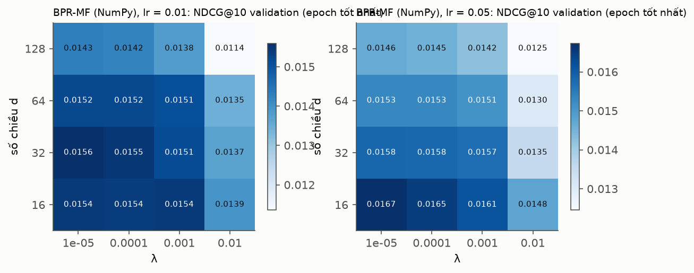
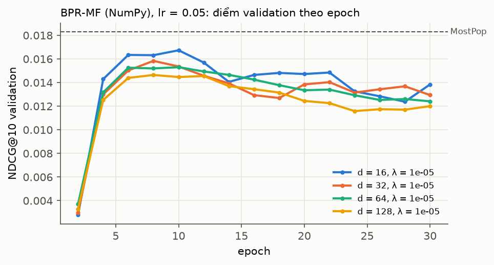
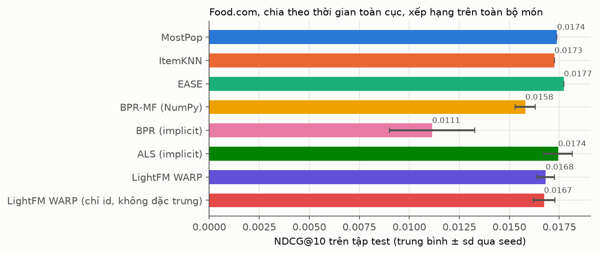
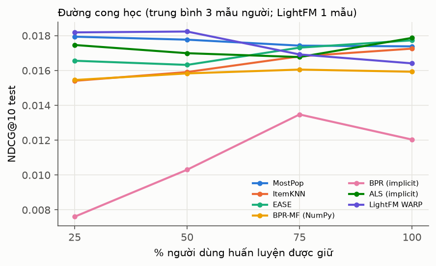
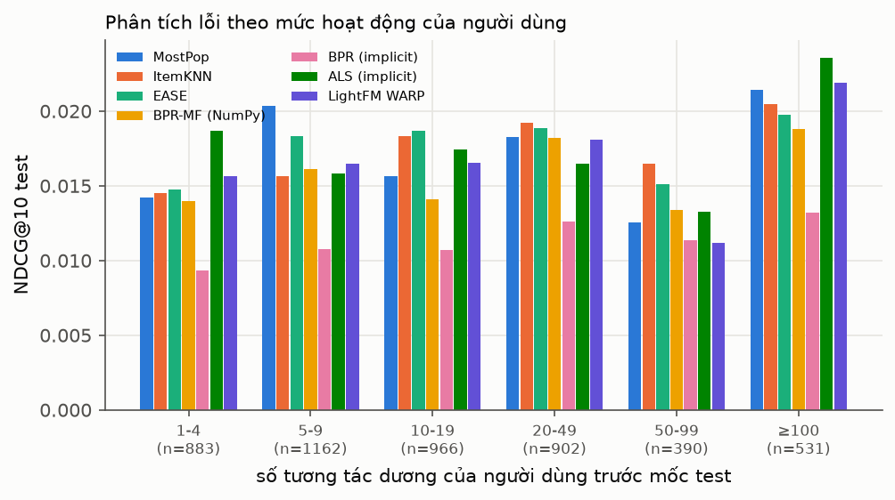
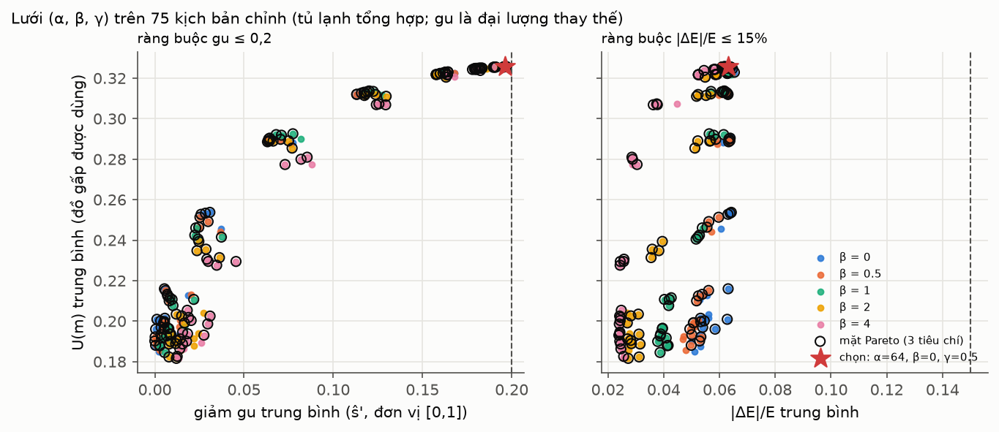
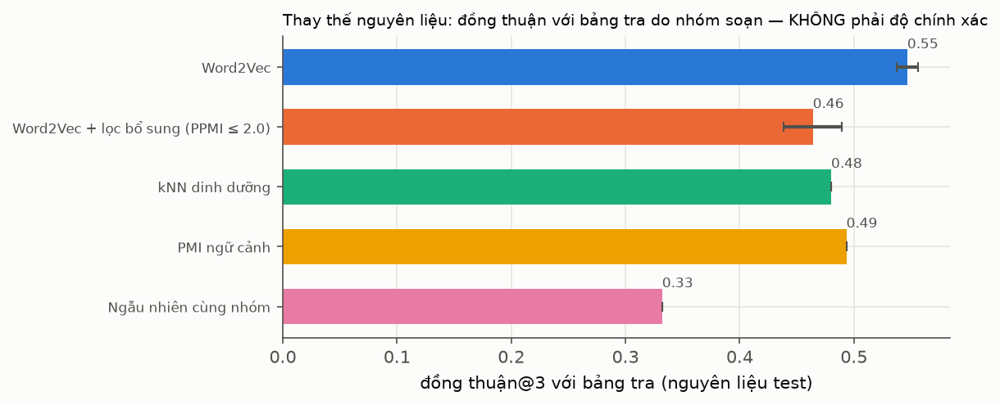
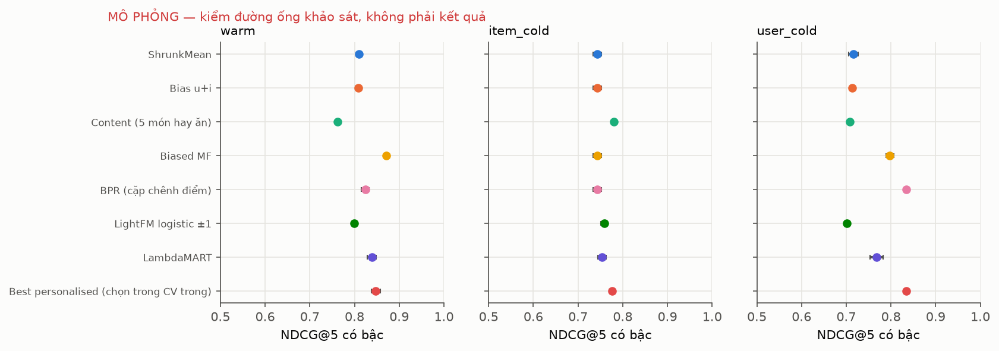

# Báo cáo môn Học máy — Tastoria: gợi ý mâm cơm từ đồ trong tủ lạnh

Tác giả: Nguyễn Xuân Nam. Ngày chạy thí nghiệm: 17–18/10/2026. Mã: `ml/src/tastoria_ml/{recsys,composer_eval,substitution}/`,
bộ ghép mâm chạy thật ở `backend/src/tastoria/modules/meal/composer.py`, kiểm thử: `ml/tests/`. Kết quả máy đọc
được: `data/processed/recsys/`, `data/processed/composer_eval/`, `data/processed/substitution/`. Mọi con số trong
báo cáo đọc từ các tệp JSON đó (đường dẫn ghi cạnh từng bảng); không có số nào lấy từ bài báo hay ước lượng tay.
Số làm tròn 3–4 chữ số; số đầy đủ ở tệp nguồn.

> **Phạm vi của các số đo.** Nhóm chưa có người tham gia khảo sát gu, chưa có bộ đáp án thay thế do người soạn và
> chưa có tủ lạnh thật nào. Vì vậy báo cáo có ba loại số, luôn ghi rõ loại nào:
> (1) **Food.com** — dữ liệu tương tác công khai thật, dùng để kiểm cài đặt và so sánh thuật toán xếp hạng;
> (2) **kịch bản tổng hợp / đại lượng thay thế** — bộ ghép mâm và thay thế nguyên liệu được đo trên tủ lạnh sinh
> tự động và trên độ đồng thuận với bảng tra do nhóm soạn, không phải trên người dùng;
> (3) **MÔ PHỎNG** — khảo sát gu sinh từ một mô hình ẩn đã nêu, chỉ để kiểm đường ống phân tích.
> Không con số nào ở loại (2) và (3) được hiểu là chất lượng gợi ý cho người Việt.

## 1. Bài toán

Tastoria nhận danh sách đồ trong tủ lạnh (từ ảnh quét, xem báo cáo Xử lý ảnh) và đề xuất một mâm cơm gia đình
cho bữa trưa hoặc bữa tối. Phần học máy gồm ba bài toán con (thiết kế v2 §6, `docs/superpowers/specs/2026-10-17-tastoria-thiet-ke-v2.md`).

**1.1 Xếp hạng gu.** Với người dùng u và món r, ước lượng điểm gu ŝ(u, r). Điểm này chỉ đo gu, không chứa tín hiệu
ngữ cảnh (đồ sắp hỏng, calo); các tín hiệu đó do bộ ghép mâm cộng vào sau. Khi phục vụ, ŝ được đổi thành phân vị
theo người trong từng slot, ký hiệu ŝ' ∈ [0, 1]. Có hai nguồn dữ liệu: tương tác công khai Food.com (phản hồi ngầm,
dùng để kiểm cài đặt) và khảo sát gu món Việt (điểm 1–5 tường minh, chưa có người tham gia).

**1.2 Ghép mâm có ràng buộc.** Chọn một món cho mỗi slot (`man`, `rau`, `canh`; n = 1 người thì 2 món) sao cho
cực đại hoá

$$\max_m \;\sum_{r \in m} \hat s'(u, r) \;+\; \alpha\,U(m) \;-\; \beta\,\frac{|E(m) - E_{\text{mâm}}|}{E_{\text{mâm}}} \;-\; \gamma\,D(m)$$

với ràng buộc cứng: đủ nguyên liệu trong kho (BR-TRAY-04), thời gian nấu theo lịch (BR-TRAY-05), dị ứng và chế độ
ăn (BR-ALG, BR-DIET). U(m) là mức dùng đồ sắp hỏng, E(m) là năng lượng mâm trên đầu người (kể cả cơm), D(m) là phạt
trùng lặp (định nghĩa ở mục 3.3). Bài toán học máy ở đây là chọn trọng số (α, β, γ).

**1.3 Thay thế nguyên liệu.** Khi thiếu nguyên liệu i của một món, đề xuất nguyên liệu khác cùng nhóm thực phẩm để
thay. Ứng viên lấy từ bảng tra do nhóm soạn, Word2Vec trên danh sách nguyên liệu, PMI đồng xuất hiện và kNN theo
vector dinh dưỡng.

## 2. Dữ liệu

### 2.1 Food.com

Tệp `RAW_interactions` của bộ Food.com (Majumder và cộng sự, 2019; bản Kaggle). Quy tắc xử lý
(`ml/src/tastoria_ml/recsys/data.py`): điểm ≥ 4 là tương tác dương; điểm 1–3 và điểm 0 (bình luận không chấm sao)
không bao giờ là dương nhưng vẫn đánh dấu món là "đã thấy" và bị loại khỏi danh sách ứng viên của người đó; 5-core
áp lên đồ thị tương tác dương, lặp đến điểm bất động. Thống kê (`data/processed/recsys/manifest.json`):

| Đại lượng | Giá trị |
|---|---|
| Tương tác thô / dương thô / điểm 0 | 1.132.367 / 1.003.724 / 60.847 |
| Sau 5-core: người dùng × món | 16.043 × 37.851 |
| Tương tác dương trong lõi | 498.607 (mật độ 0,082 %) |
| Mọi tương tác của lõi (kể cả điểm 0–3) / trong đó điểm 0 | 529.087 / 10.058 |
| Mốc validation d_val / mốc test d_test | 2010-06-24 / 2012-04-01 |
| Tỷ lệ dương train / validation / test | 79,98 % / 10,01 % / 10,01 % |
| Đặc trưng món (thẻ + nguyên liệu xuất hiện ở ≥ 20 món lõi) | 1.882 |

Số người dùng được đánh giá: 6.206 ở pha validation, 4.834 ở pha test (`tuning.json`, `test.json`).

### 2.2 Kho món Việt

Kho do nhóm biên soạn ở `data/kb/`: 180 món (75 món mặn, 55 món rau, 50 món canh), 225 nguyên liệu, gam lúc mua,
bước nấu có nhãn chủ động/thụ động/chiếm bếp, nguồn ghi theo từng món. Bảng tra thay thế
`data/kb/substitution_pairs.yaml` có 197 cặp cho 107 nguyên liệu, mỗi cặp có ngữ cảnh (slot, cách nấu) và nguồn.
Bộ truy vấn đánh giá thay thế `data/kb/substitution_eval/queries.yaml` có 90 truy vấn (món, nguyên liệu thiếu);
phần đáp án do người soạn chưa có.

### 2.3 Kịch bản tủ lạnh tổng hợp

Để chọn trọng số bộ ghép mâm khi chưa có tủ lạnh thật, 150 kịch bản được sinh từ một hạt giống cố định
(20261018; `ml/src/tastoria_ml/composer_eval/scenarios.py`): tủ lạnh khởi đầu từ nguyên liệu của một món mỗi slot
cộng 0–3 món nữa, rồi thêm 4–12 nguyên liệu theo đồng xuất hiện trong kho món; lượng lấy quanh phân vị 75 của nhu
cầu; mỗi lô có độ gấp u ~ U(0; 1,05) (u > 1 là mức "kiểm tra", không được dùng); số người n ∈ {1, 2, 3, 4};
E_mâm = 0,35 hoặc 0,30 × TEE với TEE ~ U(1700, 2700) kcal; thời gian tối đa 60/90/120 phút; 2 họng bếp. Gu của
"người dùng" là 5 món yêu thích rút ngẫu nhiên. 150 kịch bản chia đôi: 75 để chỉnh, 75 để test.

### 2.4 Khảo sát gu — MÔ PHỎNG

Khảo sát thật (80–100 người, khối không đầy đủ) **chưa có người tham gia**. Để kiểm đường ống phân tích trước khi
có dữ liệu, `ml/src/tastoria_ml/recsys/survey.py::simulate` sinh một khảo sát giả từ mô hình ẩn đã nêu trong mã:
z_ui = a_i + b_u + θ_uᵀv_i/√d + e_ui, điểm r_ui = 1 + #{k: z_ui > t_k}, với v_i trộn 60 % thành phần từ đặc trưng
nội dung của món và 40 % nhiễu; "chưa ăn bao giờ" sinh theo độ quen thuộc của món. Kết quả: 90 người, 180 món,
3.326 điểm (trung bình 36,96 điểm/người), 724 câu "chưa ăn bao giờ"; phân bố điểm 1–5 là 468 / 556 / 809 / 750 / 743
(`data/processed/recsys/survey_sim.json`, khoá `data`). Tệp mang nhãn `SIMULATED: true`. **Mọi số ở mục 5.4 chỉ cho
biết đường ống chạy đúng trên dữ liệu có cấu trúc biết trước; chúng không phải kết quả về gu người Việt.**

## 3. Phương pháp

Ký hiệu: X ∈ {0, 1}^{|U|×|I|} là ma trận tương tác dương trước mốc cắt, I_u là tập món dương của u, n_i = Σ_u X_ui.

### 3.1 Xếp hạng trên phản hồi ngầm (Food.com)

**MostPop.** s(u, i) = n_i, cùng một danh sách cho mọi người (trừ món đã thấy).

**ItemKNN** (Sarwar và cộng sự, 2001). Cosine có co rút h:

$$\text{sim}_{ij} = \frac{c_{ij}}{\sqrt{n_i n_j} + h}, \quad c_{ij} = \sum_u X_{ui}X_{uj},$$

giữ k láng giềng lớn nhất của mỗi món; s(u, r) = Σ_{j ∈ I_u} sim_{jr}.

**EASE** (Steck, 2019). Mô hình tuyến tính món–món B, đường chéo bằng 0:

$$\min_B \|X - XB\|_F^2 + \lambda\|B\|_F^2 \;\;\text{s.t. } \operatorname{diag}(B) = 0,$$

có nghiệm dạng đóng P = (XᵀX + λI)⁻¹, B_ij = −P_ij / P_jj (i ≠ j), B_jj = 0; s(u, ·) = X_u B. Nghịch đảo dày tốn
O(|I|³) nên danh mục giới hạn ở 20.000 món phổ biến nhất trong train; món ngoài danh mục nhận −∞.

**BPR-MF tự cài bằng NumPy** (Rendle và cộng sự, 2009; `models.py::BPRNumpy`). ŝ_ur = p_uᵀq_r (không có bias),

$$L_{\text{BPR}} = -\sum_{(u, r, r')} \ln \sigma(\hat s_{ur} - \hat s_{ur'}) + \lambda\|\Theta\|^2,$$

với r là món dương của u, r' lấy đều trong các món u không có tương tác dương (lấy mẫu loại bỏ trên khoá u·|I| + i
đã sắp xếp). Tối ưu SGD mini-batch 2.048 bộ ba; với x = ŝ_ur − ŝ_ur' và bước học η:

$$p_u \leftarrow p_u + \eta\,[\sigma(-x)(q_r - q_{r'}) - 2\lambda p_u],\quad
q_r \leftarrow q_r + \eta\,[\sigma(-x)\,p_u - 2\lambda q_r],\quad
q_{r'} \leftarrow q_{r'} + \eta\,[-\sigma(-x)\,p_u - 2\lambda q_{r'}].$$

Số hạng λ áp lên các hàng tham số mà bộ ba chạm tới (cách đọc thông thường của λ‖Θ‖² trong SGD). Khởi tạo
N(0; 0,1²). Bản này được đối chiếu với BPR của thư viện `implicit` 0.7.3.

**ALS ngầm** (Hu, Koren, Volinsky, 2008; thư viện `implicit`). Độ tin c_ui = 1 + α·X_ui:

$$\min_{P, Q} \sum_{u, i} c_{ui}(X_{ui} - p_u^\top q_i)^2 + \lambda\Big(\sum_u\|p_u\|^2 + \sum_i\|q_i\|^2\Big).$$

**LightFM WARP** (Kula, 2015; Weston, Bengio, Usunier, 2011; bản `lightfm-next` 1.19.0). Biểu diễn món là tổng
nhúng đặc trưng q_i = Σ_f F_if e_f, b_i = Σ_f F_if b_f với F gồm cột định danh món cộng 1.882 đặc trưng thẻ và
nguyên liệu (chuẩn hoá L1 theo hàng). WARP lấy mẫu món âm cho đến khi gặp một món vi phạm biên (tối đa 30 lần);
nếu cần N lần thì hạng ước lượng là ⌊(|I| − 1)/N⌋ và cập nhật được nhân với L(k) = Σ_{j ≤ k} 1/j, nên lỗi ở đầu
danh sách bị phạt nặng hơn. Bản "chỉ id" bỏ đặc trưng (F = I) để đo đóng góp của đặc trưng; bản "chỉ đặc trưng"
bỏ cột định danh, dùng cho món lạnh (mục 5.1.4).

**Nội dung (khởi động lạnh).** Vector món là hàng F chuẩn hoá L2 (không cột định danh); hồ sơ người là trung bình
vector các món dương của họ, chuẩn hoá L2; điểm là cosine.

### 3.2 Xếp hạng trên điểm tường minh (khảo sát)

Sáu bậc mô hình theo thiết kế §6.1, cài ở `survey.py`: (1) **ShrunkMean** s_i = (Σ_u r_ui + kμ)/(n_i + k); (2)
**Bias** r̂ = μ + b_u + b_i (ridge, luân phiên); (3) **Content** — cosine giữa vector món và trung bình vector 5 món
hay ăn; (4a) **Biased MF** r̂ = μ + b_u + b_i + p_uᵀq_i, SGD trên sai số bình phương + λ(‖p‖² + ‖q‖² + b²); (4b)
**BPR cặp chênh điểm** −Σ ln σ(ŝ_ua − ŝ_ub) + λ‖Θ‖² trên các cặp r_ua > r_ub; (5) **LightFM loss logistic** nhãn
+1 (r ≥ 4) / −1 (r ≤ 2); (6) **LambdaMART** (Burges, 2010; LightGBM lambdarank), truy vấn = người, nhãn r − 1,
đặc trưng: nội dung, slot, độ khớp với món hay ăn, trung bình món tính bỏ-một, điểm MF tính ngoài fold. Gradient
LambdaMART cho cặp (a, b) với y_a > y_b là λ_ab = −σ / (1 + e^{σ(s_a − s_b)}) · |ΔNDCG_ab|.

### 3.3 Bộ ghép mâm

Hàm mục tiêu ở mục 1.2, cài ở `backend/src/tastoria/modules/meal/composer.py` (thí nghiệm gọi đúng mã backend):

- U(m) = Σ_l u_l · min(1, dùng_l / có_l) / Σ_l u_l, lấy trên các lô được thưởng (u ∈ [0,5; 1,0]); dùng_l là lượng
  mâm lấy từ lô l theo thứ tự lô gấp trước.
- |E(m) − E_mâm| / E_mâm với E(m) = năng lượng các món trên đầu người + số bát cơm × E_bát, số bát
  = clip((E_mâm − E_món)/E_bát; 0,5; 3) làm tròn 0,5 (BR-TRAY-03).
- D(m) = (số cặp món trùng cách nấu + số cặp món chung nguyên liệu chính) / số cặp món; D càng nhỏ càng đa dạng.
- Tìm kiếm: lọc cứng, cắt top-K = 20 ứng viên mỗi slot theo điểm cấp món, duyệt tổ hợp có kiểm khả thi kho gộp,
  rồi kiểm lịch nấu chính xác bằng CP-SAT; mâm đầu tiên (theo thứ tự mục tiêu) có makespan ≤ thời gian cho phép
  được phục vụ.

Ba phương án được so trên cùng kịch bản: **composer** với (α, β, γ) chọn được; **chỉ theo gu** (α = β = γ = 0: mâm
khả thi có Σŝ' lớn nhất); **ngẫu nhiên** (mâm khả thi rút đều). Thêm phương án **trọng số tạm** (α, β, γ) =
(1; 1; 0,5) mà backend đang chạy (`Params()` mặc định). Tín hiệu gu ŝ' trong thí nghiệm là **đại lượng thay thế**:
cosine nội dung tới 5 món yêu thích ngẫu nhiên, vì oracle gu thật (điểm khảo sát) chưa có.

### 3.4 Thay thế nguyên liệu

Ứng viên cho nguyên liệu thiếu i là các nguyên liệu khác cùng nhóm thực phẩm trong kho (`substitution/methods.py`).

**Word2Vec skip-gram** (Mikolov và cộng sự, 2013; gensim, `sg = 1`). Mỗi công thức là một "câu" gồm các chuỗi
nguyên liệu (231.637 công thức Food.com, 14.942 chuỗi khác nhau, cộng 180 món Việt viết bằng token tiếng Anh tương
ứng). Mục tiêu lấy mẫu âm với cặp (w, c) trong cửa sổ:

$$\log \sigma(v'^{\top}_c v_w) + \sum_{k=1}^{K} \mathbb{E}_{n \sim P_n}\big[\log \sigma(-v'^{\top}_n v_w)\big].$$

Cửa sổ = độ dài danh sách dài nhất (43) và `shrink_windows = False`, nên mọi cặp nguyên liệu trong một công thức
đều là ngữ cảnh của nhau (thứ tự liệt kê không mang nghĩa). Nguyên liệu Việt được ánh xạ qua từ đồng nghĩa tiếng
Anh; vector là trung bình vector các từ đồng nghĩa có trong từ vựng. Điểm thay thế là cosine.

**PMI ngữ cảnh.** PPMI(a, b) = max(0, log P(a, b) / (P(a)P(b))) trên đồng xuất hiện trong cùng công thức; điểm thay
thế là cosine giữa hai hàng PPMI (đồng xuất hiện bậc hai: đồ thay thế chia sẻ ngữ cảnh). PPMI bậc một trực tiếp
dùng làm bộ lọc "không phải cặp bổ sung" (Teng, Lin, Adamic, 2012): loại ứng viên có PPMI(i, j) > 2,0.

**kNN dinh dưỡng.** Cosine giữa vector chuẩn hoá của log(1 + x) với 6 chất trên 100 g (năng lượng, protein, lipid,
glucid, chất xơ, natri) từ Bảng TPTP VN 2007 / USDA; thiếu thì điền trung bình cột.

**Ngẫu nhiên cùng nhóm.** Tính kỳ vọng chính xác của một thứ tự đều trong nhóm thực phẩm.

## 4. Thiết lập thí nghiệm

**Chia dữ liệu Food.com.** Chia theo mốc thời gian toàn cục (Ji và cộng sự, 2023): 10 % tương tác dương muộn nhất
là test, 10 % liền trước là validation, phần còn lại là train; ngày ở biên thuộc hẳn về phần sau. Pha chỉnh: train
< d_val, đánh giá trên [d_val, d_test). Pha test: huấn luyện lại trên mọi dương < d_test, đánh giá trên ≥ d_test.
Mục tiêu đánh giá của một người là các món dương trong giai đoạn đánh giá với điều kiện người và món đều đã có dương
trước mốc cắt và món chưa được người đó tương tác trước mốc; phần còn lại là người/món lạnh, xét riêng ở mục 5.1.4.
Mọi mô hình, kể cả MostPop, chỉ thấy dữ liệu trước mốc cắt của pha.

**Chỉnh siêu tham số.** Lưới cho từng mô hình (`foodcom.py::GRIDS`), chọn theo NDCG@10 validation, seed 0. BPR-MF
NumPy và LightFM được chấm mỗi 2 epoch nên số epoch cũng được chọn trên validation. Lưới BPR-MF NumPy là d ∈ {16,
32, 64, 128} × λ ∈ {10⁻⁵, 10⁻⁴, 10⁻³, 10⁻²} × η ∈ {0,01; 0,05}, 30 epoch; một lượt quét đầu 100 epoch
(`tuning_bpr_first_sweep.json`) cho thấy điểm validation đạt đỉnh trong vài epoch đầu nên lưới chính dừng ở 30.

**Seed.** Mô hình ngẫu nhiên (BPR, ALS, LightFM) chạy test với 5 seed {0, …, 4}; báo trung bình ± độ lệch chuẩn qua
seed. Điểm theo người dùng cho kiểm định là trung bình qua seed.

**Độ đo.** Xếp hạng trên toàn bộ danh mục (không lấy mẫu âm; Krichene & Rendle, 2020), bỏ món đã thấy. Với danh
sách top-K L_u và tập mục tiêu T_u:

$$\text{HR@K} = \mathbb{1}[|L_u \cap T_u| > 0],\quad \text{Recall@K} = \frac{|L_u \cap T_u|}{|T_u|},\quad
\text{NDCG@K} = \frac{\sum_{j \le K} \mathbb{1}[L_u[j] \in T_u] / \log_2(j + 1)}{\sum_{j \le \min(K, |T_u|)} 1/\log_2(j + 1)},$$

K = 10, lấy trung bình theo người. Khảo sát dùng NDCG@5 có bậc (gain = r − 1) và AUC cặp theo người.

**Kiểm định.** Bootstrap ghép cặp theo đơn vị (người dùng / kịch bản / truy vấn): B = 5.000 lần lấy lại đơn vị có
hoàn lại, khoảng tin cậy 95 % theo phân vị của trung bình hiệu, p hai phía từ phân phối bootstrap dịch về giả
thuyết không (`ml/src/tastoria_ml/recsys/stats.py`). Trên Food.com mỗi mô hình so với MostPop; p được hiệu chỉnh
Holm–Bonferroni (Holm, 1979) trong họ các so sánh đó, riêng cho NDCG@10 và HR@10. So sánh BPR NumPy với BPR
`implicit` là kiểm tra cài đặt, không nằm trong họ Holm. Bộ ghép mâm dùng thêm Wilcoxon ký hạng và McNemar chính xác
cho các đại lượng nhị phân; thay thế nguyên liệu dùng McNemar trên đồng thuận@3 (seed 0) và bootstrap trên RR có
hiệu chỉnh Holm.

**Khảo sát (mô phỏng).** CV lồng nhau theo người: 5 fold ngoài × 5 seed, siêu tham số chọn bằng CV trong 3 fold
cùng kiểu. Ba kịch bản: warm (điểm của mỗi người chia 5 fold), item cold (giữ 20 % món, phân tầng theo slot),
user cold (giữ 20 % người, chỉ thấy 5 món hay ăn). So sánh chính duy nhất: "cá nhân hoá tốt nhất" (mô hình có điểm
CV trong cao nhất, chọn theo từng fold ngoài) so với ShrunkMean; các mô hình còn lại so với ShrunkMean, hiệu chỉnh
Holm.

**Bộ ghép mâm.** Lưới α ∈ {0; 0,25; 0,5; 1; 2; 4; 8; 16; 32; 64} × β ∈ {0; 0,5; 1; 2; 4} × γ ∈ {0; 0,25; 0,5; 1}
(200 điểm). Quy tắc công bố trước (viết trước khi chạy, `composer_eval/run.py`): trên 75 kịch bản chỉnh, cực đại
U(m) trung bình với ràng buộc giảm gu trung bình (ŝ' của mâm chỉ-theo-gu trừ ŝ' của mâm composer, trung bình trên
món) ≤ 0,2 và |ΔE|/E trung bình ≤ 0,15; hoà thì chọn giảm gu nhỏ hơn rồi α + β + γ nhỏ hơn. Bộ trọng số được chọn
chấm một lần trên 75 kịch bản test.

**Thay thế nguyên liệu.** 107 nguyên liệu có trong bảng tra chia theo nguyên liệu 30 % dev (32) / 70 % test (75),
seed 20261018. Với nguyên liệu i ở tập giữ lại, tập tham chiếu là mọi đồ thay thế mà bảng tra ghi cho i; mỗi phương
pháp xếp hạng các nguyên liệu cùng nhóm. **Đồng thuận@k** = top-k chứa một đồ thay thế tham chiếu; RR = 1/hạng của
đồ đầu tiên; phương pháp không có vector cho i thì bỏ phiếu trắng (tính là trượt). Đây là **độ đồng thuận với bảng
tra do nhóm soạn, không phải độ chính xác**: chưa có bộ đáp án do người soạn độc lập. Cấu hình Word2Vec chọn trên
dev theo MRR; test chấm một lần, 5 seed.

**Môi trường.** Python 3.12.12, numpy 2.5.4, scipy 1.18.1, pandas 3.0.6, implicit 0.7.3, lightfm-next 1.19.0; chỉ
CPU (12 luồng, `CUDA_VISIBLE_DEVICES` rỗng); sha256 của tệp tương tác và commit lúc chạy ghi ở `manifest.json`.
Danh sách cặp (người, món) mục tiêu của test ghi ở `data/processed/recsys/test_targets.csv.gz` (39.103 cặp).

## 5. Kết quả

### 5.1 Food.com

#### 5.1.1 Chỉnh trên validation

Nguồn: `data/processed/recsys/tuning.json` (713 dòng lưới; 6.206 người dùng validation). Cấu hình tốt nhất theo
NDCG@10 validation, seed 0:

| Mô hình | Cấu hình chọn | NDCG@10 val | HR@10 val |
|---|---|---|---|
| LightFM WARP | d = 64, η = 0,02, item_alpha = 0, 12 epoch | 0,01923 | 0,0896 |
| MostPop | — | 0,01828 | 0,0843 |
| ALS (implicit) | 32 nhân tử, λ = 10, α = 5, 15 vòng | 0,01719 | 0,0809 |
| BPR-MF (NumPy) | d = 16, λ = 10⁻⁵, η = 0,05, 10 epoch | 0,01673 | 0,0727 |
| EASE | λ = 30.000 (20.000 món) | 0,01638 | 0,0769 |
| ItemKNN | k = 2.000, h = 1.000 | 0,01537 | 0,0752 |
| BPR (implicit) | 32 nhân tử, η = 0,01, λ = 0,001, 20 vòng | 0,01457 | 0,0627 |

Ở validation chỉ LightFM vượt MostPop. Các siêu tham số được chọn đều nằm ở phía "đơn giản" của lưới: λ lớn cho
EASE và ALS, số chiều nhỏ nhất (16) và số epoch nhỏ cho BPR-MF, co rút lớn nhất (1.000) cho ItemKNN. Hình 1 cho
thấy độ nhạy của BPR-MF NumPy theo d và λ; hình 2 cho thấy với η = 0,05, NDCG@10 validation đạt đỉnh trong
khoảng epoch 6–10 rồi giảm, và luôn nằm dưới đường MostPop.

*Hình 1. BPR-MF (NumPy): NDCG@10 validation ở epoch tốt nhất theo d và λ, hai bước học.*

*Hình 2. BPR-MF (NumPy), η = 0,05: NDCG@10 validation theo epoch; đường đứt là MostPop.*

#### 5.1.2 Test

Nguồn: `data/processed/recsys/test.json`. Huấn luyện lại trên mọi dương trước 2012-04-01; 4.834 người dùng test;
49.911 tương tác dương trong giai đoạn test, trong đó 39.103 (78,3 %) là mục tiêu hợp lệ (người và món đã có dương
trước mốc, món chưa được người đó tương tác). Mô hình ngẫu nhiên: trung bình ± sd qua 5 seed.

| Mô hình | NDCG@10 | HR@10 | Recall@10 |
|---|---|---|---|
| EASE | 0,01773 | 0,0780 | 0,0228 |
| ALS (implicit) | 0,01744 ± 0,00072 | 0,0814 ± 0,0025 | 0,0222 ± 0,0010 |
| **MostPop** | 0,01738 | 0,0803 | 0,0239 |
| ItemKNN | 0,01725 | 0,0765 | 0,0218 |
| LightFM WARP (id + đặc trưng) | 0,01682 ± 0,00043 | 0,0821 ± 0,0021 | 0,0225 ± 0,0008 |
| LightFM WARP (chỉ id) | 0,01673 ± 0,00054 | 0,0815 ± 0,0028 | 0,0227 ± 0,0011 |
| BPR-MF (NumPy) | 0,01580 ± 0,00051 | 0,0746 ± 0,0029 | 0,0215 ± 0,0014 |
| BPR (implicit) | 0,01114 ± 0,00213 | 0,0534 ± 0,0073 | 0,0144 ± 0,0024 |

EASE chỉ xếp hạng trên 20.000 món phổ biến nhất; 69,0 % mục tiêu test nằm trong danh mục đó.

Hiệu so với MostPop (bootstrap ghép cặp theo người, 5.000 lần, CI 95 %; p Holm qua 7 so sánh):

| Mô hình − MostPop | ΔNDCG@10 [CI 95 %] | p_Holm | ΔHR@10 [CI 95 %] | p_Holm |
|---|---|---|---|---|
| EASE | +0,00034 [−0,00097; 0,00174] | 1,0 | −0,0023 [−0,0075; 0,0029] | 1,0 |
| ALS (implicit) | +0,00005 [−0,00183; 0,00192] | 1,0 | +0,0012 [−0,0055; 0,0077] | 1,0 |
| ItemKNN | −0,00013 [−0,00168; 0,00150] | 1,0 | −0,0037 [−0,0093; 0,0019] | 1,0 |
| LightFM WARP | −0,00057 [−0,00221; 0,00101] | 1,0 | +0,0019 [−0,0045; 0,0082] | 1,0 |
| LightFM WARP (chỉ id) | −0,00065 [−0,00161; 0,00026] | 0,871 | +0,0012 [−0,0034; 0,0057] | 1,0 |
| BPR-MF (NumPy) | −0,00158 [−0,00263; −0,00058] | 0,014 | −0,0057 [−0,0103; −0,0014] | 0,079 |
| BPR (implicit) | −0,00624 [−0,00780; −0,00477] | 0,0014 | −0,0269 [−0,0329; −0,0210] | 0,0014 |

Không mô hình nào vượt MostPop một cách có ý nghĩa thống kê; EASE, ALS, ItemKNN và LightFM không phân biệt được với
MostPop; hai bản BPR kém hơn. Đối chiếu cài đặt: BPR-MF NumPy − BPR `implicit` = +0,00466 NDCG@10 [0,00340;
0,00599], p = 0,0002 (n = 4.834), tức bản tự cài không kém bản thư viện trên cùng lưới chỉnh. Đặc trưng thẻ và
nguyên liệu không làm LightFM tốt hơn ở người/món ấm (0,01682 so với 0,01673 khi chỉ dùng định danh).

*Hình 3. NDCG@10 trên tập test Food.com (trung bình ± sd qua seed).*

#### 5.1.3 Đường cong học và phân tích lỗi

Nguồn: `curve.json`, `errors.json`. Đường cong học giữ 25/50/75/100 % người dùng train (3.873 / 7.746 / 11.620 /
15.493 người; 3 mẫu người, LightFM 1 mẫu) và đánh giá trên các người dùng test thuộc mẫu (1.235 / 2.445 / 3.667 /
4.834 người). NDCG@10 test trung bình:

| Mô hình | 25 % | 50 % | 75 % | 100 % |
|---|---|---|---|---|
| MostPop | 0,01794 | 0,01777 | 0,01743 | 0,01738 |
| ItemKNN | 0,01541 | 0,01591 | 0,01681 | 0,01725 |
| EASE | 0,01656 | 0,01632 | 0,01731 | 0,01773 |
| BPR-MF (NumPy) | 0,01545 | 0,01583 | 0,01605 | 0,01593 |
| BPR (implicit) | 0,00761 | 0,01030 | 0,01348 | 0,01204 |
| ALS (implicit) | 0,01746 | 0,01699 | 0,01677 | 0,01787 |
| LightFM WARP (1 mẫu) | 0,01819 | 0,01824 | 0,01692 | 0,01641 |

ItemKNN và EASE tăng đều theo lượng dữ liệu; MostPop gần như không đổi (MostPop không học gì ngoài đếm). Vì tập
người đánh giá thay đổi theo mức giữ, so sánh nên đọc theo cột, không theo hàng.

*Hình 4. NDCG@10 test theo tỷ lệ người dùng train được giữ.*

Theo mức hoạt động của người dùng (số dương trước mốc test; nhóm 1–4 / 5–9 / 10–19 / 20–49 / 50–99 / ≥ 100 có
883 / 1.162 / 966 / 902 / 390 / 531 người), không mô hình nào thắng đều ở mọi nhóm: ALS cao nhất ở nhóm 1–4 (0,0187
so với MostPop 0,0142) và ≥ 100 (0,0236 so với 0,0214), MostPop cao nhất ở nhóm 5–9 (0,0203). Khoảng tin cậy theo
từng nhóm ghi ở `errors.json`; mỗi nhóm có vài trăm người nên khoảng này rộng.

*Hình 5. NDCG@10 test theo nhóm mức hoạt động của người dùng.*

Thiên lệch phổ biến (top-10 của mỗi người; "đầu" = 1 % món phổ biến nhất trong train):

| Mô hình | Tỷ lệ ô gợi ý là món đầu | Phân vị phổ biến trung bình của món gợi ý | Độ phủ danh mục @10 |
|---|---|---|---|
| MostPop | 100 % | 0,01 % | 0,12 % |
| ALS (implicit) | 97,5 % | 0,19 % | 1,97 % |
| EASE | 96,3 % | 0,50 % | 3,59 % |
| LightFM WARP (chỉ id) | 93,7 % | 1,41 % | 1,34 % |
| ItemKNN | 93,0 % | 1,67 % | 7,03 % |
| BPR-MF (NumPy) | 92,5 % | 1,99 % | 6,14 % |
| LightFM WARP | 92,4 % | 0,53 % | 1,24 % |
| BPR (implicit) | 90,7 % | 1,46 % | 0,32 % |

Trong khi đó chỉ 12,8 % mục tiêu test là món đầu. Mọi mô hình đều dồn hơn 90 % số ô gợi ý vào 1 % món phổ biến
nhất; hai mô hình gần MostPop nhất về điểm (ALS, EASE) cũng gần nó nhất về độ phổ biến của món gợi ý.

#### 5.1.4 Khởi động lạnh món

Nguồn: `cold.json`. 599 món không có dương nào trước mốc test; 422 người dùng ấm có tương tác dương với các món đó
trong giai đoạn test (3.831 mục tiêu). Ứng viên chỉ gồm 599 món lạnh, nên các mô hình lọc cộng tác thuần không
dùng được.

| Mô hình | NDCG@10 | HR@10 | Recall@10 |
|---|---|---|---|
| LightFM WARP (chỉ đặc trưng, 5 seed) | 0,0475 ± 0,0020 | 0,199 ± 0,002 | 0,0468 ± 0,0033 |
| Cosine nội dung (thẻ + nguyên liệu) | 0,0393 | 0,194 | 0,0285 |
| Ngẫu nhiên (5 seed) | 0,0195 ± 0,0022 | 0,122 ± 0,010 | 0,0171 ± 0,0055 |

Cả hai mô hình nội dung đều gấp khoảng 2 lần ngẫu nhiên về NDCG@10. LightFM − cosine nội dung = +0,0082 [−0,0072;
0,0235], p = 0,30: chưa phân biệt được hai mô hình.

### 5.2 Bộ ghép mâm (kịch bản tổng hợp, gu là đại lượng thay thế)

Nguồn: `data/processed/composer_eval/summary.json`, `weights.json`. Trong 150 kịch bản, 4 kịch bản chỉnh và 0 kịch
bản test không có mâm khả thi nào, nên phần chỉnh tính trên 71 kịch bản, phần test trên 75. Theo phương án chỉ theo
gu, 26,7 % số mâm là mâm 2 món. Kiểm tra tính khả thi độc lập trên 511 mâm khác nhau được phục vụ: 0 vi phạm.

**Chọn trọng số.** Quy tắc công bố trước chọn **(α, β, γ) = (64; 0; 0,5)**: trên 71 kịch bản chỉnh, U(m) = 0,326,
giảm gu 0,196 (sát giới hạn 0,2), |ΔE|/E = 0,063. Mặt Pareto trên ba tiêu chí (U ↑, giảm gu ↓, |ΔE|/E ↓) gồm 149
trong 200 điểm lưới (hình 6).

*Hình 6. U(m) trung bình theo giảm gu (trái) và theo |ΔE|/E (phải) cho 200 điểm lưới; ngôi sao là điểm được chọn.*

**Bão hoà theo α** (β = 0, γ = 0,5, kịch bản chỉnh):

| α | 0 | 0,25 | 0,5 | 1 | 2 | 4 | 8 | 16 | 32 | 64 |
|---|---|---|---|---|---|---|---|---|---|---|
| U(m) | 0,190 | 0,200 | 0,201 | 0,211 | 0,254 | 0,291 | 0,314 | 0,323 | 0,325 | 0,326 |
| giảm gu | 0,006 | 0,005 | 0,006 | 0,008 | 0,031 | 0,071 | 0,120 | 0,164 | 0,181 | 0,196 |

U(m) gần như không tăng sau α = 16, trong khi giảm gu vẫn tăng. α = 16 đã đạt 95 % mức tăng U(m) so với chỉ theo gu,
với giảm gu 0,164 thay vì 0,196 (`summary.json`, khoá `sensitivity_95pct_gain`; `weights.json`, khoá `caveat`).

**So sánh trên 75 kịch bản test** (trung bình theo kịch bản; D nhỏ hơn = đa dạng hơn):

| Phương án | U(m) | gu ŝ' (trung bình món) | \|ΔE\|/E | D(m) | Tỷ lệ \|ΔE\|/E ≤ 15 % | Tỷ lệ mâm dùng đồ gấp |
|---|---|---|---|---|---|---|
| Composer (64; 0; 0,5) | 0,350 | 0,552 | 0,061 | 0,133 | 89,3 % | 100 % |
| Composer α = 16 (16; 0; 0,5) | 0,348 | 0,569 | 0,061 | 0,129 | 90,7 % | 100 % |
| Trọng số tạm (1; 1; 0,5) | 0,245 | 0,725 | 0,032 | 0,058 | 98,7 % | 100 % |
| Chỉ theo gu (0; 0; 0) | 0,215 | 0,741 | 0,043 | 0,173 | 96,0 % | 96,0 % |
| Ngẫu nhiên khả thi | 0,222 | 0,525 | 0,050 | 0,213 | — | — |

Hiệu ghép cặp (bootstrap theo kịch bản, CI 95 %; p Wilcoxon):

| So sánh | ΔU(m) | Δgu | Δ\|ΔE\|/E | ΔD |
|---|---|---|---|---|
| Composer − chỉ theo gu | +0,135 [0,111; 0,159], p = 1,1·10⁻¹¹ | −0,189 [−0,229; −0,151], p = 7,6·10⁻¹² | +0,018 [−0,002; 0,043], p = 0,72 | −0,040 [−0,098; 0,018], p = 0,15 |
| Composer − ngẫu nhiên | +0,128 [0,106; 0,152], p = 7,6·10⁻¹² | +0,027 [−0,015; 0,070], p = 0,29 | +0,011 [−0,013; 0,037], p = 0,37 | −0,080 [−0,142; −0,022], p = 0,013 |
| Composer − trọng số tạm | +0,105 [0,084; 0,127], p = 1,1·10⁻¹⁰ | −0,173 [−0,212; −0,135], p = 1,2·10⁻¹⁰ | +0,029 [0,010; 0,054], p = 0,022 | +0,076 [0,022; 0,138], p = 0,010 |
| Chỉ theo gu − ngẫu nhiên | −0,007 [−0,029; 0,014], p = 0,81 | +0,216 [0,177; 0,257], p < 10⁻⁴ | −0,007 [−0,025; 0,008], p = 0,46 | −0,040 [−0,111; 0,031], p = 0,33 |

Tỷ lệ mâm có |ΔE|/E ≤ 15 %: composer 89,3 % so với trọng số tạm 98,7 % (McNemar chính xác, 1 so với 8 kịch bản
bất đồng, p = 0,039); so với chỉ theo gu 96,0 % (2 so với 7, p = 0,18).

### 5.3 Thay thế nguyên liệu (đồng thuận với bảng tra, không phải độ chính xác)

Nguồn: `data/processed/substitution/results.json`. Cấu hình Word2Vec chọn trên dev: d = 200, min_count = 5, câu món
Việt lặp 10 lần (`kb_repeat`), 10 epoch, 10 mẫu âm, cửa sổ 43; dev MRR = 0,601, đồng thuận@3 = 0,656. Lặp câu món
Việt là yếu tố lớn nhất trong lưới: với d = 200, min_count = 5, MRR dev là 0,411 khi không lặp và 0,601 khi lặp 10
lần (vì khi không lặp, chỉ 65,6 % nguyên liệu dev có vector).

Kết quả trên 75 nguyên liệu test (Word2Vec: trung bình ± sd qua 5 seed):

| Phương pháp | Đồng thuận@1 | Đồng thuận@3 | MRR | Có trả lời |
|---|---|---|---|---|
| Word2Vec | 0,389 ± 0,026 | 0,547 ± 0,009 | 0,522 ± 0,013 | 100 % |
| Word2Vec + lọc bổ sung (PPMI ≤ 2,0) | 0,288 ± 0,012 | 0,464 ± 0,026 | 0,404 ± 0,009 | 100 % |
| kNN dinh dưỡng | 0,280 | 0,480 | 0,434 | 97,3 % |
| PMI ngữ cảnh | 0,307 | 0,493 | 0,420 | 77,3 % |
| Ngẫu nhiên cùng nhóm (kỳ vọng) | 0,142 | 0,332 | 0,304 | 100 % |

*Hình 7. Đồng thuận@3 trên 75 nguyên liệu test.*

Hiệu RR ghép cặp (bootstrap theo nguyên liệu, CI 95 %, p Holm qua 6 so sánh): Word2Vec − Word2Vec có lọc bổ sung
+0,118 [0,052; 0,198], p_Holm = 0,007; Word2Vec − PMI ngữ cảnh +0,103 [0,013; 0,193], p = 0,027, p_Holm = 0,137;
Word2Vec − kNN dinh dưỡng +0,088 [−0,018; 0,198], p_Holm = 0,449; ba cặp còn lại p_Holm = 1,0. Trên đồng
thuận@3 (seed 0, McNemar) không cặp nào có p < 0,2.

**Độ phủ.** 176/225 nguyên liệu Việt có từ đồng nghĩa tiếng Anh xuất hiện trong Food.com (124 với ≥ 50 lần xuất
hiện); các nguyên liệu ánh xạ được chiếm 94,3 % số lần xuất hiện trong kho món. Có vector Word2Vec: 95,1 % nguyên
liệu (175 qua tiếng Anh, 39 qua token "vi:"), 100 % lần xuất hiện; vector dinh dưỡng: 94,2 % / 97,9 %; hàng PMI:
75,6 % / 95,1 %; bảng tra có cặp cho 47,6 % nguyên liệu. Trên 90 truy vấn đánh giá, tỷ lệ truy vấn có ít nhất một
ứng viên: bảng tra 65,6 %, Word2Vec 100 %, kNN dinh dưỡng 94,4 %, PMI ngữ cảnh 85,6 %. Ví dụ nguyên liệu không ánh
xạ được: chao, chuối xanh, cua đồng, cà pháo, cá bống, cá diêu hồng, cá lóc.

### 5.4 Đường ống khảo sát trên dữ liệu MÔ PHỎNG

> MÔ PHỎNG — chỉ kiểm đường ống, không phải kết quả. Dữ liệu sinh từ mô hình ẩn ở mục 2.4, trong đó gu một phần
> được sinh từ chính đặc trưng nội dung của món; thứ hạng các mô hình dưới đây phản ánh mô hình sinh đó.

Nguồn: `data/processed/recsys/survey_sim.json`. NDCG@5 có bậc và AUC cặp, trung bình ± sd qua 5 seed:

| Mô hình | warm NDCG@5 | warm AUC | item cold NDCG@5 | item cold AUC | user cold NDCG@5 | user cold AUC |
|---|---|---|---|---|---|---|
| ShrunkMean (đối chứng) | 0,810 ± 0,006 | 0,633 ± 0,007 | 0,743 ± 0,010 | 0,500 ± 0,000 | 0,716 ± 0,011 | 0,633 ± 0,002 |
| Bias u + i | 0,809 ± 0,007 | 0,633 ± 0,008 | 0,743 ± 0,010 | 0,500 ± 0,000 | 0,713 ± 0,004 | 0,634 ± 0,002 |
| Content (5 món hay ăn) | 0,762 ± 0,004 | 0,557 ± 0,007 | 0,781 ± 0,003 | 0,563 ± 0,004 | 0,707 ± 0,000 | 0,558 ± 0,000 |
| Biased MF | 0,871 ± 0,006 | 0,732 ± 0,008 | 0,743 ± 0,010 | 0,500 ± 0,000 | 0,798 ± 0,008 | 0,709 ± 0,004 |
| BPR cặp chênh điểm | 0,824 ± 0,008 | 0,657 ± 0,009 | 0,743 ± 0,010 | 0,500 ± 0,000 | 0,835 ± 0,002 | 0,729 ± 0,003 |
| LightFM logistic ±1 | 0,799 ± 0,005 | 0,619 ± 0,006 | 0,759 ± 0,007 | 0,544 ± 0,021 | 0,701 ± 0,004 | 0,618 ± 0,003 |
| LambdaMART | 0,839 ± 0,009 | 0,679 ± 0,013 | 0,754 ± 0,009 | 0,529 ± 0,012 | 0,768 ± 0,015 | 0,669 ± 0,005 |
| Cá nhân hoá tốt nhất (chọn trong CV trong) | 0,847 ± 0,010 | 0,695 ± 0,018 | 0,776 ± 0,006 | 0,557 ± 0,011 | 0,835 ± 0,002 | 0,729 ± 0,003 |

So sánh chính (cá nhân hoá tốt nhất − ShrunkMean, NDCG@5, bootstrap theo người, 90 người): warm +0,038 [0,029;
0,047]; item cold +0,033 [0,020; 0,045]; user cold +0,119 [0,096; 0,142]; cả ba p = 0,0002 (sàn của 5.000 lần
lấy lại). Các kiểm tra hành vi mong đợi đều đúng: ở item cold, các mô hình chỉ dựa trên định danh món (Bias, Biased
MF, BPR) cho AUC đúng 0,500 và trùng NDCG với ShrunkMean, vì món giữ lại không có tham số; chỉ các mô hình có nội dung
(Content, LightFM, LambdaMART) vượt đối chứng (LambdaMART: NDCG@5 +0,011, p_Holm = 0,169; AUC +0,029, p_Holm = 0,001). Lựa chọn "tốt nhất" trong CV trong không luôn trùng
mô hình tốt nhất ở fold ngoài (warm: 0,847 so với Biased MF 0,871), đúng như kỳ vọng của CV lồng nhau.

*Hình 8. NDCG@5 trên khảo sát MÔ PHỎNG theo ba kịch bản.*

## 6. Thảo luận

### 6.1 Vì sao MostPop mạnh trên Food.com chia theo thời gian

Trên tập test, không mô hình cá nhân hoá nào vượt MostPop có ý nghĩa thống kê, và bốn mô hình (EASE, ALS, ItemKNN,
LightFM) nằm trong khoảng ±0,0006 NDCG@10 quanh nó. Số liệu ở mục 5.1 gợi ý bốn nguyên nhân:

1. **Dữ liệu rất thưa.** Mật độ lõi 5-core là 0,082 %; 42 % người dùng test có dưới 10 tương tác dương trước mốc
   (883 + 1.162 trong 4.834 người, nhóm 1–4 và 5–9). Với ít tín hiệu cá nhân, ước lượng tốt nhất cho phần lớn
   người dùng gần với phân phối chung.
2. **Chia theo thời gian toàn cục.** Mô hình chỉ thấy quá khứ và phải đoán tương lai (Ji và cộng sự, 2023 khuyến
   nghị cách chia này vì chia bỏ-một-cuối làm rò rỉ dữ liệu tương lai). Độ phổ biến ngay trước mốc cắt là một tín
   hiệu mạnh cho giai đoạn ngay sau đó; cách chia ngẫu nhiên thường không đặt mô hình vào tình huống này.
3. **Chỉnh siêu tham số đẩy mô hình về phía phổ biến.** Trên validation, lưới chọn λ lớn cho EASE (30.000) và ALS
   (10), số chiều nhỏ nhất cho BPR-MF (16) và co rút lớn nhất cho ItemKNN (1.000). Hệ quả thấy ở bảng thiên lệch
   phổ biến: ALS và EASE, hai mô hình có điểm gần MostPop nhất, cũng dồn 97,5 % và 96,3 % số ô gợi ý vào 1 % món
   phổ biến nhất. Nói cách khác, cách tốt nhất mà các mô hình này tìm được trên dữ liệu này là xấp xỉ MostPop.
4. **Chọn trên validation không chuyển hoàn toàn sang test.** LightFM đứng đầu validation (0,01923 so với MostPop
   0,01828) nhưng đứng sau MostPop trên test (0,01682 so với 0,01738); ở đường cong học, điểm của LightFM giảm khi
   thêm người dùng (một mẫu duy nhất). Validation chỉ dùng seed 0 và một khoảng thời gian; khác biệt giữa các mô
   hình nhỏ hơn biến thiên giữa hai khoảng thời gian.

Kết quả này khớp với các nghiên cứu tái lập. Dacrema và cộng sự (2019) chỉ tái lập được 7 trên 18 mô hình học sâu
đã công bố, và 6 trong số đó thường thua các heuristic đơn giản như kNN được chỉnh đúng cách. Cremonesi, Koren và
Turrin (2010) chỉ ra rằng mô hình tối ưu cho sai số dự đoán điểm (RMSE) không nhất thiết tốt cho bài toán top-N,
và dùng gợi ý theo độ phổ biến làm đường cơ sở cho top-N. (Ghi chép nghiên cứu `docs/research/raw/02-*.md` đánh dấu
nhận định "TopPop là đường cơ sở mạnh trong bài báo đó" là chưa kiểm chứng, nên báo cáo này không dựa vào nhận định
đó.) Rendle và cộng sự (BPR) cũng như nghiên cứu "Revisiting BPR" (RecSys 2024) cho thấy BPR rất nhạy với chi tiết
cài đặt và cách chỉnh; ở đây BPR `implicit` kém bản NumPy 0,0047 NDCG@10 trên cùng lưới.

Hệ quả cho Tastoria: Food.com được dùng để **kiểm cài đặt**, không để chọn mô hình cho món Việt (thiết kế v2 §6.1).
Phần kiểm cài đặt đạt yêu cầu: BPR-MF tự cài chạy đúng hướng (tốt hơn bản thư viện, kém MostPop như mọi bản BPR ở
đây), EASE dạng đóng và các mô hình nội dung hoạt động như kỳ vọng ở khởi động lạnh (gấp khoảng 2 lần ngẫu nhiên).
Với 180 món và điểm tường minh từ khảo sát, bài toán khác về bản chất (danh mục nhỏ, có điểm âm, mỗi người được hỏi
khoảng 45 món), nên kết luận "MostPop đủ tốt" không chuyển sang được; điều đó phải đo lại trên khảo sát thật với
ShrunkMean làm đối chứng.

### 6.2 Đánh đổi trong bộ ghép mâm

Bộ ghép mâm làm đúng điều nó được thiết kế: so với chọn mâm chỉ theo gu, nó dùng đồ sắp hỏng nhiều hơn (U(m) +0,135
trên test) và mọi mâm đều dùng ít nhất một lô gấp. Cái giá là gu: với trọng số chọn theo quy tắc (64; 0; 0,5), gu
trung bình mỗi món giảm 0,189 đơn vị phân vị, và gu của mâm composer không còn khác mâm ngẫu nhiên khả thi (+0,027,
CI chứa 0). Khi α lớn, thành phần U(m) lấn át Σŝ', và bộ ghép mâm gần như chỉ còn tối ưu việc dùng đồ gấp.

**Bão hoà theo α.** U(m) tăng nhanh từ α = 1 đến α = 8 rồi gần như dừng (0,323 ở α = 16, 0,326 ở α = 64), còn giảm gu
tiếp tục tăng. Một giải thích về cấu trúc (chưa kiểm riêng): U(m) bị chặn trên vì mỗi lô chỉ đóng góp tối đa u_l, và
một phần lô gấp không có món nào trong kho món dùng được với lượng đủ; khi đã chọn được mâm dùng hết những gì dùng được, tăng α chỉ đổi gu lấy
phần U(m) rất nhỏ. Quy tắc công bố trước tối đa U(m) nên luôn chọn điểm sát giới hạn giảm gu 0,2; nó đúng như đã
viết, nhưng nó không có số hạng nào thưởng cho việc dừng ở chỗ bão hoà.

**β = 0 được chọn.** Ràng buộc |ΔE|/E ≤ 0,15 lấy trung bình trên kịch bản, và vì số bát cơm đã tự điều chỉnh năng
lượng mâm (BR-TRAY-03), lệch calo trung bình vẫn chỉ khoảng 0,06 khi β = 0. Nhưng tỷ lệ mâm có lệch ≤ 15 % giảm từ
98,7 % (trọng số tạm) xuống 89,3 % (McNemar p = 0,039). Ràng buộc trung bình che mất đuôi phân phối.

**Đa dạng.** γ = 0,5 không đủ giữ đa dạng khi α lớn: D(m) của composer (0,133) cao hơn trọng số tạm (0,058).

**Trọng số tạm khuyến nghị.** Các con số dưới đây chỉ lấy từ 71 kịch bản chỉnh (không dùng test để chọn):

| (α; β; γ) | U(m) | giảm gu | \|ΔE\|/E | tỷ lệ \|ΔE\|/E ≤ 15 % | D(m) |
|---|---|---|---|---|---|
| (0; 0; 0) chỉ theo gu | 0,187 | 0 | 0,053 | 95,8 % | 0,146 |
| (1; 1; 0,5) đang chạy | 0,208 | 0,010 | 0,042 | 97,2 % | 0,085 |
| (4; 2; 0,5) | 0,289 | 0,075 | 0,052 | 93,0 % | 0,070 |
| (8; 2; 0,5) | 0,312 | 0,124 | 0,052 | 93,0 % | 0,089 |
| (16; 0; 0,5) | 0,323 | 0,164 | 0,063 | 90,1 % | 0,099 |
| (64; 0; 0,5) theo quy tắc | 0,326 | 0,196 | 0,063 | 90,1 % | 0,094 |

Khuyến nghị cho bản chạy thử trước khi có khảo sát: **(α; β; γ) = (4; 2; 0,5)**. Bộ này lấy được khoảng 73 % mức tăng
U(m) mà quy tắc đạt được ((0,289 − 0,187)/(0,326 − 0,187)), với giảm gu 0,075 thay vì 0,196, lệch calo và đa dạng
tốt hơn bộ theo quy tắc. Đây là lựa chọn có phán đoán, không phải kết quả của quy tắc công bố trước, và vì gu trong
thí nghiệm là đại lượng thay thế (cosine nội dung tới 5 món ngẫu nhiên), mức "giảm gu 0,075" chưa có nghĩa với
người thật. `weights.json` giữ nguyên bộ do quy tắc chọn (64; 0; 0,5) kèm cảnh báo bão hoà; backend vẫn chạy
(1; 1; 0,5) cho tới khi có quyết định. Khi đổi trọng số cần ghi phiên bản mới vào `meal_plans.params_version`.

### 6.3 Thay thế nguyên liệu

Word2Vec có đồng thuận cao nhất với bảng tra (đồng thuận@3 0,547, MRR 0,522) và trả lời được mọi truy vấn, nhưng
chỉ khác có ý nghĩa với bản Word2Vec có lọc bổ sung sau hiệu chỉnh Holm. Bộ lọc "không phải cặp bổ sung" (PPMI ≤ 2,0)
làm **giảm** đồng thuận (MRR −0,118, p_Holm = 0,007): trong dữ liệu công thức, đồ thay thế cho nhau cũng thường xuất
hiện cùng nhau (ví dụ hai loại rau cùng nấu canh), nên PPMI trực tiếp cao không đủ để kết luận là cặp bổ sung. Ngưỡng
2,0 chưa được chỉnh trên dev; cần chỉnh lại hoặc bỏ. Điểm này cũng cho thấy giới hạn của thước đo: bảng tra chỉ ghi
các cặp nhóm đã soạn, nên "đồng thuận" thưởng cho phương pháp giống người soạn bảng, không nhất thiết đúng hơn.

## 7. Hạn chế và việc cần dữ liệu thật

1. **Khảo sát gu chưa có người tham gia.** Mọi kết quả xếp hạng gu cho món Việt ở mục 5.4 là MÔ PHỎNG. Cần 80–100
   người (thử trước 15–20 người) qua trang khảo sát có sẵn, rồi chạy lại `survey.py` trên dữ liệu xuất ra; so sánh
   chính đã được cố định trước: cá nhân hoá tốt nhất so với ShrunkMean.
2. **Oracle gu cho bộ ghép mâm là đại lượng thay thế.** Trọng số (α, β, γ) phải chỉnh lại với điểm khảo sát thật
   làm oracle gu, trên kịch bản có nhãn test ảnh thay vì tủ lạnh sinh tự động. Nên sửa quy tắc trước khi chạy lại:
   ràng buộc trên tỷ lệ mâm đạt |ΔE|/E ≤ 15 % (không chỉ trung bình) và dừng ở điểm đạt một tỷ lệ cố định của mức
   tăng U(m) (ví dụ 90 %) thay vì cực đại. Quy tắc mới phải viết ra trước khi chạy.
3. **Thay thế nguyên liệu chưa có đáp án do người soạn.** Cần 2 người soạn độc lập đáp án cho 90 truy vấn
   (`data/kb/substitution_eval/`) trước khi chạy mô hình; `substitution/gold.py` đã sẵn để chấm Hit@1/3, MRR. Đến lúc
   đó mọi số ở mục 5.3 chỉ là độ đồng thuận với bảng tra.
4. **Food.com không phải người dùng Việt.** Kết quả mục 5.1 chỉ kiểm cài đặt. Thêm vào đó: lựa chọn trên validation
   dùng một seed; EASE bị giới hạn 20.000 món (69,0 % mục tiêu test); LightFM ở đường cong học chỉ có một mẫu.
5. **Độ phủ ánh xạ Việt–Anh.** 49/225 nguyên liệu không có từ đồng nghĩa trong Food.com (chao, cà pháo, cá lóc…);
   Word2Vec cho những nguyên liệu này chỉ dựa vào 180 món Việt.
6. **Kịch bản tổng hợp không có dị ứng, chế độ ăn hay lô ghim.** Các ràng buộc đó được kiểm bằng kiểm thử tính chất
   trong CI, không có trong đánh giá trọng số.

## Tài liệu tham khảo

- Burges, C. J. C. (2010). *From RankNet to LambdaRank to LambdaMART: An Overview*. Microsoft Research Technical
  Report MSR-TR-2010-82.
- Cremonesi, P., Koren, Y., Turrin, R. (2010). Performance of recommender algorithms on top-N recommendation tasks.
  *RecSys 2010*. https://doi.org/10.1145/1864708.1864721
- Ferrari Dacrema, M., Cremonesi, P., Jannach, D. (2019). Are we really making much progress? A worrying analysis of
  recent neural recommendation approaches. *RecSys 2019*. https://arxiv.org/abs/1907.06902
- Holm, S. (1979). A simple sequentially rejective multiple test procedure. *Scandinavian Journal of Statistics*,
  6(2), 65–70.
- Hu, Y., Koren, Y., Volinsky, C. (2008). Collaborative filtering for implicit feedback datasets. *ICDM 2008*.
- Ji, Y., Sun, A., Zhang, J., Li, C. (2023). A critical study on data leakage in recommender system offline
  evaluation. *ACM TOIS*. https://arxiv.org/abs/2010.11060
- Krichene, W., Rendle, S. (2020). On sampled metrics for item recommendation. *KDD 2020*.
  https://doi.org/10.1145/3394486.3403226
- Kula, M. (2015). Metadata embeddings for user and item cold-start recommendations. *CBRecSys 2015*.
- Majumder, B. P., Li, S., Ni, J., McAuley, J. (2019). Generating personalized recipes from historical user
  preferences. *EMNLP 2019* (bộ dữ liệu Food.com).
- Meng, Z., McCreadie, R., Macdonald, C., Ounis, I. (2020). Exploring data splitting strategies for the evaluation
  of recommendation models. *RecSys 2020*. https://arxiv.org/abs/2007.13237
- Mikolov, T., Sutskever, I., Chen, K., Corrado, G., Dean, J. (2013). Distributed representations of words and
  phrases and their compositionality. *NeurIPS 2013*.
- Milogradskii, A. và cộng sự (2024). Revisiting BPR: A replicability study
  of a common recommender system baseline. *RecSys 2024*. https://doi.org/10.1145/3640457.3688073
- Rendle, S., Freudenthaler, C., Gantner, Z., Schmidt-Thieme, L. (2009). BPR: Bayesian personalized ranking from
  implicit feedback. *UAI 2009*.
- Sarwar, B., Karypis, G., Konstan, J., Riedl, J. (2001). Item-based collaborative filtering recommendation
  algorithms. *WWW 2001*.
- Steck, H. (2019). Embarrassingly shallow autoencoders for sparse data. *WWW 2019*.
- Teng, C.-Y., Lin, Y.-R., Adamic, L. A. (2012). Recipe recommendation using ingredient networks. *WebSci 2012*.
  https://doi.org/10.1145/2380718.2380757
- Weston, J., Bengio, S., Usunier, N. (2011). WSABIE: Scaling up to large vocabulary image annotation. *IJCAI 2011*.
