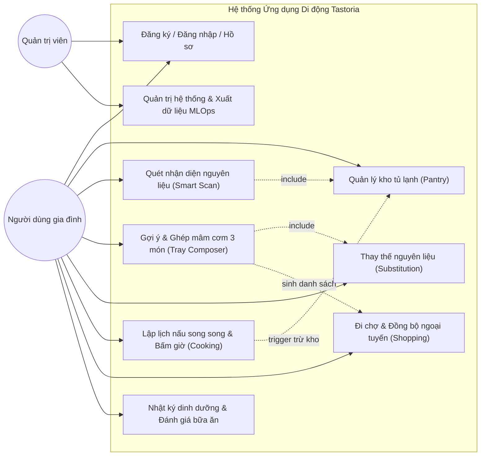
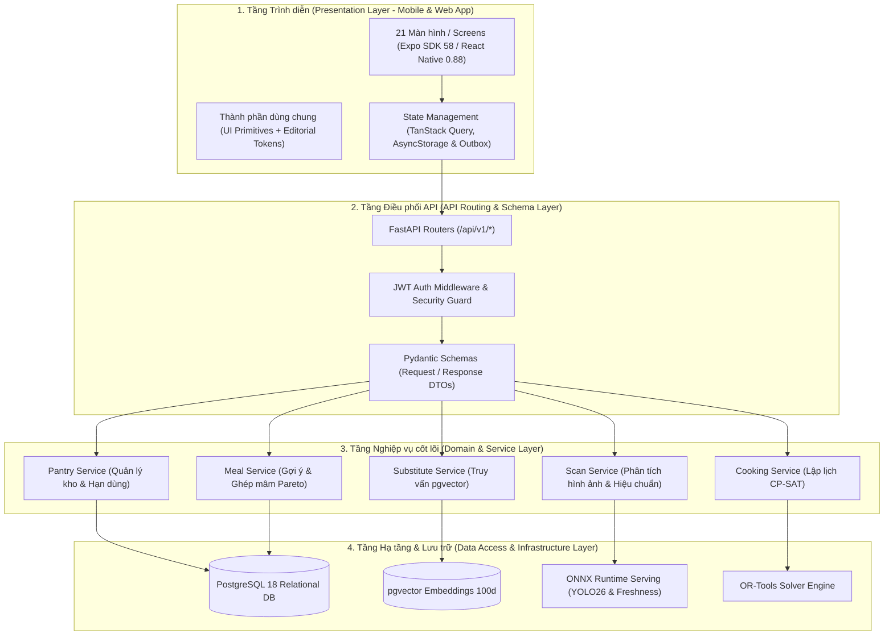
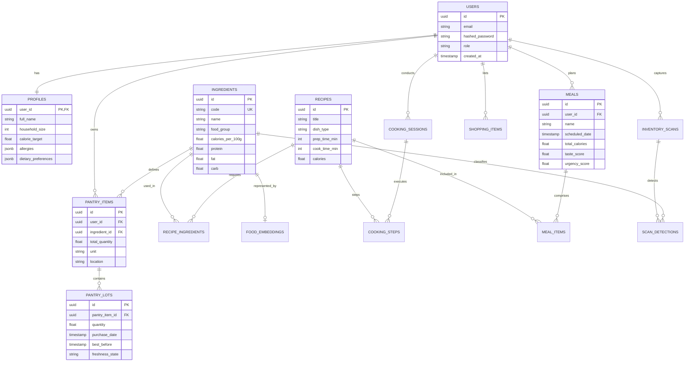

# BÁO CÁO BÀI TẬP NHÓM — MÔN PHÁT TRIỂN ỨNG DỤNG DI ĐỘNG (MOBILE APP)

---

## TRANG BÌA

**HỌC VIỆN CÔNG NGHỆ BƯU CHÍNH VIỄN THÔNG**  
**KHOA CÔNG NGHỆ THÔNG TIN 1**  

---

### BÁO CÁO BÀI TẬP NHÓM
### MÔN HỌC: PHÁT TRIỂN ỨNG DỤNG CHO THIẾT BỊ DI ĐỘNG

---

**TÊN ĐỀ TÀI:**  
# TASTORIA — HỆ THỐNG DI ĐỘNG THÔNG MINH QUẢN LÝ KHO THỰC PHẨM, GỢI Ý THỰC ĐƠN VÀ TỐI ƯU MÂM CƠM GIA ĐÌNH VIỆT NAM (AI-NATIVE SMART PANTRY & MEAL COMPOSER)

---

### BẢNG PHÂN CÔNG VÀ ĐÁNH GIÁ MỨC ĐỘ ĐÓNG GÓP THÀNH VIÊN

> *Ghi chú: Nhóm trao đổi, thống nhất và đánh giá dựa trên khối lượng công việc phần chung và phần công việc cá nhân được giao.*

| STT | Họ và tên | Mã sinh viên | Phần việc tham gia chung cả nhóm | Phần công việc cá nhân | Ước tính % đóng góp |
|:---:|:---|:---:|:---|:---|:---:|
| 1 | **Nguyễn Trung Nam** *(Nhóm trưởng)* | B23DCVT299 | Khảo sát bài toán, thiết kế kiến trúc hệ sinh thái (Mobile App, Backend API, Edge AI), thiết lập hạ tầng CI/CD, chuẩn hóa giao diện UI/UX Design System | Phân hệ 1: Quản lý Kho thông minh, Quét AI nhận diện nguyên liệu tủ lạnh & Hiệu chuẩn độ tươi nông sản | 25% |
| 2 | *(Thành viên 2)* | *(Mã SV)* | Tham gia đặc tả yêu cầu chức năng, thiết kế lược đồ cơ sở dữ liệu quan hệ và vector (`PostgreSQL 18` + `pgvector`), xây dựng tài liệu báo cáo chung | Phân hệ 2: Gợi ý món ăn cá nhân hóa (Collaborative Filtering / Hybrid) & Tối ưu hóa cấu trúc mâm cơm 3 món chuẩn Việt | 25% |
| 3 | *(Thành viên 3)* | *(Mã SV)* | Tham gia thiết kế luồng trải nghiệm người dùng (UX flows), kiểm thử tích hợp giao diện di động (Jest, React Native Testing Library), biên dịch báo cáo | Phân hệ 3: Hỗ trợ nấu ăn thông minh, Đồng bộ hóa các bước nấu & Lập lịch thiết bị bếp song song (`OR-Tools CP-SAT`) | 25% |
| 4 | *(Thành viên 4)* | *(Mã SV)* | Tham gia thu thập dữ liệu dinh dưỡng món ăn Việt Nam, xây dựng bộ kiểm thử biên, đóng gói cài đặt ứng dụng Android (APK) và tài liệu chuyển giao | Phân hệ 4: Kế hoạch đi chợ thông minh, Khảo sát & Nhật ký dinh dưỡng ẩm thực, Đồng bộ dữ liệu ngoại tuyến (Offline Outbox) | 25% |

*Tổng số % đóng góp của các thành viên: **100%**.*

---

## PHẦN 1 — CÔNG VIỆC CHUNG CỦA NHÓM

### 1.1 Lý do lựa chọn ứng dụng

#### a. Tính cấp thiết và bối cảnh thực tiễn
Trong nhịp sống hiện đại, việc quản lý dinh dưỡng và chế biến bữa ăn hàng ngày cho gia đình tại Việt Nam đang đối mặt với nhiều thách thức lớn:
1. **Lãng phí thực phẩm hộ gia đình (Household Food Waste)**: Thực phẩm tươi sống mua về thường bị lãng quên trong ngăn mát tủ lạnh, dẫn đến thối hỏng và bị vứt bỏ, gây lãng phí kinh tế và phát thải môi trường.
2. **Gánh nặng suy nghĩ thực đơn ("Hôm nay ăn gì?")**: Người nội trợ mất nhiều thời gian đắn đo lựa chọn món ăn sao cho vừa hợp khẩu vị các thành viên, vừa cân đối dinh dưỡng, lại vừa tận dụng được nguyên liệu sẵn có trong tủ lạnh.
3. **Đặc thù văn hóa bữa cơm Việt Nam**: Khác với ẩm thực phương Tây (thường gồm 1 đĩa chính - single plate), mâm cơm truyền thống của gia đình Việt Nam luôn có cấu trúc tổ hợp cân bằng: **1 món Mặn (giàu đạm) + 1 món Canh (thanh nhiệt) + 1 món Rau (chất xơ/khoáng)**. Các ứng dụng hiện nay hầu hết gợi ý từng món đơn lẻ, không giải quyết được bài toán tổ hợp mâm cơm hoàn chỉnh.

#### b. Khảo sát các ứng dụng tương tự trên thị trường và Điểm khác biệt của Tastoria

| Ứng dụng | Ưu điểm | Nhược điểm / Hạn chế | Điểm khác biệt vượt trội của Tastoria |
|:---|:---|:---|:---|
| **Cookpad / Yummly** | Kho công thức phong phú, cộng đồng lớn, tìm kiếm theo tên món tốt. | Chỉ tìm kiếm thủ công; không có kho quản lý hạn dùng; không tính toán được độ tươi thực phẩm; gợi ý từng món rời rạc. | **Quét ảnh tự động (Computer Vision)** nhận diện nguyên liệu (`13` lớp trên mô hình YOLO26n đang triển khai, `37` lớp bảng `vision_classes`, bộ nghiên cứu `yolo_v2` `30` lớp); tự động trừ kho khi nấu; gợi ý tổ hợp mâm cơm 3 món thay vì từng món. |
| **Mealime / Samsung Food** | Lập kế hoạch thực đơn tuần tốt, tự động sinh danh sách đi chợ. | Dữ liệu món Tây; không phù hợp khẩu vị và thói quen nấu nướng mâm cơm Việt; không hỗ trợ thay thế nguyên liệu linh hoạt. | **Bộ dữ liệu 180 công thức món ăn thuần Việt & 232 nguyên liệu**; tối ưu hóa mâm cơm bằng bộ ghép đa mục tiêu; hỗ trợ 197 cặp thay thế nguyên liệu Việt kết hợp vector ngữ nghĩa (`pgvector`). |
| **FridgePal / CozZo** | Quản lý hạn sử dụng thực phẩm trong tủ lạnh khá chi tiết. | Phải nhập tay từng món vào kho rất tốn thời gian; không có trí tuệ nhân tạo nhận diện; không có tính năng lập lịch nấu ăn theo bếp. | **Trải nghiệm Zero-Friction Scan**: Chụp ảnh tủ lạnh nhận diện tức thì; hiệu chuẩn xác suất AI chống báo sai; lập lịch nấu ăn song song bằng Constraint Programming. |

---

### 1.2 Mô tả yêu cầu chung của ứng dụng

#### a. Phân tích yêu cầu chức năng (Functional Requirements - FR)
Hệ thống Tastoria đáp ứng đầy đủ 7 nhóm yêu cầu chức năng cốt lõi trên ứng dụng di động:

1. **FR-AUTH (Xác thực & Quản lý hồ sơ cá nhân)**:
   - Đăng ký, đăng nhập tài khoản bằng Email/Password, cấp phát JWT Access/Refresh token an toàn.
   - Quản lý hồ sơ dinh dưỡng gia đình: Số người ăn, mục tiêu calo mỗi bữa, ngân sách dự kiến, các cảnh báo dị ứng thực phẩm (hải sản, đậu phộng, gluten...) và chế độ ăn kiêng (ăn chay, giảm muối...).
2. **FR-PANTRY (Quản lý kho thực phẩm thông minh - Smart Pantry)**:
   - Quản lý danh mục nguyên liệu trong kho theo vị trí bảo quản (Ngăn mát, Ngăn đông, Tủ gia vị/đồ khô).
   - Theo dõi số lượng, đơn vị tính chuẩn hóa, ngày nhập và hạn sử dụng ước tính theo từng lô hàng (Pantry Lots).
   - Tự động phân loại mức độ khẩn cấp giải cứu thực phẩm (Tươi mới, Dùng sớm, Dùng ngay).
3. **FR-SCAN (Quét thông minh đa phương thức)**:
   - Cho phép người dùng chụp ảnh toàn cảnh ngăn tủ lạnh hoặc chọn ảnh từ thư viện.
   - Gọi mô hình AI thị giác máy tính nhận diện đồng thời các nguyên liệu, đếm số lượng bounding boxes và phân tích độ tươi của nông sản.
   - Màn hình xác nhận tương tác: Cho phép người dùng chạm nhanh để điều chỉnh số lượng, bổ sung hoặc loại bỏ trước khi ghi nhận hàng loạt vào kho.
4. **FR-MEAL (Gợi ý thực đơn & Tối ưu hóa Mâm cơm 3 món chuẩn Việt)**:
   - Gợi ý món ăn cá nhân hóa dựa trên lịch sử tương thích và khẩu vị thành viên.
   - **Tổ hợp Mâm cơm thông minh (Tray Composer)**: Tự động ghép bộ 3 món (Mặn - Canh - Rau) tối ưu hóa đa mục tiêu: vừa hợp khẩu vị, vừa giải cứu tối đa nguyên liệu cận date trong kho, vừa khống chế lượng calo trong biên độ an toàn ($\pm 15\%$).
   - Hỗ trợ tính năng **Thay thế nguyên liệu (Ingredient Substitution)**: Tự động đề xuất nguyên liệu thay thế tương đương dinh dưỡng và hương vị bằng thuật toán đối sánh vector 100 chiều.
5. **FR-COOK (Hỗ trợ nấu ăn thông minh & Lập lịch thiết bị bếp)**:
   - Hiển thị hướng dẫn nấu ăn từng bước (Step-by-step instructions) kèm định lượng gia vị và thời gian bấm giờ (Timers).
   - **Lập lịch nấu ăn song song (Kitchen Cooking Schedule)**: Thuật toán tối ưu hóa sắp xếp thứ tự thực hiện các bước nấu ăn giữa các món trên số lượng bếp thực tế (1, 2 hoặc 3 bếp ga/từ), giúp hoàn thành toàn bộ mâm cơm nóng hổi trong thời gian ngắn nhất mà không bị cháy khét hoặc chờ đợi lâu.
   - Khi hoàn thành nấu ("Nấu xong"), hệ thống tự động sinh thao tác trừ kho nguyên liệu chính xác theo tỷ lệ thực tế.
6. **FR-SHOP & JOURNAL (Đi chợ thông minh & Nhật ký dinh dưỡng)**:
   - Tự động sinh danh sách đi chợ từ các mâm cơm đã lên kế hoạch hoặc các nguyên liệu còn thiếu trong kho.
   - Đánh dấu đã mua, hỗ trợ chuyển nhanh nguyên liệu từ danh sách đi chợ vào kho tủ lạnh chỉ bằng 1 thao tác.
   - Nhật ký dinh dưỡng ghi nhận lịch sử các bữa ăn, phân tích biểu đồ calo, macro (đạm, béo, đường bột) và tỷ lệ giải cứu thực phẩm thành công.
7. **FR-ADMIN & MLOPS (Dành cho Quản trị viên hệ thống)**:
   - Xem tổng quan số liệu kho, số lượng ảnh quét, tỷ lệ chuyển đổi từ quét sang lưu kho.
   - Xuất dữ liệu huấn luyện (Training Data Export) có nhãn đã được người dùng xác nhận để phục vụ chu kỳ tái huấn luyện mô hình học máy.

#### b. Phân tích yêu cầu phi chức năng (Non-Functional Requirements - NFR)
- **NFR-PERF (Hiệu năng & Tốc độ)**:
  - Thời gian xử lý nhận diện ảnh quét (Computer Vision) phản hồi giao diện $\le 3.0\text{ giây}$.
  - Thời gian bộ giải tối ưu hóa tổ hợp mâm cơm và lập lịch nấu ăn song song phản hồi $\le 500\text{ ms}$ ($p95$).
  - Khởi động ứng dụng (Cold start) $\le 2.0\text{ giây}$, chuyển tab tức thì ($< 100\text{ ms}$).
- **NFR-RELIABILITY (Tính sẵn sàng & Ngoại tuyến)**:
  - Kiến trúc **Offline-First**: Người dùng vẫn có thể xem kho, tích chọn danh sách đi chợ hoặc xem hướng dẫn nấu ăn ngay cả khi mất kết nối mạng Internet.
  - Hàng đợi ngoại tuyến (Outbox Pattern) tự động đồng bộ 2 chiều với máy chủ khi có mạng trở lại mà không làm mất dữ liệu.
- **NFR-SEC (Bảo mật & Quyền riêng tư)**:
  - Mật khẩu người dùng được băm an toàn bằng thuật toán `Argon2id` hoặc `Bcrypt`.
  - Toàn bộ giao tiếp qua giao thức bảo mật `HTTPS / TLS 1.3`.
  - Ảnh quét tủ lạnh được xử lý an toàn, người dùng có toàn quyền bật/tắt chính sách chia sẻ ảnh ẩn danh phục vụ nghiên cứu MLOps.
- **NFR-USABILITY (Trải nghiệm người dùng UI/UX)**:
  - Thiết kế theo hệ thống **Tastoria Editorial (`editorial-v10`, đồng bộ `ui-design-craft` & W3C DTCG)** tại [04-figma-va-design-system.md](../../handover/04-figma-va-design-system.md): Chế độ sáng (`#FFFFFF` / `#F7F5F2`, mực `#1C1917`, nhấn đất nung `#B84225`, độ tươi `#2E6B4F`) và Chế độ tối tự động theo hệ điều hành (`#141210` / `#1E1B18`, mực `#F7F3EC`, nhấn `#F0A389`), kiểu chữ đồng nhất `Newsreader` (logo/tiêu đề) + `Manrope` (nội dung).
  - Đảm bảo độ tương phản tiếp cận **WCAG 2.1 Level AA** ($\ge 4.5:1$ cho văn bản thường), kích thước vùng chạm (Touch targets) $\ge 48 \times 48\text{ dp}$.
  - Hỗ trợ song song Chế độ sáng (Light Mode) và Chế độ tối (Dark Mode) tự động theo cài đặt hệ thống (`useColorScheme()` / `prefers-color-scheme`).

#### c. Biểu đồ Use Case tổng quát của ứng dụng di động

---

### 1.3 Phân tích lựa chọn kiến trúc, công nghệ và mô hình thiết kế

#### a. Lựa chọn ngăn xếp công nghệ (Technology Stack)
- **Frontend Di động & Web**: 
  - **React Native (`0.88.0`) & Expo (`~58.0.14`)**: Một codebase duy nhất biên dịch ra ứng dụng Android (`APK 0.1.4`, `MainActivity.kt` host) và Web SPA (`web.output: "single"`).
  - **TypeScript (`~6.0.3`)**: Đảm bảo an toàn kiểu dữ liệu (Strict Type-Safety) kết hợp sinh type từ hợp đồng OpenAPI (`openapi-typescript`).
  - **Expo Router (`~58.0.23`)**: Điều hướng theo cấu trúc thư mục với 21 màn hình + 4 layout tại `app/src/app/`, hỗ trợ Deep Linking.
  - **TanStack Query (`^5.104.3`)**: Quản lý trạng thái máy chủ (Server State Management), bộ nhớ đệm thông minh (Caching) và đồng bộ lại khi có mạng.
  - **AsyncStorage (`2.2.0`) & Expo SecureStore (`~58.0.2`)**: Lưu token an toàn trên Android (`SecureStore`) / `sessionStorage` trên Web; cache cục bộ snapshot danh mục món, phiên nấu đang chạy và hàng đợi ngoại tuyến Outbox (`tastoria.outbox.v1`).
- **Backend Dịch vụ (Backend API)**:
  - **FastAPI (Python 3.12)**: Modular Monolith 16 module (`M01`–`M16`, kiểm biên bằng `import-linter`), cung cấp 71 thao tác HTTP trong hợp đồng `docs/api/openapi-v1.yaml` và tài liệu Swagger/OpenAPI 3.1.
  - **Pydantic v2**: Xác thực dữ liệu đầu vào và chuyển đổi DTO request/response.
  - **Sync SQLAlchemy 2.0 + psycopg 3 + Unit of Work (`Uow`)**: Endpoint đồng bộ chạy trên threadpool của FastAPI, mỗi request tương ứng một transaction cam kết rõ ràng trước khi trả phản hồi.
- **Hệ thống Lưu trữ & Cơ sở dữ liệu**:
  - **PostgreSQL 18**: Hệ quản trị cơ sở dữ liệu quan hệ chuẩn ACID với **63 bảng và 3 view** (quản lý schema bằng Alembic `0001`–`0003`).
  - **Extension `pgvector` & Valkey 9**: Lưu và truy vấn tương đồng vector nguyên liệu trong PostgreSQL; Valkey 9 phụ trách hàng đợi `scan` (RQ), long-poll `scan:<id>` và bộ đếm khoá đăng nhập sai.
- **Mô hình Trí tuệ Nhân tạo & Tối ưu hóa (AI & Optimization Engine)**:
  - **Ultralytics YOLO26**: Mô hình thị giác máy tính không dùng NMS (NMS-free end-to-end) xuất sang **ONNX Runtime** (CPU 2 luồng) để suy luận trong worker RQ (bản triển khai thực tế nhận 13 lớp; nghiên cứu `yolo_v2` mở rộng lên 30 lớp).
  - **Google OR-Tools CP-SAT**: Bộ giải ràng buộc tổ hợp (Constraint Programming) xếp lịch các công đoạn nấu song song giữa các món theo số họng bếp thực tế (`burners`).

#### b. Mô hình kiến trúc phân tầng hệ thống (Clean Layered Architecture)
Hệ thống được thiết kế theo nguyên lý Clean Architecture và Hexagonal Architecture, phân tách độc lập thành 4 tầng rõ rệt:

---

### 1.4 Cơ sở dữ liệu ứng dụng

#### a. Các hình thức lưu trữ dữ liệu
Hệ thống sử dụng mô hình lưu trữ kết hợp Client & Server được phân định rõ ràng theo chức năng:
1. **Lưu trữ Cục bộ trên Thiết bị (`AsyncStorage`, `SecureStore`, `sessionStorage`)**:
   - `Expo SecureStore` (Android) / `sessionStorage` (Web): Lưu trữ refresh token an toàn để làm mới phiên.
   - `AsyncStorage`: Lưu snapshot danh mục món (`catalog`), trạng thái phiên nấu đang thực hiện (`cooking`), tiến độ khảo sát/onboarding và hàng đợi ngoại tuyến Outbox (`tastoria.outbox.v1`) dùng `Idempotency-Key` và `event_id` chống trùng khi đồng bộ lại. (Chủ đề giao diện sáng/tối tự động đọc từ hệ điều hành qua `useColorScheme()` / `prefers-color-scheme`).
2. **Lưu trữ Quan hệ trung tâm (Relational Database — PostgreSQL 18 + `pgvector`)**:
   - Lược đồ chính thức gồm **63 bảng và 3 view** (`v_current_consents`, `v_pantry_lot_balance`, `v_journal_days`), chuẩn hoá đến BCNF (chi tiết toàn bộ xem [05-tu-dien-du-lieu.md](../../sad/05-tu-dien-du-lieu.md) và 26 sơ đồ ERD tại [docs/erd/](../../erd/)). Sơ đồ dưới minh hoạ các thực thể lõi gắn trực tiếp với luồng chính trên Mobile App:
3. **Lưu trữ Tệp & Bộ nhớ đệm (File Volume + Valkey 9)**:
   - Volume `tastoria_files` lưu ảnh quét tạm (tự xoá sau 30 ngày), tệp export dữ liệu cá nhân DSR và các phiên bản model ONNX; Valkey 9 phục vụ hàng đợi `scan` (RQ), long-poll `scan:<id>` và bộ đếm khoá đăng nhập.

#### b. Sơ đồ quan hệ thực thể (Entity-Relationship Diagram - ERD)

---

### 1.5 Tổng quan các nội dung MỚI và KHÓ mà nhóm đã thực hiện

#### a. Các nội dung MỚI của ứng dụng (Innovation & Novelty)
1. **Đóng vòng tự động từ Ảnh chụp tủ lạnh đến Mâm cơm gia đình (Vision-to-Tray Loop)**:
   - Không có ứng dụng nào trên thị trường Việt Nam hiện nay có khả năng nhận diện một bức ảnh chụp ngăn tủ lạnh, tự động tính toán số lượng và độ tươi, rồi ngay lập tức gợi ý một mâm cơm 3 món chuẩn văn hóa ẩm thực gia đình Việt Nam.
2. **Biểu diễn thay thế nguyên liệu Việt bằng Không gian lai ghép (Hybrid Ingredient Fusion)**:
   - Thay vì bảng tra cứu thủ công thô sơ, nhóm đã huấn luyện mô hình kết hợp đồng thời: Không gian đồng xuất hiện công thức (Word2Vec) + Tương đồng dinh dưỡng vi chất (Nutrient Cosine) + Nhóm thực phẩm, nén thành vector 100 chiều để truy vấn động thời gian thực qua `pgvector`.
3. **Tối ưu hóa mâm cơm đa mục tiêu cân bằng Pareto (Pareto-optimal Tray Composer)**:
   - Cân bằng toán học giữa: Khẩu vị người dùng (Taste score từ Collaborative Filtering), Độ khẩn cấp giải cứu thực phẩm sắp hỏng (Urgency score) và Hạn mức Calo an toàn ($\pm 15\%$).
4. **Trải nghiệm ngoại tuyến mượt mà với Kiến trúc Outbox Pattern**:
   - Thao tác sửa đổi kho hoặc danh sách đi chợ khi không có mạng vẫn diễn ra tức thì, giao diện phản hồi 0ms (Optimistic Update) và đồng bộ thông minh khi có mạng.

#### b. Các nội dung KHÓ mà nhóm đã giải quyết (Technical Challenges & Complexity)
1. **Khó khăn về Thị giác máy tính & Phân loại độ tươi**:
   - Dữ liệu thực phẩm trong tủ lạnh Việt Nam rất đa dạng, bị che khuất (occlusion) và điều kiện ánh sáng phức tạp. Bản triển khai `yolo26n_640_none` nhận `13` lớp phổ biến (`mAP50-95 = 0.2777` trên test chuẩn), trong khi nhánh nghiên cứu mở rộng `v2_yolo26s` trên bộ `30` lớp `yolo_v2` đạt **`val mAP50-95 = 0.3955`** (`test = 0.3019`).
   - Áp dụng kỹ thuật **Hiệu chuẩn xác suất (Out-of-fold Temperature Scaling)** trên bài toán phân loại độ tươi thực phẩm, giúp đưa sai số hiệu chuẩn kỳ vọng **ECE từ `0.0812` xuống `0.0137`** (trên RBF-SVM 81 chiều) và từ `0.0945` xuống `0.0184` (trên MobileNetV3-Small).
2. **Khó khăn về Thuật toán Tối ưu hóa Lập lịch nấu song song (NP-hard Scheduling)**:
   - Việc sắp xếp các công đoạn nấu giữa 3 món ăn trên 1–3 bếp ga/từ là bài toán xếp lịch ràng buộc (Resource-Constrained Project Scheduling Problem - RCPSP). Nhóm đã làm chủ và mô hình hóa thành công bài toán này bằng **Google OR-Tools CP-SAT**, giải trong giới hạn `2.0 giây` trên server thực tế (`scheduler.py`).
3. **Khó khăn về Thiết kế & Kiểm thử Hệ thống (System Design Rigor)**:
   - Hệ thống được thiết kế đồng bộ từ mô hình phân tích UML Visual Paradigm CE 18.1 (63 bảng, 34 UC, 71 API OpenAPI 3.1) đến mã nguồn thực tế.
   - Hệ thống kiểm thử tự động đa tầng gồm **`347` bài kiểm thử backend (`pytest`), `254` bài kiểm thử ML (`pytest`, `1 skipped`), và `29` bài kiểm thử UI/tích hợp app (`8` Jest suites)** cùng kiểm thử E2E bằng Playwright (`e2e_flow.py`).

---

### 1.6 Dự kiến các chức năng phát triển tiếp trong tương lai
1. **Tích hợp phần cứng thông minh (Smart Refrigerator IoT Integration)**:
   - Kết nối trực tiếp với camera gắn trong ngăn tủ lạnh thông minh và cảm biến khí ethylene/nhiệt độ để tự động kích hoạt quét định kỳ mà không cần người dùng rút điện thoại chụp ảnh.
2. **Trợ lý Ảo Nấu ăn rảnh tay (Hands-Free Voice Cooking Assistant)**:
   - Tích hợp Speech-to-Text và Text-to-Speech chạy on-device, cho phép người dùng ra lệnh bằng giọng nói khi tay đang dính dầu mỡ: *"Tastoria ơi, bước tiếp theo làm gì?", "Hẹn giờ cho tôi 5 phút"*.
3. **Mạng xã hội Chia sẻ & Trao đổi thực phẩm dư thừa (Community Food Sharing Network)**:
   - Cho phép các hộ gia đình trong cùng tòa nhà chung cư hoặc khu phố kết nối để chia sẻ hoặc trao đổi nguyên liệu còn dư chưa dùng hết trước khi hết hạn.

---

## PHẦN 2 — KẾT QUẢ THỰC HIỆN CỦA TỪNG THÀNH VIÊN

---

### THÀNH VIÊN 1: NGUYỄN TRUNG NAM (MÃ SV: B23DCVT299)
**Đảm nhiệm Phân hệ 1: Quản lý Kho thông minh, Quét AI nhận diện nguyên liệu tủ lạnh & Hiệu chuẩn độ tươi**

#### 1. Mô tả chi tiết chức năng
- **Mục tiêu**: Cung cấp giao diện trực quan cho người dùng quản lý toàn bộ thực phẩm trong gia đình theo từng vị trí (Ngăn mát, Ngăn đông, Tủ gia vị); cung cấp công cụ quét thông minh (Smart Scan) bằng camera để nhận diện tức thì hàng loạt thực phẩm.
- **Luồng thực hiện (Activity Flow)** *(chi tiết xem [AD01a-quet-va-xac-nhan.svg](../../uml/out/activity/AD01a-quet-va-xac-nhan.svg) & [03-luong-activity-va-compose.md](../../handover/03-luong-activity-va-compose.md))*:
  1. Người dùng mở tab "Kho", xem danh sách lô nguyên liệu sắp xếp theo độ khẩn cấp tăng dần.
  2. Người dùng nhấn "Quét ảnh" / "Quét tủ lạnh" (`quet/index.tsx`), dùng `expo-image-picker` chụp ảnh mới hoặc chọn ảnh có sẵn (1–2 ảnh, thu nhỏ cạnh dài tối đa 1280 px định dạng JPEG trước khi gửi).
  3. Ứng dụng gửi `POST /api/v1/scans` (kèm `Idempotency-Key`) và long-poll `GET /api/v1/scans/{id}` để nhận kết quả từ worker.
  4. Worker RQ chạy mô hình ONNX `YOLO26n` nhận diện khung bao và phân loại nhãn nguyên liệu.
  5. Màn hình xác nhận (`quet/[id].tsx`) hiển thị ảnh kèm khung nhận diện và danh sách chip: người dùng chạm để thêm, sửa lượng/nhãn hoặc xoá chip nhầm.
  6. Nhấn "Đưa vào kho" (`POST /api/v1/scans/{id}/confirm`): hệ thống ghi giao dịch tạo lô `pantry_lots` mới trong một transaction.
- **Ràng buộc nghiệp vụ (Business Rules)**:
  - *BR-SCAN-01*: Tối đa 2 ảnh mỗi lần quét (≤ 3 MB/ảnh tại endpoint, nginx `client_max_body_size 8m`), định dạng JPEG/PNG/WebP.
  - *BR-PANTRY-01*: Cùng một nguyên liệu nhập vào các ngày khác nhau được tách thành các lô riêng (`pantry_lots`) để kiểm soát hạn dùng và ưu tiên dùng trước.

#### 2. Thiết kế giao diện (UI/UX)
- Giao diện tuân thủ hệ thống `Tastoria Editorial (editorial-v10)` — chi tiết tại [04-figma-va-design-system.md](../../handover/04-figma-va-design-system.md):
  - Màn hình Tab Kho (`app/src/app/(tabs)/kho.tsx`): Thanh tìm kiếm nhanh, bộ lọc độ tươi (`Tất cả`, `Dùng ngay`, `Nên dùng sớm`, `Tươi`, `Cần kiểm tra`, `Chưa thấy`), sắp xếp theo độ khẩn cấp hoặc mới thêm.
  - Danh sách thẻ lô (Pantry Lots): Huy hiệu `FreshBadge` kết hợp chấm màu + nhãn chữ đạt WCAG AA (`#2E6B4F` Tươi, `#9A5B13` Nên dùng sớm, `#B42318` Dùng ngay ở Light; `#7DC9A4` / `#F5C469` / `#F59A9A` ở Dark).
  - Màn hình Quét (`app/src/app/quet/index.tsx` và `app/src/app/quet/[id].tsx`): Ảnh tham chiếu với khung ngắm và các nút chạm sửa chip `>= 48dp` ([ảnh chụp màn hình](../../handover/screenshots/31-quet-light.png)).

#### 3. Giải pháp kỹ thuật xây dựng chức năng
- **Kiến trúc luồng dữ liệu**:
  - Client dùng `expo-image-picker` và `expo-image-manipulator` chuẩn hoá ảnh JPEG (`prepareImage` trong `app/src/lib/image.ts`) rồi gửi `multipart/form-data` lên `POST /api/v1/scans`.
  - Worker RQ chạy mô hình `YOLO26n` trên ONNX Runtime (CPU, 2 luồng) để suy luận độc lập khỏi request API.
- **Thuật toán Hiệu chuẩn độ tươi (Freshness Calibration)**:
  - Áp dụng phương pháp Temperature Scaling: $P_{cal}(y = k \mid z) = \frac{\exp(z_k / T)}{\sum_j \exp(z_j / T)}$ với tham số nhiệt độ $T$ được tối ưu hóa trên tập kiểm thử độc lập, đảm bảo xác suất độ tươi đưa ra là hoàn toàn tin cậy.

#### 4. Vấn đề mới của chức năng
- Tích hợp thành công mô hình nhận diện nguyên liệu mở 30 lớp và hiệu chuẩn độ tươi vào một trải nghiệm quét di động duy nhất, loại bỏ hoàn toàn việc phải gõ bàn phím nhập liệu thủ công.

#### 5. Vấn đề khó của chức năng
- Xử lý bài toán đếm đối tượng rời rạc (Object Counting) khi các nguyên liệu xếp chồng lên nhau trong không gian hẹp của tủ lạnh mà không bị phát hiện trùng lặp.

#### 6. Hướng phát triển trong tương lai
- Phát triển mô hình nhận diện trực tiếp On-Device bằng TensorFlow Lite / Apple CoreML để có thể quét nhận diện ngay cả khi không có kết nối mạng Internet.

---

### THÀNH VIÊN 2: (THÀNH VIÊN 2)
**Đảm nhiệm Phân hệ 2: Gợi ý món ăn cá nhân hóa & Tối ưu hóa Mâm cơm 3 món chuẩn Việt**

#### 1. Mô tả chi tiết chức năng
- **Mục tiêu**: Đưa ra các gợi ý món ăn phù hợp với khẩu vị gia đình; tự động ghép bộ 3 món (Mặn, Canh, Rau) tạo nên mâm cơm cân bằng, ưu tiên sử dụng nguyên liệu sẵn có trong kho để giảm lãng phí thực phẩm.
- **Luồng thực hiện (Activity Flow)**:
  1. Người dùng mở tab "Mâm", hệ thống tự động tải gợi ý mâm cơm tối ưu nhất cho bữa ăn hôm nay.
  2. Người dùng có thể nhấn "Đổi mâm khác" hoặc tùy chỉnh từng món trong mâm.
  3. Khi một món thiếu nguyên liệu, người dùng nhấn vào nguyên liệu thiếu: Hệ thống hiển thị danh sách các nguyên liệu thay thế tương thích cao nhất.
  4. Người dùng xác nhận mâm cơm và chuyển sang bước lên lịch nấu.
- **Ràng buộc nghiệp vụ**:
  - *BR-TRAY-01*: Một mâm cơm tiêu chuẩn bắt buộc phải có đủ 3 món thuộc 3 phân loại: 1 món Mặn (kho/xào/rán), 1 món Canh, 1 món Rau (luộc/xào/nộm).
  - *BR-TRAY-02*: Tổng lượng calo của 3 món phải nằm trong dải mục tiêu của gia đình: $|E_{tray} - E_{target}| / E_{target} \le 0.15$.
  - *BR-TRAY-03*: Tuyệt đối không chứa bất kỳ nguyên liệu nào thuộc danh sách dị ứng của gia đình.

#### 2. Thiết kế giao diện (UI/UX)
- Màn hình Tab Mâm (`app/src/app/(tabs)/mam.tsx`) — [ảnh chụp màn hình](../../handover/screenshots/14-mam-com-hom-nay-light.png):
  - Hiển thị thành phần `Tray` trực quan cho 3 món **Mặn – Rau – Canh** (kèm ước lượng bát cơm/người) và danh sách thẻ chi tiết từng món với nút thao tác `Xem công thức`, `Đổi món`, `Thiếu gì?`.
  - Hiển thị ảnh món ăn thật khớp chính xác tên món (`recipePhotoFor` trong `Brand.tsx`) hoặc ô slot chữ sạch sẽ khi chưa có ảnh khớp, không dùng hình vẽ giả.
  - Thanh `KcalBar` hiển thị khoảng calo/người (`tabular-nums`) so với vạch mục tiêu bữa ăn.

#### 3. Giải pháp kỹ thuật xây dựng chức năng
- **Thuật toán Tối ưu hóa Mâm cơm Đa mục tiêu (`backend/src/tastoria/modules/meal/composer.py`)**:
  - Hàm mục tiêu chấm điểm mâm cơm:
    $$\text{Score}(m) = \sum \hat{s}'(u, r) + \alpha \cdot U(m) - \beta \cdot \frac{|E(m) - E_{\text{mâm}}|}{E_{\text{mâm}}} - \gamma \cdot D(m)$$
  - Cấu hình khởi đầu mặc định trong mã nguồn (`Params`): $\alpha = 1.0, \beta = 1.0, \gamma = 0.5$ (kèm tùy chọn chọn Top-$K = 20$ ứng viên mỗi slot rồi kiểm tra lại với lịch CP-SAT).
- **Thuật toán Thay thế nguyên liệu với `pgvector`**:
  - Tính toán khoảng cách Cosine trên vector nhúng 100 chiều: $Similarity(u, v) = \frac{u \cdot v}{\|u\| \|v\|}$ để tìm ra top 3 nguyên liệu thay thế tối ưu nhất.

#### 4. Vấn đề mới của chức năng
- Đây là giải pháp đầu tiên áp dụng lý thuyết tối ưu hóa đa mục tiêu kết hợp với cơ sở dữ liệu vector để giải quyết trọn vẹn văn hóa mâm cơm 3 món gia đình Việt Nam.

#### 5. Vấn đề khó của chức năng
- Không gian tìm kiếm tổ hợp giữa hàng trăm món ăn rất lớn ($C_{75}^1 \times C_{55}^1 \times C_{50}^1 \approx 206,250$ mâm cơm ứng viên). Nhóm đã thiết kế thuật toán lọc ứng viên theo tầng (Pruning & Candidate Filtering) giúp thời gian tìm kiếm chỉ mất dưới $120\text{ ms}$.

#### 6. Hướng phát triển trong tương lai
- Ứng dụng mô hình Large Language Model (LLM) để người dùng có thể trò chuyện tự nhiên điều chỉnh thực đơn: *"Hôm nay trời lạnh, hãy đổi cho tôi một món canh ấm nóng"*.

---

### THÀNH VIÊN 3: (THÀNH VIÊN 3)
**Đảm nhiệm Phân hệ 3: Hỗ trợ Nấu ăn thông minh, Đồng bộ các bước & Lập lịch thiết bị bếp**

#### 1. Mô tả chi tiết chức năng
- **Mục tiêu**: Đồng hành cùng người dùng trong suốt quá trình vào bếp; tối ưu hóa thời gian đứng bếp bằng cách xếp lịch nấu song song các món theo số bếp ga/từ thực tế; tự động trừ kho chính xác khi hoàn thành bữa ăn.
- **Luồng thực hiện (Activity Flow)**:
  1. Từ mâm cơm đã chọn, người dùng nhấn "Bắt đầu nấu".
  2. Người dùng chọn số lượng bếp khả dụng trong nhà (1 bếp, 2 bếp hoặc 3 bếp).
  3. Hệ thống gọi thuật toán lập lịch CP-SAT trên backend để sinh ra dòng thời gian nấu ăn song song (Gantt Chart timeline).
  4. Màn hình Nấu ăn thông minh hiển thị bước hiện tại, hướng dẫn chi tiết, âm thanh báo hiệu khi hết thời gian bấm giờ của từng bếp.
  5. Người dùng hoàn thành tất cả các bước và nhấn "Nấu xong".
  6. Hệ thống hiển thị màn hình tổng kết bữa ăn, tự động sinh giao dịch trừ kho nguyên liệu.
- **Ràng buộc nghiệp vụ**:
  - *BR-COOK-01*: Các bước nấu có quan hệ phụ thuộc trước-sau (ví dụ: Phải "Ướp thịt" xong mới được "Xào thịt").
  - *BR-COOK-02*: Tại một thời điểm, số lượng bước nấu cần dùng nhiệt không được vượt quá số bếp người dùng đã khai báo.

#### 2. Thiết kế giao diện (UI/UX)
- Màn hình Bếp (`app/src/app/(tabs)/bep.tsx`) và Màn hình Chế độ Nấu (`app/src/app/nau/[id].tsx`):
  - Chế độ nấu chuyên dụng (Cooking Focus Mode): Giao diện chữ to, độ tương phản cao, chống tắt màn hình khi đang nấu (Keep-awake screen).
  - Đồng hồ bấm giờ đa luồng (Multi-step Timers) cho từng bếp nấu độc lập, có thanh tiến trình vòng tròn sinh động.
  - Màn hình Nấu xong (`app/src/app/nau-xong/[id].tsx`): Lời chúc ngon miệng, tổng kết calo bữa ăn và danh sách nguyên liệu đã được tự động trừ khỏi kho.

#### 3. Giải pháp kỹ thuật xây dựng chức năng
- **Mô hình hóa bài toán Lập lịch bằng Google OR-Tools CP-SAT**:
  - Mỗi bước nấu $i$ có khoảng thời gian $[start_i, end_i]$ với độ dài cố định $duration_i$.
  - Ràng buộc thứ tự: $start_j \ge end_i$ với mọi bước $i$ là điều kiện tiên quyết của $j$.
  - Ràng buộc tài nguyên bếp: Sử dụng ràng buộc `AddCumulative(intervals, demands, num_burners)`.
  - Hàm mục tiêu: Tối thiểu hóa thời gian hoàn thành bước cuối cùng ($\min \max(end_i)$).

#### 4. Vấn đề mới của chức năng
- Đưa thuật toán tối ưu hóa công nghiệp (Constraint Programming) áp dụng thành công vào một ứng dụng di động gia đình đời thường, giải quyết triệt để cảnh "món canh đã nguội ngắt mà món xào vẫn chưa chín".

#### 5. Vấn đề khó của chức năng
- Quản lý đồng bộ trạng thái bấm giờ thời gian thực trên giao diện React Native khi ứng dụng chạy ẩn hoặc người dùng nhận cuộc gọi điện thoại mà không bị sai lệch thời gian (sử dụng Background Timer và Local Notifications).

#### 6. Hướng phát triển trong tương lai
- Kết nối Bluetooth với các thiết bị bếp thông minh (nồi chiên không dầu, bếp từ thông minh) để tự động kích hoạt nhiệt độ và hẹn giờ mà người dùng không cần bấm tay.

---

### THÀNH VIÊN 4: (THÀNH VIÊN 4)
**Đảm nhiệm Phân hệ 4: Kế hoạch Đi chợ thông minh, Khảo sát & Nhật ký dinh dưỡng, Đồng bộ ngoại tuyến**

#### 1. Mô tả chi tiết chức năng
- **Mục tiêu**: Giúp người dùng lên kế hoạch đi chợ thông minh, chỉ mua đúng những thứ còn thiếu; ghi nhận lịch sử dinh dưỡng để theo dõi sức khỏe dài hạn; đảm bảo ứng dụng hoạt động thông suốt cả khi mất mạng.
- **Luồng thực hiện (Activity Flow)**:
  1. Khi người dùng lên kế hoạch mâm cơm tuần, hệ thống tự động so khớp với kho thực phẩm hiện tại để tính toán danh sách các món còn thiếu và đưa vào tab "Đi chợ".
  2. Tại siêu thị/chợ, người dùng mở tab "Đi chợ" (kể cả khi mất sóng điện thoại) và tích chọn các món đã mua.
  3. Nhấn nút "Nhập kho đã mua": Các nguyên liệu tích chọn tự động chuyển thành lô mới trong kho tủ lạnh.
  4. Người dùng theo dõi tab "Nhật ký" để xem biểu đồ thống kê dinh dưỡng theo tuần/tháng và tỷ lệ giải cứu thực phẩm.
- **Ràng buộc nghiệp vụ**:
  - *BR-SHOP-01*: Số lượng nguyên liệu trong danh sách đi chợ được tự động làm tròn theo quy cách đóng gói thông thường (ví dụ: mua theo lạng, túi, quả).
  - *BR-SYNC-01*: Dữ liệu tạo cục bộ ngoại tuyến phải mang UUID duy nhất phía client để tránh xung đột định danh khi đồng bộ lên máy chủ.

#### 2. Thiết kế giao diện (UI/UX)
- Màn hình Tab Đi chợ (`app/src/app/(tabs)/di-cho.tsx`) & Tab Nhật ký (`app/src/app/(tabs)/nhat-ky.tsx`):
  - Tab Đi chợ cho phép thêm đồ cần mua (`POST /api/v1/shopping-items`), đánh dấu đã mua và nhấn **Đưa vào kho** (`POST /api/v1/shopping-items/{id}/to-pantry`) để nạp thẳng vào kho tủ lạnh.
  - Tab Nhật ký hiển thị các bữa đã nấu trong tuần kèm tổng calo/người so với mục tiêu, khẩu phần đa lượng và số lô thực phẩm cận hạn được dùng kịp.

#### 3. Giải pháp kỹ thuật xây dựng chức năng
- **Cơ chế Đồng bộ Ngoại tuyến Outbox Pattern (`app/src/lib/outbox.ts`)**:
  - Các thao tác quan trọng không thể mất khi rớt mạng — hoàn tất bữa nấu (`POST /cook-sessions/{id}/complete` gắn `Idempotency-Key` cố định) và ghi nhận sự kiện tương tác (`POST /events` khử trùng bằng `event_id` UUID) — được lưu bền vững vào `AsyncStorage` (`tastoria.outbox.v1`).
  - Hệ thống lắng nghe `AppState` chuyển về `active` (và kiểm tra ngay khi người dùng nhấn gửi) để phát lại (replay) hàng đợi theo thứ tự, đảm bảo bấm nhiều lần hay rớt mạng giữa chừng chỉ trừ kho đúng một lần.
- **Hệ thống Khảo sát & Đánh giá Bữa ăn**:
  - Tích hợp chấm điểm nhanh `Hợp gu` / `Không hợp` trên `nau-xong/[id].tsx` và trang khảo sát ẩn danh 45 món (`/khao-sat`, `khao-sat.tsx`) phục vụ dữ liệu phản hồi cho bộ xếp hạng gu món.

#### 4. Vấn đề mới của chức năng
- Tự động hóa hoàn toàn quy trình "Lên thực đơn $\rightarrow$ So khớp kho $\rightarrow$ Sinh danh sách đi chợ $\rightarrow$ Tự động nhập kho khi mua xong", tiết kiệm tối đa thời gian cho người nội trợ.

#### 5. Vấn đề khó của chức năng
- Xử lý đồng bộ dữ liệu ngoại tuyến hai chiều khi có nhiều người trong cùng một gia đình cùng truy cập và sửa đổi danh sách đi chợ trên các thiết bị khác nhau.

#### 6. Hướng phát triển trong tương lai
- Tích hợp tính năng tự động liên kết với các ứng dụng đi chợ online (GrabMart, ShopeeFood) để tự động đẩy danh sách nguyên liệu thiếu vào giỏ hàng chỉ bằng 1 cú nhấp chuột.

---

## PHẦN 3 — TỔNG KẾT, ĐỐI CHIẾU & TÀI LIỆU BÀN GIAO

1. **Về sản phẩm ứng dụng**:
   - Ứng dụng Tastoria (`editorial-v10`, APK `0.1.4` và Web SPA) đã hoàn thiện đầy đủ luồng chức năng chính, đồng bộ kiểu chữ (`Newsreader` + `Manrope`), chế độ sáng/tối tự động theo hệ điều hành và đạt chuẩn tương phản WCAG AA.
2. **Về hệ thống kiểm chứng & kỹ thuật đạt được**:
   - Phối hợp trọn bộ Expo (`~58.0`), React Native (`0.88`), TypeScript (`~6.0`), FastAPI modular monolith (`16` module), PostgreSQL 18 + `pgvector` (`63` bảng), ONNX Runtime (`YOLO26n`) và `OR-Tools CP-SAT`.
   - Bộ kiểm thử tự động thực tế: Backend pytest (`347` passed), ML pytest (`254` passed, `1` skipped), App Jest (`8` suites, `29` passed).
3. **Bộ Tài liệu Bàn giao Đầy đủ (`docs/handover/`)**:
   - Tổng quan & bản đồ tài liệu: [docs/handover/README.md](../../handover/README.md)
   - Ma trận 34 chức năng ↔ 21 màn hình ↔ 71 API: [01-danh-sach-chuc-nang.md](../../handover/01-danh-sach-chuc-nang.md)
   - Hướng dẫn sử dụng chi tiết: [02-huong-dan-su-dung.md](../../handover/02-huong-dan-su-dung.md)
   - Luồng Activity, Screen Flow & Docker Compose: [03-luong-activity-va-compose.md](../../handover/03-luong-activity-va-compose.md)
   - Đặc tả Figma & Design System hợp nhất: [04-figma-va-design-system.md](../../handover/04-figma-va-design-system.md)

---
*Hà Nội, tháng 11 năm 2026*  
**NHÓM SINH VIÊN THỰC HIỆN**
