# BÁO CÁO BÀI TẬP NHÓM

## TASTORIA — HỖ TRỢ LÊN MÂM CƠM VIỆT TỪ NGUYÊN LIỆU SẴN CÓ

**Taste and write your story**

Học phần: [Điền tên học phần của bài tập nhóm] 
Giảng viên: [Điền họ tên] 
Lớp / nhóm: [Điền thông tin] 
Ngày đối chiếu tài liệu và mã nguồn: **31/10/2026**

| STT | Họ và tên | Phần việc tham gia chung cả nhóm | Phần công việc cá nhân | Ước tính % đóng góp |
|---|---|---|---|---|
| 1 | [Điền] | [Điền theo thực tế] | [Điền theo thực tế] | [Điền] |
| 2 | [Điền] | [Điền theo thực tế] | [Điền theo thực tế] | [Điền] |
| 3 | [Điền] | [Điền theo thực tế] | [Điền theo thực tế] | [Điền] |
| … | [Thêm/bớt dòng theo nhóm] | | | |
| | **Tổng** | | | **100%** |

**Ghi chú phân công:** thành viên thảo luận dựa trên công sức thực tế để chốt tỷ lệ. Báo cáo không tự gán tên, tác giả chức năng hoặc tỷ lệ đóng góp. Bảng phân công chỉ đặt tại trang đầu; nội dung báo cáo được tổ chức theo các pha phát triển hệ thống.

# PHẠM VI VÀ CÁCH ĐỌC BÁO CÁO

Báo cáo sử dụng ba tài liệu trong `PTTKHT`: `SLIDE-INFOR-SYSTEM-ANAL-DESIGN.rar` (5 tập slide), `TAILIEU.rar` (2 sách) và `TỪ PHÂN TÍCH ĐẾN THIẾT KẾ.pdf`. Bộ slide nhấn mạnh chuỗi **ngữ cảnh → yêu cầu → hành vi → lớp phân tích → thiết kế**. Báo cáo áp dụng chuỗi đó cho Tastoria, không chuyển nguyên mô hình bán hàng của bài mẫu sang miền nấu ăn.

Tài liệu cũ trong Tastoria cung cấp đường cơ sở yêu cầu; mã nguồn và DDL giúp xác định cách hiện thực. Khi hai nguồn lệch nhau, báo cáo ghi rõ ở bảng đối chiếu. Việc có mã nguồn không đồng nghĩa một tính năng đã đạt chỉ tiêu nghiệm thu. Không lấy số kiểm thử cũ, kết quả ML trên tập khác hoặc ảnh giao diện làm bằng chứng cho độ chính xác thực tế.

Sơ đồ được tạo bằng **Visual Paradigm CE 18.1**, qua plugin Open API phát triển từ bộ mới `PTTKHT/DesignV2/vp` ngày 28/10/2026. Tệp `.vpp` chứa phần tử mô hình và quan hệ chỉnh sửa được. Ảnh trong báo cáo được xuất từ VP và giữ watermark CE. Các hình DB dùng ký pháp lớp UML «table» để biểu diễn cấu trúc bảng, không gọi nhầm là Chen ERD.

Báo cáo được tổ chức theo trình tự khảo sát → xác định yêu cầu → phân tích → thiết kế → hiện thực và kiểm thử. Chương 6 tổng hợp đánh giá và hướng phát triển. Bảng dưới giúp tra cứu các nội dung của khung bài tập nhóm trong cấu trúc theo pha.

| Nội dung cần trình bày | Vị trí trong báo cáo |
|---|---|
| Lý do lựa chọn, sản phẩm tương tự | Chương 1 |
| Yêu cầu chức năng, phi chức năng | Chương 2 |
| UC tổng quát, phân rã, đặc tả và mô hình phân tích | Chương 3; Phụ lục A |
| Lựa chọn kiến trúc, công nghệ, thiết kế lớp và tương tác | Mục 4.1–4.5 |
| Lưu trữ và cấu trúc dữ liệu | Mục 4.6; Phụ lục B |
| Giao diện theo chức năng | Mục 4.7 |
| Hiện thực, kiểm thử và giới hạn bằng chứng | Chương 5 |
| Nội dung mới, khó và phát triển tiếp | Chương 6 |

Mỗi pha có đầu vào và sản phẩm bàn giao riêng. Mô hình phân tích mô tả bài toán, mục tiêu và trách nhiệm nghiệp vụ; mô hình thiết kế lựa chọn thành phần phần mềm và cơ chế hiện thực. Tên module, transaction và API không được dùng thay cho việc giải thích yêu cầu nghiệp vụ.

# 1. KHẢO SÁT HIỆN TRẠNG VÀ XÁC ĐỊNH BÀI TOÁN

Pha khảo sát làm rõ bối cảnh sử dụng, vấn đề cần giải quyết, bên liên quan và mục tiêu. Đầu ra là phạm vi bài toán và nhu cầu làm cơ sở cho yêu cầu ở Chương 2.

## 1.1. Lý do lựa chọn và bài toán

Bài toán không chỉ là tìm một công thức. Người nấu cần quyết định nhiều món cùng lúc, chia số nguyên liệu hữu hạn cho cả mâm, sử dụng đồ mua trước và sắp xếp thao tác để bữa ăn hoàn thành trong thời gian cho phép. Nếu hai món cùng cần 200 g thịt nhưng trong tủ chỉ có 300 g, việc kiểm tra riêng từng món đều “đủ” vẫn tạo ra một mâm không khả thi.

Tastoria đặt kho nguyên liệu của người dùng ở trung tâm. Ảnh giúp giảm thao tác nhập, nhưng kết quả nhận diện phải được người dùng xác nhận. Kho lưu theo lô vì hai lần mua cùng một nguyên liệu có ngày nhập, lượng và mức ưu tiên sử dụng khác nhau. Gợi ý mâm xem xét ràng buộc chung; nấu xong mới ghi giảm kho và cho phép hoàn tác khi bấm nhầm.

Đề tài phù hợp bài tập nhóm vì kết hợp giao diện đa nền tảng, nghiệp vụ có trạng thái, cơ sở dữ liệu quan hệ, xử lý ảnh bất đồng bộ, bài toán tối ưu và quản lý dữ liệu cá nhân. Các phần có thể phân công độc lập nhưng phải thống nhất mã nguyên liệu, trạng thái và hợp đồng API.

## 1.2. Bối cảnh và quy trình hiện tại

Đơn vị phân tích là một người quản lý kho và tổ chức bữa ăn, không phải cửa hàng bán thực phẩm. Người đó có thể nấu cho nhiều người, nhưng quyền sở hữu dữ liệu trong phiên bản hiện tại gắn với tài khoản cá nhân. Vì vậy, yêu cầu khai số người và dị ứng người ăn cùng không đồng nghĩa hệ thống đã hỗ trợ nhiều thành viên đồng quản trị một hộ.

Trước khi có ứng dụng, người nấu thường kiểm tra nguyên liệu bằng trí nhớ hoặc quan sát trực tiếp, tìm công thức riêng lẻ, tự ước lượng khẩu phần rồi sắp thứ tự nấu. Đây là tình huống phân tích của đề tài, chưa phải kết quả phỏng vấn hay thống kê hành vi. Sau khi có Tastoria, quyết định cuối vẫn thuộc người dùng; hệ thống hỗ trợ ghi nhận kho, kiểm tra tính khả thi của mâm và cập nhật kết quả sau nấu.

| Mã quy trình | Đầu vào và người thực hiện | Xử lý chính | Đầu ra và điểm kiểm soát |
|---|---|---|---|
| BP01 Ghi nhận nguyên liệu | Người dùng nhập tay hoặc gửi ảnh | Đề xuất tên, sửa lượng, xác nhận lô | Kho được cập nhật sau xác nhận; nhận diện ảnh chưa làm thay đổi kho |
| BP02 Chuẩn bị bữa ăn | Kho, số người, thời gian, dị ứng | Lọc món, ghép mâm, kiểm tài nguyên dùng chung | Mâm hợp lệ hoặc thông báo nguyên nhân không có lời giải |
| BP03 Điều chỉnh và nấu | Mâm đề xuất, lựa chọn người dùng | Đổi món/thay nguyên liệu, chấp nhận, lập lịch | Phiên nấu; đổi món phải kiểm lại toàn mâm |
| BP04 Đóng phiên và rà soát | Xác nhận hoàn tất, đánh giá tùy chọn | Trừ kho, ghi trạng thái, cho phép hoàn tác | Lịch sử có thể truy vết; gửi lại không ghi giảm lần hai |
| BP05 Quản trị dữ liệu | Yêu cầu quyền dữ liệu, nguồn công thức, phiên bản mô hình | Kiểm quyền, kiểm dữ liệu, kiểm định, triển khai | Dữ liệu có nguồn và phiên bản; thao tác vận hành có dấu vết |

Ranh giới giữa BP01 và BP02 là kho đã được xác nhận. Ranh giới giữa BP03 và BP04 là sự kiện người dùng báo đã nấu xong, không phải thời điểm mở màn hình lịch. Cách xác định này tránh hai sai sót: tự nhập nguyên liệu từ dự đoán chưa được duyệt và tự trừ kho khi người dùng chỉ xem thử một mâm.

## 1.3. Bên liên quan, vấn đề và mục tiêu

| Bên liên quan | Nhu cầu | Xung đột cần xử lý |
|---|---|---|
| Người nấu | Ít nhập liệu, mâm phù hợp nguyên liệu và thời gian | Tự động hóa nhanh có thể giảm khả năng kiểm tra kết quả nhận diện |
| Người ăn cùng | Bữa ăn đáp ứng các ràng buộc được khai báo | Không trực tiếp dùng app; thông tin do người nấu cung cấp có thể thiếu |
| Người quản trị dữ liệu | Công thức và đơn vị nhất quán | Dữ liệu phong phú nhưng thiếu cấu trúc làm giảm khả năng tính toán |
| Người vận hành mô hình | Triển khai đúng artifact, có thể quay lui | Tăng dữ liệu huấn luyện phải tuân theo phạm vi được phép sử dụng |
| Nhóm phát triển | Chức năng dễ phân công, có thể kiểm thử và bảo trì | Tách module phải giữ nhất quán giao dịch xuyên kho–mâm–phiên nấu |

| Vấn đề | Nguyên nhân và tác động | Nhu cầu | Mục tiêu thiết kế |
|---|---|---|---|
| P01 Khó biết còn bao nhiêu nguyên liệu | Mỗi lần mua khác lượng/ngày; cộng gộp làm mất thông tin lô | SN01 Theo dõi lượng và lịch sử theo lô | BO01 Giảm thao tác nhập nhưng giữ quyền xác nhận |
| P02 Món riêng lẻ phù hợp nhưng cả mâm thiếu nguyên liệu | Nhiều món cùng sử dụng một nguyên liệu | SN02 Kiểm lượng trên tổng tổ hợp | BO02 Chỉ đề xuất mâm thỏa ràng buộc cứng |
| P03 Nấu không kịp dù tổng thời gian công thức có vẻ đủ | Tranh chấp bếp, phụ thuộc bước và thao tác chủ động | SN03 Lập lịch theo tài nguyên | BO03 Đưa ra lịch có giải thích và phương án dự phòng |
| P04 Mất mạng hoặc bấm lại làm sai kho | Request có thể đến máy chủ nhiều lần | SN04 Ghi nhận hoàn tất một lần và có hoàn tác | BO04 Giữ nhất quán phiên nấu, mâm và kho |
| P05 Dữ liệu cá nhân được dùng vượt mục đích | Đồng ý bị gộp với đăng ký hoặc không có lịch sử | SN05 Chọn và rút đồng ý theo mục đích | BO05 Tách quyền dùng app khỏi quyền đóng góp dữ liệu |

Các mục tiêu BO là định hướng thiết kế. Chưa có đo lường trước–sau thì không kết luận đã giảm bao nhiêu phần trăm thời gian hoặc lãng phí thực phẩm.

## 1.4. Khảo sát ứng dụng tương tự

Khảo sát bàn giấy trên trang chính thức ngày 31/10/2026. “Chưa có bằng chứng” dưới đây là giới hạn khảo sát, không phải kết luận sản phẩm đối thủ hoàn toàn không có tính năng.

| Sản phẩm | Điểm mạnh có nguồn | Hạn chế đối với bài toán của nhóm | Hướng riêng của Tastoria |
|---|---|---|---|
| Samsung Food / Food+ | Lưu công thức, lập kế hoạch ăn, danh sách mua sắm; Food+ có cá nhân hóa và theo dõi dinh dưỡng [W1–W2] | Tài liệu khảo sát chưa chứng minh cơ chế chia tồn kho theo lô cho cấu trúc mặn–rau–canh Việt Nam; một số tính năng thuộc gói trả phí | Gợi ý một mâm cụ thể theo lượng nguyên liệu chung và số người |
| SuperCook | Tìm công thức dựa trên nguyên liệu người dùng khai báo [W3] | Trang công khai tập trung tìm công thức; chưa có bằng chứng trong nguồn về giao dịch kho và hoàn tác sau nấu | Khép kín nhập kho → ghép mâm → nấu → trừ kho |
| Cookpad Việt Nam | Cộng đồng công thức và chia sẻ kinh nghiệm nấu; có hỗ trợ viết công thức [W4] | Trọng tâm nguồn khảo sát là tạo/chia sẻ công thức, không phải điều phối một phiên nấu theo tồn kho của hộ | Dùng công thức có cấu trúc để kiểm ràng buộc và lập lịch |

Nhóm không tuyên bố “đầu tiên”, “duy nhất” hoặc tốt hơn mọi đối thủ. Điểm khác biệt đề xuất là tích hợp chuỗi nghiệp vụ phù hợp bữa cơm Việt, với khả năng giải thích mâm được chọn và giữ nhất quán dữ liệu kho.

## 1.5. Phương pháp thu thập và xác minh

Nguồn yêu cầu gồm bộ đặc tả Tastoria, tài liệu môn học và khảo sát bàn giấy sản phẩm tương tự. Mã nguồn cùng DDL dùng để kiểm chứng phạm vi hiện thực, không thay thế việc hỏi người dùng. Phương pháp trong báo cáo là đọc tài liệu, phân tích tình huống, lần theo luồng dữ liệu và đối chiếu quy tắc với các điểm ghi trạng thái. Nhóm chưa cung cấp biên bản phỏng vấn hay phiếu khảo sát sử dụng nên báo cáo không mô tả các hoạt động đó như đã thực hiện.

Khi có mâu thuẫn, cần ghi rõ ba lớp thông tin: yêu cầu mong muốn, quyết định mô hình hóa của báo cáo và hành vi mã hiện tại. Ví dụ, mong muốn chống trừ lặp được thực hiện bằng cả khóa yêu cầu tại router và kiểm trạng thái tại service; vì vậy đặc tả “mọi lần gọi sau hoàn tất đều lỗi” phải sửa, thay vì ép mã theo một sơ đồ cũ.

# 2. XÁC ĐỊNH YÊU CẦU HỆ THỐNG

Pha yêu cầu chuyển nhu cầu khảo sát thành các chức năng, ràng buộc nghiệp vụ và chỉ tiêu có thể kiểm chứng. Đầu ra là đường cơ sở yêu cầu; các ngưỡng mục tiêu không được coi là số đo đã đạt.

## 2.1. Phạm vi, biên hệ thống và tác nhân

Trong phạm vi: tài khoản, hồ sơ và đồng ý xử lý dữ liệu; nhập/quét và xác nhận kho; đề xuất mâm, đổi món và nguyên liệu thay thế; đi chợ; lịch nấu; hoàn tất/hoàn tác; nhật ký; khảo sát gu; công cụ quản trị dữ liệu và mô hình; tác vụ định kỳ.

Ngoài phạm vi bản hiện tại: mua bán/giao hàng, tính năng lượng chính xác từ ảnh món đã nấu, chứng nhận an toàn thực phẩm bằng ảnh, nhiều hồ sơ thành viên cùng quản lý một hộ, thực đơn tuần tự động và phát hành iOS. Huấn luyện mô hình là quy trình ngoại tuyến; ứng dụng sử dụng mô hình đã đăng ký/triển khai.

| Tác nhân | Mục tiêu và kênh tương tác |
|---|---|
| A01 Khách | Xem trang giới thiệu, đăng ký, đăng nhập, khôi phục mật khẩu |
| A02 Người dùng | Quản lý dữ liệu và quá trình nấu của chính mình qua app/web |
| A03 Người tham gia khảo sát | Chấm món qua đường dẫn khảo sát, không bắt buộc tài khoản app |
| A04 Quản trị viên | Xử lý yêu cầu dữ liệu, kiểm toán; không mặc nhiên có màn hình admin trong app |
| A05 Người biên soạn | Nhập, kiểm tra danh mục/công thức và cặp thay thế qua công cụ vận hành |
| A06 Người vận hành mô hình | Quản lý khảo sát, bản xuất dữ liệu, phiên bản và triển khai mô hình |
| A07 Người gán nhãn | Gán nhãn ảnh được phép dùng qua công cụ chuyên dụng |
| A08 Bộ lập lịch | Tác nhân kích hoạt từ môi trường chạy đối với các UC bảo trì |
| A09 Dịch vụ email | Hỗ trợ gửi thư khôi phục mật khẩu |
| A10 Công cụ gán nhãn | Tích hợp vào quy trình gán nhãn; không đồng nhất với người gán nhãn |

Người ăn cùng là bên liên quan, không phải actor nếu không trực tiếp tương tác. Người dùng khai dị ứng của họ trong yêu cầu tạo mâm. PostgreSQL, mô hình ONNX và worker là thành phần bên trong, không vẽ thành tác nhân người dùng.

## 2.2. Yêu cầu chức năng và tiêu chí chấp nhận

Các mã F01–F12 dưới đây là nhóm yêu cầu của báo cáo, không thay thế mã FR chi tiết trong kho mã nguồn.

| Mã | Yêu cầu | Tiêu chí chấp nhận quan sát được | UC |
|---|---|---|---|
| F01 | Phân biệt nội dung công khai và dữ liệu cá nhân | Khách xem landing không bị chuyển sang đăng nhập; vào kho phải có phiên hợp lệ | 01–04 |
| F02 | Quản lý đồng ý theo mục đích | Không ghi sự kiện cá nhân hóa khi chưa đồng ý; thay đổi đồng ý có lịch sử | 05–08 |
| F03 | Hồ sơ ảnh hưởng ràng buộc mâm | Dị ứng cập nhật được dùng khi tạo mâm mới; không lấy dữ liệu người khác | 09–11 |
| F04 | Quét ảnh bất đồng bộ | Nhận mã lần quét, xem trạng thái; tải ảnh lỗi có thông báo; chưa xác nhận thì kho không đổi | 12–13 |
| F05 | Kho lưu theo lô | Hai lần nhập cùng nguyên liệu giữ được hai lô/ngày nhập khác nhau | 14 |
| F06 | Ghép mâm theo lượng kho tổng | Với tổng nhu cầu vượt lượng khả dụng, không trả mâm như thể đủ nguyên liệu | 15 |
| F07 | Đổi món vẫn tuân ràng buộc | Giữ món không đổi, kiểm lại kho/dị ứng/thời gian cho toàn mâm | 16–17 |
| F08 | Theo dõi nguyên liệu cần mua | Thêm/sửa/đánh dấu món cần mua, không tự tăng kho chỉ vì thêm vào danh sách | 18 |
| F09 | Lịch nấu theo nguồn lực | Không trùng hai bước cần thao tác chủ động; số bước chiếm bếp đồng thời không vượt số họng | 19 |
| F10 | Hoàn tất chống ghi lặp | Gửi lại cùng yêu cầu không tạo lần trừ kho thứ hai; lỗi giao dịch không để trạng thái nửa chừng | 20 |
| F11 | Hoàn tác có giới hạn | Trong 10 phút: ghi giao dịch đảo; quá hạn: từ chối, giữ nguyên lịch sử | 21–22 |
| F12 | Quản trị và vận hành có kiểm soát | Phân quyền, lưu phiên bản mô hình; bản xuất tuân phạm vi đồng ý; job kẹt có xử lý | 23–34 |

## 2.3. Quy tắc nghiệp vụ

1. **Mâm ăn:** 1–6 người. Mâm một người có 2 món; mâm từ hai người thông thường gồm mặn, rau, canh; trường hợp giảm cấu trúc khi không khả thi phải được giải thích. Số món active khác tổng số dòng lịch sử đổi món.
2. **Lượng cần:** `need = grams × persons / servings`. Đồ đếm được làm tròn theo quy tắc đơn vị; không cộng số “quả” với số gam.
3. **Khả thi kho:** tổng nhu cầu một nguyên liệu trên mọi món không vượt cận dưới lượng khả dụng; gia vị luôn có miễn kiểm kho nhưng không miễn kiểm dị ứng.
4. **Dị ứng/chế độ ăn:** lọc trước xếp hạng; điểm sở thích cao không được bù cho vi phạm điều kiện loại trừ.
5. **Nhận diện chỉ đề xuất:** chỉnh kết quả quét chưa ghi kho; chỉ xác nhận mới ghi. Quét toàn tủ không tự xóa lô không nhìn thấy.
6. **Nấu xong:** trừ kho, cập nhật phiên và mâm trong cùng giao dịch. Kho thay đổi trong lúc nấu có thể tạo thiếu hụt; phản hồi phải chỉ rõ, không tạo số tồn âm giả.
7. **Hoàn tác:** ghi bản ghi đảo tham chiếu bản ghi trừ gốc, không xóa lịch sử. Thời hạn tính theo thời điểm hoàn tất ở máy chủ.
8. **Độ tươi:** chỉ là gợi ý ưu tiên sử dụng. Worker hiện chưa triển khai bộ phân loại độ tươi; không mô tả xác suất độ tươi từ ảnh như kết quả đã có.
9. **Calo:** số ước tính từ công thức/nguồn dinh dưỡng, không đo trực tiếp từ ảnh. Báo cáo kỹ thuật không đưa công thức này thành tư vấn dinh dưỡng cá nhân.

## 2.4. Yêu cầu phi chức năng

Các ngưỡng dưới đây là **mục tiêu SRS**, không phải số đo đã đạt. Giữ nguyên môi trường đo khi nghiệm thu để kết quả so sánh được.

| Nhóm | Yêu cầu/đích đo | Cách kiểm chứng |
|---|---|---|
| Hiệu năng | `POST /meal-plans` p95 ≤ 1 s: 200 món, 30 lô/người, 10 người đồng thời, ≥300 yêu cầu, môi trường 2 vCPU/4 GB | Kiểm thử tải và lưu cấu hình, log request |
| Truy vấn | Các endpoint đọc chính p95 ≤ 300 ms với 20 người đồng thời theo SRS | Đo riêng mỗi endpoint, không gộp trung bình |
| Lịch nấu | p95 ≤ 2 s; có giới hạn thời gian bộ giải và phương án dự phòng | Test bất khả thi, hết thời gian và giới hạn số bếp |
| Toàn vẹn | Chống gửi lặp, khóa bản ghi, rollback khi lỗi | Test hai request đồng thời; chèn lỗi giữa các bước ghi |
| Bảo mật | Kiểm tra chủ sở hữu mọi tài nguyên; xoay refresh token; giới hạn thử đăng nhập | Test người A đọc/sửa tài nguyên người B; token bị thu hồi |
| Quyền dữ liệu | Đồng ý riêng từng mục đích; ảnh/tệp không công khai; xuất/xóa có quy trình | Kiểm DB, API và tệp sau thao tác; kiểm quyền URL tải |
| Dễ sử dụng | SRS đặt SUS ≥68 và ≥80% hoàn thành nhiệm vụ với 8–10 người | Cần nghiên cứu người dùng; hiện không tự điền kết quả |
| Tiếp cận | Vùng chạm ≥44dp, chữ có tương phản phù hợp, trạng thái không chỉ dùng màu | Kiểm tự động kết hợp bàn phím/trình đọc màn hình |
| Bảo trì | Ranh giới module, truy vết BR–test, hợp đồng API | import-linter, kiểm đặc tả và kiểm thử hồi quy |
| Phục hồi | Sao lưu phải khôi phục được, không chỉ tạo được tệp | Diễn tập restore trên môi trường riêng và ghi thời gian |

## 2.5. Truy vết nhu cầu và ưu tiên

| Mục tiêu / nhu cầu | Yêu cầu | UC và phân hệ | Tiêu chí quan sát |
|---|---|---|---|
| BO01 / SN01 | F04–F05 Quét và quản lý kho | UC12–14 / PK4 | Bỏ kết quả quét không ghi lô; xác nhận lại không tạo lô trùng |
| BO02 / SN02 | F06–F08 Ghép mâm, đổi món, đi chợ | UC15–18 / PK5 | Tổng lượng dùng chung không vượt phương án khả thi được chọn |
| BO03 / SN03 | F09 Lập lịch nấu | UC19 / PK6 | Không chồng thao tác chủ động; số bếp không vượt khai báo |
| BO04 / SN04 | F10–F11 Hoàn tất, hoàn tác, nhật ký | UC20–22 / PK6 | Retry giữ nguyên lượng kho; hoàn tác tạo giao dịch đảo |
| BO05 / SN05 | F01–F03 Tài khoản, quyền dữ liệu, hồ sơ | UC01–11 / PK1–3 | Thao tác chỉ tác động dữ liệu thuộc người dùng; đồng ý có thể rút |
| BO02, BO05 / vận hành | F12 Dữ liệu và mô hình | UC23–34 / PK7–10 | Công thức, artifact và bản triển khai có nguồn và phiên bản |

Mức ưu tiên dùng để tổ chức nghiệm thu: luồng kho → mâm → nấu → hoàn tất và cơ chế quyền dữ liệu là lõi; đổi món, đi chợ và nhật ký mở rộng tính hữu dụng; công cụ vận hành bảo đảm khả năng duy trì dữ liệu và mô hình. Đây không phải lý do bỏ kiểm quyền hoặc toàn vẹn ở bản đầu. Các tính năng tương lai được tách khỏi tiêu chí nghiệm thu hiện tại.

# 3. PHÂN TÍCH HỆ THỐNG

Pha phân tích mô tả hệ thống phải làm gì để đáp ứng yêu cầu: mục tiêu của tác nhân, hành vi, các khái niệm miền và trách nhiệm phối hợp. Phần này chưa quyết định cấu trúc router, kiểu lưu trữ hay hợp đồng HTTP; các lựa chọn đó được cụ thể hóa ở Chương 4.

## 3.1. Mô hình use case tổng quát và phân hệ

Mã UC01–UC34 được giữ để truy vết về đặc tả hiện có. Sơ đồ tổng quát chỉ trình bày các mục tiêu chính; **10 sơ đồ PK01–PK10 trong phụ lục** bao phủ đủ 34 UC. Không nhồi tất cả actor, oval và cạnh lên một hình khiến không đọc được.

| Phân hệ | Use case | Vai trò chính |
|---|---|---|
| PK1 Tài khoản và bảo mật | UC01 đăng ký; UC02 đăng nhập; UC03 đăng xuất; UC04 đặt lại mật khẩu | A01, A02 |
| PK2 Quyền riêng tư | UC05 quản lý đồng ý; UC06 tải dữ liệu; UC07 xóa tài khoản; UC08 yêu cầu sửa/hạn chế/phản đối | A02, A04 hỗ trợ |
| PK3 Hồ sơ và mục tiêu | UC09 thiết lập hồ sơ; UC10 cập nhật hồ sơ/dị ứng/bếp; UC11 đặt mục tiêu năng lượng | A02 |
| PK4 Kho và quét | UC12 quét ảnh; UC13 sửa/xác nhận kết quả; UC14 quản lý kho theo lô | A02 |
| PK5 Mâm cơm | UC15 nhận mâm; UC16 đổi món; UC17 chọn thay thế; UC18 quản lý danh sách đi chợ | A02 |
| PK6 Nấu và nhật ký | UC19 nấu cả mâm; UC20 hoàn tất; UC21 hoàn tác; UC22 nhật ký tuần | A02 |
| PK7 Khảo sát gu | UC23 tham gia khảo sát; UC24 quản lý đợt khảo sát | A03, A06 |
| PK8 Nội dung và dữ liệu | UC25 nhập kho công thức; UC26 cặp thay thế; UC27 xử lý yêu cầu dữ liệu/kiểm toán | A05, A04 |
| PK9 Vận hành mô hình | UC28 xuất dữ liệu huấn luyện; UC29 đăng ký/kiểm định; UC30 triển khai/quay lui; UC31 gán nhãn | A06, A07, A10 |
| PK10 Tác vụ định kỳ | UC32 xóa ảnh quá hạn; UC33 sao lưu; UC34 dọn job/token/khóa hết hạn | A08 |

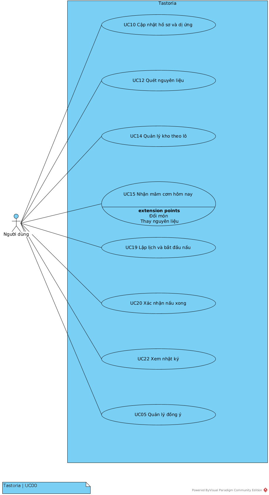

**Quy tắc đọc sơ đồ:** đường actor–UC là association, không biểu diễn thứ tự. `extend` hướng từ UC mở rộng về UC cơ sở, có điểm mở rộng và điều kiện. `include` chỉ dùng khi hành vi được gọi bắt buộc, không dùng để biểu diễn “màn hình sau” hay “phải đăng nhập trước”. Không tạo kế thừa actor chỉ vì hai vai trò có chung một màn hình.

## 3.2. Phân tích quan hệ use case

| Quan hệ trong tài liệu cũ | Phân tích lại | Cách trình bày ở bản này |
|---|---|---|
| UC12 include UC13 | UC12 kết thúc khi có kết quả nhận diện; người dùng có thể bỏ kết quả mà không nhập kho | Hai mục tiêu liên tiếp trong activity. UC13 là thao tác xác nhận riêng, không include bắt buộc từ nhận diện |
| UC09 include UC05 | Việc quản lý đồng ý là mục tiêu riêng; phần khai sức khỏe có thể được bỏ qua | Mô tả điều kiện đồng ý trong luồng UC09 và BR; không include toàn bộ “quản lý đồng ý” |
| UC16/UC17 extend UC15 | Có ý nghĩa nếu UC15 bao gồm xem và điều chỉnh mâm đề xuất | Giữ extend với hai điểm “Đổi món” và “Thay nguyên liệu” trong lúc xem mâm; điều kiện là người dùng chủ động yêu cầu |
| UC18 extend UC15/UC17 | Danh sách đi chợ tồn tại và được quản lý độc lập, không chỉ trong lúc nhận mâm | Association từ người dùng tới UC18; thêm nguyên liệu thiếu là luồng tùy chọn của UC15/UC17 |
| UC21 extend UC20 | Hoàn tác diễn ra sau giao dịch hoàn tất đã kết thúc | UC21 độc lập, tiền điều kiện là phiên đã hoàn tất và còn hạn; sequence thể hiện giao dịch đảo |

Đây là điều chỉnh mô hình trong báo cáo, không tự sửa bộ đặc tả gốc hoặc thay đổi hành vi phần mềm. Nhóm cần thống nhất phiên bản khi hợp nhất lại `model.yaml`.

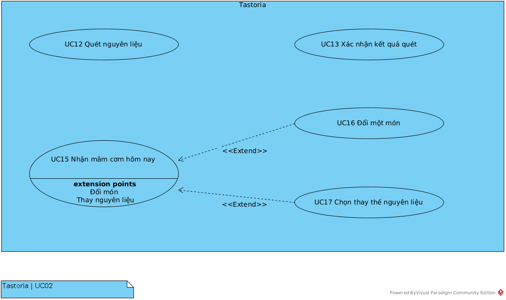

## 3.3. Đặc tả và hợp đồng nghiệp vụ

UC tổng quát thể hiện mục tiêu có giá trị cho tác nhân. Sơ đồ PK phân nhóm các mục tiêu đó theo trách nhiệm; không phải cứ nằm trong cùng phân hệ thì các UC có quan hệ include. Các thao tác kỹ thuật như kiểm JWT, khóa bản ghi và commit là trách nhiệm thiết kế, không tách thành UC người dùng chỉ để làm sơ đồ nhiều nút hơn.

Phụ lục A giữ đủ 34 đặc tả. Với từng UC, người đọc cần xác định được: ai kích hoạt, dữ liệu/trạng thái nào phải có trước, luồng thành công, vị trí rẽ nhánh, dữ liệu thay đổi và dữ liệu phải giữ nguyên khi thất bại. Các mục tiêu trọng tâm được phân tích tiếp trong các mục tiếp theo: UC09–10, UC13, UC15, UC20–21 và UC30. Những UC còn lại có đặc tả đầy đủ nhưng chưa có một bộ activity/sequence/lớp riêng cho từng UC; phạm vi này được công khai trong bảng truy vết.

| UC trọng tâm | Tiền điều kiện | Điểm quyết định | Hậu điều kiện thành công | Bảo đảm khi lỗi |
|---|---|---|---|---|
| UC13 Xác nhận quét | Lần quét thuộc người gọi, trạng thái done | Lượng bắt buộc, mục đã xóa, trạng thái gửi lại | Kho và scan confirmed cùng được ghi | Không để kho thay đổi mà scan vẫn chưa xác nhận |
| UC15 Nhận mâm | Người dùng có bối cảnh hợp lệ | Dị ứng, lượng chung, thời gian, ứng viên khả thi | Mâm đề xuất có món, khẩu phần và lý do | Không tạo mâm giả bằng cách âm thầm bỏ ràng buộc cứng |
| UC20 Hoàn tất | Phiên thuộc người gọi | in_progress, completed hoặc trạng thái không hợp lệ | Giao dịch kho, phiên completed, mâm cooked nhất quán | Retry không trừ lại; lỗi trước commit không để trạng thái dở dang |
| UC21 Hoàn tác | Phiên đã completed và còn thời hạn | Thời gian máy chủ; phiên reverted gửi lại | Ghi đảo, phiên reverted, mâm accepted | Không đảo ngoài hạn hoặc đảo lần hai |
| UC30 Triển khai | Vai trò vận hành và phiên bản được phép chọn | Tính tương thích artifact, ánh xạ lớp và trạng thái kiểm định | Chọn phiên bản hoạt động có khả năng truy vết | Không dùng tên phiên bản thay cho bằng chứng chất lượng |

## 3.4. Phân tích luồng nghiệp vụ và ngoại lệ

Các luồng dưới đây chọn theo mục tiêu nghiệp vụ, không theo người thực hiện bài tập. AD01–AD02 mô tả luồng thành công; AD03 và các bảng ngoại lệ bổ sung điều kiện quyết định. Đặc tả đầy đủ được giữ ở Phụ lục A.

### 3.4.1. Tài khoản, hồ sơ và quyền dữ liệu

Phạm vi UC01–UC11. Khách đăng ký bằng email/mật khẩu; đăng nhập thành công mở vùng bếp. Người dùng thiết lập dị ứng, chế độ ăn, số bếp và mục tiêu; chỉ thu thập dữ liệu nhạy cảm khi có đồng ý thích hợp. Rút đồng ý không đồng nghĩa xóa toàn bộ tài khoản; xóa tài khoản là quy trình riêng.

Ngoại lệ cần phân biệt: email đã dùng, mật khẩu không hợp lệ, đăng nhập sai/quá giới hạn, refresh token hết hạn hoặc bị dùng lại, dữ liệu hồ sơ không hợp lệ, yêu cầu dữ liệu không thuộc người gọi. Lỗi không được lộ dữ liệu tài khoản người khác. Xem phụ lục UC01–UC11 để đọc tiền/hậu điều kiện và FR gốc.

### 3.4.2. Quét ảnh và quản lý kho theo lô

UC12–UC14. Người dùng chọn chế độ toàn tủ hoặc đồ vừa mua, tải 1–2 ảnh, theo dõi xử lý, sửa chip nguyên liệu và xác nhận. Chỉ bước xác nhận ghi kho; cùng ngăn có quy tắc gộp tránh đếm lặp. Quét toàn tủ có thể đánh dấu lô không thấy để người dùng kiểm, không tự xóa.

Luồng thất bại: không cấp quyền ảnh → nhập tay; ảnh sai định dạng/dung lượng → sửa đầu vào; worker lỗi → retry giới hạn rồi báo thất bại; mất mạng → hỏi lại mã scan; bỏ kết quả → không đổi kho; xác nhận lặp → không thêm lô trùng.

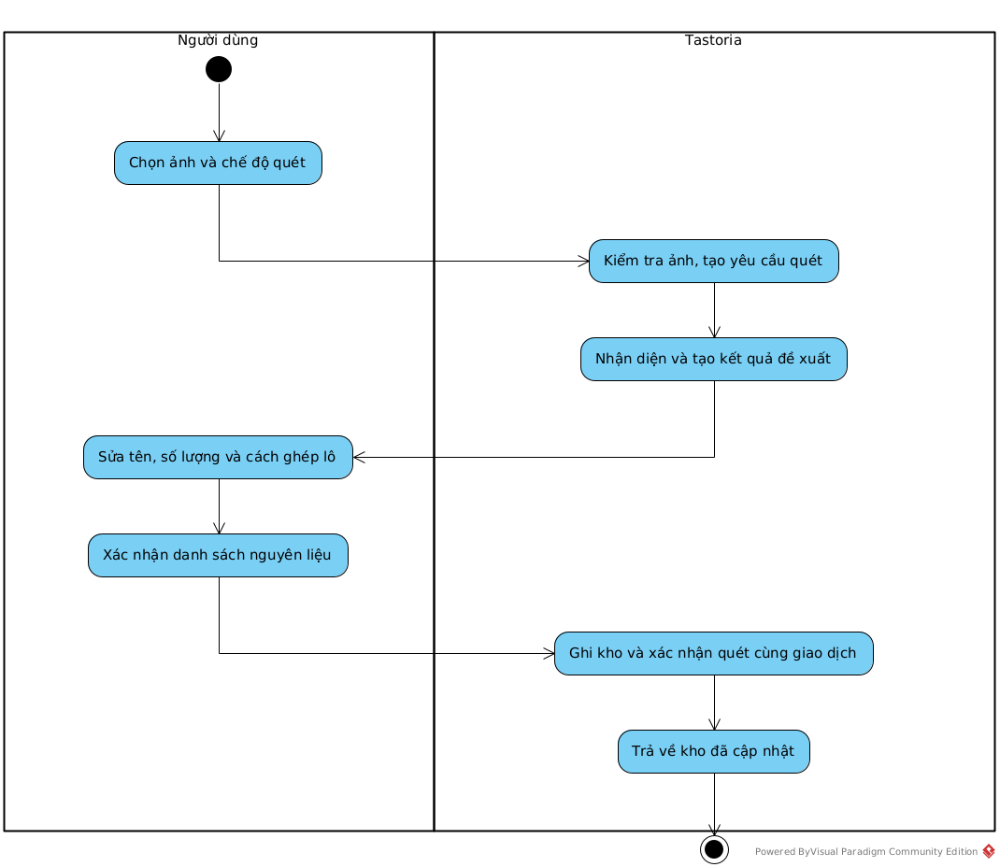

### 3.4.3. Gợi ý mâm, đổi món và đi chợ

UC15–UC18. Nhập số người, thời gian, dị ứng người ăn cùng và lô ưu tiên. Hệ thống loại món không hợp lệ, tính lượng theo khẩu phần, ghép tổ hợp, kiểm tổng nhu cầu và thời gian rồi xếp hạng. Người dùng xem lý do, đổi một món hoặc chọn thay thế hợp lệ trước khi chấp nhận.

Không có mâm khả thi phải báo thiếu gì hoặc đề xuất thay đổi điều kiện, không âm thầm bỏ ràng buộc dị ứng. Đổi món cố định các vị trí còn lại nhưng vẫn tính lại toàn mâm. Thêm thứ cần mua không được coi như nguyên liệu đã có trong kho.

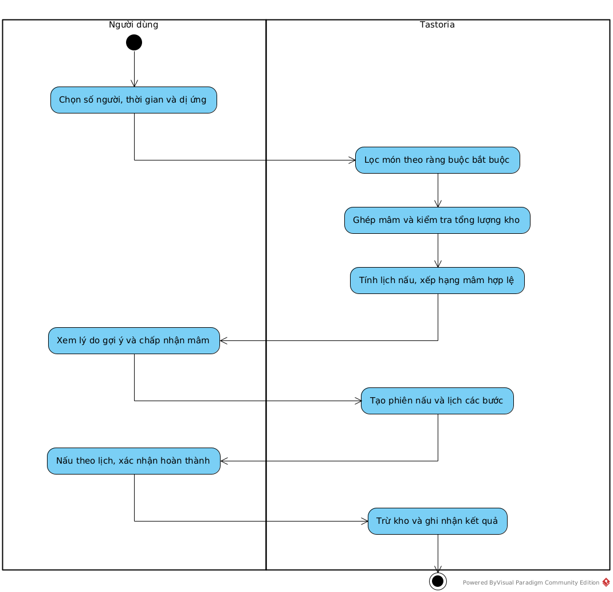

### 3.4.4. Lịch nấu, hoàn tất, hoàn tác và nhật ký

UC19–UC22. Mâm được chấp nhận mới tạo phiên nấu. Lịch xét thứ tự bước, thao tác chủ động và số bếp. Khi nấu xong, người dùng đánh giá tùy chọn và xác nhận. Hệ thống trừ kho một lần, cập nhật phiên/mâm; hoàn tác trong 10 phút bằng giao dịch đảo. Nhật ký dựa trên dữ liệu đã hoàn tất, không đếm lại một request retry.

Bộ lịch có thể nới điều kiện các món xong gần nhau hoặc trả lịch tuần tự dự phòng; không nới số bếp và thứ tự công việc để tạo lịch giả. Khi mất mạng, outbox giữ yêu cầu hoàn tất và cùng khóa lũy đẳng để gửi lại.

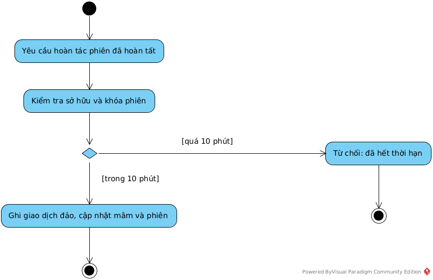

### 3.4.5. Dữ liệu, mô hình và vận hành

UC23–UC34. Quy trình gồm khảo sát gu, nhập/kiểm tra công thức, cặp thay thế, xuất dữ liệu có quyền sử dụng, đăng ký/kiểm định/triển khai mô hình, gán nhãn và bảo trì. Tách người biên soạn với người vận hành mô hình; người tham gia khảo sát không trở thành quản trị viên.

## 3.5. Mô hình lớp miền

Ở pha phân tích, “Mâm cơm”, “Món trong mâm”, “Phiên nấu” là khái niệm nghiệp vụ. “Món trong mâm” cần tách khỏi “Công thức món” vì nó mang hệ số khẩu phần, trạng thái thay món và ảnh chụp giá trị ở bữa cụ thể. “Lô kho” tách khỏi “Nguyên liệu” vì mỗi lô có thời điểm nhập và lượng riêng. Cách tách này tương ứng nguyên tắc phân biệt đối tượng danh mục với dòng giao dịch trong slide.

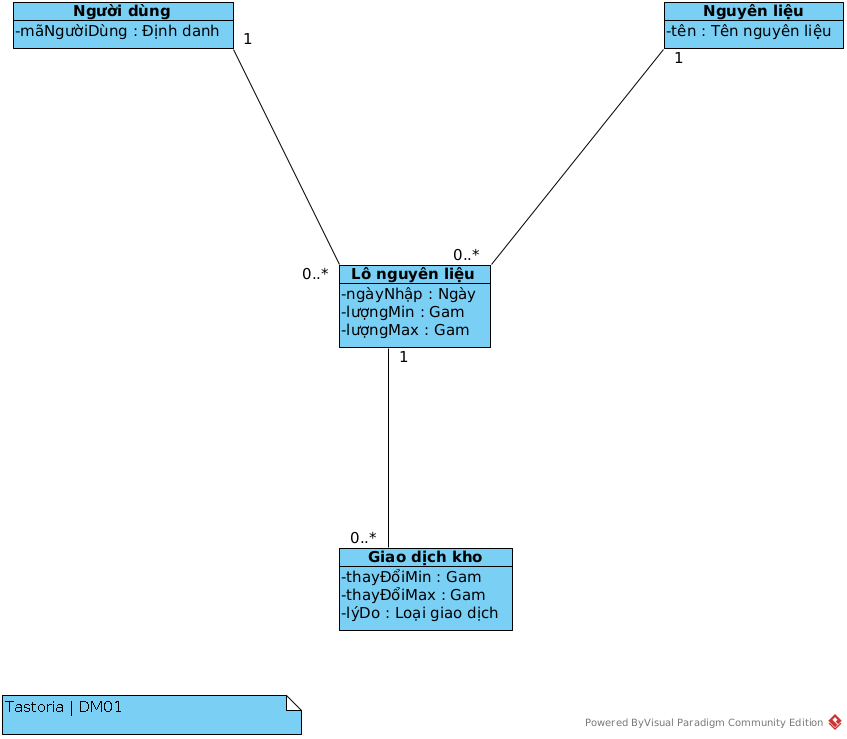

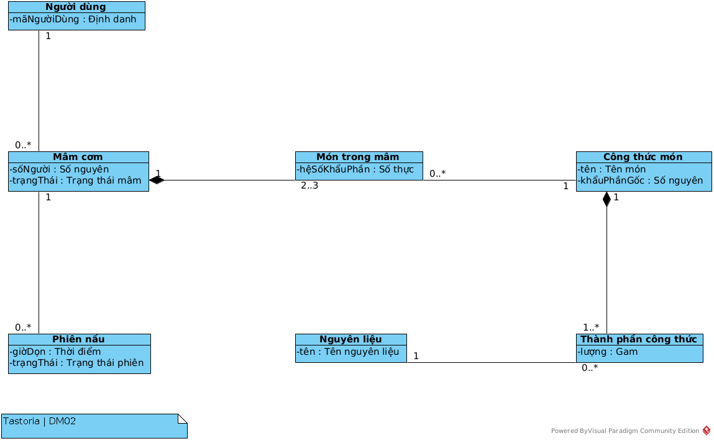

Bội số `2..3` ở DM02 là số **món active của một mâm hợp lệ** trong mô hình miền rút gọn; bảng vật lý có thể có nhiều dòng hơn để lưu lịch sử đổi. Composition chỉ đặt giữa đối tượng sở hữu và phần tử không có vòng đời độc lập, không đặt giữa người dùng và công thức dùng chung.

| Quan hệ | Bội số và ý nghĩa | Quyết định mô hình hóa |
|---|---|---|
| Người dùng – Lô nguyên liệu | Một người có 0..* lô; mỗi lô thuộc một người | Association; không suy diễn xóa vật lý dây chuyền từ quyền sở hữu |
| Nguyên liệu – Lô | Một nguyên liệu được dùng ở 0..* lô; một lô có một nguyên liệu | Danh mục dùng chung có vòng đời độc lập |
| Lô – Giao dịch kho | Một lô có 0..* giao dịch; mỗi giao dịch chỉ thuộc một lô | Giữ lịch sử, không thay tất cả giao dịch bằng giá trị tổng |
| Mâm – Món trong mâm | Miền mâm hợp lệ gồm 2..3 món đang hoạt động | Composition của phần tử mâm; DB vẫn giữ thêm dòng đã bị thay |
| Công thức – Thành phần | Công thức được công bố có 1..* thành phần | Thành phần mang lượng và chỉ có nghĩa trong một công thức |
| Nguyên liệu – Thành phần | Một nguyên liệu xuất hiện trong nhiều công thức | Association tới danh mục, không composition với danh mục |
| Mâm – Phiên nấu | Mâm có 0..* phiên theo lịch sử; mỗi phiên thuộc một mâm | “Tối đa một phiên đang nấu” là bất biến có điều kiện, không phải bội số lịch sử 0..1 |

Một quan hệ nhiều–nhiều chỉ có liên kết không đủ để giữ thuộc tính lượng. “Thành phần công thức” trở thành đối tượng liên kết giữa công thức và nguyên liệu, mang lượng gam. “Món trong mâm” cũng là đối tượng liên kết nhưng cần định danh riêng vì có trạng thái và quan hệ thay thế. Đây là bước chuyển từ quan hệ miền sang bảng nối có thuộc tính, tương ứng phương pháp trong bài PTTKHT.

## 3.6. Lớp phân tích theo use case

Lớp phân tích được rút ra từ thông tin cần nhớ và trách nhiệm trong UC. Một danh từ xuất hiện trong giao diện chưa chắc là lớp miền: “nút xác nhận” thuộc giao diện, “xác nhận nhập kho” là hành vi điều phối, còn “lần quét” và “lô nguyên liệu” có định danh, trạng thái và vòng đời cần lưu. Vì vậy, báo cáo dùng ba nhóm boundary, control và entity để giải thích trách nhiệm trước khi ánh xạ sang mã.

Boundary nhận dữ liệu từ tác nhân và biểu diễn kết quả. Control điều phối một mục tiêu nghiệp vụ, kiểm điều kiện và gọi các đối tượng liên quan. Entity biểu diễn thông tin của miền. Đây là mô hình phân tích, không khẳng định mỗi control phải trở thành một class Python: Tastoria tổ chức phần lớn điều phối bằng module hàm. Các đường «use» trong CL09, CL13, CL15, CL20 và CL30 biểu diễn sử dụng trách nhiệm, không phải khóa ngoại hay quan hệ sở hữu; vì vậy không gán bội số cơ sở dữ liệu cho những đường này.

### 3.6.1. Tài khoản, hồ sơ và quyền dữ liệu

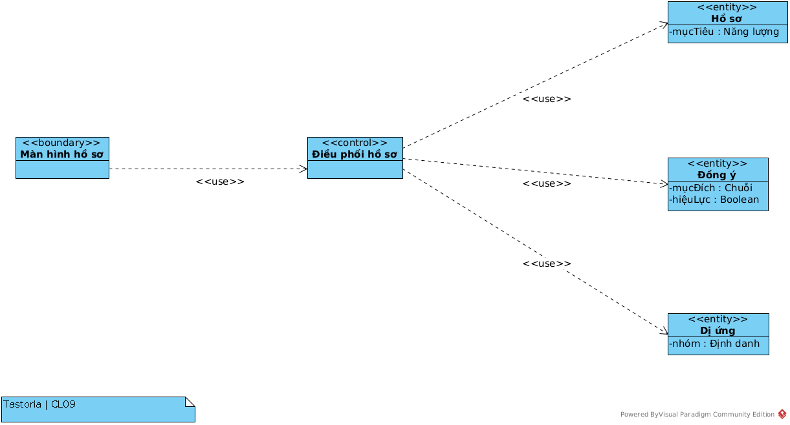

CL09 tách màn hình hồ sơ khỏi điều phối đồng ý và các thực thể hồ sơ/dị ứng. Gửi thông tin sức khỏe cần kiểm mục đích xử lý tương ứng; việc đã đăng nhập không thay thế điều kiện này. Khi người dùng bỏ qua phần không bắt buộc, giao diện cần biểu diễn thiếu thông tin, không ghi số 0 như một giá trị đã đo.

### 3.6.2. Quét ảnh và quản lý kho theo lô

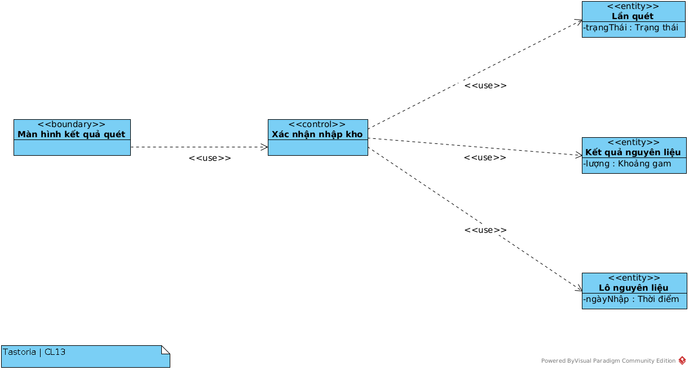

CL13 phân biệt “kết quả nguyên liệu” với “lô nguyên liệu”. Sửa một mục kết quả chưa tạo ra lô; control xác nhận mới chuyển dữ liệu đã duyệt sang nghiệp vụ kho. Quy tắc này giúp người dùng xóa dự đoán sai mà không phải thực hiện một giao dịch xuất kho giả.

### 3.6.3. Gợi ý mâm, đổi món và đi chợ

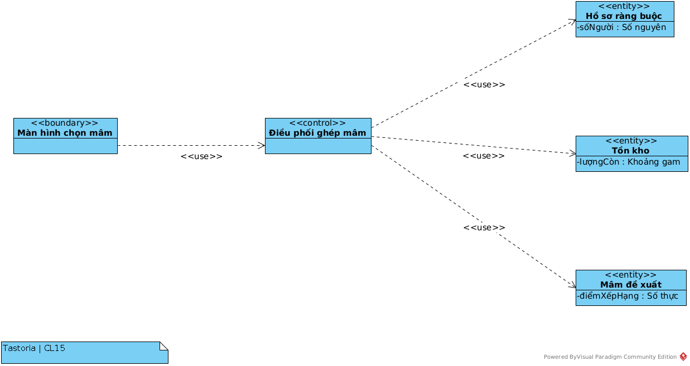

CL15 cho thấy mâm đề xuất phụ thuộc đồng thời hồ sơ ràng buộc và tồn kho. Không để bộ xếp hạng tự quyết định tính hợp lệ: điểm gu cao chỉ giúp sắp thứ tự các phương án đã qua điều kiện bắt buộc.

### 3.6.4. Lịch nấu, hoàn tất, hoàn tác và nhật ký

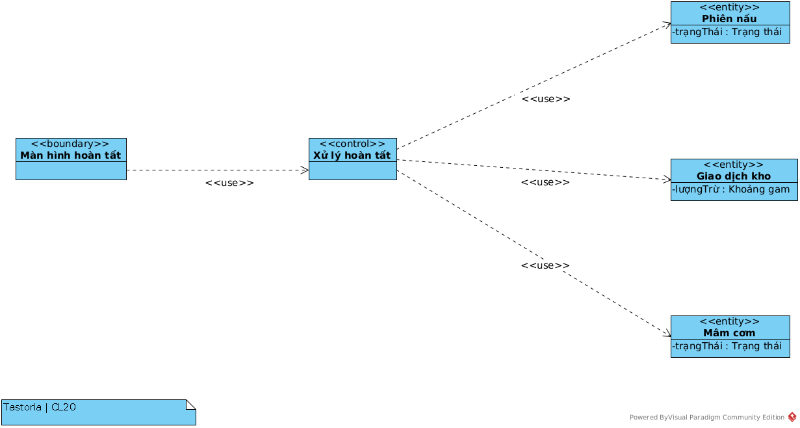

CL20 đặt xử lý hoàn tất ở control vì thao tác tác động phiên, mâm và giao dịch kho. Không giao toàn bộ nghiệp vụ cho setter trạng thái của phiên. Các dependency tới entity biểu diễn phạm vi trách nhiệm, còn cơ chế khóa và commit được cụ thể hóa ở DS01, SQ01 và SQ02.

### 3.6.5. Dữ liệu, mô hình và vận hành

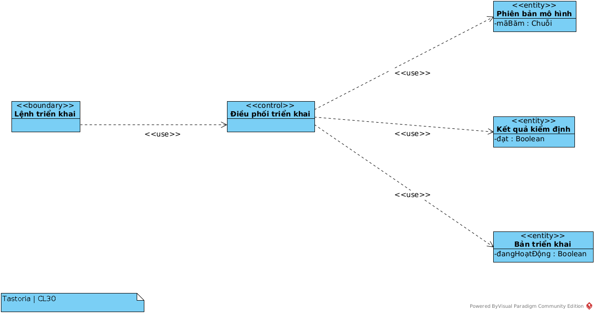

CL30 tách phiên bản, kết quả kiểm định và bản triển khai: một phiên bản có mặt trong kho artifact chưa đồng nghĩa được phục vụ. Control triển khai kiểm quyền và tính phù hợp của phiên bản rồi cập nhật lựa chọn hoạt động. Boundary là lệnh vận hành, không phải một màn hình admin giả định.

## 3.7. Kết quả của pha phân tích

Đầu ra gồm danh mục 34 UC trong 10 phân hệ, các đặc tả có tiền/hậu điều kiện, mô hình miền DM01–DM02 và năm góc nhìn trách nhiệm CL09/13/15/20/30. Mô hình miền giải thích quan hệ và bội số; các dependency trong lớp trách nhiệm thể hiện sử dụng, không biểu diễn khóa ngoại. Không yêu cầu mọi UC đều có cùng số loại sơ đồ: mức chi tiết phụ thuộc rủi ro, độ phức tạp và nhu cầu giải thích. Bảng truy vết ở Chương 5 chỉ rõ mô hình nào hỗ trợ mỗi nhóm yêu cầu.

# 4. THIẾT KẾ HỆ THỐNG

Pha thiết kế chuyển kết quả phân tích thành cấu trúc phần mềm có thể hiện thực: kiến trúc, thành phần, giao tiếp, dữ liệu, giao diện và cơ chế đáp ứng yêu cầu phi chức năng. Các lớp phân tích không bị sao chép máy móc thành lớp Python.

## 4.1. Lựa chọn kiến trúc

**Modular monolith** phù hợp quy mô nhóm: nhiều module nghiệp vụ trong một backend, giao tiếp qua hàm/service có ranh giới; các thao tác kho–mâm–phiên nấu có thể dùng một giao dịch PostgreSQL. Tách thành microservice ngay sẽ phải giải quyết nhất quán phân tán và vận hành nhiều dịch vụ mà chưa có số liệu chứng minh nhu cầu.

Phần xử lý ảnh chạy trong worker độc lập để không giữ request HTTP trong suốt suy luận. API ghi scan, commit rồi đưa job vào RQ. Nếu enqueue sau commit lỗi, sweeper xử lý bản ghi chưa được đưa vào hàng đợi; vì vậy cần phân biệt “đã nhận yêu cầu” với “đã hoàn thành nhận diện”.

Phân tầng: giao diện → router/validation/quyền → service nghiệp vụ → SQLAlchemy/Unit of Work → PostgreSQL. Mã hiện tại dùng nhiều module hàm Python, không phải mọi thành phần đều là lớp `Service` hoặc `Repository`. Bản thiết kế không bịa thêm lớp DAO đã cài đặt; SQLAlchemy Session cùng models đang đảm nhiệm truy cập dữ liệu.

## 4.2. Công nghệ và phụ thuộc thành phần

| Thành phần | Lựa chọn trong repo | Lý do và đánh đổi |
|---|---|---|
| Giao diện | Expo / React Native / TypeScript, Android và web | Chia sẻ phần lớn mã; vẫn cần kiểm khác biệt camera, lưu phiên và layout |
| Backend | FastAPI + Pydantic | Hợp đồng dữ liệu rõ, tích hợp Python ML; cần tránh để tác vụ nặng chặn request |
| Nghiệp vụ và dữ liệu | SQLAlchemy + PostgreSQL | Giao dịch, khóa và ràng buộc mạnh; migration phải theo phiên bản |
| Hàng đợi | Valkey + RQ | Đơn giản cho tác vụ nền; cần retry, sweep và giám sát worker |
| Nhận diện | Mô hình xuất ONNX + ONNX Runtime CPU | Tách huấn luyện khỏi phục vụ; phải kiểm phiên bản, mã băm và ánh xạ lớp |
| Ghép mâm | Thuật toán tổ hợp có ràng buộc và điểm xếp hạng | Bảo toàn điều kiện bắt buộc; giảm không gian ứng viên cần đánh giá ảnh hưởng chất lượng |
| Lịch nấu | OR-Tools CP-SAT | Biểu diễn thứ tự bước, nguồn lực người/bếp; có trạng thái relaxed/fallback khi cần |
| Lưu tệp | Ổ đĩa riêng, nginx tải sau kiểm quyền | Dễ vận hành một máy; mở rộng nhiều máy cần shared/object storage |
| Triển khai | Docker Compose, nginx, tunnel, CI frontend và pull deployment | Tái lập được bản frontend; máy chủ và sao lưu vẫn là điểm cần giám sát |

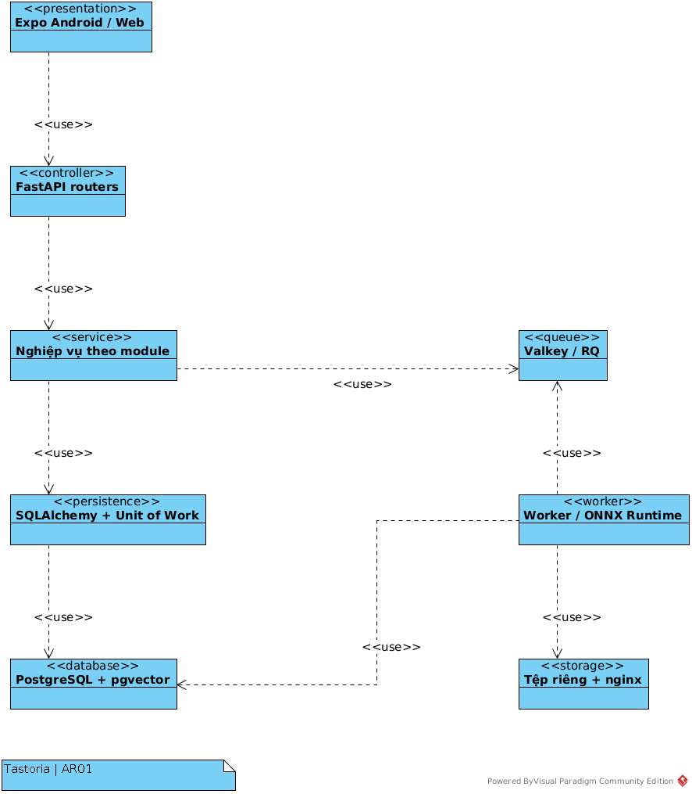

AR01 dùng UML dependency «use». Mũi tên worker → queue thể hiện worker sử dụng hàng đợi, không phải hướng chảy dữ liệu. Đây là góc nhìn trách nhiệm/phụ thuộc, không phải sơ đồ mạng. PostgreSQL và tệp là kho lưu lâu dài; Valkey không thay thế cơ sở dữ liệu nghiệp vụ.

## 4.3. Chuyển lớp phân tích sang thiết kế

| Khái niệm phân tích | Lý do tách | Ánh xạ thiết kế | Dữ liệu |
|---|---|---|---|
| Kết quả quét và lô kho | Dự đoán có thể sửa/bỏ; lô là tồn kho đã xác nhận | scan.service.confirm gọi pantry.service.apply_scan | scans, scan_items; pantry_lots, pantry_transactions |
| Công thức và món trong mâm | Công thức dùng lại; món trong mâm có khẩu phần và lịch sử thay | catalog cung cấp công thức; meal.service tạo dòng mâm | recipes, recipe_ingredients; meal_plan_items |
| Mâm và phiên nấu | Đề xuất có thể chưa nấu; phiên có thời điểm và trạng thái riêng | meal.service và cooking.service | meal_plans, cook_sessions |
| Biến động kho và số dư | Cần giữ lịch sử để đảo; số dư là giá trị dẫn xuất | pantry.deduct / reverse, truy vấn balance | pantry_transactions, v_pantry_lot_balance |
| Phiên bản và triển khai mô hình | Một phiên bản có thể tồn tại nhưng chưa được chọn phục vụ | module mlops, worker nạp artifact | model_versions, model_deployments |

Ở pha thiết kế, router nhận yêu cầu, service phối hợp nhiều đối tượng, UnitOfWork quản lý giao dịch và ORM entity biểu diễn trạng thái lưu. Ví dụ complete_session không phải phương thức cập nhật đơn lẻ của `CookSession`: nó còn cần kho, mâm, sự kiện và kiểm đồng ý.

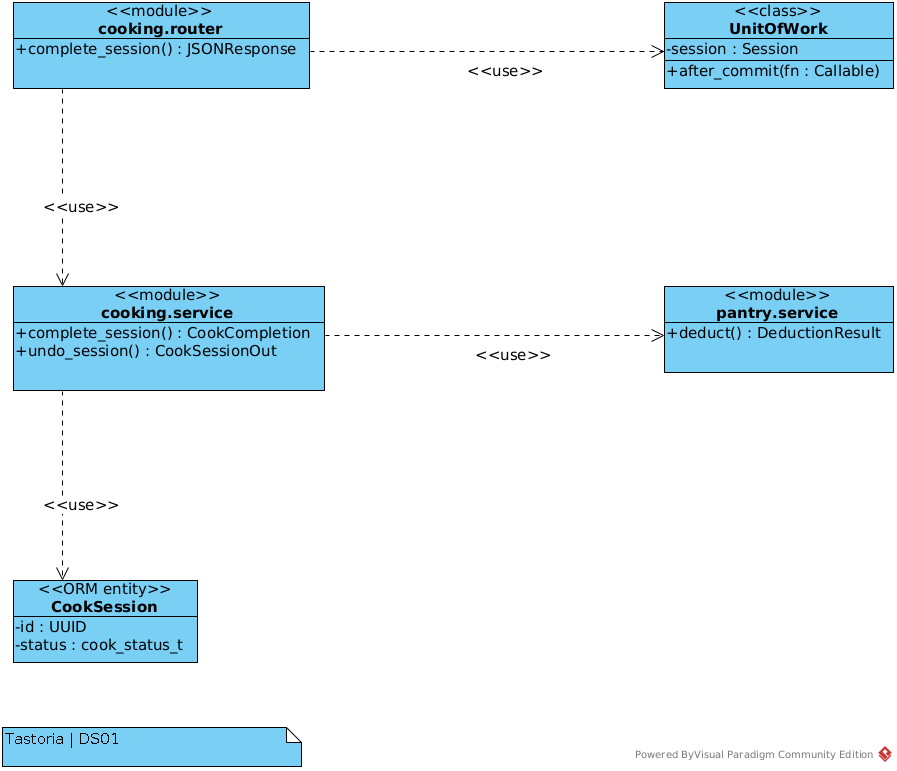

Tên phương thức trên các sơ đồ thiết kế được rút gọn tham số để dễ đọc; chữ ký thực và việc truyền session/dependency cần đối chiếu mã nguồn. «module» biểu diễn module hàm, không khẳng định đó là lớp khởi tạo được.

## 4.4. Thiết kế chi tiết theo chức năng

Các mục dưới cụ thể hóa trách nhiệm ở mục 3.6 bằng module, giao dịch và tương tác. Hình SQ chỉ biểu diễn các kịch bản được ghi trong chú thích; bảng nhánh và đặc tả UC bổ sung các tình huống khác.

### 4.4.1. Tài khoản, hồ sơ và quyền dữ liệu

Các module `identity`, `profile`, `privacy` cùng `core.auth` chịu trách nhiệm xác thực và quyền. API dùng access token và refresh token xoay vòng; app giữ trạng thái phiên theo nền tảng. Dữ liệu hồ sơ đi qua service để tạo điều kiện bữa ăn, thay vì để bộ ghép mâm đọc tùy ý mọi trường sức khỏe.

Khó nhất là phân biệt quyền đăng nhập với quyền xử lý từng mục đích; rút đồng ý phải tác động cả dữ liệu/sự kiện liên quan. Điểm tích hợp là người dùng có thể sử dụng chức năng phù hợp mà không bị buộc đồng ý mọi mục đích nghiên cứu/cá nhân hóa.

| Bước nghiệp vụ | Trách nhiệm và dữ liệu | Trường hợp cần kiểm |
|---|---|---|
| Mở thiết lập | Lấy phiên bản điều khoản và hồ sơ hiện có | Điều khoản thay phiên bản trong lúc thao tác |
| Chọn đồng ý | Ghi sự kiện theo từng mục đích | Không chọn sẵn thay người dùng |
| Lưu hồ sơ và dị ứng | Kiểm miền giá trị, chủ sở hữu và mã danh mục | Không sửa hồ sơ tài khoản khác |
| Rút đồng ý | Cập nhật quyền xử lý theo mục đích | Đọc lại trạng thái từ máy chủ, không chỉ đổi công tắc local |

Điểm khó nằm ở tính nhất quán giữa trạng thái đồng ý và tác vụ sử dụng dữ liệu. Sơ đồ phân tích thể hiện trách nhiệm; phần bảo vệ cụ thể phải được kiểm ở API/service, không giao toàn bộ cho biểu mẫu.

### 4.4.2. Quét ảnh và quản lý kho theo lô

`scan.router/service` kiểm đầu vào và tạo scan; `queue/worker/detector/aggregate` xử lý nền; `pantry.service` cập nhật lô. Dữ liệu chính gồm `scans`, `scan_images`, `detections`, `scan_items`, `pantry_lots`, `pantry_transactions`. Worker không giữ giao dịch DB mở trong toàn bộ suy luận; ghi kết quả có kiểm trạng thái để không hồi sinh một scan đã hết hạn.

Khó nhất là chuyển đầu ra thị giác thành quyết định nhập kho: lớp phát hiện chưa chắc trùng mã nguyên liệu và ảnh không đảm bảo đo đúng lượng. Cách giải là ánh xạ có phiên bản, biểu diễn độ bất định và xác nhận của người dùng. Worker hiện có `freshness_version=None`; báo cáo không coi mô hình độ tươi là thành phần đã triển khai.

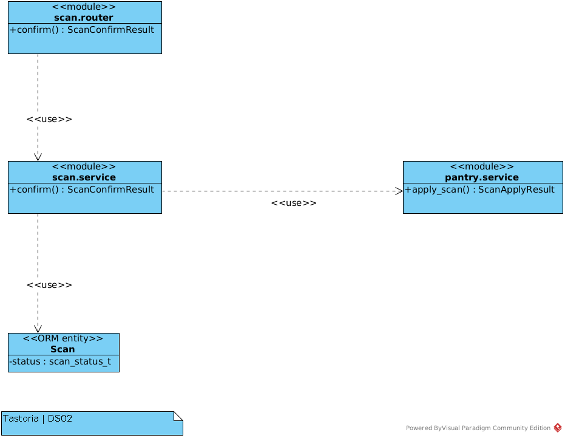

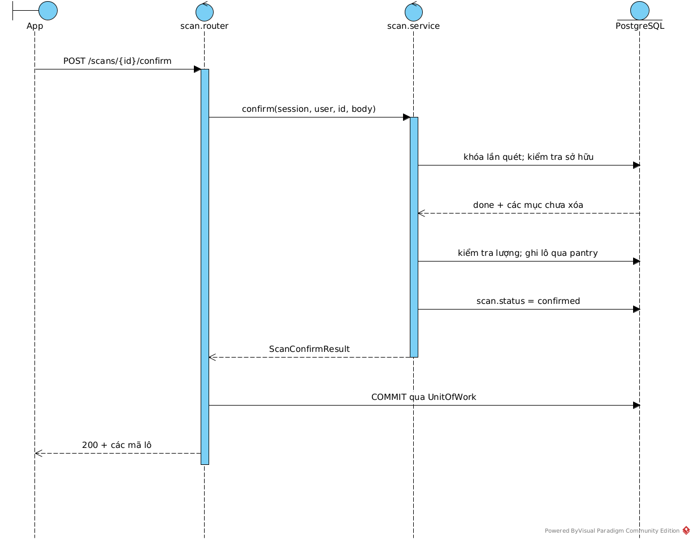

Ở SQ03, scan.service khóa bản ghi scan, kiểm chủ sở hữu, bỏ các mục đã xóa và kiểm lượng. Hàm pantry.apply_scan nhận cùng session, ghi thay đổi kho rồi scan chuyển confirmed. UnitOfWork ở biên request commit trước khi hoàn tất phản hồi. Đường tới PostgreSQL biểu diễn truy vấn/ghi qua ORM trong cùng giao dịch, không có nghĩa App được truy cập DB trực tiếp.

| Trường hợp | Xử lý của chức năng | Hậu điều kiện cần kiểm |
|---|---|---|
| scan done, dữ liệu hợp lệ | Áp dụng các mục đã duyệt vào kho | Kho và trạng thái confirmed cùng tồn tại |
| scan confirmed được gửi lại | Trả kết quả đã có qua nhánh replay | Không tạo thêm lô do retry |
| Thiếu mức lượng bắt buộc | Trả lỗi xác thực dữ liệu | Kho giữ nguyên |
| scan chưa done hoặc đã bị bỏ | Từ chối trạng thái không hợp lệ | Không chuyển trạng thái lùi |
| Hai request xác nhận đồng thời | Khóa scan để tuần tự hóa quyết định | Chỉ một lần áp dụng kho |

SQ03 chỉ vẽ nhánh thành công đầu tiên để giữ hình đọc được; các nhánh trong bảng và đặc tả UC13 là phần của cùng hợp đồng. Độ tin cậy nhận diện phải đánh giá riêng theo dữ liệu ảnh; không suy ra từ việc giao dịch xác nhận chạy đúng.

### 4.4.3. Gợi ý mâm, đổi món và đi chợ

`meal.service` điều phối hồ sơ, catalog, kho, bộ xếp hạng, thuật toán `composer` và bộ lịch `schedule`; `substitute` kiểm các cặp thay thế. `meal_plan_items` lưu phiên bản món trong mâm; thay món giữ dấu vết qua dòng bị thay. Năng lượng và lời giải thích lưu theo bối cảnh tạo mâm.

Điểm khó là tiêu chí mềm (gu, sử dụng nguyên liệu sớm, gần mục tiêu năng lượng) không được lấn điều kiện cứng (dị ứng, lượng dùng chung, nguồn lực). Kiểm riêng từng món không đủ; phải kiểm cả tổ hợp. Chưa có kết quả thử người dùng thì không tuyên bố xếp hạng “phù hợp khẩu vị hơn” đối thủ.

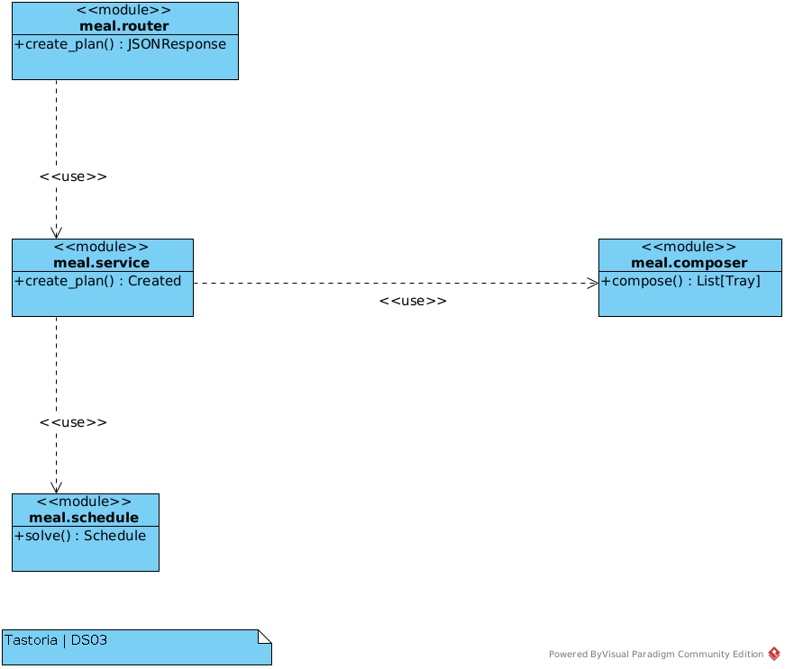

Trong DS03, meal.router xử lý biên HTTP và khóa yêu cầu; meal.service dựng bối cảnh, lấy ứng viên và điều phối. meal.composer ghép tổ hợp theo cấu trúc mâm; meal.schedule kiểm khả năng sắp lịch. Catalog và truy vấn kho là đầu vào bổ sung, được lược khỏi góc nhìn này và đã thể hiện ở AR01/DM01.

Một ví dụ phân tích: kho có 300 g thịt, món mặn cần 200 g và món canh cần 150 g. Hai món riêng lẻ đều không vượt 300 g nhưng tổng 350 g vượt kho. Phải cộng nhu cầu theo mã nguyên liệu sau quy đổi khẩu phần và thay thế, rồi kiểm cả mâm. Các số trên chỉ minh họa bất biến, không phải dữ liệu kiểm thử đã chạy.

| Tình huống | Quyết định | Tác động dữ liệu |
|---|---|---|
| Có mâm hợp lệ | Xếp hạng, lưu món và lời giải thích | Tạo đề xuất; chưa trừ kho |
| Không đủ lượng dùng chung | Tìm tổ hợp khác hoặc báo không khả thi | Không âm thầm chấp nhận thiếu kho như mâm đủ |
| Người dùng đổi một món | Cố định phần còn lại, kiểm lại toàn mâm | Giữ dấu vết dòng bị thay |
| Thay nguyên liệu | Kiểm cặp thay, dị ứng, tỷ lệ và nhu cầu chung | Lưu lựa chọn thay thế gắn với món |
| Hết thời gian giải lịch | Dùng chế độ dự phòng có ghi trạng thái | Không báo lịch tối ưu khi chỉ có nghiệm dự phòng |

Khó khăn thuật toán là số tổ hợp tăng nhanh khi thêm món; thu hẹp ứng viên giảm chi phí nhưng có thể bỏ nghiệm tốt. Vì vậy cần đo cả thời gian và tỷ lệ tìm được phương án, lưu cấu hình ứng viên, giới hạn thời gian và bộ dữ liệu khi so sánh.

### 4.4.4. Lịch nấu, hoàn tất, hoàn tác và nhật ký

`meal.schedule` dùng CP-SAT: NoOverlap cho thao tác chủ động, Cumulative cho bếp, ràng buộc thứ tự bước. `cooking.service` phối hợp kho và mâm; router dùng idempotency; `core.db.UnitOfWork` commit trước khi trả phản hồi. Đây là hiện thực bằng module hàm, không phải một lớp controller tự giữ mọi nghiệp vụ.

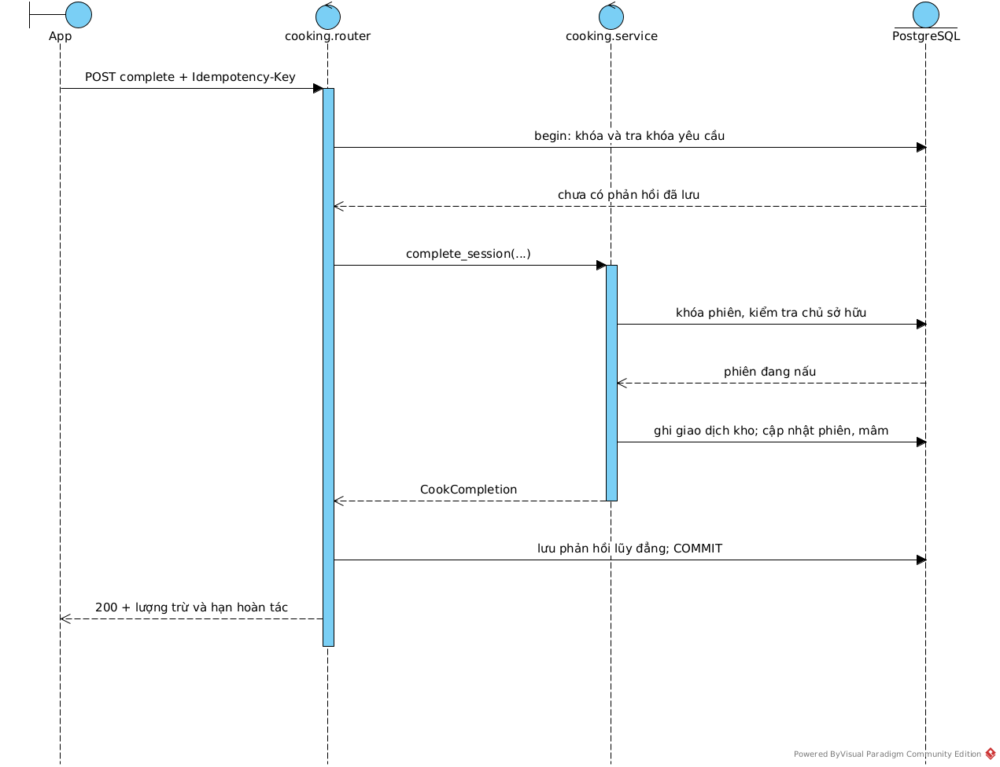

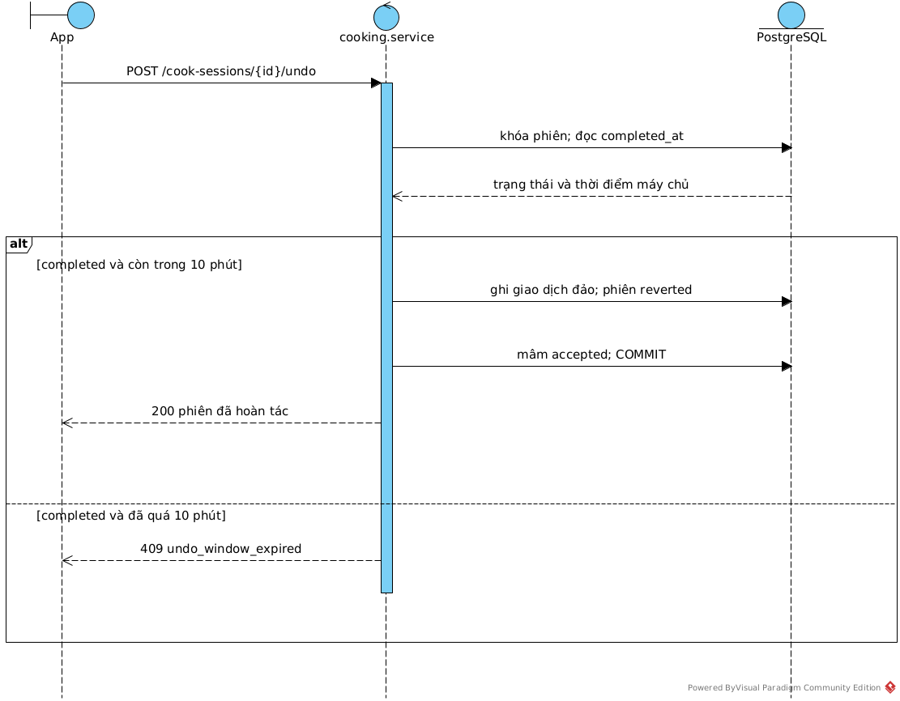

Ở mã hiện tại, nếu phiên đã `completed`, service trả tóm tắt đã có thay vì trừ kho lần nữa. Điều này khác một số sequence cũ mô tả trả 409 cho mọi phiên không `in_progress`. Nhánh cùng Idempotency-Key được xử lý sớm tại router. Cả hai lớp bảo vệ đều cần test, không chỉ test nút bị vô hiệu hóa trên giao diện.

| Trạng thái phiên trước thao tác | Thao tác / điều kiện | Kết quả |
|---|---|---|
| in_progress | Hoàn tất hợp lệ | completed; ghi biến động kho và thời điểm máy chủ |
| completed | Gửi lại hoàn tất | Trả tóm tắt hiện có; không trừ lần hai |
| completed | Hoàn tác trong hạn | reverted; ghi đảo; mâm trở lại accepted |
| completed | Hoàn tác quá hạn | Lỗi undo_window_expired; dữ liệu giữ nguyên |
| reverted | Gửi lại hoàn tác | Trả trạng thái đã có; không đảo lần hai |
| in_progress | Bỏ phiên | abandoned; không trừ kho |

Thời điểm thiết bị báo nấu xong có thể được dùng cho sự kiện sau kiểm tra, nhưng hạn hoàn tác căn cứ completed_at do máy chủ ghi. Hai mốc có vai trò khác nhau; dùng giờ thiết bị cho hạn sẽ làm kết quả phụ thuộc đồng hồ hoặc thời gian gửi lại.

Có hai lớp chống lặp: khóa Idempotency-Key trả phản hồi cho cùng yêu cầu; trạng thái completed bảo vệ khi người dùng gửi lại mục tiêu với khóa mới. Khóa phiên ngăn hai luồng đồng thời cùng thấy in_progress. Toàn bộ thao tác phải cùng transaction để lỗi sau ghi kho nhưng trước cập nhật mâm không tạo trạng thái lệch.

Lượng kho thực tế có thể thay đổi từ lúc đề xuất tới lúc hoàn tất. Service trả danh sách shortfalls nếu có thiếu hụt; báo cáo không giả định lời giải hợp lệ lúc tạo mâm bảo đảm tồn kho bất biến mãi về sau. Nhật ký và kết quả hoàn tất cần phản ánh dữ liệu đã ghi thay vì tự suy ra từ thao tác bấm nút.

### 4.4.5. Dữ liệu, mô hình và vận hành

Danh mục nhập từ nguồn có cấu trúc; mô hình có phiên bản và mã băm; worker nạp artifact đã được chọn. Dữ liệu huấn luyện phải theo phạm vi đồng ý, không lấy mọi ảnh người dùng chỉ vì chúng tồn tại trên máy chủ. Sao lưu và xóa ảnh theo lịch là tác vụ riêng, cần bằng chứng chạy/khôi phục.

Frontend CI kiểm TypeScript, lint, export, browser và nginx trước khi promote; máy chủ triển khai web rồi build APK ký. Pipeline này không đồng nghĩa backend/model cũng tự động được nghiệm thu và phát hành. Phần khó là đồng bộ model–ánh xạ lớp–tiền xử lý–artifact và giữ khả năng quay lui.

| Công đoạn | Đầu vào | Kiểm soát cần có | Bằng chứng nghiệm thu |
|---|---|---|---|
| Biên soạn | Công thức, nguyên liệu, nguồn | Mã danh mục, đơn vị, cấu trúc và nguồn gốc | Log kiểm/import đúng phiên bản |
| Khảo sát | Form, món chấm, người tham gia | Phiên bản form và phạm vi đồng ý | Bản xuất có mô tả cấu trúc |
| Đăng ký mô hình | Artifact và metadata | Mã băm, ánh xạ lớp, tiền xử lý | Manifest và báo cáo đánh giá |
| Triển khai/quay lui | Phiên bản được chọn | Tương thích worker, khả năng tải artifact | Log chọn phiên bản và yêu cầu kiểm tra |
| Bảo trì | Lịch xóa/sao lưu/dọn | Phạm vi xóa, quyền tệp, khả năng khôi phục | Log chạy và biên bản restore |

Các loại bằng chứng trong bảng là điều kiện cần thu thập, không phải tuyên bố đã có đủ. Khả năng mở một endpoint hoặc chạy CLI không chứng minh chất lượng mô hình, cũng không thay thế kiểm thử khôi phục dữ liệu.

## 4.5. Giao dịch, bất đồng bộ và hiệu năng

Có hai ranh giới cần phân biệt. Ranh giới module giúp phân công và kiểm soát phụ thuộc. Ranh giới transaction bảo đảm một thay đổi nghiệp vụ hoặc được ghi đầy đủ hoặc không ghi. UC13 và UC20 đi qua nhiều module nhưng vẫn dùng cùng session/giao dịch; tách chúng thành nhiều HTTP service ngay sẽ làm mất tính nguyên tử nếu chưa có cơ chế điều phối giao dịch phân tán.

Tác vụ nhận diện ảnh không nằm trong giao dịch chờ người dùng. API tạo scan và lưu ảnh, commit bản ghi rồi mới enqueue. Worker nhận nhiệm vụ, chạy mô hình và ghi kết quả; người dùng đọc trạng thái rồi xác nhận bằng một yêu cầu mới. Khoảng lỗi giữa commit và enqueue được xử lý bằng dấu enqueued_at và tác vụ quét bù; do đó “API đã nhận ảnh” không có nghĩa “worker đã nhận nhiệm vụ”.

Frontend web và Android dùng cùng API nghiệp vụ nhưng có vòng đời phát hành khác nhau. Trang công khai không yêu cầu phiên đăng nhập; các tài nguyên riêng kiểm quyền tại API. Kiểm tra route trên trình duyệt chỉ là kiểm giao diện, không chứng minh backend chống truy cập chéo. Tương tự, build APK thành công không chứng minh mô hình nhận diện đạt độ chính xác yêu cầu.

Tác vụ ảnh có retry giới hạn; dữ liệu yêu cầu và trạng thái ở DB giúp quan sát lỗi. Bộ giải lịch nấu có giới hạn thời gian và phương án dự phòng. Request nấu xong dùng khóa lũy đẳng và khóa phiên; ghi phản hồi lũy đẳng trong cùng giao dịch với biến động kho, tránh trường hợp kho đã trừ nhưng không có dấu vết chống lặp.

Khi cần mở rộng, ưu tiên đo nút thắt trước: số job chờ, thời gian suy luận, thời gian ghép mâm, truy vấn chậm và dung lượng ảnh. Có thể thêm worker, cache dữ liệu danh mục bất biến và tách lưu tệp mà vẫn giữ backend modular monolith. Chỉ tách service khi có nhu cầu triển khai/scale độc lập và kế hoạch nhất quán dữ liệu rõ.

## 4.6. Thiết kế dữ liệu và lưu trữ

Mô hình dữ liệu cụ thể hóa các thực thể miền bằng bảng, khóa và ràng buộc. Các hình DB biểu diễn UML class «table»; Phụ lục B cung cấp từ điển cấu trúc theo DDL.

### 4.6.1. Các hình thức lưu trữ

| Nơi lưu | Dữ liệu | Vai trò và giới hạn |
|---|---|---|
| PostgreSQL | Người dùng, đồng ý, hồ sơ, danh mục, scans, lô kho, giao dịch, mâm, phiên nấu, khảo sát, phiên bản mô hình | Nguồn dữ liệu nghiệp vụ chính; có FK, UNIQUE, CHECK, transaction |
| pgvector | Biểu diễn vector theo thiết kế danh mục/mô hình | Không thay thế các bảng và quy tắc lọc nghiệp vụ |
| Tệp trên máy chủ | Ảnh quét, artifact mô hình, tệp xuất | DB giữ khóa tham chiếu; nginx chỉ tải sau kiểm quyền ở API |
| Valkey | Hàng đợi RQ, tín hiệu tiến độ và trạng thái tạm | Không coi là sổ kho lâu dài |
| Thiết bị | Cache danh mục/lịch nấu, outbox | Dùng khi mất mạng; gửi lại giữ khóa yêu cầu, không quyết định tồn kho cuối cùng |
| Bộ dữ liệu ngoại tuyến | YAML, nguồn dinh dưỡng, dữ liệu huấn luyện | Có phiên bản và nguồn; không nhầm với DB giao dịch đang chạy |

### 4.6.2. Bảng, khóa và quan hệ

Các hình dưới chọn cột phục vụ giải thích; từ điển bảng đầy đủ được sinh từ `db/schema.sql` trong phụ lục. Kiểu cột/PK/FK lấy từ DDL, không suy từ tên màn hình. Quan hệ nhiều–nhiều giữa công thức và nguyên liệu được chuyển thành `recipe_ingredients` có lượng gam.

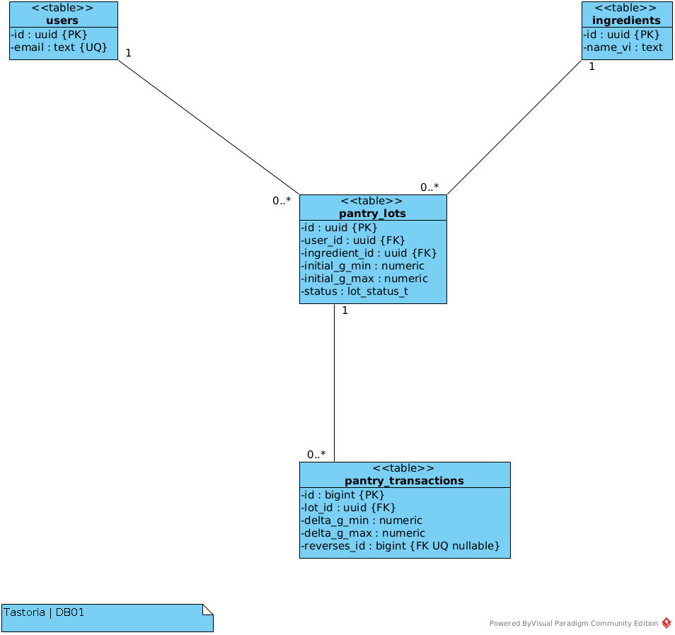

`pantry_transactions.lot_id` bắt buộc tham chiếu một lô. `reverses_id` là FK tự tham chiếu nullable và UNIQUE: một giao dịch trừ có tối đa một bản ghi đảo. Hình DB01 giản lược cạnh tự tham chiếu để dễ đọc; ràng buộc vẫn được liệt kê trong bảng đầy đủ. `ref_type/ref_id` là cặp tham chiếu nghiệp vụ đa loại, không được trình bày như một FK thực khi DDL không có FK.

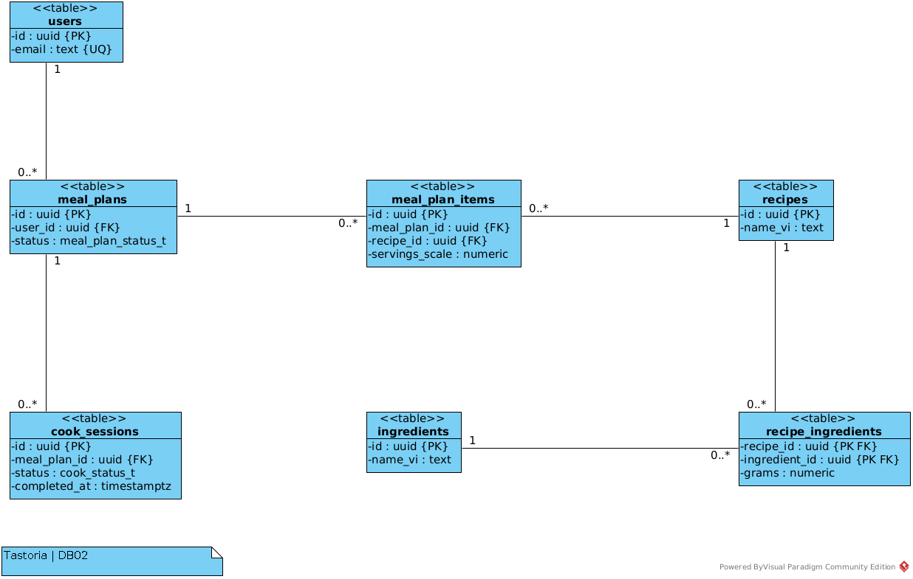

`recipe_ingredients` có PK ghép `(recipe_id, ingredient_id)`. `meal_plan_items` giữ lịch sử món thay thế qua `replaced_item_id`; công thức và vị trí món được kiểm bằng FK ghép `(recipe_id, slot)`. Một mâm có thể có nhiều phiên theo thời gian; ràng buộc một phiên đang nấu cần xem index/logic dịch vụ, không thay bội số toàn lịch sử thành 1–1.

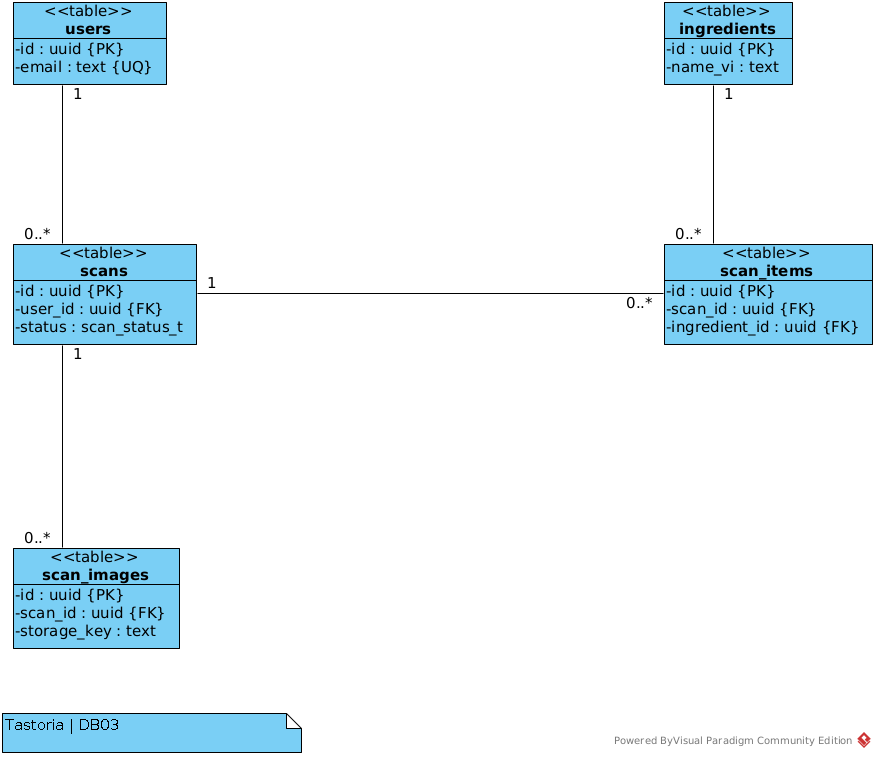

Mỗi ảnh/kết quả thuộc một lần quét. Scan thuộc đúng một người dùng. Ảnh thô và lô kho không đồng nhất: phải qua bước xác nhận rồi mới phát sinh thay đổi kho. `detections` lưu khung phát hiện; `scan_items` là kết quả nghiệp vụ đã gộp/sửa.

### 4.6.3. Chuẩn hóa và dữ liệu dẫn xuất

Tách người dùng, nguyên liệu, công thức và lô kho để tránh lặp dữ liệu danh mục trong giao dịch. Các quan hệ nhiều–nhiều có bảng nối, không lưu danh sách mã bằng chuỗi phân cách. Đơn vị/nhóm dị ứng là danh mục, không rải nhãn tự do trong nhiều bảng.

Số dư kho là giá trị tính từ lượng ban đầu và các giao dịch; mức ưu tiên dùng phụ thuộc thời gian nên cần tính lại khi đọc. Ngược lại, giá trị ảnh chụp tại lúc lập mâm hoặc hoàn tất nấu được giữ để lịch sử không thay đổi khi danh mục cập nhật. Không kết luận mọi bảng đều đạt BCNF chỉ vì đã có khóa chính; phải xét khóa ứng viên và phụ thuộc hàm từng bảng. Phụ lục cũ về chuẩn hóa là tài liệu tham khảo để nhóm rà soát, không được dùng như chứng nhận tự động.

### 4.6.4. Bất biến giao dịch

Giả sử lô có khoảng 400–500 g. Sau khi ghi giảm 150 g, còn 250–350 g. Gửi lại cùng thao tác không ghi thêm dòng giảm. Khi hoàn tác hợp lệ, thêm dòng +150 g tham chiếu dòng −150 g; số dư trở lại 400–500 g. Không sửa mất dấu giao dịch cũ. Nếu lỗi trước commit, cả cập nhật phiên và dòng biến động phải rollback.

## 4.7. Thiết kế giao diện theo luồng sử dụng

Giao diện được trình bày theo chức năng và điểm quyết định của người dùng. Ảnh chụp hiện có minh họa bố cục, không thay thế kiểm thử trạng thái lỗi, quyền truy cập hoặc hiệu năng.

### 4.7.1. Tài khoản, hồ sơ và quyền dữ liệu

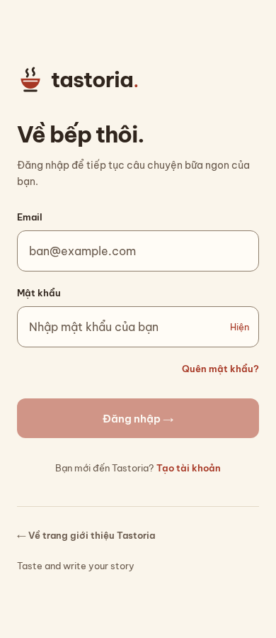

Form có email, mật khẩu, hiện/ẩn mật khẩu, khôi phục và chuyển đăng ký. Trên desktop form đi cùng ảnh chụp thật; mobile ưu tiên form. Landing vẫn truy cập công khai. Ảnh này là bằng chứng bố cục, không phải bằng chứng đã kiểm thử mọi lỗi bảo mật.

### 4.7.2. Quét ảnh và quản lý kho theo lô

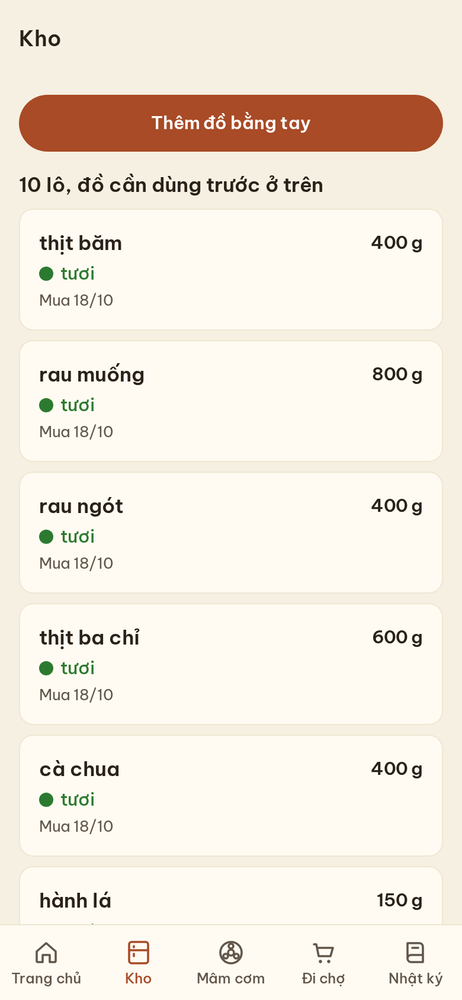

Màn quét cần hiển thị trạng thái rõ; màn xác nhận cho sửa tên, số lượng, nguồn lô. Màn kho hiển thị lượng/ngày nhập/ưu tiên sử dụng bằng chữ, không chỉ chấm màu. Ảnh nghiệp vụ trong mục 2 lấy từ bộ ảnh kiểm thử có sẵn, không phải dữ liệu người dùng thật.

### 4.7.3. Gợi ý mâm, đổi món và đi chợ

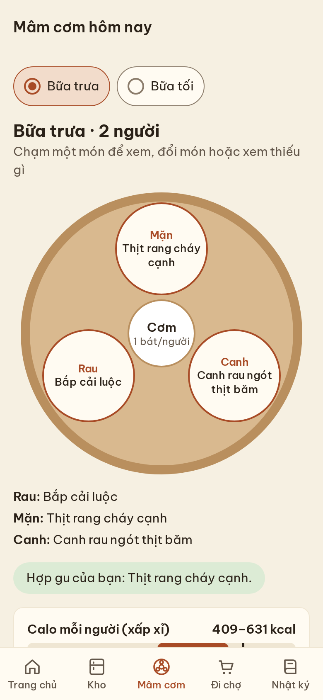

Thẻ món cần có vị trí, lượng/khẩu phần, lý do gợi ý và đường đi tới đổi món hoặc nguyên liệu thiếu. Khi không còn ứng viên thay thế, giữ mâm hiện tại và giải thích, không hiện nút có vẻ thao tác được nhưng không có kết quả.

### 4.7.4. Lịch nấu, hoàn tất, hoàn tác và nhật ký

Lịch cần thể hiện các bước có thể chờ và bước cần thao tác. Màn hoàn tất hiển thị đã trừ những lô nào và thời hạn hoàn tác. Nếu outbox đang chờ, trạng thái phải khác với “máy chủ đã xác nhận”.

### 4.7.5. Dữ liệu, mô hình và vận hành

Khảo sát có màn hình chọn/chấm món trong app/web. Các công việc vận hành dùng CLI/API và công cụ gán nhãn; không vẽ một trang quản trị chưa được xây dựng rồi gọi là “giao diện đã hoàn thành”. Khi nghiệm thu vận hành, cần bổ sung ảnh đầu ra CLI hoặc công cụ thật, che bí mật và ghi môi trường chạy.

# 5. HIỆN THỰC, KIỂM THỬ VÀ ĐỐI CHIẾU

Pha hiện thực ánh xạ thiết kế vào module, API, bảng và giao diện có trong dự án. Pha kiểm thử xác định liệu kết quả có đáp ứng đường cơ sở yêu cầu hay không. Báo cáo phân biệt việc đọc mã, kiểm tài liệu và chạy thử ứng dụng.

## 5.1. Truy vết yêu cầu – mô hình – thành phần

| Nhóm yêu cầu | UC | Hành vi / mô hình | Thành phần thực hiện | Dữ liệu | Ca cần chứng minh |
|---|---|---|---|---|---|
| F01–F03 | 01–11 | PK01–03, CL09 | identity/profile/privacy | users, consents, profiles | Truy cập chéo, thu hồi phiên, rút đồng ý |
| F04–F05 | 12–14 | PK04, AD01, CL13, DS02, SQ03, DM01, DB01/03 | scan, pantry, worker | scans, items, lots, transactions | Quét không đổi kho; xác nhận lặp |
| F06–F08 | 15–18 | PK05, UC02, AD02, CL15, DS03, DM02, DB02 | meal, substitute | plans, items, substitutions | Vượt kho tổng; dị ứng; đổi món bất khả thi |
| F09–F11 | 19–22 | PK06, AD03, CL20, SQ01/02, DS01 | cooking, pantry, journal | sessions, transactions | Retry; rollback; hoàn tác đúng hạn/quá hạn |
| F12 | 23–34 | PK07–10, CL30 | survey, catalog, mlops, admin, jobs | model_versions, surveys, audit | Phân quyền, version mismatch, restore |

## 5.2. Đối chiếu thiết kế với hiện trạng mã nguồn

| Nội dung | Nguồn cũ / nhận định dễ sai | Hiện trạng cần dùng |
|---|---|---|
| Địa chỉ công khai | Báo cáo cũ ghi safework.ctslab.net | Tastoria dùng tastoria.ctslab.net |
| Độ tươi từ ảnh | UC12 có bước suy luận độ tươi | Worker chưa có freshness model triển khai; coi là khả năng thiết kế |
| Complete lặp | Sequence cũ coi completed luôn lỗi | Service hiện trả tóm tắt completed, không trừ lặp |
| Thời hạn hoàn tác | Dễ lấy completed_at client làm mốc | Dùng thời điểm máy chủ ghi hoàn tất |
| Bảng công thức/nguyên liệu | Dễ mặc định ID là bigint | DDL dùng uuid; pantry_transactions.id mới là bigint |
| Số dòng món/mâm | Dễ gán bảng items chỉ có 2–3 dòng | Lịch sử thay món có thể nhiều dòng; 2–3 là số món active ở miền rút gọn |
| NFR và kết quả | Có mục tiêu p95/SUS nên ghi “đạt” | Phải có log đo/phiếu thử tương ứng mới kết luận |
| Người thực hiện | Có tác giả báo cáo cũ nên gán toàn nhóm | Chờ danh sách và phân công thực tế |

## 5.3. Thiết kế kiểm thử và tiêu chí nghiệm thu

Bảng sau là các ca nghiệm thu đề xuất từ phân tích, chưa phải biên bản đã chạy. Mỗi ca cần lưu phiên bản mã, dữ liệu đầu vào, phản hồi API và trạng thái DB trước–sau. Chỉ kiểm thông báo giao diện là chưa đủ để chứng minh toàn vẹn.

| Mã | UC / quy tắc | Thiết lập và kích hoạt | Kết quả mong đợi |
|---|---|---|---|
| TC01 | UC13, xác nhận một lần | Hai yêu cầu đồng thời cho cùng scan done | Một lần áp dụng kho; request sau nhận trạng thái đã xác nhận |
| TC02 | UC13, nhập liệu hợp lệ | Thiếu mức lượng của nguyên liệu cần ước lượng | Báo lỗi đúng mục; không tạo lô hoặc confirmed |
| TC03 | UC15, lượng chung | Hai món cùng dùng nguyên liệu, tổng vượt tồn | Không trả tổ hợp đó như mâm khả thi |
| TC04 | UC16, kiểm lại mâm | Đổi món làm tăng tổng nhu cầu hoặc vi phạm dị ứng | Loại ứng viên không hợp lệ; giữ phần mâm cũ nếu không tìm được |
| TC05 | UC19, tài nguyên | Các bước cạnh tranh một bếp và thao tác chủ động | Không vượt số bếp; thứ tự công việc được giữ |
| TC06 | UC20, lũy đẳng | Gửi lại cùng Idempotency-Key sau thành công | Phản hồi đã lưu; số giao dịch trừ không tăng |
| TC07 | UC20, bảo vệ trạng thái | Gửi complete với khóa mới cho phiên completed | Trả tóm tắt hiện có; không trừ kho lần hai |
| TC08 | UC20, nguyên tử | Gây lỗi sau ghi kho nhưng trước hoàn tất giao dịch | Rollback mọi thay đổi trong giao dịch |
| TC09 | UC21, thời hạn | Hoàn tác trước, tại và sau hạn máy chủ | Cho phép đúng biên quy định; quá hạn giữ nguyên dữ liệu |
| TC10 | UC21, đảo một lần | Gửi lại undo cho phiên reverted | Không có giao dịch đảo thứ hai |
| TC11 | Quyền sở hữu | Người B đọc/sửa scan, lô hoặc phiên của A | Không lộ hoặc sửa dữ liệu của A |
| TC12 | UC30, phiên bản | Artifact/ánh xạ lớp không phù hợp worker | Không coi phiên bản đó là triển khai thành công |

Với TC09, mã hiện tại từ chối khi now lớn hơn completed_at cộng thời hạn; vì vậy trường hợp bằng đúng hạn cần có ca riêng thay vì chỉ thử trước/sau bằng phút. Với TC08, lỗi phải được đưa vào môi trường thử riêng; không dùng dữ liệu đang vận hành để tạo lỗi có chủ ý.

## 5.4. Kết quả kiểm tra tài liệu và giới hạn bằng chứng

Bộ tài liệu được kiểm ở các mức: số UC và phân hệ; đường dẫn ảnh; xuất mô hình bằng Visual Paradigm; bố cục SVG; nhãn bị rút gọn; dẫn chiếu hình/bảng; chữ ngoài vùng trang PDF. Nhật ký được lưu trong thư mục evidence. Việc kiểm tài liệu không thay thế các ca chức năng ở mục 5.3, đánh giá thuật toán với người dùng hay đo NFR trên môi trường triển khai.

Bài tiểu luận PTTKHT và bài thiết kế V2 được dùng làm mẫu phương pháp: trình bày bối cảnh trước yêu cầu, phân tích trách nhiệm trước lớp thiết kế, giải thích quan hệ và nối mô hình với dữ liệu/mã. Nội dung miền SafeWork hoặc ABC Online Shop không được chuyển sang Tastoria. Báo cáo tổ chức nội dung theo pha; phân công được ghi ở trang đầu.

## 5.5. Điều kiện nghiệm thu ứng dụng

Để kết luận ứng dụng đạt yêu cầu, cần chạy các ca ở mục 5.3 trên môi trường xác định, lưu đầu vào/đầu ra và kiểm trạng thái DB. NFR cần có cấu hình đo và báo cáo tương ứng; các mục tiêu p95 hoặc SUS ở Chương 2 chưa phải kết quả. Đối với mô hình ảnh, phải đánh giá đúng artifact và tập dữ liệu, tách khỏi việc kiểm tính nguyên tử của thao tác xác nhận. Đối với vận hành, cần bằng chứng tải artifact, kiểm quyền và diễn tập khôi phục, không chỉ log tạo tệp sao lưu.

# 6. ĐÁNH GIÁ VÀ HƯỚNG PHÁT TRIỂN

Phần đánh giá tổng hợp quyết định của các pha trước, chỉ rõ nội dung mới, khó và các giới hạn còn cần kiểm chứng.

## 6.1. Nội dung mới của đề tài

- Quyết định ở cấp mâm với kho dùng chung giữa các món, thay vì trả danh sách món độc lập.
- Đưa người dùng vào bước xác nhận nhận diện, kết hợp quét ảnh với kho theo lô.
- Kết nối lịch nấu và biến động kho bằng giao dịch có hoàn tác.
- Xếp hạng có thể cá nhân hóa nhưng luôn đứng sau lọc ràng buộc bắt buộc.
- Một nguồn giao diện Android/web, nội dung giới thiệu công khai tách khỏi vùng dữ liệu cá nhân.

Các điểm trên là đóng góp tích hợp của bài tập, không được tuyên bố là phát minh thuật toán mới trên thế giới.

## 6.2. Nội dung khó và cách giải quyết

| Khó khăn | Nguyên nhân | Giải pháp và giới hạn |
|---|---|---|
| Ảnh tủ lạnh khó nhận diện | Che khuất, nhiều lớp, ánh sáng và bao bì | Mô hình nhận diện + bước sửa kết quả; cần test ảnh thực tế của miền triển khai |
| Lượng nguyên liệu không chắc chắn | Ảnh không đo chính xác khối lượng | Kho lưu khoảng, kiểm khả thi bằng cận dưới; người dùng hiệu chỉnh |
| Tổ hợp mâm tăng nhanh | Nhiều ứng viên, ràng buộc chéo | Lọc trước, thu hẹp ứng viên và kiểm ràng buộc toàn mâm; cần đánh giá trade-off |
| Lịch nấu nhiều nguồn lực | Một người, nhiều bếp, bước chờ/đảo/xào | CP-SAT; báo relaxed/fallback thay vì che việc nới điều kiện |
| Request lặp và hai thiết bị | Mất phản hồi, retry đồng thời | Idempotency, khóa phiên, UnitOfWork, giao dịch đảo |
| Dữ liệu riêng tư qua nhiều quy trình | Ảnh, hồ sơ, tương tác và tập huấn luyện liên quan | Đồng ý theo mục đích, tách quyền tải tệp, xuất/xóa và kiểm toán |
| Đồng bộ phân tích với mã nguồn | Đặc tả và triển khai thay đổi khác thời điểm | Ma trận truy vết, bảng khác biệt, phiên bản nguồn |

## 6.3. Hướng phát triển chung

Ưu tiên trước mắt là thu thập bộ ảnh thực tế có đồng ý, đánh giá nhận diện theo từng lớp và sai sót ảnh hưởng nhập kho; kiểm thử tải đúng môi trường SRS; thử tác vụ với người dùng; diễn tập khôi phục dữ liệu. Sau khi có số đo mới cân nhắc phân loại độ tươi, quản lý hộ nhiều người, thực đơn tuần, thông báo, tối ưu nhiều mục tiêu và phát hành nền tảng khác. Không gộp các mục này vào kết quả đã hoàn thành.

## 6.4. Hướng phát triển theo chức năng

Các định hướng dưới đây là công việc tương lai, không gộp vào kết quả đã đạt.

### 6.4.1. Tài khoản, hồ sơ và quyền dữ liệu

Kiểm thử đồng thời xoay refresh token, nghiên cứu khả dụng của luồng đồng ý, hỗ trợ khôi phục tài khoản và quản lý thiết bị rõ hơn. Cần xác nhận yêu cầu pháp lý riêng trước khi khẳng định tuân thủ đầy đủ.

### 6.4.2. Quét ảnh và quản lý kho theo lô

Đánh giá đếm trùng qua nhiều ảnh, bổ sung lớp nguyên liệu Việt còn thiếu, dữ liệu bao bì/che khuất và trải nghiệm sửa nhanh; chỉ bật mô hình mới sau đánh giá độc lập.

### 6.4.3. Gợi ý mâm, đổi món và đi chợ

Đánh giá chất lượng mâm với người nấu thực, độ đa dạng qua nhiều ngày, tác động của thu hẹp ứng viên, mô hình gu khi dữ liệu ít và giải thích rõ nguyên nhân không có lời giải.

### 6.4.4. Lịch nấu, hoàn tất, hoàn tác và nhật ký

Đánh giá lịch với người thật, đồng hồ nấu nền và thông báo, giải quyết xung đột nhiều thiết bị. Tăng độ tin cậy cần test lỗi giữa giao dịch, không chỉ luồng thành công.

### 6.4.5. Dữ liệu, mô hình và vận hành

Tự động kiểm chất lượng dữ liệu, đánh giá drift, cảnh báo job, thử restore và quy trình duyệt mô hình trước triển khai. Chốt benchmark riêng cho mỗi mô hình và tập dữ liệu, không dùng độ chính xác của bộ khác để điền báo cáo.

# TÀI LIỆU THAM KHẢO

- [L1] Bộ slide INFOR-SYSTEM-ANAL-DESIGN, 5 tập trong `SLIDE-INFOR-SYSTEM-ANAL-DESIGN.rar`; đặc biệt slide 04 về miền phân tích và slide 05 về chuyển sang thiết kế.
- [L2] “TỪ PHÂN TÍCH ĐẾN THIẾT KẾ”, phụ lục môn PTTKHT, HK1 2023–2024; ví dụ thêm phương thức, DAO và phân tầng MVC.
- [L3] Karl Wiegers, Joy Beatty, *Software Requirements*, 3rd edition; bản trong TAILIEU.rar. Dùng các nguyên tắc yêu cầu kiểm chứng được và truy vết, không sao chép nội dung sách.
- [L4] Alan Dennis, Barbara Haley Wixom, David Tegarden, *Systems Analysis & Design: An Object-Oriented Approach with UML*, 5th edition; bản trong TAILIEU.rar.
- [R1] Tastoria: `docs/sad/model.yaml`, `01-SRS.md`, `use-cases/UC01.md` … `UC34.md`.
- [R2] Tastoria: `db/schema.sql`, migrations và models tương ứng.
- [R3] Tastoria: `backend/src/tastoria/modules/{scan,meal,cooking,pantry,privacy}`, `core/db.py`, `core/idempotency.py`.
- [R4] Tastoria: `app/src`, `app/docs/screenshots`, `deploy/FRONTEND-CD.md`, `.github/workflows/frontend.yml`.
- [L5] Bài tiểu luận tham khảo `PTTKHT/TieuLuan/main.pdf` (SafeWork, 106 trang): cấu trúc xác định yêu cầu và phân tích theo UC.
- [L6] Bài thiết kế tham khảo `PTTKHT/Design_04_04_NamNT_299.pdf` (51 trang): chuyển từ phân tích sang thiết kế, phân tầng và liên hệ mã nguồn.
- [G1] Generator Visual Paradigm mới: `PTTKHT/DesignV2/vp/{gen_design.py,spec_lib.py,gen_beh.py,check_svg.py}` và plugin `~/opt/vp/tools/pttkht-uml-plugin`.
- [W1] [Samsung Food](https://samsungfood.com/), truy cập 31/10/2026.
- [W2] [Samsung Food+](https://samsungfood.com/food-plus/), truy cập 31/10/2026.
- [W3] [SuperCook](https://www.supercook.com/), truy cập 31/10/2026.
- [W4] [Cookpad Việt Nam — công cụ hỗ trợ viết công thức](https://blog.cookpad.com/vn/tinh-nang-tro-ly-ai-viet-cong-thuc-nhanh-hon/), truy cập 31/10/2026.
