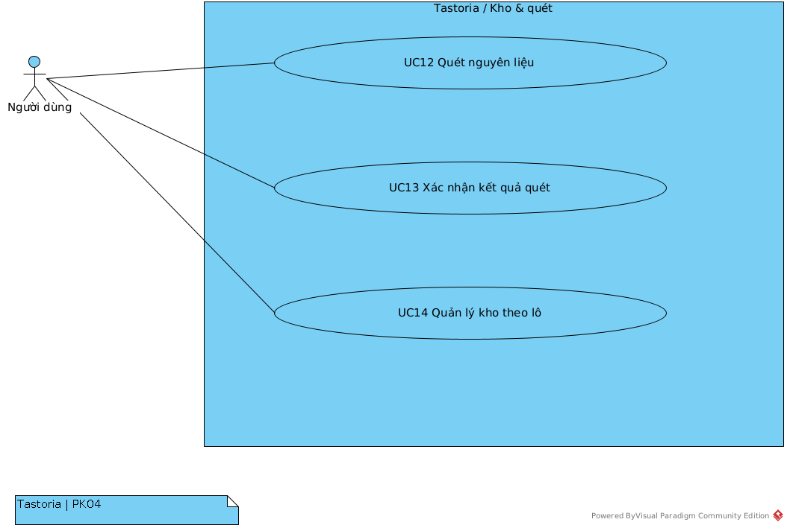
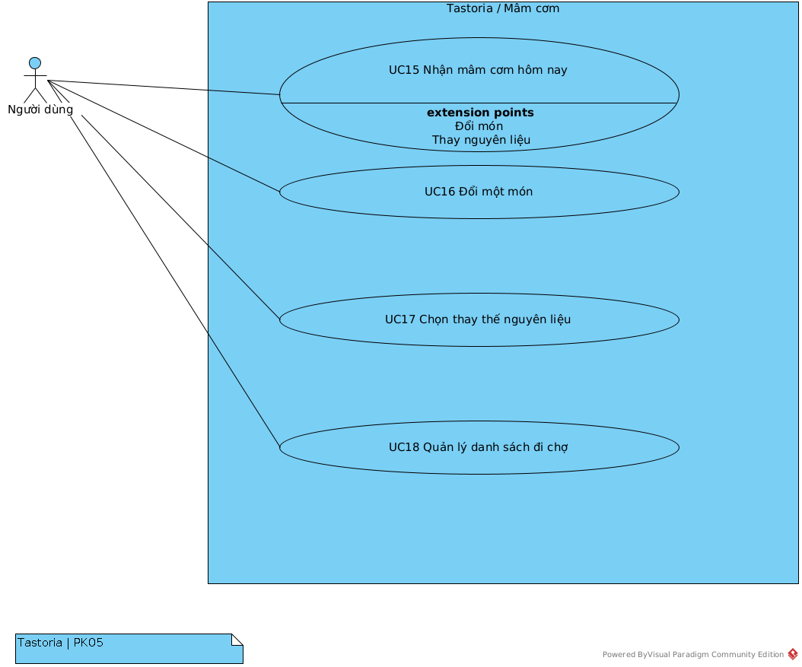
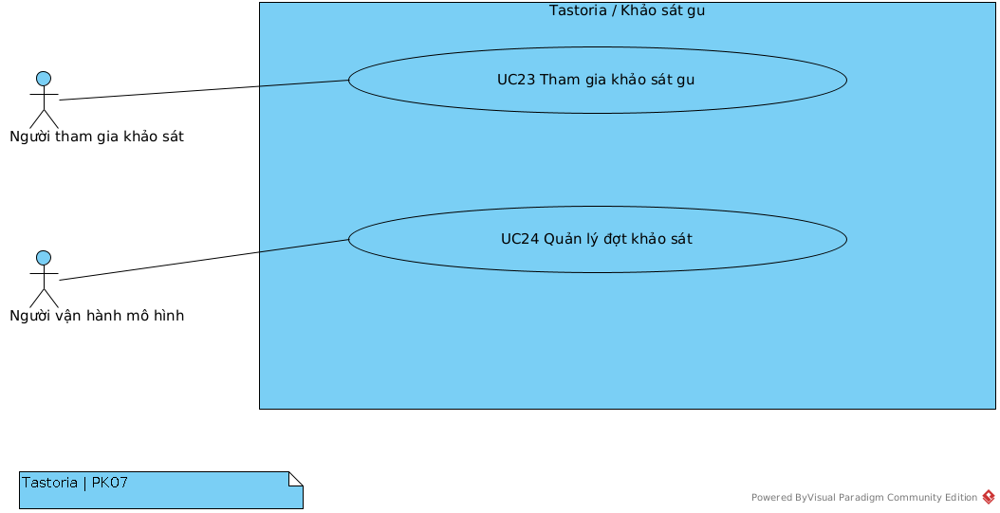
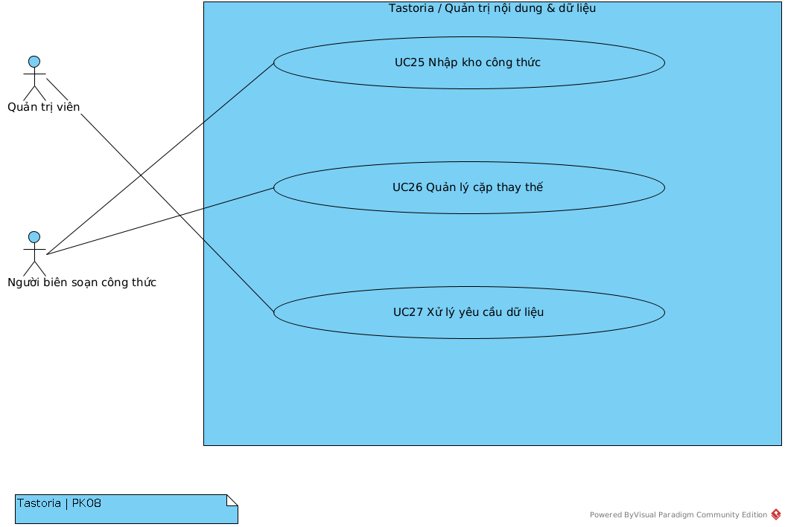
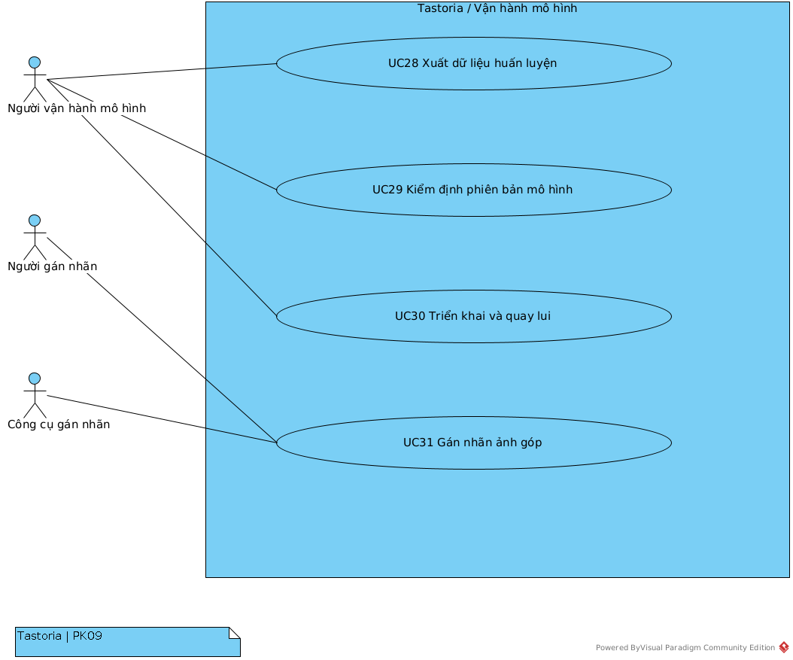

# PHỤ LỤC A — PHÂN RÃ VÀ ĐẶC TẢ 34 USE CASE

Bản biên tập theo bộ đặc tả Tastoria và đối chiếu ngày 31/10/2026. Mỗi UC có định danh, vai trò, tiền điều kiện, bảo đảm tối thiểu/thành công, kích hoạt, luồng chính và luồng thay thế. Các chỉ tiêu định lượng là yêu cầu, không phải kết quả thử. Ghi chú cập nhật của báo cáo ưu tiên hơn mô tả kế thừa khi có khác biệt. Mã FR/BR giữ nguyên để đối chiếu nguồn.

# PK1 — Tài khoản & bảo mật

## UC01 — Đăng ký tài khoản

### 1. Mục tiêu trong ngữ cảnh

Khách (A01) tạo tài khoản bằng email và mật khẩu để dùng các chức năng cần đăng nhập (hồ sơ, kho, mâm cơm). Sau khi đăng ký, người đó trở thành Người dùng (A02) và được chuyển sang thiết lập hồ sơ (UC09).

### 2. Phạm vi và mức

- Phạm vi: hệ thống Tastoria (app Android/web + backend), module `identity` (M02).
- Mức: mục tiêu người dùng (user goal), một phiên làm việc dưới 1 phút.
- Không thuộc UC này: thu đồng ý theo mục đích (thuộc UC05, được sử dụng có điều kiện trong UC09), nhập hồ sơ (UC09).

### 3. Tác nhân và bên liên quan (quyền lợi)

| Tác nhân / bên liên quan | Quyền lợi |
|---|---|
| A01 Khách (chính) | Tạo tài khoản nhanh, không bị hỏi dữ liệu chưa cần; biết ngay nếu email đã dùng. |
| Nhóm vận hành Tastoria | Mỗi email đúng một tài khoản; mật khẩu không bao giờ lưu dạng rõ. |
| Chủ thể dữ liệu (chính A01) | Không có đồng ý nào bị ghi thay mình trong lúc đăng ký (BR-CONSENT-01). |

### 4. Tiền điều kiện

- Khách chưa đăng nhập trên thiết bị.
- App kết nối được tới `/api/v1`.

### 5. Đảm bảo tối thiểu

- Không có tài khoản dở dang: hoặc có đủ bản ghi `users` (và token nếu cấp), hoặc không có gì.
- Mật khẩu không xuất hiện dạng rõ trong CSDL, log hay phản hồi.
- Không có bản ghi `consent_events` nào được tạo.

### 6. Đảm bảo khi thành công

- Có một dòng `users` mới: `role = user`, `status = active`, `token_version = 0`, `failed_logins = 0`, `password_hash` dạng Argon2id.
- App nhận access token và refresh token của phiên đầu tiên (một `refresh_tokens` mới với `family_id` mới) và chuyển sang UC09.

### 7. Kích hoạt

Khách chọn "Đăng ký" trên màn Đăng ký/Đăng nhập.

### 8. Kịch bản chính

1. A01 mở màn Đăng ký, nhập email và mật khẩu (ô mật khẩu có nút hiện/ẩn).
2. App kiểm tra cú pháp email và độ dài mật khẩu phía client, rồi gửi `POST /auth/register`.
3. Module `identity` chuẩn hoá email (cắt khoảng trắng; so khớp không phân biệt hoa thường nhờ kiểu `citext`) và kiểm tra chính sách mật khẩu.
4. Module `identity` băm mật khẩu bằng Argon2id (`pwdlib`).
5. Module `identity` mở một giao dịch (Unit of Work của `core`), ghi `users`, tạo refresh token ngẫu nhiên, lưu `token_sha256` vào `refresh_tokens` với `family_id` mới, `expires_at = issued_at + 30 ngày`, rồi commit.
6. Module `identity` ký access JWT 15 phút (có `kid`, mang `token_version`) và trả 201 kèm hai token.
7. App lưu token vào secure-store và chuyển sang màn Hồ sơ 60 giây (UC09).

### 9. Mở rộng

- **2a. Email sai cú pháp hoặc mật khẩu ngắn (kiểm phía client):** app đánh dấu ô lỗi bằng chữ, không gửi yêu cầu; quay lại bước 1.
- **3a. Email sai cú pháp (kiểm phía server):** `identity` trả 422 `application/problem+json`, `code = invalid_email`; không ghi gì; app hiện lỗi tại ô email.
- **3b. Mật khẩu không đạt chính sách:** trả 422, `code = weak_password`, kèm độ dài tối thiểu; không ghi gì.
- **5a. Email đã có tài khoản:** ràng buộc UQ trên `users.email` từ chối; giao dịch rollback; trả 409, `code = email_taken`. App đề nghị đăng nhập (UC02) hoặc đặt lại mật khẩu (UC04), email điền sẵn.
- **5b. Hai yêu cầu đăng ký đồng thời cùng email:** ràng buộc UQ bảo đảm đúng một yêu cầu thành công; yêu cầu còn lại đi theo 5a.
- **5c. Lỗi CSDL hoặc lỗi hệ thống:** giao dịch rollback; trả 500/503 problem+json có `request_id`; không có tài khoản dở dang. App cho thử lại.
- **\*a. Mất mạng hoặc quá thời gian chờ phản hồi:** `POST /auth/register` không lũy đẳng. App gửi lại cùng email và mật khẩu. Nếu lần trước đã thành công, lần gửi lại nhận 409 `email_taken` (5a); app khi đó tự gọi đăng nhập (UC02) với thông tin vừa nhập, nên kết quả cuối cùng vẫn là một tài khoản và một phiên.
- **\*b. Thiếu đồng ý:** không áp dụng ở UC này. Đăng ký không yêu cầu và không ghi đồng ý; đồng ý theo mục đích thu ở UC09 theo lựa chọn đồng ý từng mục đích.
- **\*c. Không khả thi:** không có nhánh không khả thi về nghiệp vụ.

### Ghi chú đối chiếu của báo cáo

Giữ phạm vi yêu cầu của đặc tả nguồn; cần kiểm thử theo môi trường và phiên bản thực tế trước khi ghi kết quả nghiệm thu.

**Nguồn:** `Tastoria/docs/sad/use-cases/UC01.md`. Mã nghiệp vụ: BR-CONSENT-01.

**Dữ liệu liên quan:** `users`, `refresh_tokens`, `consent_events`.

**Điểm giao tiếp:** `POST /auth/register`.

## UC02 — Đăng nhập

### 1. Mục tiêu trong ngữ cảnh

Khách (A01) có tài khoản đăng nhập bằng email và mật khẩu để nhận phiên làm việc. UC này gồm cả làm mới phiên bằng refresh token (app tự gọi khi access token hết hạn) và khoá tạm khi nhập sai 5 lần (NFR-SEC-02).

### 2. Phạm vi và mức

- Phạm vi: hệ thống Tastoria, hộp đen.
- Mức: mục tiêu con (subfunction). Đăng nhập không mang giá trị tự thân cho A01; nó phục vụ mọi UC cần tài khoản (quy tắc gán mức ở SRS §2.2). Làm mới phiên là luồng phụ R của cùng UC, không phải kịch bản chính thứ hai.

### 3. Tác nhân và bên liên quan (quyền lợi)

| Tác nhân / bên liên quan | Quyền lợi |
|---|---|
| A01 Khách (chính) | Vào app nhanh, không phải đăng nhập lại mỗi 15 phút; biết vì sao bị từ chối và bao lâu thì thử lại được. |
| A02 Người dùng (chủ tài khoản) | Tài khoản không bị dò mật khẩu; token bị đánh cắp và dùng lại thì cả chuỗi bị thu hồi. |
| Nhóm vận hành | Không lộ việc một email có tài khoản hay không qua thông báo lỗi. |

### 4. Tiền điều kiện

- Đã có tài khoản (UC01) với `status = active`.
- Với làm mới phiên: app đang giữ một refresh token trong secure-store.

### 5. Đảm bảo tối thiểu

- Không cấp token khi chưa xác thực đúng.
- Mỗi lần đăng nhập sai được tính vào bộ đếm theo cặp (email, IP).
- Refresh token chỉ lưu ở dạng băm SHA-256.

### 6. Đảm bảo khi thành công

- App có access JWT 15 phút (có `kid`, mang `token_version` hiện hành) và refresh token 30 ngày.
- Bộ đếm sai của cặp (email, IP) về 0.
- Khi làm mới: token cũ có `revoked_at` và `replaced_by_id` trỏ token mới cùng `family_id`.

### 7. Kích hoạt

A01 bấm "Đăng nhập" trên màn Đăng ký/Đăng nhập. Luồng phụ R (làm mới phiên) do app tự kích hoạt khi nhận 401 vì access token hết hạn, hoặc khi access token sắp hết hạn.

### 8. Kịch bản chính

Kịch bản viết ở mức tác nhân ↔ hệ thống; cách lưu bộ đếm (Valkey) và token (`refresh_tokens`) ở mục 13 và `docs/uml/sequence/SD08-lam-moi-token.puml`.

1. A01 nhập email và mật khẩu, bấm "Đăng nhập".
2. App gửi `POST /auth/login`.
3. Hệ thống kiểm cặp (email, IP) không bị khoá đăng nhập. Bộ đếm theo cặp (email, IP) là nguồn duy nhất quyết định khoá (FR-02-03, FR-02-04); `users.failed_logins` và `users.locked_until` chỉ phản ánh lần khoá gần nhất để hiển thị và kiểm toán, không dùng để từ chối đăng nhập.
4. Hệ thống tìm tài khoản theo email (không phân biệt hoa thường) và kiểm mật khẩu.
5. Hệ thống kiểm tài khoản đang `active`.
6. Hệ thống đặt lại bộ đếm sai của cặp (email, IP), mở một phiên mới (refresh token 30 ngày thuộc một family mới).
7. Hệ thống trả 200 kèm access JWT 15 phút và refresh token.
8. App lưu token vào secure-store và mở Trang chủ (hoặc Hồ sơ 60 giây nếu hồ sơ chưa xong).

**Luồng phụ R — làm mới phiên** (app tự chạy, không cần A01 thao tác):

- R1. App gửi `POST /auth/refresh` kèm refresh token.
- R2. Hệ thống kiểm refresh token tồn tại, chưa thu hồi, chưa hết hạn và tài khoản đang `active`.
- R3. Hệ thống xoay vòng trong một giao dịch: thu hồi token cũ, cấp token mới cùng family (FR-02-06).
- R4. Hệ thống trả 200 kèm access JWT mới (mang `token_version` hiện hành) và refresh token mới; app thay token trong secure-store.

### 9. Mở rộng

- **2a. Mất mạng hoặc quá thời gian khi đăng nhập:** app gửi lại `POST /auth/login`. Lần gửi lại tạo thêm một family mới; family của lần trước không có client giữ và hết hạn sau 30 ngày rồi được UC34 dọn.
- **3a. Cặp (email, IP) đang bị khoá:** trả 429 `code = login_locked` với `Retry-After`, không kiểm mật khẩu, kể cả khi mật khẩu đúng. App hiện thời gian còn lại bằng chữ.
- **3b. Valkey không sẵn sàng:** hệ thống không đọc được bộ đếm nên từ chối đăng nhập, trả 503 `code = service_unavailable` (đóng an toàn); làm mới phiên không phụ thuộc Valkey nên vẫn chạy.
- **4a. Email không tồn tại hoặc mật khẩu sai:** hệ thống tăng bộ đếm (email, IP) và `users.failed_logins` (nếu email tồn tại); trả 401 `code = invalid_credentials`, cùng một thông điệp cho cả hai trường hợp. App cho nhập lại và hiện liên kết "Quên mật khẩu" (UC04).
- **4b. Lần sai thứ 5 của cặp (email, IP):** hệ thống khoá cặp này 15 phút, ghi `users.locked_until = now() + 15 phút` để hiển thị (đăng nhập từ IP khác không bị cặp này chặn); trả 429 `code = login_locked` với `Retry-After` (giây còn lại).
- **5a. Tài khoản `status = deletion_requested`:** trả 403 `code = account_deletion_pending`; không cấp token. App báo yêu cầu xoá đang xử lý (UC07).
- **R2a. Refresh token không tồn tại hoặc đã hết hạn:** trả 401 `code = refresh_invalid`; app xoá token cục bộ và quay về bước 1.
- **R2b. Refresh token đã bị thu hồi được dùng lại:** hệ thống coi là dấu hiệu token bị lộ, thu hồi mọi token chưa thu hồi cùng `family_id`; trả 401 `code = refresh_reused`. App xoá token và về bước 1.
- **R2c. Tài khoản `status = deletion_requested`:** trả 403 `code = account_deletion_pending` (như 5a).
- **R4a. Mất mạng sau khi server đã xoay vòng nhưng app chưa nhận phản hồi:** `POST /auth/refresh` không lũy đẳng. App gửi lại token cũ, token này đã bị thu hồi nên rơi vào R2b, cả family bị thu hồi và người dùng phải đăng nhập lại. Đây là đánh đổi có chủ đích để phát hiện token bị đánh cắp (xem câu hỏi mở 2).
- **\*a. Lỗi CSDL hoặc lỗi hệ thống:** giao dịch rollback, trả 5xx có `request_id`; không có token mới nào hợp lệ.
- **\*b. Thiếu đồng ý / không khả thi:** không áp dụng; đăng nhập không phụ thuộc đồng ý.

### Ghi chú đối chiếu của báo cáo

Giữ phạm vi yêu cầu của đặc tả nguồn; cần kiểm thử theo môi trường và phiên bản thực tế trước khi ghi kết quả nghiệm thu.

**Nguồn:** `Tastoria/docs/sad/use-cases/UC02.md`. Mã nghiệp vụ: .

**Dữ liệu liên quan:** `users`, `refresh_tokens`.

**Điểm giao tiếp:** `POST /auth/login`; `POST /auth/refresh`.

## UC03 — Đăng xuất (một hoặc mọi thiết bị)

### 1. Mục tiêu trong ngữ cảnh

Người dùng (A02) kết thúc phiên trên thiết bị đang dùng, hoặc kết thúc mọi phiên trên mọi thiết bị (ví dụ khi mất điện thoại). Sau khi đăng xuất, token của các phiên bị kết thúc không dùng được nữa.

### 2. Phạm vi và mức

- Phạm vi: hệ thống Tastoria, module `identity` (M02).
- Mức: mục tiêu người dùng, một thao tác.

### 3. Tác nhân và bên liên quan (quyền lợi)

| Tác nhân / bên liên quan | Quyền lợi |
|---|---|
| A02 Người dùng (chính) | Chắc chắn thiết bị bị mất hoặc dùng chung không còn vào được tài khoản. |
| Nhóm vận hành | Thu hồi có hiệu lực ngay, không phải chờ token hết hạn tự nhiên. |

### 4. Tiền điều kiện

- A02 đang đăng nhập, app giữ access token và refresh token.

### 5. Đảm bảo tối thiểu

- App xoá token khỏi secure-store của thiết bị, kể cả khi không gọi được server.
- Trạng thái token ở server chỉ chuyển theo một chiều: chưa thu hồi → đã thu hồi.

### 6. Đảm bảo khi thành công

- Đăng xuất một thiết bị: mọi refresh token chưa thu hồi thuộc `family_id` của thiết bị đó có `revoked_at`.
- Đăng xuất mọi thiết bị: `users.token_version` tăng 1 và mọi refresh token chưa thu hồi của người dùng có `revoked_at`; mọi access token cũ bị từ chối ở yêu cầu kế tiếp.

### 7. Kích hoạt

A02 chọn "Đăng xuất" hoặc "Đăng xuất mọi thiết bị" ở màn Cài đặt.

### 8. Kịch bản chính

1. A02 chọn "Đăng xuất" (luồng A) hoặc "Đăng xuất mọi thiết bị" (luồng B) ở màn Cài đặt; với luồng B, app hỏi xác nhận.
2. Luồng A: app gửi `POST /auth/logout` kèm access token và refresh token của thiết bị.
3. Luồng A: module `identity` băm refresh token, tìm `family_id` của nó (phải thuộc chính người dùng của access token), đặt `revoked_at = now()` cho mọi token chưa thu hồi của family đó; trả 204.
4. Luồng B: app gửi `POST /auth/logout-all` kèm access token.
5. Luồng B: module `identity`, trong một giao dịch, tăng `users.token_version` thêm 1 và đặt `revoked_at = now()` cho mọi `refresh_tokens` chưa thu hồi của người dùng; trả 204.
6. App xoá token khỏi secure-store, xoá dữ liệu phiên trong bộ nhớ và chuyển về màn Đăng ký/Đăng nhập.

### 9. Mở rộng

- **2a. Access token đã hết hạn:** app gọi làm mới (UC02) rồi gửi lại; nếu làm mới thất bại, app vẫn làm bước 6 vì phiên đã mất.
- **3a. Refresh token đã bị thu hồi từ trước (gửi lại do mất mạng, hoặc đã đăng xuất ở luồng B):** `identity` trả 204, không ghi thêm gì và không kích hoạt thu hồi do dùng lại (khác với UC02 mở rộng R2b).
- **3b. Refresh token không thuộc người dùng của access token hoặc không tồn tại:** trả 204 nhưng không thu hồi gì của người khác; không lộ thông tin token có tồn tại hay không.
- **5a. Mất mạng sau khi server đã xử lý luồng B:** app gửi lại với access token cũ; token này đã bị từ chối do `token_version` tăng nên trả 401 `code = token_revoked`. App coi 204 và 401 đều là "đã đăng xuất" và làm bước 6.
- **\*a. Mất mạng hoặc quá thời gian, không gọi được server:** app vẫn làm bước 6 ngay; refresh token được giữ trong mục "chờ thu hồi" của secure-store và app gửi lại `POST /auth/logout` khi có mạng (cả hai endpoint đều lũy đẳng nên gửi lại an toàn). Luồng B không thể hoàn tất khi offline; app báo bằng chữ "chưa đăng xuất được các thiết bị khác, sẽ thử lại khi có mạng".
- **\*b. Lỗi CSDL hoặc lỗi hệ thống:** giao dịch rollback, trả 5xx; app xử lý như \*a.
- **\*c. Thiếu đồng ý / không khả thi:** không áp dụng.

### Ghi chú đối chiếu của báo cáo

Giữ phạm vi yêu cầu của đặc tả nguồn; cần kiểm thử theo môi trường và phiên bản thực tế trước khi ghi kết quả nghiệm thu.

**Nguồn:** `Tastoria/docs/sad/use-cases/UC03.md`. Mã nghiệp vụ: .

**Dữ liệu liên quan:** `users`, `refresh_tokens`.

**Điểm giao tiếp:** `POST /auth/logout`; `POST /auth/logout-all`.

## UC04 — Đặt lại mật khẩu

### 1. Mục tiêu trong ngữ cảnh

Khách (A01) quên mật khẩu yêu cầu một liên kết đặt lại gửi tới email đã đăng ký, rồi đặt mật khẩu mới. Sau khi đặt lại, mọi phiên cũ bị kết thúc.

### 2. Phạm vi và mức

- Phạm vi: hệ thống Tastoria, module `identity` (M02); gửi thư qua Dịch vụ email (A09: SMTP, môi trường dev dùng Mailpit).
- Mức: mục tiêu người dùng, hai phiên ngắn (yêu cầu, rồi mở thư và đặt mật khẩu).

### 3. Tác nhân và bên liên quan (quyền lợi)

| Tác nhân / bên liên quan | Quyền lợi |
|---|---|
| A01 Khách (chính) | Lấy lại quyền vào tài khoản mà không cần liên hệ ai. |
| A09 Dịch vụ email (phụ) | Nhận yêu cầu gửi thư hợp lệ, không bị dùng để gửi thư rác hàng loạt. |
| Chủ tài khoản (A02) | Người khác không chiếm được tài khoản bằng luồng này; không ai dò được email nào có tài khoản. |

### 4. Tiền điều kiện

- A01 không đăng nhập được và có quyền đọc hộp thư của email đã đăng ký.
- Cấu hình SMTP của A09 đã đặt.

### 5. Đảm bảo tối thiểu

- Phản hồi của bước yêu cầu không cho biết email có tài khoản hay không.
- Token đặt lại chỉ lưu dạng SHA-256, dùng tối đa một lần, có hạn.
- Mật khẩu cũ vẫn dùng được cho đến khi xác nhận thành công.

### 6. Đảm bảo khi thành công

- `users.password_hash` là băm Argon2id của mật khẩu mới.
- Dòng `password_resets` đã dùng có `used_at`.
- `users.token_version` tăng 1, mọi refresh token của người dùng bị thu hồi, trạng thái khoá đăng nhập được xoá.

### 7. Kích hoạt

A01 chọn "Quên mật khẩu" ở màn Đăng ký/Đăng nhập.

### 8. Kịch bản chính

1. A01 nhập email ở màn Quên mật khẩu và bấm "Gửi liên kết".
2. App gửi `POST /auth/password-reset/request`.
3. Module `identity` tìm `users` theo email; tài khoản tồn tại với `status = active`.
4. Module `identity` sinh token ngẫu nhiên (CSPRNG), ghi `password_resets` với `token_sha256`, `created_at`, `expires_at = created_at + reset_token_ttl`.
5. Module `identity` xếp việc gửi thư vào hàng đợi worker rồi trả 202 với thông điệp chung "Nếu email đã đăng ký, thư sẽ tới trong vài phút".
6. Worker gửi thư qua A09; thư chứa liên kết mở màn Đặt mật khẩu mới với token.
7. A01 mở liên kết, nhập mật khẩu mới hai lần.
8. App gửi `POST /auth/password-reset/confirm` với token và mật khẩu mới.
9. Module `identity` băm token, tìm dòng `password_resets` khớp, chưa dùng, chưa hết hạn; kiểm chính sách mật khẩu như UC01.
10. Trong một giao dịch, `identity` ghi `password_hash` mới, đặt `used_at = now()`, tăng `token_version`, thu hồi mọi `refresh_tokens` chưa thu hồi, đặt `failed_logins = 0` và `locked_until = NULL`, xoá bộ đếm sai trong Valkey cho email đó.
11. Module `identity` trả 204; app báo thành công và mở màn Đăng nhập (UC02) với email điền sẵn.

### 9. Mở rộng

- **2a. Mất mạng khi gửi yêu cầu:** app gửi lại; `POST /auth/password-reset/request` lũy đẳng theo 4a nên không sinh thư trùng.
- **3a. Email không có tài khoản, hoặc tài khoản `status = deletion_requested`:** `identity` không ghi gì, không gửi thư, vẫn trả 202 với cùng thông điệp ở bước 5.
- **4a. Đã có token chưa dùng còn hạn tạo trong vòng `reset_resend_cooldown`:** `identity` không tạo token mới và không gửi thư mới; trả 202 như bước 5 (yêu cầu lũy đẳng, chống gửi thư dồn dập).
- **4b. Yêu cầu mới sau `reset_resend_cooldown`:** `identity` đặt `used_at = now()` cho các token cũ chưa dùng của người dùng rồi tạo token mới; chỉ liên kết mới nhất còn hiệu lực.
- **6a. A09 lỗi (SMTP từ chối, hết thời gian chờ):** worker thử lại theo chính sách thử lại của worker; hết lượt thì ghi log mức lỗi có `request_id`. Phản hồi bước 5 không đổi. A01 có thể yêu cầu lại sau `reset_resend_cooldown`.
- **7a. Hai ô mật khẩu không khớp:** app báo lỗi tại chỗ, không gửi yêu cầu.
- **9a. Token không khớp, đã dùng hoặc đã hết hạn:** trả 400 `code = reset_token_invalid`, một thông điệp chung cho cả ba trường hợp. App mời yêu cầu liên kết mới (quay lại bước 1).
- **9b. Mật khẩu mới không đạt chính sách:** trả 422 `code = weak_password`; token chưa bị tiêu; A01 nhập lại (bước 7).
- **11a. Mất mạng sau khi server đã xử lý bước 10:** app gửi lại confirm; token đã dùng nên nhận 400 `reset_token_invalid`. App hiện "Nếu bạn vừa đặt mật khẩu, hãy đăng nhập bằng mật khẩu mới" kèm nút sang UC02.
- **\*a. Lỗi CSDL hoặc lỗi hệ thống ở bước 10:** giao dịch rollback; mật khẩu cũ và token vẫn như trước; trả 5xx và app cho thử lại.
- **\*b. Thiếu đồng ý / không khả thi:** không áp dụng.
- Token hết hạn được UC34 dọn khỏi `password_resets`.

### Ghi chú đối chiếu của báo cáo

Giữ phạm vi yêu cầu của đặc tả nguồn; cần kiểm thử theo môi trường và phiên bản thực tế trước khi ghi kết quả nghiệm thu.

**Nguồn:** `Tastoria/docs/sad/use-cases/UC04.md`. Mã nghiệp vụ: .

**Dữ liệu liên quan:** `users`, `password_resets`, `refresh_tokens`.

**Điểm giao tiếp:** `POST /auth/password-reset/request`; `POST /auth/password-reset/confirm`.

# PK2 — Quyền riêng tư

## UC05 — Quản lý đồng ý theo mục đích

### 1. Mục tiêu trong ngữ cảnh

Người dùng (A02) xem từng mục đích xử lý dữ liệu, đồng ý hoặc rút đồng ý cho từng mục đích riêng, và biết hệ thống sẽ làm gì với dữ liệu khi rút. Hệ thống giữ nhật ký đồng ý chỉ ghi thêm, gắn với phiên bản điều khoản đã hiển thị. Chức năng đồng ý được truy cập trong luồng UC09 theo lựa chọn người dùng và từ Cài đặt; không mô hình hóa toàn bộ UC05 là include bắt buộc.

### 2. Phạm vi và mức

- Phạm vi: hệ thống Tastoria, module `privacy` (M03); `privacy` gọi `identity` (M02) để tăng `token_version`. Việc xoá dữ liệu theo mục đích chạy trong worker và gọi các bộ xoá mà module `profile`, `events`, `scan` đã đăng ký với sổ đăng ký dữ liệu cá nhân của `core` (M01), nên `privacy` không phụ thuộc ngược vào các module đó.
- Mức: mục tiêu người dùng.
- Mục đích áp dụng cho A02: `health_profile`, `personalization`, `photo_contribution`. Mục đích `survey` dành cho Người tham gia khảo sát (A03) ở UC23, không quản lý ở UC này.

### 3. Tác nhân và bên liên quan (quyền lợi)

| Tác nhân / bên liên quan | Quyền lợi |
|---|---|
| A02 Người dùng (chính) | Chọn riêng từng mục đích, không bị tích sẵn; rút lúc nào cũng được và có hiệu lực ngay. |
| Nhóm vận hành / bên kiểm tra tuân thủ | Chứng minh được ai đồng ý mục đích nào, với văn bản điều khoản nào, lúc nào, qua kênh nào (Luật 91/2025, NĐ 356/2025). |
| Các module dùng dữ liệu (`profile`, `events`, `meal`, `scan`) | Có một nguồn trả lời duy nhất "người này hiện có đồng ý mục đích X không". |

### 4. Tiền điều kiện

- A02 đã đăng nhập.
- Mỗi mục đích có ít nhất một `policy_versions` với `effective_from ≤ now()`.

### 5. Đảm bảo tối thiểu

- `consent_events` chỉ được thêm dòng; không có UPDATE hay DELETE (trừ xoá dây chuyền khi xoá tài khoản ở UC07).
- Không có đồng ý nào được ghi mà người dùng chưa chủ động bật.
- Sau khi rút, không module nào được tiếp tục dùng dữ liệu của mục đích đó, kể cả khi việc xoá dữ liệu chưa chạy xong.

### 6. Đảm bảo khi thành công

- Đồng ý: có `consent_events` `action = grant` trỏ `policy_versions` hiện hành; `v_current_consents` trả `granted`.
- Rút: có `consent_events` `action = withdraw`; `users.token_version` tăng 1; có `dsr_requests` `type = withdraw`; trong ≤ 24 giờ dữ liệu của mục đích bị xoá và yêu cầu chuyển `completed`.

### 7. Kích hoạt

- A02 tới màn đồng ý trong Hồ sơ 60 giây (UC09, `channel = onboarding`), hoặc mở Cài đặt > Đồng ý (`channel = settings`).
- App phát hiện một mục đích ở trạng thái `superseded` (điều khoản có bản mới) khi mở app.

### 8. Kịch bản chính

1. App gọi `GET /me/consents`; module `privacy` đọc `v_current_consents` và trả trạng thái của từng mục đích (`none`, `granted`, `withdrawn`, `superseded`).
2. Với mỗi mục đích, app gọi `GET /policies/{purpose}/current`; `privacy` trả bản điều khoản hiện hành từ `policy_versions` và `consent_purposes` (`name_vi`, `description_vi`, `data_category`, `is_sensitive`, `version`, `text_sha256`, nội dung).
3. App hiện mỗi mục đích một công tắc riêng kèm mô tả và hệ quả khi không bật; mọi công tắc chưa có `granted` hiển thị ở trạng thái tắt.
4. A02 bật các mục đích muốn đồng ý và bấm "Lưu".
5. App gửi `POST /me/consents` với danh sách `{purpose, policy_version_id}` vừa bật, `channel`, `app_version`.
6. Module `privacy` kiểm từng `policy_version_id` là bản hiện hành của mục đích tương ứng, ghi một `consent_events` `action = grant` cho mỗi mục đích chưa ở trạng thái `granted` với đúng bản đó, rồi trả trạng thái mới.
7. Để rút, A02 tắt một công tắc đang bật; app hiện hộp xác nhận nêu dữ liệu sẽ bị xoá trong ≤ 24 giờ.
8. A02 xác nhận; app gửi `POST /me/consents/{purpose}/withdraw`.
9. Module `privacy`, trong một giao dịch: ghi `consent_events` `action = withdraw`; gọi `identity.bump_token_version(user_id)`; tạo `dsr_requests` `type = withdraw`, `status = received`, `subject_ref = HMAC-SHA256(user_id)`, `received_at = now()`, `acknowledged_at = now()`, `note` = mã mục đích; xếp job xoá theo mục đích vào worker; commit và trả 200 kèm trạng thái mới và id yêu cầu.
10. App nhận 401 `token_revoked` ở yêu cầu kế tiếp, tự làm mới phiên (UC02) và nhận access token mang `token_version` mới.
11. Worker chạy job: `privacy` đặt `dsr_requests.status = in_progress`, gọi các bộ xoá đã đăng ký cho mục đích đó:
    - `health_profile`: module `profile` đặt `sex_enc`, `birth_year_enc`, `height_cm_enc`, `weight_kg_enc`, `enc_key_id`, `kcal_target`, `kcal_source` của `profiles` về NULL.
    - `personalization`: module `events` xoá mọi `interactions` của người dùng.
    - `photo_contribution`: module `scan` đặt `scan_images.contributed = false` và xoá tệp trong thư mục `contrib/`; ảnh gốc còn lại theo hạn 30 ngày của BR-RETAIN-01 (UC32).
12. `privacy` đặt `status = completed`, `completed_at = now()`.

### 9. Mở rộng

- **1a. Một mục đích ở trạng thái `superseded`:** app hiện văn bản điều khoản mới, nêu đây là bản mới, và yêu cầu bật lại; trong lúc chờ, `privacy.has_consent()` trả false cho mục đích đó (FR-05-07).
- **2a. Mục đích không tồn tại trong `consent_purposes`:** trả 404 `code = purpose_not_found`.
- **4a. A02 không bật mục đích nào và bấm "Lưu" (thiếu đồng ý):** app không gửi `POST /me/consents`; trạng thái giữ `none`. App nêu hệ quả bằng chữ: không có `health_profile` thì "chưa có mục tiêu" năng lượng (BR-CONSENT-02); không có `personalization` thì gợi ý dựa trên trung bình món và 5 món hay ăn (BR-CONSENT-03). Luồng UC09 vẫn đi tiếp.
- **6a. `policy_version_id` không phải bản hiện hành (điều khoản vừa đổi trong lúc A02 đọc):** trả 409 `code = policy_outdated`, không ghi dòng nào; app tải lại bản hiện hành (bước 2) và hỏi lại.
- **6b. Mục đích đã `granted` với đúng bản hiện hành (gửi lại do mất mạng):** `privacy` không ghi dòng mới cho mục đích đó và trả 200 với trạng thái hiện tại (lũy đẳng).
- **6c. Gửi mục đích `survey` hoặc mã lạ:** trả 422 `code = purpose_not_allowed`; không ghi dòng nào cho cả yêu cầu.
- **9a. Mục đích đang ở `none` hoặc `withdrawn` (gửi lại do mất mạng, hoặc rút hai lần):** `privacy` trả 200 với trạng thái hiện tại, không ghi `consent_events`, không tăng `token_version`, không tạo `dsr_requests` mới (lũy đẳng).
- **9b. Lỗi CSDL ở bước 9:** giao dịch rollback; không có sự kiện rút, `token_version` không đổi; trả 5xx; công tắc trên app quay về bật và app cho thử lại.
- **11a. Job xoá lỗi:** worker thử lại theo chính sách thử lại; bộ xoá lũy đẳng nên chạy lại không hỏng dữ liệu. Nếu tới 24 giờ sau `received_at` vẫn chưa `completed`, yêu cầu hiện ở danh sách quá hạn của Quản trị viên (UC27).
- **11b. Người dùng đồng ý lại trước khi job xoá chạy xong:** job vẫn xoá dữ liệu đã thu trước lúc rút; dữ liệu mới chỉ được thu sau sự kiện grant mới.
- **\*a. Mất mạng hoặc quá thời gian ở bước 5 hoặc 8:** app gửi lại cùng nội dung; cả hai endpoint lũy đẳng theo 6b và 9a.
- **\*b. Không khả thi:** không áp dụng.

### Ghi chú đối chiếu của báo cáo

Giữ phạm vi yêu cầu của đặc tả nguồn; cần kiểm thử theo môi trường và phiên bản thực tế trước khi ghi kết quả nghiệm thu.

**Nguồn:** `Tastoria/docs/sad/use-cases/UC05.md`. Mã nghiệp vụ: BR-CONSENT-01, BR-CONSENT-02, BR-CONSENT-03, BR-CONSENT-04, BR-DSR-01.

**Dữ liệu liên quan:** `consent_purposes`, `policy_versions`, `consent_events`, `v_current_consents`, `users`, `dsr_requests`, `profiles`, `interactions`, `scan_images`.

**Điểm giao tiếp:** `GET /policies/{purpose}/current`; `GET /me/consents`; `POST /me/consents`; `POST /me/consents/{purpose}/withdraw`.

## UC06 — Tải về dữ liệu cá nhân

### 1. Mục tiêu trong ngữ cảnh

Người dùng (A02) yêu cầu một bản sao toàn bộ dữ liệu cá nhân Tastoria đang giữ về mình, ở định dạng máy đọc được, và tải về khi bản sao sẵn sàng. Yêu cầu được ghi nhận như một yêu cầu của chủ thể dữ liệu và hệ thống tự hoàn tất trong ≤ 24 giờ.

### 2. Phạm vi và mức

- Phạm vi: hệ thống Tastoria, module `privacy` (M03) nhận yêu cầu, chạy job xuất trong worker và phục vụ tải về. Dữ liệu của các module khác được lấy qua sổ đăng ký dữ liệu cá nhân của `core` (M01): mỗi module sở hữu dữ liệu cá nhân (`identity`, `profile`, `pantry`, `scan`, `substitute`, `meal`, `cooking`, `events`) đăng ký một bộ xuất; `privacy` chỉ gọi `core`. Việc giải mã cột sức khoẻ chỉ do bộ xuất của `profile` làm.
- Mức: mục tiêu người dùng, bất đồng bộ (gửi yêu cầu, quay lại tải sau).

### 3. Tác nhân và bên liên quan (quyền lợi)

| Tác nhân / bên liên quan | Quyền lợi |
|---|---|
| A02 Người dùng (chính) | Nhận đủ dữ liệu của mình, đọc được, không phải liên hệ ai. |
| Nhóm vận hành / bên kiểm tra tuân thủ | Có bằng chứng tiếp nhận và hoàn tất đúng hạn; mỗi lần giải mã dữ liệu sức khoẻ có nhật ký. |
| Người dùng khác | Không ai tải được bản xuất của người khác (chống BOLA). |

### 4. Tiền điều kiện

- A02 đã đăng nhập, tài khoản `status = active`.

### 5. Đảm bảo tối thiểu

- Mọi yêu cầu đã nhận đều có một dòng `dsr_requests` với `received_at`.
- Tệp xuất chỉ phục vụ cho chính chủ tài khoản.
- Tệp xuất không chứa bí mật xác thực (băm mật khẩu, băm token, khoá mã hoá).

### 6. Đảm bảo khi thành công

- `dsr_requests` của yêu cầu có `status = completed`, `completed_at − received_at ≤ 24 giờ`, `result_key` trỏ tệp xuất trên volume lưu trữ.
- A02 tải được tệp nén chứa dữ liệu của mọi module đã đăng ký.

### 7. Kích hoạt

A02 chọn Cài đặt > "Tải dữ liệu của tôi".

### 8. Kịch bản chính

1. A02 bấm "Tải dữ liệu của tôi"; app nêu nội dung tệp và thời hạn tối đa 24 giờ.
2. App gửi `POST /me/data-requests` với `type = export`.
3. Module `privacy` tạo `dsr_requests`: `type = export`, `status = received`, `subject_ref = HMAC-SHA256(user_id)`, `received_at = now()`, `acknowledged_at = now()`; xếp job xuất vào worker; trả 202 kèm `id` và `Location`.
4. App hiện "Đang chuẩn bị" và theo dõi bằng `GET /me/data-requests/{id}` mỗi khi người dùng mở lại màn này.
5. Worker nhận job; `privacy` đặt `status = in_progress`.
6. `privacy` gọi lần lượt các bộ xuất đã đăng ký trong `core`; mỗi bộ trả các bản ghi của người dùng dưới dạng JSON UTF-8, theo bảng:
   - `identity`: `users` (email, vai trò, trạng thái, thời điểm tạo), `refresh_tokens` (thời điểm cấp, hết hạn, `user_agent`).
   - `privacy`: `consent_events`, `v_current_consents`, `dsr_requests` của người dùng.
   - `profile`: `profiles` (giải mã cột `*_enc`, mỗi lần giải mã ghi `audit_log`), `user_allergens`, `user_favorite_recipes`, `user_settings`.
   - `pantry`: `pantry_lots`, `pantry_transactions`.
   - `scan`: `scans`, `scan_items`, `detections`, siêu dữ liệu `scan_images` và tệp ảnh gốc chưa bị xoá (`purged_at IS NULL`).
   - `substitute`: `shopping_items`.
   - `meal`: `meal_plans`, `meal_plan_coeater_allergens`, `meal_plan_pins`, `meal_plan_items`, `meal_plan_item_substitutions`.
   - `cooking`: `cook_sessions`, `cook_schedule_entries`.
   - `events`: `interactions`.
7. `privacy` đóng gói thành một tệp ZIP kèm tệp mô tả (danh sách bảng, ý nghĩa cột, thời điểm xuất), lưu trên volume lưu trữ, ghi `result_key`, đặt `status = completed`, `completed_at = now()`.
8. A02 mở lại màn; `GET /me/data-requests/{id}` trả `completed`; app hiện nút "Tải về".
9. A02 bấm "Tải về"; app gọi `GET /me/data-requests/{id}/download`.
10. Module `privacy` kiểm chủ sở hữu và trạng thái, ghi `audit_log` (`action = dsr_download`), trả header `X-Accel-Redirect` để nginx phục vụ tệp từ location internal.

### 9. Mở rộng

- **2a. Đã có một yêu cầu `export` của người dùng ở `received` hoặc `in_progress` (gửi lại do mất mạng, hoặc bấm hai lần):** `privacy` trả 200 kèm yêu cầu đang có, không tạo dòng mới, không xếp job mới (lũy đẳng).
- **2b. Mất mạng hoặc quá thời gian ở bước 2:** app gửi lại; xử lý như 2a.
- **2c. `type = access`:** hệ thống trả 422 `invalid_request` kèm hướng dẫn xem dữ liệu tự phục vụ (hồ sơ UC10, kho UC14, nhật ký UC22) và tải bản sao (`type = export`); không tạo `dsr_requests` (FR-06-12).
- **3a. Lỗi CSDL khi tạo yêu cầu:** rollback, trả 5xx; không có job nào được xếp; app cho thử lại.
- **4a. `id` không tồn tại hoặc thuộc người khác:** `GET /me/data-requests/{id}` trả 404 `code = not_found` (không phân biệt hai trường hợp).
- **6a. Một bộ xuất lỗi:** job thất bại, không tạo tệp dở dang; worker thử lại theo chính sách thử lại; các bộ xuất chỉ đọc nên chạy lại an toàn.
- **6b. Hết lượt thử lại:** `status` giữ `in_progress`, log mức lỗi có `request_id`; yêu cầu hiện trong danh sách cần xử lý của Quản trị viên (UC27) để chạy lại trước hạn 24 giờ.
- **6c. Giải mã cột sức khoẻ lỗi (khoá `enc_key_id` không còn):** bộ xuất của `profile` ghi giá trị là "không giải mã được" kèm `enc_key_id`, ghi `audit_log`, job vẫn hoàn tất; tệp mô tả nêu rõ trường hợp này.
- **6d. Thiếu đồng ý `health_profile` (đã rút):** các cột sức khoẻ đã NULL nên tệp xuất không có số đo cơ thể; không phải lỗi.
- **9a. Gọi tải về khi yêu cầu chưa `completed`:** trả 409 `code = request_not_ready`.
- **9b. Gọi tải về cho yêu cầu không phải `export`:** trả 409 `code = request_not_downloadable`.
- **9c. Tệp đã bị dọn khỏi volume:** trả 410 `code = export_expired`; app mời tạo yêu cầu mới.
- **9d. Mất mạng giữa lúc tải:** app tải lại; endpoint lũy đẳng, mỗi lần tải ghi thêm một dòng `audit_log`.
- **\*a. Tài khoản chuyển `deletion_requested` (UC07) khi yêu cầu xuất đang chạy:** token của người dùng bị vô hiệu nên không tải được nữa; job xuất vẫn có thể hoàn tất nhưng tệp bị xoá cùng tài khoản.
- **\*b. Không khả thi:** không áp dụng.

### Ghi chú đối chiếu của báo cáo

Giữ phạm vi yêu cầu của đặc tả nguồn; cần kiểm thử theo môi trường và phiên bản thực tế trước khi ghi kết quả nghiệm thu.

**Nguồn:** `Tastoria/docs/sad/use-cases/UC06.md`. Mã nghiệp vụ: BR-DSR-01.

**Dữ liệu liên quan:** `dsr_requests`, `audit_log`, `users`, `refresh_tokens`, `consent_events`, `v_current_consents`, `profiles`, `user_allergens`, `user_favorite_recipes`, `user_settings`, `pantry_lots`, `pantry_transactions`, `scans`, `scan_images`, `scan_items`, `detections`, `shopping_items`, `meal_plans`, `meal_plan_coeater_allergens`, `meal_plan_pins`, `meal_plan_items`, `meal_plan_item_substitutions`, `cook_sessions`, `cook_schedule_entries`, `interactions`.

**Điểm giao tiếp:** `POST /me/data-requests`; `GET /me/data-requests/{id}`; `GET /me/data-requests/{id}/download`.

## UC07 — Xoá tài khoản và toàn bộ dữ liệu

### 1. Mục tiêu trong ngữ cảnh

Người dùng (A02) yêu cầu xoá tài khoản. Hệ thống chặn truy cập ngay, rồi xoá cứng mọi dữ liệu cá nhân trong CSDL và trên volume lưu trữ trong ≤ 24 giờ, chỉ giữ lại bằng chứng đã xử lý yêu cầu ở dạng bí danh (`subject_ref`).

### 2. Phạm vi và mức

- Phạm vi: hệ thống Tastoria. Module `privacy` (M03) nhận yêu cầu và điều phối job xoá trong worker; `privacy` gọi `identity` (M02) để khoá phiên và xoá dòng `users`. Mọi bảng dữ liệu cá nhân có FK tới `users` với `ON DELETE CASCADE` (trực tiếp hoặc qua bảng cha), nên CSDL tự xoá dây chuyền. Tệp trên volume (ảnh quét trong `tmp/` và `contrib/`, tệp xuất của UC06) được xoá bởi bộ xoá mà `scan` và `privacy` đăng ký trong sổ đăng ký dữ liệu cá nhân của `core` (M01).
- Mức: mục tiêu người dùng; phần xoá chạy bất đồng bộ.

### 3. Tác nhân và bên liên quan (quyền lợi)

| Tác nhân / bên liên quan | Quyền lợi |
|---|---|
| A02 Người dùng (chính) | Dữ liệu bị xoá hẳn, đúng hạn; không ai đăng nhập được vào tài khoản sau khi đã yêu cầu. |
| Nhóm vận hành / bên kiểm tra tuân thủ | Có bằng chứng đã nhận và hoàn tất yêu cầu xoá mà không giữ danh tính người dùng. |
| Người biên soạn công thức (A05) | Kho món, nguyên liệu không bị ảnh hưởng (BR-CATALOG-01). |

### 4. Tiền điều kiện

- A02 đã đăng nhập, tài khoản `status = active`.

### 5. Đảm bảo tối thiểu

- Sau khi yêu cầu được nhận, không ai đăng nhập hay dùng token cũ của tài khoản được nữa.
- Không xoá dữ liệu dùng chung (`recipes`, `ingredients` và các bảng `catalog`), không xoá `model_versions`.
- Job xoá chạy lại nhiều lần cho cùng kết quả.

### 6. Đảm bảo khi thành công

- Không còn dòng nào của người dùng ở mọi bảng có `user_id` hoặc truy được về `users` qua FK; không còn tệp nào của người dùng trên volume.
- `dsr_requests` của yêu cầu có `status = completed`, `completed_at − received_at ≤ 24 giờ`, `user_id = NULL`, `subject_ref` giữ HMAC-SHA256 của `user_id` cũ.
- Các dòng `audit_log` của người dùng còn lại với `actor_user_id = NULL`.
- Bản sao lưu cũ chứa dữ liệu của người dùng hết hạn trong ≤ 14 ngày (BR-RETAIN-01).

### 7. Kích hoạt

A02 chọn Cài đặt > "Xoá tài khoản".

### 8. Kịch bản chính

1. A02 chọn "Xoá tài khoản"; app nêu những gì bị xoá, thời hạn ≤ 24 giờ, việc bản sao lưu tự hết hạn sau tối đa 14 ngày, và gợi ý tải dữ liệu trước (UC06).
2. A02 nhập lại mật khẩu và gõ chữ xác nhận, rồi bấm "Xoá vĩnh viễn".
3. App gửi `POST /me/data-requests` với `type = delete` và mật khẩu.
4. Module `privacy` gọi `identity` kiểm mật khẩu.
5. Module `privacy`, trong một giao dịch: tạo `dsr_requests` `type = delete`, `status = received`, `subject_ref = HMAC-SHA256(user_id)`, `received_at = now()`, `acknowledged_at = now()`; gọi `identity` đặt `users.status = deletion_requested`, tăng `token_version` thêm 1 và thu hồi mọi `refresh_tokens`; xếp job xoá vào worker; commit.
6. Module `privacy` trả 202 kèm `id`; app xoá token khỏi secure-store, xoá dữ liệu cục bộ (SQLite, outbox) và hiện màn "Đã nhận yêu cầu xoá".
7. Worker nhận job; `privacy` đặt `status = in_progress`.
8. `privacy` gọi các bộ xoá tệp đã đăng ký trong `core`: `scan` xoá mọi tệp ảnh của người dùng trong `tmp/` và `contrib/`; `privacy` xoá tệp xuất (theo `result_key` của các yêu cầu `export`).
9. `privacy` gọi `identity` xoá dòng `users`. CSDL xoá dây chuyền mọi bảng có FK `ON DELETE CASCADE` (gồm `profiles`, `user_allergens`, `user_favorite_recipes`, `user_settings`, `refresh_tokens`, `password_resets`, `idempotency_keys`, `consent_events`, `pantry_lots` và `pantry_transactions`, `scans` và `scan_images`, `scan_items`, `detections`, `shopping_items`, `meal_plans` và các bảng con của mâm, `cook_sessions` và `cook_schedule_entries`, `interactions`); `dsr_requests.user_id` và `audit_log.actor_user_id` chuyển NULL.
10. `privacy` đặt `dsr_requests.status = completed`, `completed_at = now()` (truy dòng theo `id` của yêu cầu) và ghi `audit_log` `action = dsr_delete_completed` với `entity_id` là `id` của yêu cầu.

### 9. Mở rộng

- **2a. A02 huỷ ở hộp xác nhận:** không gửi gì; tài khoản giữ nguyên.
- **3a. Mất mạng hoặc quá thời gian sau khi gửi:** app gửi lại. Nếu lần trước đã được nhận, `token_version` đã tăng nên lần gửi lại trả 401 `token_revoked`; app thử làm mới phiên và nhận 403 `account_deletion_pending` (UC02), từ đó biết yêu cầu đã được nhận và làm bước 6. Nếu lần trước chưa tới server, lần gửi lại đi tiếp như bước 4.
- **4a. Mật khẩu sai:** trả 403 `code = reauth_failed` (không dùng 401 để app không nhầm với token hết hạn); không ghi gì; tài khoản và phiên giữ nguyên; app báo lỗi tại ô mật khẩu và cho nhập lại (bước 2).
- **5a. Đã có yêu cầu `delete` đang mở cho người dùng:** không thể xảy ra với token hợp lệ (bước 5 đã vô hiệu token); nếu vẫn xảy ra do đua yêu cầu, `privacy` trả yêu cầu đang có, không tạo dòng mới (lũy đẳng).
- **5b. Lỗi CSDL ở bước 5:** rollback; tài khoản vẫn `active`, token vẫn hợp lệ; trả 5xx; app cho thử lại.
- **7a. Job quét hoặc job xuất của người dùng đang chạy trong worker:** job đó thất bại khi ghi vì dòng cha đã mất hoặc bỏ qua vì tài khoản `deletion_requested`; không tạo lại dữ liệu sau khi xoá.
- **8a. Một bộ xoá tệp lỗi:** job dừng trước bước 9 (để còn `user_id` mà tìm tệp), worker thử lại; xoá tệp không tồn tại không coi là lỗi.
- **9a. Lỗi CSDL ở bước 9:** rollback dòng xoá; job thử lại; các tệp đã xoá ở bước 8 không cần làm lại.
- **10a. Job chưa xong khi tới 24 giờ sau `received_at`:** yêu cầu hiện trong danh sách quá hạn của Quản trị viên (UC27) để xử lý thủ công.
- **\*a. A02 muốn dùng lại email:** sau khi xong bước 9, email tự do và A02 đăng ký lại như tài khoản mới (UC01); không khôi phục dữ liệu cũ.
- **\*b. Thiếu đồng ý / không khả thi:** không áp dụng; xoá tài khoản không phụ thuộc trạng thái đồng ý.

### Ghi chú đối chiếu của báo cáo

Giữ phạm vi yêu cầu của đặc tả nguồn; cần kiểm thử theo môi trường và phiên bản thực tế trước khi ghi kết quả nghiệm thu.

**Nguồn:** `Tastoria/docs/sad/use-cases/UC07.md`. Mã nghiệp vụ: BR-DSR-01, BR-RETAIN-01, BR-CATALOG-01.

**Dữ liệu liên quan:** `dsr_requests`, `users`, `refresh_tokens`, `password_resets`, `idempotency_keys`, `consent_events`, `audit_log`, `profiles`, `user_allergens`, `user_favorite_recipes`, `user_settings`, `pantry_lots`, `pantry_transactions`, `scans`, `scan_images`, `scan_items`, `detections`, `shopping_items`, `meal_plans`, `meal_plan_coeater_allergens`, `meal_plan_pins`, `meal_plan_items`, `meal_plan_item_substitutions`, `cook_sessions`, `cook_schedule_entries`, `interactions`.

**Điểm giao tiếp:** `POST /me/data-requests`; `GET /me/data-requests/{id}`.

## UC08 — Yêu cầu sửa, hạn chế hoặc phản đối xử lý

### 1. Mục tiêu trong ngữ cảnh

Người dùng (A02) gửi một yêu cầu mà app không tự làm được: sửa dữ liệu không có ô tự sửa, hạn chế xử lý, hoặc phản đối một cách xử lý. Quản trị viên (A04) xử lý thủ công và ghi kết quả; người dùng theo dõi trạng thái trong app.

### 2. Phạm vi và mức

- Phạm vi: hệ thống Tastoria. Module `privacy` (M03) nhận và lưu yêu cầu; module `admin` (M15) cung cấp endpoint xử lý cho A04 và gọi `privacy` để cập nhật yêu cầu và ghi `audit_log`. A04 tìm yêu cầu trong danh sách ở UC27.
- Mức: mục tiêu người dùng; phần xử lý là công việc thủ công của A04.
- Ngoài phạm vi: các thay đổi người dùng tự làm được (hồ sơ, dị ứng, chế độ ăn, cài đặt ở UC10; rút đồng ý ở UC05); tải dữ liệu (UC06); xoá tài khoản (UC07).

### 3. Tác nhân và bên liên quan (quyền lợi)

| Tác nhân / bên liên quan | Quyền lợi |
|---|---|
| A02 Người dùng (chính) | Có kênh chính thức cho các quyền không tự phục vụ được; biết yêu cầu đã được nhận và kết quả. |
| A04 Quản trị viên (phụ) | Nhận đủ mô tả để xử lý; ghi được kết quả và lý do từ chối; mọi thao tác có nhật ký. |
| Bên kiểm tra tuân thủ | Có thời điểm nhận, xác nhận, hoàn tất của từng yêu cầu. |

### 4. Tiền điều kiện

- A02 đã đăng nhập, tài khoản `status = active`.
- Với phần xử lý: A04 đăng nhập bằng tài khoản `role = admin`.

### 5. Đảm bảo tối thiểu

- Mọi yêu cầu gửi thành công đều có dòng `dsr_requests` với `received_at` và `acknowledged_at`.
- Chỉ tài khoản `role = admin` đổi được trạng thái yêu cầu; mỗi lần đổi có một dòng `audit_log`.

### 6. Đảm bảo khi thành công

- `dsr_requests` có `status = completed` hoặc `rejected`, `completed_at`, và ghi chú kết quả.
- A02 thấy trạng thái và ghi chú kết quả trong app.

### 7. Kích hoạt

A02 chọn Cài đặt > Quyền dữ liệu > "Yêu cầu khác" và chọn một loại: sửa, hạn chế, phản đối.

### 8. Kịch bản chính

1. A02 chọn loại yêu cầu. Với loại "sửa", app liệt kê các trường tự sửa được ở UC10 và mở thẳng màn đó nếu A02 chọn; với loại "phản đối" xử lý dữ liệu hành vi, app nêu cách rút đồng ý `personalization` ở UC05.
2. A02 vẫn muốn gửi yêu cầu, nhập mô tả (dữ liệu nào, muốn làm gì) và bấm "Gửi".
3. App gửi `POST /me/data-requests` với `type` ∈ {`correct`, `restrict`, `object`} và `note`.
4. Module `privacy` tạo `dsr_requests`: `status = received`, `subject_ref = HMAC-SHA256(user_id)`, `received_at = now()`, `acknowledged_at = now()`, `note` là mô tả của A02; trả 202 kèm `id`.
5. App hiện "Đã nhận yêu cầu" kèm thời điểm nhận.
6. A04 mở danh sách yêu cầu (UC27), chọn yêu cầu, đối chiếu dữ liệu và thực hiện thay đổi cần thiết.
7. A04 gửi `POST /admin/data-requests/{id}/resolve` với `status` ∈ {`completed`, `rejected`} và ghi chú kết quả.
8. Module `admin` kiểm `role = admin`, gọi `privacy` cập nhật `status`, `completed_at = now()`, nối ghi chú kết quả vào `note`, và ghi `audit_log` (`actor_role = admin`, `action = dsr_resolve`, `entity = dsr_requests`, `entity_id`, `request_id`); trả 200.
9. A02 mở lại màn; `GET /me/data-requests/{id}` trả trạng thái và ghi chú kết quả.

### 9. Mở rộng

- **1a. Thay đổi tự làm được:** A02 chọn mở UC10 hoặc UC05; UC này kết thúc, không tạo yêu cầu.
- **2a. Mô tả trống:** app báo lỗi tại ô mô tả, không gửi.
- **3a. Server nhận `note` trống hoặc `type` không thuộc {`correct`, `restrict`, `object`, `export`, `delete`}:** trả 422 `code = invalid_request`; không ghi gì. (`export` đi theo UC06, `delete` theo UC07.)
- **3b. Mất mạng hoặc quá thời gian:** app gửi lại cùng `type`; nếu đã có yêu cầu cùng `type` của người dùng ở `received` hoặc `in_progress`, `privacy` trả yêu cầu đó (200), không tạo dòng mới (lũy đẳng). A02 muốn bổ sung thì đợi kết quả rồi gửi yêu cầu mới.
- **4a. Lỗi CSDL:** rollback, trả 5xx; app cho thử lại.
- **6a. Yêu cầu quá hạn theo loại** (FR-08-10): danh sách ở UC27 đánh dấu yêu cầu quá hạn; việc nhắc thuộc UC27.
- **7a. Người gọi không có `role = admin`:** trả 403 `code = forbidden`; yêu cầu không đổi.
- **7b. A04 từ chối mà không có ghi chú lý do:** trả 422 `code = reason_required`; yêu cầu không đổi.
- **7c. Yêu cầu đã ở `completed` hoặc `rejected` (gửi lại do mất mạng, hoặc hai quản trị viên cùng xử lý):** trả 200 với trạng thái hiện tại, không đổi `completed_at`, không ghi thêm `audit_log` (lũy đẳng).
- **7d. Yêu cầu là loại `export`, `delete` hoặc `withdraw` (hệ thống tự xử lý):** trả 409 `code = request_not_manual`; A04 chỉ theo dõi các loại này ở UC27.
- **\*a. Tài khoản bị xoá (UC07) khi yêu cầu còn mở:** `dsr_requests.user_id` chuyển NULL, yêu cầu còn lại với `subject_ref`; A04 đóng yêu cầu với `rejected` và ghi chú "tài khoản đã xoá".
- **\*b. Thiếu đồng ý / không khả thi:** không áp dụng.

### Ghi chú đối chiếu của báo cáo

Giữ phạm vi yêu cầu của đặc tả nguồn; cần kiểm thử theo môi trường và phiên bản thực tế trước khi ghi kết quả nghiệm thu.

**Nguồn:** `Tastoria/docs/sad/use-cases/UC08.md`. Mã nghiệp vụ: BR-DSR-01.

**Dữ liệu liên quan:** `dsr_requests`, `audit_log`, `users`.

**Điểm giao tiếp:** `POST /me/data-requests`; `GET /me/data-requests/{id}`; `POST /admin/data-requests/{id}/resolve`.

# PK3 — Hồ sơ & mục tiêu

## UC09 — Thiết lập hồ sơ 60 giây

### 1. Mục tiêu trong ngữ cảnh

Người dùng (A02) vừa có tài khoản cần, trong khoảng một phút, khai đủ thông tin để Tastoria ghép được mâm cơm an toàn và vừa năng lượng: đồng ý theo mục đích, chỉ số cơ thể, mức vận động, mục tiêu năng lượng, dị ứng, chế độ ăn và 5 món hay ăn. Màn này chỉ xuất hiện lần đầu; sửa về sau thuộc UC10 và UC11.

### 2. Phạm vi và mức

- Phạm vi: hệ thống Tastoria (app Android/web + backend), hộp đen.
- Mức: mục tiêu người dùng (sea level).
- Gói: PK3 Hồ sơ & mục tiêu.

### 3. Tác nhân và bên liên quan (quyền lợi)

| Tác nhân / bên liên quan | Quyền lợi |
|---|---|
| A02 Người dùng (chính) | Khai nhanh, ít trường; biết rõ dữ liệu nào bị dùng cho mục đích nào; có thể bỏ qua phần sức khỏe mà vẫn dùng được app. |
| Người ăn cùng (không tài khoản) | Không bị đề xuất món thuộc nhóm dị ứng người dùng đã khai cho chính mình (dị ứng người ăn cùng khai theo bữa ở UC15). |
| Nhóm phát triển (chủ thể chịu trách nhiệm xử lý dữ liệu) | Có bằng chứng đồng ý gắn phiên bản điều khoản; chỉ số cơ thể chỉ lưu khi có đồng ý `health_profile` và luôn ở dạng mã hoá. |
| Nhóm Học máy | Có 5 món hay ăn làm đặc trưng người dùng cho xếp hạng gu lúc khởi đầu lạnh. |

### 4. Tiền điều kiện

- A02 đã đăng nhập (UC01 hoặc UC02) và có access token còn hạn.
- Tài khoản chưa có dòng `profiles` (app kiểm bằng `GET /me/profile` của UC10 trả hồ sơ rỗng).
- Bảng `consent_purposes` có 4 mục đích và mỗi mục đích có một `policy_versions` đang hiệu lực; bảng `allergen_groups`, `diets` và ít nhất một món `recipes.status = published` đã được nạp (UC25).

### 5. Đảm bảo tối thiểu

- Không lưu chỉ số cơ thể nào khi chưa có đồng ý `health_profile` hiện hành.
- Chỉ số cơ thể không bao giờ được lưu ở dạng rõ; mỗi lần giải mã có một dòng `audit_log`.
- Bước nào đã được hệ thống xác nhận lưu (HTTP 200) thì giữ nguyên khi app bị tắt giữa chừng; bước lỗi không để lại dữ liệu dở dang.

### 6. Đảm bảo khi thành công

- `consent_events` có một sự kiện `grant` (kênh `onboarding`) cho mỗi mục đích người dùng chọn, gắn đúng `policy_version_id` hiện hành.
- Nếu có đồng ý `health_profile`: `profiles` có các cột `*_enc`, `enc_key_id`, `activity_level`, `goal`, `kcal_target`, `kcal_source`.
- `user_allergens` chứa đúng tập nhóm dị ứng đã chọn (có thể rỗng khi người dùng chọn "Không dị ứng nhóm nào"); `profiles.diet_code` đúng lựa chọn.
- `user_favorite_recipes` có 0–5 món đã xuất bản.
- App chuyển tới Trang chủ.

### 7. Kích hoạt

- Ngay sau khi UC01 Đăng ký tài khoản thành công; hoặc
- A02 đăng nhập (UC02) trên thiết bị mới khi tài khoản chưa có hồ sơ.

### 8. Kịch bản chính

1. **App** lấy văn bản điều khoản hiện hành của từng mục đích `health_profile`, `personalization`, `photo_contribution` qua `GET /policies/{purpose}/current` (module privacy) và hiện màn đồng ý riêng, mỗi mục đích một ô chưa tích. **[đồng ý theo từng mục đích; người dùng có thể bỏ qua phần không bắt buộc]**
2. **A02** tích các mục đích muốn đồng ý và bấm "Tiếp tục".
3. **App** gửi `POST /me/consents` với danh sách (mục đích, `policy_version_id`, `grant`), kênh `onboarding`. **Module privacy** ghi `consent_events` và trả trạng thái hiện hành từ `v_current_consents`.
4. **App** hiện thanh tiến độ 4 bước và bước 1 "Cơ thể": giới, năm sinh, chiều cao, cân nặng. **A02** nhập và bấm "Tiếp".
5. **App** hiện bước 2 "Vận động và mục tiêu": mức vận động (nhẹ / trung bình / nặng) và mục tiêu (giữ cân / giảm cân / do chuyên gia đặt). **A02** chọn và bấm "Tiếp".
6. **App** gửi `PUT /me/profile`. **Module profile** gọi `privacy.has_consent(user_id, "health_profile")`, kiểm tuổi ≥ 18 và miền giá trị, mã hoá AES-GCM các cột `sex_enc`, `birth_year_enc`, `height_cm_enc`, `weight_kg_enc`, ghi `enc_key_id`, `activity_level`, `goal` vào `profiles`.
7. **App** gửi `POST /me/energy-suggestion`. **Module profile** giải mã chỉ số (gọi `privacy.audit(...)` để ghi `audit_log`), tính BMR, TEE, E theo FR-11-01 đến FR-11-05 và E_mâm trưa/tối theo FR-11-08, trả kết quả mà không ghi `profiles`.
8. **App** hiện mục tiêu gợi ý (kcal/ngày, E_mâm trưa và tối, dòng "đây là ước tính" kèm nguồn công thức). **A02** bấm "Dùng mục tiêu này".
9. **App** gửi `PUT /me/energy-target` với `kcal_source = suggested`. **Module profile** tính lại E từ hồ sơ đã lưu và ghi `kcal_target`, `kcal_source`.
10. **App** lấy `GET /reference` (module catalog: `allergen_groups`, `diets`) và hiện bước 3 "Dị ứng và chế độ ăn". **A02** chọn các nhóm dị ứng (hoặc "Không dị ứng nhóm nào") và chế độ ăn (không có / chay), bấm "Tiếp".
11. **App** gửi `PUT /me/allergens` rồi `PUT /me/diet`. **Module profile** gọi catalog để kiểm mã và ghi `user_allergens`, `profiles.diet_code`.
12. **App** lấy `GET /recipes` (module catalog, chỉ món `published`) và hiện bước 4 "5 món hay ăn". **A02** chọn tối đa 5 món và bấm "Xong".
13. **App** gửi `PUT /me/favorites`. **Module profile** kiểm số lượng và trạng thái món qua catalog, ghi `user_favorite_recipes`.
14. **App** chuyển tới Trang chủ. Use case kết thúc.

### 9. Mở rộng

- **1a.** Không lấy được điều khoản (mất mạng, 5xx): app hiện "Không tải được điều khoản" và nút "Thử lại"; không cho sang bước 2. Endpoint lũy đẳng nên gọi lại an toàn.
- **3a.** A02 không tích ô nào: hợp lệ; app vẫn gửi danh sách rỗng (không có sự kiện nào được ghi) và đi tiếp. Mọi ô đều không tích sẵn (BR-CONSENT-01).
- **3b.** A02 không đồng ý `health_profile`: app bỏ qua bước 1, bước 2 và các bước 6–9; hiện "Chưa có mục tiêu năng lượng" (BR-CONSENT-02); nhảy tới bước 10. Thanh tiến độ còn 2 bước.
- **3c.** Mất mạng khi gửi `POST /me/consents`: app gửi lại cùng thân; module privacy không ghi thêm sự kiện khi trạng thái hiện hành đã khớp (hành vi của UC05). Hết 3 lần thử: app giữ lựa chọn trong máy và hiện "Thử lại".
- **3d.** Phiên bản điều khoản đổi giữa bước 1 và 3: module privacy trả 409 `policy_version_outdated`; app tải lại điều khoản (quay về bước 1).
- **5a.** A02 chọn "Do chuyên gia đặt": bước 7–8 không tính gợi ý; app hiện ô nhập kcal/ngày, gửi `PUT /me/energy-target` với `kcal_source = expert` (quy tắc FR-11-09, FR-11-11).
- **6a.** Năm sinh B với Y − B ≤ 17 (BR-NUT-01, FR-09-05): hệ thống trả 422 `age_below_minimum`, không lưu gì; app hiện "Tastoria chỉ tính mục tiêu năng lượng cho người từ 18 tuổi" và cho đi tiếp như 3b.
- **6a1.** Y − B = 18: app hỏi "Bạn đã đủ 18 tuổi chưa?"; A02 xác nhận thì app gửi lại với `adult_confirmed = true` (FR-09-13); A02 chọn "Chưa" thì đi tiếp như 6a.
- **6b.** Chiều cao hoặc cân nặng ngoài miền cấu hình, thiếu trường bắt buộc: 422 `validation_error` kèm danh sách trường theo RFC 9457; app đánh dấu trường lỗi, ở lại bước 1.
- **6c.** Đồng ý `health_profile` vừa bị rút ở thiết bị khác (UC05): 403 `consent_required`; app quay về màn đồng ý.
- **6d.** Mất mạng hoặc quá thời gian khi `PUT /me/profile`: PUT lũy đẳng, app gửi lại cùng thân; kết quả cuối giống gửi một lần.
- **6e.** Lỗi hệ thống (không lấy được khoá mã hoá, DB lỗi): 503/500 `problem+json`; giao dịch huỷ, không có dòng `profiles` dở; app hiện "Thử lại".
- **7a.** Thiếu trường để tính (ví dụ chưa có cân nặng): 422 `profile_incomplete` kèm tên trường; app quay về bước 1.
- **8a.** A02 bấm "Tự nhập": app cho nhập số kcal, gửi `PUT /me/energy-target` với `kcal_source = user` (FR-11-09, FR-11-12).
- **8b.** A02 bấm "Để sau": không gửi bước 9; `kcal_target` để NULL; app hiện "Chưa có mục tiêu năng lượng".
- **10a.** A02 bấm "Tiếp" khi chưa chọn nhóm dị ứng nào và cũng chưa chọn "Không dị ứng nhóm nào": app không cho qua bước (FR-09-09).
- **11a.** Mã dị ứng hoặc chế độ ăn không có trong `allergen_groups`/`diets`: 422 `unknown_code`; không ghi phần nào.
- **12a.** A02 chọn quá 5 món: app khoá ô thứ 6; nếu yêu cầu vẫn tới server với > 5 món thì 422 `favorites_limit`.
- **12b.** A02 bấm "Bỏ qua": gửi danh sách rỗng; xếp hạng gu ở UC15 dùng trung bình món.
- **13a.** Món đã chuyển `retired` giữa lúc chọn: 422 `recipe_not_published` kèm id; app tải lại danh sách.
- **\*a.** App bị tắt giữa chừng: lần mở sau app bắt đầu ở bước đầu tiên chưa được server xác nhận lưu (FR-09-12).
- **\*b.** Access token hết hạn: app làm mới phiên theo UC02 rồi gửi lại yêu cầu.

### Ghi chú đối chiếu của báo cáo

Không dùng include UC05 cho toàn bộ quản lý đồng ý. Thu thập hồ sơ sức khỏe có điều kiện đồng ý; người dùng có thể bỏ qua phần không bắt buộc.

**Nguồn:** `Tastoria/docs/sad/use-cases/UC09.md`. Mã nghiệp vụ: BR-NUT-01, BR-NUT-02, BR-NUT-03, BR-NUT-04, BR-CONSENT-01, BR-CONSENT-02, BR-ALG-02, BR-DIET-01.

**Dữ liệu liên quan:** `consent_purposes`, `policy_versions`, `consent_events`, `v_current_consents`, `profiles`, `user_allergens`, `user_favorite_recipes`, `allergen_groups`, `diets`, `recipes`, `audit_log`.

**Điểm giao tiếp:** `GET /policies/{purpose}/current`; `POST /me/consents`; `PUT /me/profile`; `POST /me/energy-suggestion`; `PUT /me/energy-target`; `PUT /me/allergens`; `PUT /me/diet`; `PUT /me/favorites`; `GET /reference`; `GET /recipes`.

## UC10 — Cập nhật hồ sơ, dị ứng, chế độ ăn, cài đặt bếp

### 1. Mục tiêu trong ngữ cảnh

Người dùng (A02) sửa thông tin đã khai ở UC09 khi có thay đổi: cân nặng, mức vận động, nhóm dị ứng, chế độ ăn, 5 món hay ăn, số họng bếp, số người ăn mặc định, múi giờ. Thay đổi về dị ứng và chế độ ăn phải có hiệu lực ngay ở lần ghép mâm kế tiếp (UC15) để không đề xuất món không an toàn.

### 2. Phạm vi và mức

- Phạm vi: hệ thống Tastoria (app + backend), hộp đen.
- Mức: mục tiêu người dùng.
- Gói: PK3 Hồ sơ & mục tiêu.

### 3. Tác nhân và bên liên quan (quyền lợi)

| Tác nhân / bên liên quan | Quyền lợi |
|---|---|
| A02 Người dùng (chính) | Sửa nhanh từng phần; xem được dữ liệu hệ thống đang giữ về mình. |
| Người ăn cùng | Dị ứng mới khai của người dùng được áp ngay khi ghép mâm. |
| Nhóm phát triển | Mọi lần đọc chỉ số cơ thể đều để lại dấu kiểm toán; không lưu chỉ số khi đồng ý `health_profile` đã rút. |

### 4. Tiền điều kiện

- A02 đã đăng nhập, access token còn hạn.
- Đã qua UC09 (có thể đã bỏ qua phần sức khỏe).

### 5. Đảm bảo tối thiểu

- Mỗi yêu cầu PUT hoặc được áp toàn bộ, hoặc không áp gì (một giao dịch).
- Không lưu chỉ số cơ thể khi không có đồng ý `health_profile` hiện hành.
- Không có tập dị ứng nào chứa mã ngoài `allergen_groups`.

### 6. Đảm bảo khi thành công

- `profiles`, `user_allergens`, `user_favorite_recipes`, `user_settings` phản ánh đúng giá trị A02 vừa lưu; `updated_at` mang thời điểm lưu.
- Lần gọi `profile.get_meal_constraints()` kế tiếp (từ module meal, substitute) trả dị ứng và chế độ ăn mới.
- Nếu mục tiêu năng lượng đang là `suggested` và chỉ số đổi, app đã thông báo mục tiêu cần xác nhận lại (UC11).

### 7. Kích hoạt

A02 mở Cài đặt → "Hồ sơ", "Dị ứng và chế độ ăn", "Món hay ăn" hoặc "Bếp".

### 8. Kịch bản chính

1. **A02** mở Cài đặt → "Hồ sơ".
2. **App** gọi `GET /me/profile`. **Module profile** đọc `profiles`, giải mã các cột `*_enc`, gọi `privacy.audit(...)` ghi `audit_log`, đọc `user_allergens`, `user_favorite_recipes`, trả hồ sơ cho chính chủ.
3. **App** gọi `GET /reference` (module catalog) để có danh mục `allergen_groups`, `diets`, rồi hiện các mục.
4. **A02** sửa cân nặng và mức vận động, bấm "Lưu".
5. **App** gửi `PUT /me/profile`. **Module profile** gọi `privacy.has_consent(user_id, "health_profile")`, kiểm tuổi và miền giá trị, mã hoá lại các cột `*_enc`, ghi `profiles`. Nếu `kcal_source = suggested`, module profile tính gợi ý mới (FR-11-01 đến FR-11-05) và trả kèm cờ `target_stale = true`; `kcal_target` chưa đổi.
6. **App** hiện "Mục tiêu năng lượng có thể đã thay đổi" và nút mở UC11.
7. **A02** mở "Dị ứng và chế độ ăn", thêm nhóm "Giáp xác", bỏ chế độ "Chay", bấm "Lưu".
8. **App** gửi `PUT /me/allergens` (cả tập) và `PUT /me/diet`. **Module profile** gọi catalog kiểm mã, thay toàn bộ dòng `user_allergens` của A02 và ghi `profiles.diet_code` trong một giao dịch.
9. **A02** mở "Bếp", đổi số họng bếp từ 2 thành 3, số người ăn mặc định từ 2 thành 4, bấm "Lưu".
10. **App** gửi `PUT /me/settings`. **Module profile** kiểm miền và ghi `user_settings`.
11. **App** hiện "Đã lưu". Use case kết thúc.

### 9. Mở rộng

- **2a.** A02 chưa có dòng `profiles` hoặc chưa có đồng ý `health_profile`: module profile trả hồ sơ với các trường cơ thể rỗng, không giải mã gì, không ghi `audit_log`; app hiện "Chưa có thông tin cơ thể" và nút mở UC05 để đồng ý.
- **2b.** Mất mạng: app hiện bản lưu gần nhất trong máy (chỉ phần dị ứng, chế độ ăn, cài đặt; chỉ số cơ thể không giữ trong máy) và nút "Thử lại".
- **2c.** Không giải mã được (khoá `enc_key_id` không còn): 500 `decryption_failed`; app hiện "Không đọc được hồ sơ, vui lòng nhập lại"; sự cố được ghi log.
- **5a.** Không có đồng ý `health_profile`: 403 `consent_required`; không ghi gì (BR-CONSENT-02).
- **5b.** Năm sinh cho tuổi < 18: 422 `age_below_minimum` (BR-NUT-01).
- **5c.** Giá trị ngoài miền hoặc thiếu trường bắt buộc: 422 `validation_error` kèm danh sách trường.
- **5d.** `kcal_source = expert` hoặc `user`: không tính gợi ý, `target_stale = false`; mục tiêu giữ nguyên (FR-11-11).
- **5e.** Mất mạng hoặc quá thời gian: PUT lũy đẳng; app gửi lại cùng thân, kết quả như gửi một lần.
- **5f.** Hai thiết bị cùng sửa: bản ghi tới sau ghi đè bản trước (last write wins); xem câu hỏi mở 2.
- **8a.** Mã dị ứng hoặc chế độ ăn không tồn tại: 422 `unknown_code`; không thay đổi phần nào.
- **8b.** A02 bỏ hết nhóm dị ứng: app hỏi xác nhận "Bạn không dị ứng nhóm nào?" trước khi gửi tập rỗng (FR-10-06).
- **8c.** Mâm đang ở trạng thái `proposed`/`accepted` được ghép trước thay đổi dị ứng: UC10 không sửa mâm; việc kiểm lại ở UC15/UC19 (câu hỏi mở 1).
- **8d.** A02 sửa "Món hay ăn": app gửi `PUT /me/favorites`; > 5 món → 422 `favorites_limit`; món không `published` → 422 `recipe_not_published`.
- **10a.** `burners` ngoài [1, 4], `default_persons` ngoài [1, 6], hoặc `timezone` không phải tên IANA: 422 `validation_error`.
- **10b.** A02 chưa từng lưu cài đặt: `GET /me/settings` trả giá trị mặc định (FR-10-09).
- **\*a.** Lỗi hệ thống (DB): 500 `problem+json`; giao dịch huỷ; app hiện "Thử lại".
- **\*b.** Access token hết hạn: làm mới theo UC02 rồi gửi lại.

### Ghi chú đối chiếu của báo cáo

Giữ phạm vi yêu cầu của đặc tả nguồn; cần kiểm thử theo môi trường và phiên bản thực tế trước khi ghi kết quả nghiệm thu.

**Nguồn:** `Tastoria/docs/sad/use-cases/UC10.md`. Mã nghiệp vụ: BR-ALG-02, BR-DIET-01, BR-CONSENT-02, BR-NUT-01, BR-TRAY-01, BR-COOK-01.

**Dữ liệu liên quan:** `profiles`, `user_allergens`, `user_favorite_recipes`, `user_settings`, `allergen_groups`, `diets`, `diet_exclusions`, `recipes`, `v_current_consents`, `audit_log`.

**Điểm giao tiếp:** `GET /me/profile`; `PUT /me/profile`; `PUT /me/allergens`; `PUT /me/diet`; `PUT /me/favorites`; `GET /me/settings`; `PUT /me/settings`; `GET /reference`.

## UC11 — Đặt mục tiêu năng lượng (gợi ý / tự nhập / chuyên gia)

### 1. Mục tiêu trong ngữ cảnh

Người dùng (A02) đặt mục tiêu năng lượng ngày E (kcal/ngày) để bộ ghép mâm (UC15) tính E_mâm cho từng bữa. Có ba cách: nhận gợi ý tính từ công thức có nguồn, tự nhập, hoặc nhập mục tiêu do chuyên gia đặt (ghi đè mọi công thức). Mục tiêu luôn là gợi ý để người dùng xác nhận; Tastoria không phải công cụ y tế.

### 2. Phạm vi và mức

- Phạm vi: hệ thống Tastoria, hộp đen.
- Mức: mục tiêu người dùng.
- Gói: PK3 Hồ sơ & mục tiêu.

### 3. Tác nhân và bên liên quan (quyền lợi)

| Tác nhân / bên liên quan | Quyền lợi |
|---|---|
| A02 Người dùng (chính) | Có con số hợp lý, biết nó được tính thế nào, sửa được. |
| Người có bệnh lý (đái tháo đường, bệnh thận…) | Mục tiêu chuyên gia đặt không bị công thức ghi đè khi hồ sơ đổi. |
| Nhóm phát triển | Mọi con số truy được về công thức và nguồn; không hứa tốc độ giảm cân; không có công thức tăng cân tự động. |

### 4. Tiền điều kiện

- A02 đã đăng nhập.
- A02 có đồng ý `health_profile` hiện hành.
- Với cách "gợi ý": `profiles` đã có giới, năm sinh, cân nặng (mã hoá) và `activity_level`.

### 5. Đảm bảo tối thiểu

- `kcal_target` chỉ đổi khi A02 bấm xác nhận; tính gợi ý không ghi gì vào `profiles`.
- Không có `kcal_target` ngoài [800, 5000].
- Mỗi lần giải mã chỉ số cơ thể có một dòng `audit_log`.

### 6. Đảm bảo khi thành công

- `profiles.kcal_target`, `kcal_source` (`suggested` | `user` | `expert`) và `goal` mang giá trị A02 xác nhận.
- App hiện E và E_mâm cho bữa trưa, bữa tối.

### 7. Kích hoạt

- A02 mở Cài đặt → "Mục tiêu năng lượng"; hoặc
- A02 bấm thông báo "Mục tiêu năng lượng có thể đã thay đổi" sau UC10.

### 8. Kịch bản chính

(Cách "gợi ý", mục tiêu giữ cân hoặc giảm cân.)

1. **A02** mở "Mục tiêu năng lượng", chọn mục tiêu "Giữ cân" hoặc "Giảm cân" và bấm "Tính gợi ý".
2. **App** gửi `POST /me/energy-suggestion` với `goal`.
3. **Module profile** gọi `privacy.has_consent(user_id, "health_profile")`, giải mã giới, năm sinh, cân nặng (và chiều cao nếu có), gọi `privacy.audit(...)` ghi `audit_log`.
4. **Module profile** tính tuổi, chọn khoảng tuổi, tính BMR theo FAO/WHO/UNU 1985, TEE = BMR × PAL, E theo mục tiêu, E_mâm trưa và tối; trả kết quả cùng công thức, hệ số và nguồn; không ghi `profiles`.
5. **App** hiện E (kcal/ngày), BMR, PAL, E_mâm trưa, E_mâm tối, dòng "Đây là ước tính; có thể sai hơn 10% ở một phần người dùng. Bạn sửa được." và nút "Dùng mục tiêu này".
6. **A02** bấm "Dùng mục tiêu này".
7. **App** gửi `PUT /me/energy-target` với `kcal_source = suggested`, `goal`.
8. **Module profile** tính lại E từ hồ sơ hiện tại, ghi `kcal_target`, `kcal_source`, `goal`, `updated_at` vào `profiles`, trả giá trị đã lưu.
9. **App** hiện "Đã lưu mục tiêu". Use case kết thúc.

### 9. Mở rộng

- **1a.** A02 chọn "Tự nhập": app hiện ô số kcal/ngày, A02 nhập và bấm "Lưu"; app gửi `PUT /me/energy-target` với `kcal_source = user`, `kcal_target`. Nhảy tới bước 8 (module profile ghi số người dùng nhập, không tính lại).
  - **1a1.** Số nhập dưới sàn 1.200 (nữ) / 1.500 (nam): phản hồi có `below_floor = true`; app hiện cảnh báo và hỏi xác nhận; vẫn lưu khi A02 xác nhận (FR-11-12).
- **1b.** A02 chọn "Do chuyên gia đặt": app hiện ô số kcal/ngày và ghi chú "Nhập đúng số chuyên gia dinh dưỡng hoặc bác sĩ đã đặt"; gửi `PUT /me/energy-target` với `kcal_source = expert`, `goal = expert`. Nhảy tới bước 8.
- **1c.** A02 muốn "Tăng cân": app không có lựa chọn này; dòng hướng dẫn chỉ tới "Do chuyên gia đặt" (BR-NUT-03).
- **2a.** Mất mạng hoặc quá thời gian: `POST /me/energy-suggestion` không ghi gì nên gửi lại an toàn; app hiện "Thử lại" sau 3 lần.
- **3a.** Không có đồng ý `health_profile`: 403 `consent_required`; app hiện "Chưa có mục tiêu năng lượng" và nút mở UC05 (BR-CONSENT-02).
- **3b.** Thiếu giới, năm sinh, cân nặng hoặc mức vận động: 422 `profile_incomplete` kèm danh sách trường; app mở UC10.
- **3c.** Không giải mã được: 500 `decryption_failed`; app đề nghị nhập lại chỉ số ở UC10.
- **4a.** Tuổi < 18: 422 `age_below_minimum`; không trả con số nào (BR-NUT-01).
- **4b.** E giảm cân nhỏ hơn sàn: E lấy bằng sàn; phản hồi có `floor_applied = true` (FR-11-05).
- **7a.** Mất mạng khi `PUT /me/energy-target`: PUT lũy đẳng; gửi lại cùng thân cho cùng kết quả.
- **8a.** `kcal_target` (cách tự nhập/chuyên gia) ngoài [800, 5000]: 422 `validation_error`.
- **8b.** Hồ sơ đổi giữa bước 4 và 8 (thiết bị khác): module profile tính lại theo hồ sơ mới nhất (FR-11-10); phản hồi trả giá trị mới; app hiện số đã lưu thay cho số đã xem.
- **8c.** `kcal_source` hoặc `goal` không thuộc miền: 422 `validation_error`.
- **\*a.** Lỗi hệ thống: 500 `problem+json`; không ghi gì.

### Ghi chú đối chiếu của báo cáo

Giữ phạm vi yêu cầu của đặc tả nguồn; cần kiểm thử theo môi trường và phiên bản thực tế trước khi ghi kết quả nghiệm thu.

**Nguồn:** `Tastoria/docs/sad/use-cases/UC11.md`. Mã nghiệp vụ: BR-NUT-01, BR-NUT-02, BR-NUT-03, BR-NUT-04, BR-CONSENT-02.

**Dữ liệu liên quan:** `profiles`, `v_current_consents`, `audit_log`.

**Điểm giao tiếp:** `POST /me/energy-suggestion`; `PUT /me/energy-target`.

# PK4 — Kho & quét

## UC12 — Quét nguyên liệu (toàn tủ hoặc đồ vừa mua)

### 1. Mục tiêu trong ngữ cảnh

Người dùng (A02) chụp 1–2 ảnh tủ lạnh (chế độ "toàn tủ", `fridge`) hoặc túi đồ vừa mua (chế độ "đồ vừa mua", `haul`) để hệ thống nhận diện nguyên liệu, đếm đồ đếm được và chuẩn bị đầu vào cho đánh giá độ tươi khi có mô hình, trả về danh sách chip. Kho chưa bị ghi ở UC12; người dùng xem, sửa và xác nhận chip ở UC13 (thao tác tiếp theo).

### 2. Phạm vi và mức

- Phạm vi: hệ thống Tastoria (app, API, worker suy luận), hộp đen.
- Mức: mục tiêu người dùng.
- Gói: PK4 Kho & quét.

### 3. Tác nhân và bên liên quan (quyền lợi)

| Tác nhân / bên liên quan | Quyền lợi |
|---|---|
| A02 Người dùng (chính) | Có danh sách nguyên liệu nhanh (mục tiêu ≤ 3 s ở server), không phải gõ tay; ảnh không bị giữ lâu hơn cần thiết. |
| Nhóm Xử lý ảnh / Học máy | Mỗi lần quét ghi đúng phiên bản bộ phát hiện, bộ phân loại, tiền xử lý; ảnh của người đã đồng ý góp ảnh được giữ để học chủ động. |
| Nhóm vận hành | Job không kẹt vô hạn; gửi lại không tạo job trùng. |

### 4. Tiền điều kiện

- A02 đã đăng nhập.
- `model_deployments` có bản `detector` đang chạy; worker đã nạp phiên ONNX.
- App có quyền camera hoặc thư viện ảnh.

### 5. Đảm bảo tối thiểu

- Không có giao dịch kho nào được ghi trong UC12 (chỉ bước xác nhận ở UC13 mới ghi kho).
- Một `Idempotency-Key` sinh nhiều nhất một `scans`.
- Ảnh lưu đã bỏ metadata EXIF; ảnh không được đồng ý góp sẽ bị xoá sau 30 ngày (UC32).
- Mọi scan kết thúc ở một trạng thái xác định: `done`, `failed` hoặc `expired` (sweeper UC34).

### 6. Đảm bảo khi thành công

- `scans.status = done`, có `detector_version_id`; `classifier_version_id` chỉ có khi triển khai bộ phân loại; có `preprocess_version`, `started_at`, `finished_at`.
- `scan_images` có 1–2 dòng; `detections` có các khung; `scan_items` có một chip cho mỗi nguyên liệu nhận được (`origin = model`).
- App đang ở màn Xác nhận nguyên liệu (UC13).

### 7. Kích hoạt

A02 bấm "Chụp tủ lạnh" hoặc "Đồ vừa mua" ở Trang chủ.

### 8. Kịch bản chính

Kịch bản viết ở mức tác nhân ↔ hệ thống (hộp đen). Phân công giữa API, worker và các module (`scan`, `mlops`, `catalog`, `pantry`, `privacy`) cùng các bảng được đọc, ghi ở từng bước nằm ở `docs/uml/sequence/SD01-quet-anh-bat-dong-bo.puml` và mục 13 (Dữ liệu).

1. **A02** chọn chế độ (toàn tủ / đồ vừa mua) và chụp ảnh thứ nhất; tuỳ chọn chụp ảnh thứ hai và đánh dấu "ngăn khác" nếu ảnh 2 chụp ngăn khác.
2. **App** nén ảnh về cạnh dài 1.280 px JPEG, sinh `Idempotency-Key` (UUID) cho lần gửi này và gửi `POST /scans` (multipart: `mode`, 1–2 ảnh, `shelf_group` mỗi ảnh).
3. **Hệ thống** kiểm khoá lũy đẳng, số ảnh, dung lượng, loại tệp và số điểm ảnh; xoay ảnh theo EXIF rồi lưu lại ở dạng JPEG không metadata (FR-12-02 … FR-12-07).
4. **Hệ thống** ghi nhận lần quét ở trạng thái `queued`, đánh dấu ảnh được giữ để góp dữ liệu nếu A02 có đồng ý `photo_contribution` (FR-12-17), đưa việc nhận diện vào hàng đợi và ghi nhớ phản hồi theo khoá lũy đẳng.
5. **Hệ thống** trả 202 kèm địa chỉ của lần quét và gợi ý thời gian hỏi lại (FR-12-08).
6. **App** hỏi trạng thái lần quét theo kiểu chờ dài (long-poll, tối đa 10 s mỗi lần; FR-12-09).
7. **Hệ thống** chạy bộ phát hiện đang triển khai trên từng ảnh và ghi các khung nhận được (FR-12-10, FR-12-11).
8. **Hệ thống (chỉ khi có mô hình; chưa triển khai ở worker hiện tại)** ước xác suất độ tươi cho khung thuộc lớp có mô hình độ tươi (FR-12-16; BR-FRESH-02).
9. **Hệ thống** quy mỗi lớp thị giác về nguyên liệu, gộp khung thành một chip cho mỗi nguyên liệu và đếm theo BR-SCAN-01 (FR-12-12, FR-12-13).
10. **Hệ thống** ghi phiên bản mô hình và tiền xử lý đã dùng, chuyển lần quét sang `done`.
11. **Hệ thống** trả cho lần hỏi đang chờ: trạng thái `done`, danh sách chip (tên nguyên liệu, số đếm, độ tin cậy cao nhất, u_img và nhãn độ tươi), và — với chế độ `fridge` — danh sách lô đang `in_stock` mà lần quét này không thấy (FR-12-18).
12. **App** mở màn Xác nhận nguyên liệu. **[chuyển sang UC13 nếu người dùng tiếp tục]**

### 9. Mở rộng

- **1a.** A02 từ chối quyền camera: app cho chọn ảnh từ thư viện; từ chối cả hai thì hiện "Nhập tay" (thêm lô ở UC14).
- **2a.** Mất mạng khi tải lên: app giữ ảnh và `Idempotency-Key` trong máy, tự gửi lại với đúng key đó khi có mạng; server trả lại nguyên văn phản hồi lần đầu nếu đã nhận (FR-12-06).
- **2b.** A02 bấm "Gửi" hai lần: cùng `Idempotency-Key` → cùng một scan.
- **3a.** Thiếu `Idempotency-Key`: 400 `idempotency_key_required`.
- **3b.** Cùng key nhưng thân khác (ảnh khác): 422 `idempotency_key_reused`; app sinh key mới.
- **3c.** 0 ảnh hoặc > 2 ảnh, `mode` thiếu hay sai: 422 `validation_error`.
- **3d.** Ảnh > 3 MB: 413 `image_too_large`; tệp không phải ảnh (magic bytes): 415 `unsupported_media_type`; số điểm ảnh > 4096²: 422 `image_too_many_pixels`. App nén lại hoặc báo người dùng.
- **4a.** Không có bản `detector` đang chạy: 503 `model_unavailable` kèm `Retry-After`; không tạo scan.
- **4b.** Hàng đợi quá dài: 503 `queue_full` kèm `Retry-After`; không tạo scan.
- **4c.** Lưu tệp xong nhưng đưa vào hàng đợi lỗi: giao dịch DB huỷ, tệp tạm bị xoá; 503; app gửi lại cùng key.
- **6a.** Long-poll hết 10 s mà job chưa xong: server trả trạng thái hiện tại (`queued`/`processing`); app gọi lại, tối đa 20 s tổng; quá 20 s app hiện "Thử lại / Nhập tay" (FR-12-15).
- **6b.** Mất mạng khi đang chờ: `GET /scans/{id}` lũy đẳng; app gọi lại khi có mạng.
- **6c.** Gọi `GET /scans/{id}` của người khác: 404 `not_found` (FR-12-14).
- **7a.** Lần chạy gặp lỗi suy luận (ngoại lệ trong bộ phát hiện hoặc bộ phân loại): hệ thống đưa lần quét lại hàng đợi khi `attempts` < 3 (1 lần đầu + tối đa 2 lần thử lại); lần chạy thứ 3 vẫn lỗi thì `status = failed`, `error_code` ghi nguyên nhân (FR-12-19). App hiện "Không nhận diện được, thử lại hoặc nhập tay".
- **7b.** Lần chạy vượt 30 s bị cắt (FR-12-10), hoặc worker chết giữa chừng: lần quét nằm lại ở `processing`; tác vụ dọn (UC34) đưa lại hàng đợi khi `attempts` < 3, và đặt `status = expired`, `error_code = timeout` khi `attempts` = 3 (FR-34-01, FR-34-02). App hiện như 7a.
- **7c.** Lần quét nằm ở `queued` mà không được worker nhận (mất job): tác vụ dọn đưa lại hàng đợi; lần quét tồn tại quá 5 phút kể từ `created_at` mà chưa rời `queued`/`processing` thì chuyển `expired` (FR-34-11).
- **8a.** Lớp không có mô hình độ tươi hoặc không có bản `freshness` đang chạy: các cột `p_*` để NULL; `classifier_version_id` NULL; độ gấp lô sau này dùng u = u_time (BR-FRESH-02).
- **9a.** Không phát hiện khung nào: `status = done` với danh sách chip rỗng; app hiện "Chưa thấy nguyên liệu nào" và nút "Thêm" (UC13).
- **9b.** Nhiều lớp quy về cùng một nguyên liệu: gộp vào một chip.
- **9c.** Ảnh mờ, tối (chất lượng thấp): chip có độ tin cậy thấp hiện nhạt hơn ở UC13; không chặn quét.
- **11a.** Chế độ `haul`: không trả danh sách lô "không thấy" (BR-PANTRY-03).
- **\*a.** A02 rời màn hình khi scan đang chạy: scan tiếp tục; lần mở sau app lấy lại theo `scan_id` đã lưu.
- **\*b.** Lỗi hệ thống không lường: 500 `problem+json` có `request_id`; scan không đổi trạng thái.

### Ghi chú đối chiếu của báo cáo

Phạm vi UC12 dừng ở kết quả nhận diện; UC13 là mục tiêu xác nhận riêng. Không dùng include để mô tả chuyển màn hình. Bộ phân loại độ tươi chưa được triển khai trong worker hiện tại; classifier_version_id có thể rỗng, không coi xác suất độ tươi là hậu điều kiện bắt buộc của phiên bản đang chạy.

**Nguồn:** `Tastoria/docs/sad/use-cases/UC12.md`. Mã nghiệp vụ: BR-SCAN-01, BR-PANTRY-03, BR-FRESH-02, BR-RETAIN-01, BR-CONSENT-01.

**Dữ liệu liên quan:** `scans`, `scan_images`, `scan_items`, `detections`, `idempotency_keys`, `model_deployments`, `model_versions`, `model_version_classes`, `vision_classes`, `vision_class_ingredients`, `ingredients`, `pantry_lots`, `v_current_consents`.

**Điểm giao tiếp:** `POST /scans`; `GET /scans/{id}`.

## UC13 — Xác nhận và sửa kết quả quét

### 1. Mục tiêu trong ngữ cảnh

Sau khi UC12 trả danh sách chip, người dùng (A02) sửa những gì mô hình nhận sai (đổi tên, sửa số, chọn mức ít/vừa/nhiều, thêm đồ bị sót, xoá đồ thừa), xác nhận các chip ở mức "kiểm tra trước khi dùng", rồi bấm xác nhận để đưa vào kho. Chỉ bước xác nhận mới ghi kho; mọi sửa chip trước đó là dữ liệu nháp và là tín hiệu chọn ảnh cho học chủ động.

### 2. Phạm vi và mức

- Phạm vi: hệ thống Tastoria, hộp đen.
- Mức: mục tiêu con (subfunction), được UC12 include; cũng mở trực tiếp từ một scan `done` chưa xác nhận.
- Gói: PK4 Kho & quét.

### 3. Tác nhân và bên liên quan (quyền lợi)

| Tác nhân / bên liên quan | Quyền lợi |
|---|---|
| A02 Người dùng (chính) | Sửa nhanh bằng chạm; kho phản ánh đúng thứ đang có; không bị đưa đồ đáng ngờ vào kho mà không biết. |
| Người ăn cùng | Đồ ở mức "kiểm tra" không vào kho khả dụng khi chưa được người dùng xác nhận. |
| Nhóm Học máy / Xử lý ảnh | Sửa chip (đổi nhãn, sửa số, xoá) được lưu kèm nhãn gốc để chọn ảnh học chủ động (với người đã đồng ý góp ảnh). |

### 4. Tiền điều kiện

- A02 đã đăng nhập; scan thuộc A02 và ở `status = done`.

### 5. Đảm bảo tối thiểu

- Không có dòng `pantry_lots`/`pantry_transactions` nào được tạo hay đổi trước khi xác nhận thành công (BR-SCAN-02).
- Xác nhận hoặc ghi toàn bộ kho của scan trong một giao dịch, hoặc không ghi gì.
- Xác nhận gửi lại nhiều lần chỉ ghi kho một lần.

### 6. Đảm bảo khi thành công

- `scans.status = confirmed`, `confirmed_at` có giá trị.
- Mỗi chip không bị xoá tạo một lô mới hoặc cập nhật quan sát của lô hiện có theo FR-13-13 đến FR-13-16; lô `in_stock` không thấy ở chế độ `fridge` chuyển `not_seen`.
- Mọi chip có `user_action` phản ánh thao tác của người dùng.

### 7. Kích hoạt

- Include từ UC12 bước 12; hoặc
- A02 mở lại một scan `done` từ thông báo "Bạn có kết quả quét chưa xác nhận" ở Trang chủ.

### 8. Kịch bản chính

Kịch bản viết ở mức tác nhân ↔ hệ thống (hộp đen). Lời gọi giữa module `scan`, `pantry`, `catalog` và Unit of Work ở bước 12–13 nằm ở `docs/uml/sequence/SD02-xac-nhan-quet.puml`.

1. **App** hiện màn Xác nhận nguyên liệu từ dữ liệu `GET /scans/{id}`: chip theo nhóm thực phẩm, mỗi chip có tên, số đếm hoặc mức lượng, nhãn độ tươi (chữ kèm chấm màu); chip độ tin cậy thấp hiện nhạt hơn; nhóm "Cần kiểm tra" đặt trên cùng.
2. **A02** chạm một chip bị nhận sai tên, tìm nguyên liệu đúng.
3. **App** gọi `GET /ingredients?q=` (tìm theo `name_vi` và `ingredient_synonyms`), A02 chọn kết quả.
4. **App** gửi `PATCH /scans/{id}/items/{itemId}` với `ingredient_id` mới. **Hệ thống** lưu `original_ingredient_id`, đặt `user_action = relabeled`.
5. **A02** sửa số trứng từ 4 thành 6; chọn mức "vừa" cho chip rau muống. **App** gửi `PATCH` tương ứng; **hệ thống** ghi `final_count` / `qty_level`, `user_action = edited`.
6. **A02** bấm "Thêm" để thêm đồ mô hình bỏ sót. **App** gửi `POST /scans/{id}/items`; **hệ thống** tạo chip `origin = user_added`.
7. **A02** xoá một chip thừa. **App** gửi `DELETE /scans/{id}/items/{itemId}`; **hệ thống** đặt `user_action = deleted` (chip của mô hình) hoặc xoá dòng (chip người dùng thêm).
8. **A02** xem chip "Cần kiểm tra trước khi dùng", chọn "Vẫn dùng được" (hoặc xoá chip). **App** gửi `PATCH` với `user_freshness`.
9. Ở chế độ `fridge`, **app** hiện danh sách "Lần này không thấy" (các lô `in_stock` không có chip) với chú thích "Sẽ được đánh dấu chưa thấy; bạn xác nhận ở Kho".
10. **A02** bấm "Đưa vào kho".
11. **App** gửi `POST /scans/{id}/confirm`.
12. **Hệ thống** kiểm lần quét đang `done` và mọi chip đủ điều kiện xác nhận (FR-13-09, FR-13-11); quy lượng mỗi chip về khoảng gam [g_min, g_max] (BR-QTY-02).
13. **Hệ thống** ghi kho trong một giao dịch: tạo lô mới hoặc ghi quan sát cho lô hiện có, với chế độ `fridge` đánh dấu `not_seen` các lô `in_stock` không thấy (BR-PANTRY-03), rồi chuyển lần quét sang `confirmed` (BR-SCAN-02).
14. **App** hiện tóm tắt "Đã thêm n món vào kho" và nút "Ra mâm cơm" (UC15). Use case kết thúc.

### 9. Mở rộng

- **1a.** Scan không ở `done` (`queued`, `processing`): app quay về màn chờ của UC12. `failed`/`expired`: app hiện "Không nhận diện được" và nút "Quét lại" / "Nhập tay" (UC14).
- **1b.** A02 muốn xem ảnh gốc để đối chiếu: app gọi `GET /scans/{id}/images/{ordinal}`; hệ thống kiểm chủ sở hữu và trả `X-Accel-Redirect`. Ảnh đã xoá theo hạn 30 ngày: 410 `image_purged`.
- **3a.** Không tìm thấy nguyên liệu: app hiện "Chưa có trong danh mục"; A02 chọn nguyên liệu gần nhất hoặc bỏ qua. Danh mục chỉ do A05 sửa (UC25).
- **4a.** Sửa chip khi scan đã `confirmed`/`discarded`: 409 `scan_not_editable` (FR-13-07).
- **4b.** `ingredient_id` không tồn tại hoặc `is_active = false`: 422 `unknown_ingredient`.
- **4c.** Mất mạng khi `PATCH`/`DELETE`: hai endpoint lũy đẳng; app đưa thao tác vào hàng đợi outbox và gửi lại theo thứ tự.
- **5a.** `final_count` < 0 hoặc > 99, `qty_level` ngoài {`it`, `vua`, `nhieu`}: 422 `validation_error`.
- **5b.** Đặt `final_count` cho nguyên liệu không đếm được (hoặc `qty_level` cho đồ đếm được): 422 `qty_kind_mismatch`.
- **6a.** Mất mạng khi `POST /scans/{id}/items` (không lũy đẳng): app không tự gửi lại; khi có mạng app tải lại scan và chỉ gửi lại nếu chip chưa xuất hiện.
- **6b.** Thêm chip trùng nguyên liệu với chip đã có: 409 `duplicate_item`; app mở chip có sẵn để sửa số.
- **10a.** Còn chip "kiểm tra" chưa có `user_freshness` và chưa bị xoá: 409 `freshness_check_required` kèm danh sách chip; app cuộn tới nhóm "Cần kiểm tra" (FR-13-09).
- **10b.** Còn chip không đếm được chưa chọn mức: 422 `qty_level_required` kèm danh sách chip (FR-13-11).
- **11a.** Mất mạng hoặc quá thời gian khi xác nhận: endpoint lũy đẳng; app gửi lại; nếu lần trước đã commit thì nhận 200 với cùng kết quả, kho không bị ghi lần hai (FR-13-17).
- **11b.** Hai thiết bị cùng xác nhận một scan: khoá dòng `scans` bảo đảm chỉ một giao dịch ghi kho; yêu cầu còn lại nhận kết quả đã có.
- **12a.** Đồ đếm được chưa có dòng `ingredient_units`: 422 `unit_conversion_missing` kèm chip; app đề nghị chọn mức ít/vừa/nhiều thay cho số đếm. Lỗi được ghi log để A05 bổ sung danh mục.
- **13a.** Lỗi giữa giao dịch (DB, ràng buộc): rollback toàn bộ; scan vẫn `done`; 500 `problem+json`; app hiện "Chưa lưu được, thử lại".
- **14a.** A02 bấm "Bỏ kết quả này" thay cho xác nhận: app gửi `POST /scans/{id}/discard`; hệ thống đặt `status = discarded`, không ghi kho (FR-13-18).
- **\*a.** A02 rời màn hình không xác nhận: các sửa chip đã lưu vẫn còn; scan ở `done` cho tới khi người dùng quay lại hoặc sweeper xử lý (UC34).
- **\*b.** Access token hết hạn: làm mới theo UC02.

### Ghi chú đối chiếu của báo cáo

Xác nhận chỉ hợp lệ sau khi có kết quả done. Gửi lại một lần xác nhận đã thành công không được ghi thêm kho. Đây là giao dịch nhập kho, khác với sửa chip.

**Nguồn:** `Tastoria/docs/sad/use-cases/UC13.md`. Mã nghiệp vụ: BR-SCAN-02, BR-PANTRY-01, BR-PANTRY-03, BR-QTY-01, BR-QTY-02, BR-FRESH-04, BR-FRESH-05.

**Dữ liệu liên quan:** `scans`, `scan_images`, `scan_items`, `detections`, `ingredients`, `ingredient_synonyms`, `ingredient_units`, `qty_levels`, `pantry_lots`, `v_pantry_lot_balance`.

**Điểm giao tiếp:** `GET /scans/{id}`; `GET /scans/{id}/images/{ordinal}`; `POST /scans/{id}/items`; `PATCH /scans/{id}/items/{itemId}`; `DELETE /scans/{id}/items/{itemId}`; `POST /scans/{id}/confirm`; `POST /scans/{id}/discard`; `GET /ingredients`.

## UC14 — Quản lý kho (sửa lượng, ngày mua, bỏ đồ, xác nhận đồ cần kiểm tra)

### 1. Mục tiêu trong ngữ cảnh

Người dùng (A02) xem kho hiện tại sắp theo độ gấp và giữ kho đúng với thực tế: thêm tay đồ không quét, sửa lượng, nhập ngày mua thật, bỏ đồ hỏng, trả lời "còn không?" cho lô `not_seen`, và xác nhận đồ ở mức "kiểm tra trước khi dùng" vẫn dùng được. Kho đúng là điều kiện để mâm cơm (UC15) khả thi thật và ưu tiên đúng đồ sắp hỏng.

### 2. Phạm vi và mức

- Phạm vi: hệ thống Tastoria, hộp đen.
- Mức: mục tiêu người dùng.
- Gói: PK4 Kho & quét.

### 3. Tác nhân và bên liên quan (quyền lợi)

| Tác nhân / bên liên quan | Quyền lợi |
|---|---|
| A02 Người dùng (chính) | Thấy ngay đồ nào cần dùng trước, sửa bằng vài chạm; không mất lịch sử khi sửa nhầm. |
| Người ăn cùng | Đồ ở mức "kiểm tra" không được đưa vào mâm khi chưa có người xác nhận. |
| Nhóm Học máy | Sổ giao dịch chỉ ghi thêm cho biết đồ gấp bị bỏ hay được dùng (đo "dùng kịp" ở nhật ký UC22). |

### 4. Tiền điều kiện

- A02 đã đăng nhập.

### 5. Đảm bảo tối thiểu

- Không giao dịch nào bị sửa hay xoá; mọi thay đổi lượng là một giao dịch mới.
- Lượng hiện tại không âm (chặn dưới 0 ở `v_pantry_lot_balance`).
- Độ gấp u không được lưu; mỗi lần đọc tính lại theo ngày hiện tại.
- Người dùng chỉ thấy và sửa lô của mình.

### 6. Đảm bảo khi thành công

- `pantry_lots` và `pantry_transactions` phản ánh thao tác: lô mới, giao dịch `manual_edit`/`discard`, trạng thái lô mới, `acquired_at`/`acquired_basis` mới, `user_checked_at`.
- Danh sách kho trên app hiện lượng [g_min, g_max], nhãn độ tươi có chữ và chấm màu, sắp theo u giảm dần.

### 7. Kích hoạt

- A02 mở tab Kho; hoặc
- A02 bấm thông báo "n món lần này không thấy" sau UC13; hoặc
- A02 chọn "Nhập tay" từ UC12.

### 8. Kịch bản chính

1. **A02** mở Kho.
2. **App** gọi `GET /pantry/lots`. **Module pantry** đọc lô `in_stock` và `not_seen` của A02 cùng lượng từ `v_pantry_lot_balance`, gọi catalog lấy `shelf_life_days`, tính u, nhãn và cờ khả dụng cho từng lô; trả danh sách sắp theo u giảm dần.
3. **App** hiện ba nhóm: "Cần kiểm tra trước khi dùng", "Chưa thấy ở lần quét gần nhất" (lô `not_seen`), và kho khả dụng; mỗi lô có tên, lượng, ngày mua hoặc "lần đầu thấy", nhãn độ tươi.
4. **A02** chọn lô "thịt ba chỉ", sửa lượng còn lại thành khoảng 200 g và ngày mua thành hôm qua, bấm "Lưu".
5. **App** gửi `PATCH /pantry/lots/{id}` với lượng mới và `acquired_at`. **Module pantry** khoá dòng lô, tính delta = lượng mới − lượng hiện tại, ghi giao dịch `manual_edit` (`ref_type = user`), cập nhật `acquired_at`, `acquired_basis = purchase_date_entered`, `updated_at`.
6. **A02** chọn lô rau muống đã héo, bấm "Bỏ đi".
7. **App** gửi `POST /pantry/lots/{id}/discard`. **Module pantry** ghi giao dịch `discard` có delta bằng âm lượng hiện tại, `urgency_at_event` = u lúc đó, đặt `status = discarded`.
8. **A02** ở nhóm "Chưa thấy" trả lời "Vẫn còn" cho lô cà rốt và "Đã hết" cho lô đậu phụ.
9. **App** gửi `PATCH /pantry/lots/{id}` với `status = in_stock` cho cà rốt; `status = used_up` cho đậu phụ. **Module pantry** cập nhật trạng thái; với `used_up` ghi giao dịch `manual_edit` đưa lượng về 0.
10. **A02** ở nhóm "Cần kiểm tra" xem lô cải ngọt, bấm "Vẫn dùng được".
11. **App** gửi `PATCH /pantry/lots/{id}` với `user_checked = true`. **Module pantry** ghi `user_checked_at = now()`.
12. **A02** bấm "Thêm", tìm "trứng gà" (app gọi `GET /ingredients`, module catalog), nhập 10 quả, ngày mua hôm nay, bấm "Lưu".
13. **App** gửi `POST /pantry/lots`. **Module pantry** gọi catalog quy đổi 10 × `grams_per_unit`, tạo lô mới `acquired_basis = purchase_date_entered`.
14. **App** tải lại danh sách (bước 2). Use case kết thúc.

### 9. Mở rộng

- **2a.** Mất mạng: app hiện bản kho đã lưu trong máy kèm dòng "Cập nhật lúc hh:mm"; nhãn độ tươi tính lại trên máy theo cùng công thức; các sửa đổi bị khoá cho tới khi có mạng.
- **2b.** Nguyên liệu không có `shelf_life_days` và lô không có xác suất độ tươi: u không xác định; lô hiện "Chưa rõ hạn", xếp cuối nhóm khả dụng (FR-14-05).
- **4a.** Lượng âm hoặc g_min > g_max: 422 `validation_error`.
- **4b.** Ngày mua ở tương lai: 422 `acquired_at_in_future`.
- **4c.** Lô không thuộc A02: 404 `not_found` (FR-14-16).
- **4d.** Lô đã `discarded`/`used_up`: 409 `lot_closed`.
- **5a.** Lượng mới bằng lượng hiện tại (gửi lại sau mất mạng): delta = 0, không ghi giao dịch, trả 200 (FR-14-10).
- **5b.** Một phiên nấu (UC20) trừ kho cùng lúc: khoá dòng lô bảo đảm delta tính trên lượng mới nhất; yêu cầu tới sau thấy lượng sau khi trừ.
- **7a.** Gửi lại `discard` sau mất mạng: lô đã `discarded` → 200, không ghi giao dịch mới (FR-14-19).
- **7b.** Bỏ nhầm: không có hoàn tác trong UC14; A02 thêm lại bằng bước 12 (câu hỏi mở 3).
- **9a.** Chuyển trạng thái không hợp lệ (ví dụ `discarded` → `in_stock`, `in_stock` → `not_seen` bằng tay): 409 `invalid_lot_transition`.
- **9b.** A02 bỏ qua câu hỏi "còn không?": lô giữ `not_seen`, không tính vào lượng khả dụng (FR-14-07).
- **11a.** `user_checked` gửi cho lô không ở mức "kiểm tra": 409 `lot_not_check_level`.
- **13a.** Đồ đếm được chưa có `ingredient_units`: app cho chọn mức ít/vừa/nhiều hoặc nhập gam trực tiếp.
- **13b.** Mất mạng khi `POST /pantry/lots` (không lũy đẳng): app không tự gửi lại; khi có mạng app tải lại kho và chỉ gửi lại nếu lô chưa xuất hiện (câu hỏi mở 2).
- **13c.** Không chọn ngày mua: `acquired_at = now()`, `acquired_basis = first_seen`.
- **\*a.** Lỗi hệ thống: 500 `problem+json`; giao dịch huỷ.
- **\*b.** Access token hết hạn: làm mới theo UC02.

### Ghi chú đối chiếu của báo cáo

Giữ phạm vi yêu cầu của đặc tả nguồn; cần kiểm thử theo môi trường và phiên bản thực tế trước khi ghi kết quả nghiệm thu.

**Nguồn:** `Tastoria/docs/sad/use-cases/UC14.md`. Mã nghiệp vụ: BR-PANTRY-01, BR-PANTRY-03, BR-QTY-01, BR-QTY-02, BR-FRESH-01, BR-FRESH-02, BR-FRESH-03, BR-FRESH-04, BR-FRESH-05.

**Dữ liệu liên quan:** `pantry_lots`, `pantry_transactions`, `v_pantry_lot_balance`, `ingredients`, `ingredient_synonyms`, `ingredient_units`, `qty_levels`, `food_groups`.

**Điểm giao tiếp:** `GET /pantry/lots`; `POST /pantry/lots`; `PATCH /pantry/lots/{id}`; `POST /pantry/lots/{id}/discard`; `GET /ingredients`.

# PK5 — Mâm cơm

## UC15 — Nhận mâm cơm hôm nay

### 1. Mục tiêu trong ngữ cảnh

Người dùng (A02) muốn biết bữa trưa hoặc bữa tối nay nấu gì. Hệ thống ghép một mâm cơm Việt (mặn + rau + canh, hoặc 2 món khi ăn một mình) từ nguyên liệu đang có trong kho, ưu tiên lô sắp hỏng, hợp gu, vừa năng lượng mục tiêu, nấu xong trong thời gian người dùng chọn, và không chứa thứ gì thuộc nhóm dị ứng hoặc trái chế độ ăn của người dùng và người ăn cùng.

### 2. Phạm vi và mức

- Phạm vi: hệ thống Tastoria (app Android/web + backend), hộp đen.
- Mức: mục tiêu người dùng (user goal, mức "mặt biển").
- Gói: PK5 Mâm cơm.

### 3. Tác nhân và bên liên quan (quyền lợi)

| Bên liên quan | Quyền lợi |
|---|---|
| A02 Người dùng (tác nhân chính) | Có mâm nấu được ngay bằng đồ đang có, ít phải đi chợ, dùng kịp đồ sắp hỏng, bám mục tiêu calo. |
| Người ăn cùng (không có tài khoản, khai qua A02) | Không bị đề xuất món, gia vị hay đồ thay thế thuộc nhóm dị ứng của mình. |
| Nhóm dự án (học máy) | Có tương tác `served`/`viewed` hợp lệ, gắn phiên bản bộ xếp hạng và xác suất hiển thị, để huấn luyện lại; chỉ khi người dùng đồng ý `personalization`. |
| Bên kiểm soát dữ liệu | Dữ liệu sức khoẻ chỉ được giải mã trong module profile và có nhật ký kiểm toán; không ghi dữ liệu hành vi khi thiếu đồng ý. |

### 4. Tiền điều kiện

1. A02 đã đăng nhập (UC02), có access token còn hạn.
2. Kho món có ít nhất một món `published` cho mỗi slot `man`, `rau`, `canh`.

Việc A02 đã hoàn tất UC09 hay chưa không phải tiền điều kiện: hệ thống không bảo đảm điều đó trước khi UC bắt đầu, nên trường hợp chưa có hồ sơ được xử lý ở mở rộng 1a.

### 5. Đảm bảo tối thiểu

- Không có mâm nào được lưu hoặc trả về nếu vi phạm BR-ALG-01 hoặc BR-DIET-01.
- Không có bản ghi `interactions` nào được ghi khi A02 chưa đồng ý (hoặc đã rút đồng ý) mục đích `personalization`.
- Kho (`pantry_lots`, `pantry_transactions`) không thay đổi: UC15 chỉ đọc kho.
- Gửi lại cùng `Idempotency-Key` không tạo mâm thứ hai.

### 6. Đảm bảo khi thành công

- Có một bản ghi `meal_plans` trạng thái `proposed` (sau bước chấp nhận là `accepted`) của A02, kèm 2 hoặc 3 dòng `meal_plan_items` trạng thái `active` (mỗi slot tối đa một dòng), dị ứng người ăn cùng (`meal_plan_coeater_allergens`), lô ghim (`meal_plan_pins`), ảnh chụp mục tiêu năng lượng, số bát cơm gợi ý, dòng lý do, phiên bản bộ xếp hạng và phiên bản tham số.
- Mâm thoả BR-TRAY-01, BR-TRAY-04, BR-TRAY-05, BR-TRAY-08, BR-ALG-01, BR-DIET-01.
- Nếu A02 đã đồng ý `personalization`: có một `interactions` loại `served` cho mỗi món trong mâm.

### 7. Kích hoạt

A02 bấm "Ra mâm cơm" ở màn Xác nhận nguyên liệu (sau UC13) hoặc nút "Mâm cơm hôm nay" ở Trang chủ.

### 8. Kịch bản chính

Kịch bản viết ở mức tác nhân ↔ hệ thống (hộp đen). Lời gọi giữa các module, bảng và view được đọc ở từng bước nằm ở sơ đồ tuần tự `docs/uml/sequence/SD03-tao-mam.puml` và mục 13 (Dữ liệu); chúng là thiết kế, không phải yêu cầu.

1. A02 mở màn Mâm cơm hôm nay. App hiện danh mục nhóm dị ứng, các lô đang có trong kho và điền sẵn số người mặc định của A02.
2. A02 chọn bữa (trưa/tối), số người n, thời gian nấu tối đa, (tuỳ chọn) nhóm dị ứng của người ăn cùng và tối đa 2 lô "phải dùng", rồi bấm "Ra mâm".
3. App gửi yêu cầu tạo mâm kèm một khoá lũy đẳng mới (`POST /meal-plans`, header `Idempotency-Key`).
4. Hệ thống kiểm khoá lũy đẳng và dữ liệu vào (FR-15-01 … FR-15-05).
5. Hệ thống lấy ràng buộc bữa ăn của A02: nhóm dị ứng, chế độ ăn, số họng bếp, 5 món hay ăn và E_mâm của bữa đã chọn (BR-NUT-04). Mỗi lần đọc chỉ số sức khoẻ để tính E_mâm được ghi nhật ký kiểm toán.
6. Hệ thống kiểm A02 có đồng ý `personalization` hiện hành hay không.
7. Hệ thống xác định lượng khả dụng của từng lô trong kho A02 và độ gấp u tại thời điểm này; lô ở mức "kiểm tra trước khi dùng" không được tính (BR-FRESH-04).
8. Hệ thống lọc cứng các món `published`, loại món có nguyên liệu thuộc nhóm dị ứng của A02 hoặc người ăn cùng, hoặc trái chế độ ăn của A02 (BR-ALG-01, BR-DIET-01).
9. Hệ thống chấm điểm gu cho từng món còn lại (FR-15-17, FR-15-18).
10. Hệ thống ghép mâm: trong các tổ hợp thoả BR-TRAY-01, BR-TRAY-04, BR-TRAY-05 và BR-TRAY-08, chọn tổ hợp có hàm mục tiêu cao nhất (FR-15-14, FR-15-15).
11. Hệ thống tính số bát cơm gợi ý (BR-TRAY-03), khoảng calo (BR-NUT-06) và dòng lý do.
12. Hệ thống lưu mâm ở trạng thái `proposed`, ghi tương tác `served` nếu A02 có đồng ý `personalization`, ghi nhớ phản hồi theo khoá lũy đẳng và trả mâm (201).
13. App hiện mâm tròn: tên món, dòng lý do, thanh calo dạng khoảng so với mục tiêu (ghi "xấp xỉ theo số người"), "gợi ý x bát cơm".
14. A02 chạm một món để xem chi tiết; app lấy chi tiết món (`GET /recipes/{id}`) và gửi sự kiện `viewed` (`POST /events`).
15. A02 bấm "Nấu mâm này"; app gửi `POST /meal-plans/{id}/accept`; hệ thống chuyển mâm sang `accepted`. App chuyển sang UC19.

### 9. Mở rộng

- **1a. A02 chưa hoàn tất UC09** (chưa có hồ sơ hoặc cài đặt bếp): app hiện nhắc "Bạn chưa khai dị ứng và mục tiêu" kèm nút mở UC09 trước khi cho bấm "Ra mâm". Nếu A02 vẫn ra mâm, hệ thống ghép mâm như với người chưa khai dị ứng, chưa chọn chế độ ăn, không có mục tiêu năng lượng (như 5a) và dùng giá trị mặc định của cài đặt bếp (FR-15-36). Tiếp bước 2.
- **1b. Mở lại app khi đã có mâm**: app gọi `GET /meal-plans/latest`; nếu có mâm thì hiện mâm đó và tiếp từ bước 13; nếu 404 thì tiếp bước 2.
- **2a. A02 muốn tự chọn món**: app cho xem danh sách món qua `GET /recipes` để tham khảo; việc thay món trong mâm thực hiện ở UC16 sau bước 13.
- **4a. Dữ liệu vào sai** (n ngoài [1, 6], thời gian ngoài [10, 180] phút, bữa không hợp lệ, quá 2 lô ghim, lô ghim không thuộc A02 hoặc không `in_stock`, mã dị ứng người ăn cùng không có trong `allergen_groups`): API trả 422 với `code` riêng từng lỗi; không lưu gì; app tô đỏ trường lỗi, A02 sửa và quay lại bước 3.
- **4b. Thiếu header `Idempotency-Key`**: API trả 400; app (lỗi lập trình) ghi log và sinh khoá rồi gửi lại.
- **4c. Gửi lại cùng khoá, cùng nội dung** (mất mạng sau bước 3, app gửi lại khi có mạng; hoặc bấm hai lần): hệ thống trả nguyên văn phản hồi đã lưu (mã trạng thái và thân); không tạo mâm mới. Tiếp bước 13.
- **4d. Cùng khoá, khác nội dung**: API trả 422 `idempotency_key_reused`; app sinh khoá mới cho yêu cầu mới.
- **4e. Yêu cầu đầu tiên còn đang xử lý khi bản gửi lại tới**: API trả 409 kèm `Retry-After`; app chờ rồi gửi lại cùng khoá.
- **5a. Chưa đồng ý `health_profile` hoặc chưa có mục tiêu năng lượng**: hệ thống không có E_mâm; đặt β = 0, `e_target_kcal`, `rice_bowls_per_person` = NULL; app hiện "chưa có mục tiêu" và nút mở UC11 (BR-CONSENT-02). Tiếp bước 6.
- **6a. Chưa đồng ý `personalization`**: hệ thống xếp hạng bằng trung bình món + content-based từ 5 món hay ăn, không đọc `interactions`; ở bước 12 không ghi `served` (BR-CONSENT-03).
- **9a. Không có bản bộ xếp hạng đang triển khai hoặc nạp lỗi**: hệ thống dùng trung bình món + content-based như 6a, ghi `ranker_version_id` = NULL; tiếp bước 10.
- **10a. Không có mâm 3 món khả thi khi n ≥ 2**: hệ thống thử mâm 2 món (mặn + rau hoặc canh). Có thì tiếp bước 11, dòng lý do ghi rõ "mâm 2 món vì thiếu nguyên liệu" (BR-TRAY-06, FR-15-24).
- **10b. Vẫn không có mâm khả thi**: API trả 422 `no_feasible_tray` kèm danh sách nguyên liệu còn thiếu (gam) của 3 mâm có hàm mục tiêu cao nhất bỏ qua ràng buộc kho; không lưu `meal_plans` (FR-15-31). App hiện danh sách; điểm mở rộng tới **UC18** (điều kiện "không có mâm khả thi (BR-TRAY-06)"): A02 chọn nguyên liệu để đưa vào danh sách đi chợ.
- **10c. Lô ghim không thể dùng đủ 50% g_min trong mâm khả thi nào**: API trả 422 `pin_unsatisfiable` nêu lô gây xung đột; app gợi ý bỏ ghim lô đó; A02 bỏ ghim và quay lại bước 3 với khoá mới (BR-TRAY-08, FR-15-30).
- **10d. Không có mâm nào nấu xong trong thời gian tối đa**: xử lý như 10a/10b; danh sách thiếu ghi lý do "thời gian"; app gợi ý tăng thời gian tối đa.
- **12a. Quá thời gian chờ phía app** (không nhận phản hồi sau 10 s): app hiện "đang ghép mâm", gửi lại cùng `Idempotency-Key` (như 4c/4e), tối đa 3 lần rồi báo lỗi mạng và giữ dữ liệu đã nhập.
- **12b. Lỗi hệ thống** (DB, lỗi không lường): giao dịch rollback, không lưu mâm, không lưu khoá lũy đẳng; API trả 500 RFC 9457 có `request_id`; app hiện "chưa ghép được mâm, thử lại" và cho gửi lại cùng khoá.
- **13a. A02 không ưng một món**: điểm mở rộng tới **UC16** (Đổi một món).
- **13b. A02 muốn xem thiếu gì / thay nguyên liệu của một món**: điểm mở rộng tới **UC17**.
- **14a. Mất mạng khi gửi `viewed`**: app giữ sự kiện trong outbox với `event_id` cố định, gửi lại khi có mạng; hệ thống bỏ qua bản trùng theo `event_id`.
- **15a. Mâm không còn ở `proposed`** (đã `cooked`, `abandoned`, `expired`): API trả 409 (FR-15-33); app tải lại mâm bằng `GET /meal-plans/{id}`.
- **15b. Gửi lại accept khi mâm đã `accepted`**: API trả 200 với mâm hiện tại, không đổi gì (FR-15-32).
- **15c. A02 không nấu mâm này**: khi A02 tạo mâm mới cho cùng bữa, hoặc khi đã qua giờ kết thúc bữa, mâm `proposed` chuyển `expired` và mâm `accepted` chưa có phiên nấu `in_progress` chuyển `abandoned` (FR-15-37 … FR-15-39, FR-15-41; sơ đồ ST02).
- **\*a. Truy cập mâm của người khác** (`GET /meal-plans/{id}`, accept): API trả 404 (chống BOLA; FR-15-28, FR-15-34).
- **\*b. Access token hết hạn**: app làm mới phiên (UC02, `POST /auth/refresh`) rồi gửi lại yêu cầu với cùng `Idempotency-Key`.

### Ghi chú đối chiếu của báo cáo

Hai điểm mở rộng Đổi món và Thay nguyên liệu của UC15 dành cho UC16 và UC17. Các ràng buộc dị ứng/kho/thời gian phải được kiểm toàn mâm, không chỉ từng món.

**Nguồn:** `Tastoria/docs/sad/use-cases/UC15.md`. Mã nghiệp vụ: BR-TRAY-01, BR-TRAY-02, BR-TRAY-03, BR-TRAY-04, BR-TRAY-05, BR-TRAY-06, BR-TRAY-07, BR-TRAY-08, BR-ALG-01, BR-DIET-01, BR-NUT-04, BR-NUT-06, BR-CONSENT-03, BR-CONSENT-02, BR-FRESH-04, BR-FRESH-05, BR-QTY-01, BR-QTY-02, BR-COOK-01, BR-CATALOG-01.

**Dữ liệu liên quan:** `meal_plans`, `meal_plan_items`, `meal_plan_coeater_allergens`, `meal_plan_pins`, `meal_plan_item_substitutions`, `idempotency_keys`, `profiles`, `user_allergens`, `user_favorite_recipes`, `user_settings`, `allergen_groups`, `diets`, `diet_exclusions`, `food_groups`, `ingredients`, `ingredient_allergens`, `ingredient_units`, `recipes`, `recipe_ingredients`, `recipe_steps`, `recipe_nutrition`, `recipe_tags`, `recipe_sources`, `tags`, `cooking_methods`, `food_items`, `food_nutrients`, `nutrients`, `pantry_lots`, `v_pantry_lot_balance`, `substitution_pairs`, `model_deployments`, `model_versions`, `interactions`, `v_current_consents`, `audit_log`.

**Điểm giao tiếp:** `POST /meal-plans`; `GET /meal-plans/latest`; `GET /meal-plans/{id}`; `POST /meal-plans/{id}/accept`; `GET /pantry/lots`; `GET /reference`; `GET /recipes`; `GET /recipes/{id}`; `POST /events`.

## UC16 — Đổi một món

### 1. Mục tiêu trong ngữ cảnh

Trong mâm vừa nhận (UC15), A02 không muốn một món. A02 chọn lý do; hệ thống thay đúng món đó bằng món khác cùng slot, giữ nguyên các món còn lại, và mâm mới vẫn khả thi về kho, thời gian, lô ghim, dị ứng và chế độ ăn. Lý do đổi được lưu để phân biệt nhãn âm về gu ("không hợp gu") với các lý do ngữ cảnh.

### 2. Phạm vi và mức

- Phạm vi: hệ thống Tastoria, hộp đen.
- Mức: mục tiêu con (subfunction) mở rộng UC15 (`extend: UC15`).
- Gói: PK5 Mâm cơm.

### 3. Tác nhân và bên liên quan (quyền lợi)

| Bên liên quan | Quyền lợi |
|---|---|
| A02 Người dùng (tác nhân chính) | Đổi nhanh một món mà không mất các món đã ưng; không gặp lại món vừa bỏ trong cùng mâm. |
| Người ăn cùng (khai qua A02) | Món mới vẫn tránh nhóm dị ứng đã khai cho bữa này. |
| Nhóm dự án (học máy) | Lý do đổi được ghi đúng; chỉ "không hợp gu" là nhãn âm về gu; chỉ ghi khi có đồng ý `personalization`. |

### 4. Tiền điều kiện

1. A02 đã đăng nhập.
2. Có mâm của A02 ở trạng thái `proposed` hoặc `accepted`, và món cần đổi là `meal_plan_items` `active` của mâm đó.

### 5. Đảm bảo tối thiểu

- Mâm luôn có đúng một món `active` cho mỗi slot đang có (ràng buộc `UNIQUE(meal_plan_id, slot) WHERE status = 'active'`).
- Không món mới nào vi phạm BR-ALG-01, BR-DIET-01.
- Nếu không đổi được, mâm giữ nguyên như trước yêu cầu.
- Gửi lại cùng `Idempotency-Key` không đổi món lần thứ hai.

### 6. Đảm bảo khi thành công

- Dòng món cũ chuyển `swapped_out`, ghi `swap_reason`; có dòng món mới `active` cùng slot, `replaced_item_id` trỏ dòng cũ.
- `meal_plans.kcal_low`, `kcal_high`, `rice_bowls_per_person`, `reason_vi`, `updated_at` được tính lại; `e_target_kcal` giữ nguyên ảnh chụp.
- Nếu có đồng ý `personalization`: một `interactions` loại `swapped` (kèm `swap_reason`) cho món cũ và một `served` cho món mới.

### 7. Kích hoạt

A02 chạm một món trên mâm tròn ở màn Mâm cơm hôm nay và bấm "Đổi món".

### 8. Kịch bản chính

Kịch bản viết ở mức tác nhân ↔ hệ thống (hộp đen); lời gọi giữa module ở `docs/uml/sequence/SD04-doi-mon.puml`.

1. A02 chạm món, bấm "Đổi món". App hiện hộp chọn lý do: không hợp gu / mới ăn / thiếu thời gian / khác.
2. A02 chọn một lý do.
3. App sinh `Idempotency-Key` và gửi `POST /meal-plans/{id}/items/{itemId}/swap` với lý do.
4. Hệ thống kiểm khoá lũy đẳng, mâm thuộc A02, trạng thái mâm và món, lý do hợp lệ.
5. Hệ thống giữ cố định các món `active` khác của mâm, dị ứng người ăn cùng và lô ghim của bữa, và loại khỏi ứng viên mọi món đã bị đổi ra trong mâm này cùng món đang đổi (BR-SWAP-01).
6. Hệ thống lấy ràng buộc bữa ăn của A02 (dị ứng, chế độ ăn, số họng bếp, E_mâm, 5 món hay ăn) và trạng thái đồng ý `personalization`.
7. Hệ thống lấy lượng khả dụng theo lô và các món `published` cùng slot, lọc cứng dị ứng và chế độ ăn (BR-ALG-01, BR-DIET-01).
8. Hệ thống chấm điểm gu ứng viên rồi giải lại hàm mục tiêu của cả mâm với các slot khác cố định, kiểm khả thi kho gộp, lô ghim và thời gian (BR-TRAY-04, BR-TRAY-05, BR-TRAY-08).
9. Hệ thống ghi trong một giao dịch: món cũ chuyển `swapped_out` kèm lý do, món mới `active`; tính lại các trường tổng của mâm; ghi tương tác `swapped` và `served` nếu có đồng ý; ghi nhớ phản hồi theo khoá lũy đẳng. API trả 200 kèm mâm đã cập nhật.
10. App vẽ lại mâm với món mới và dòng lý do mới.

### 9. Mở rộng

- **2a. A02 huỷ hộp chọn lý do**: không gửi gì, mâm giữ nguyên. Kết thúc.
- **4a. Lý do không thuộc `khong_hop_gu`, `moi_an`, `thieu_thoi_gian`, `khac`, hoặc thiếu lý do**: API trả 422; không đổi gì; app yêu cầu chọn lại.
- **4b. Mâm hoặc món không thuộc A02, hoặc `itemId` không thuộc mâm `{id}`**: API trả 404 (chống BOLA).
- **4c. Mâm ở `cooked`, `abandoned`, `expired`, hoặc món đã `swapped_out`**: API trả 409; app tải lại mâm bằng `GET /meal-plans/{id}`.
- **4d. Gửi lại cùng khoá, cùng nội dung** (mất mạng sau bước 3, bấm hai lần): hệ thống trả nguyên văn phản hồi đã lưu; không đổi món thêm lần nữa. Tiếp bước 10.
- **4e. Cùng khoá, khác nội dung**: API trả 422 `idempotency_key_reused`.
- **4f. Thiếu `Idempotency-Key`**: API trả 400.
- **6a. Chưa đồng ý `personalization`**: xếp hạng bằng trung bình món + content-based từ 5 món hay ăn; bước 9 không ghi `interactions` (BR-CONSENT-03).
- **6b. Chưa đồng ý `health_profile`**: β = 0 như UC15 mở rộng 5a.
- **8a. Không còn ứng viên khả thi cho slot** (đã đổi hết, hoặc kho, thời gian, lô ghim không cho phép): API trả 422 `no_alternative`; mâm giữ nguyên; app báo "không còn món khác phù hợp với đồ đang có" và gợi ý UC17 (thay nguyên liệu) hoặc UC18 (đi chợ).
- **8b. Bỏ món đang đổi làm lô ghim không còn được dùng đủ 50% g_min**: ứng viên mới phải bù được; nếu không có ứng viên nào bù được thì xử lý như 8a, thông báo nêu lô ghim.
- **8c. Không có bộ xếp hạng đang chạy**: dùng trung bình món + content-based, `ranker_version_id` của các dòng `served` mới = NULL.
- **9a. Quá thời gian phía app** (10 s không có phản hồi): app gửi lại cùng khoá (như 4d), tối đa 3 lần, rồi báo lỗi mạng; mâm trên app giữ trạng thái cũ cho tới khi tải lại.
- **9b. Lỗi hệ thống**: giao dịch rollback, mâm giữ nguyên, không lưu khoá lũy đẳng; API trả 500 có `request_id`; app cho thử lại.
- **9c. Hai yêu cầu đổi cùng slot song song với khoá khác nhau**: một yêu cầu thành công; yêu cầu kia gặp món đã `swapped_out` và nhận 409 (4c).
- **10a. A02 muốn đổi tiếp**: lặp lại từ bước 1; món đã bị đổi ra không quay lại trong mâm này.

### Ghi chú đối chiếu của báo cáo

Giữ phạm vi yêu cầu của đặc tả nguồn; cần kiểm thử theo môi trường và phiên bản thực tế trước khi ghi kết quả nghiệm thu.

**Nguồn:** `Tastoria/docs/sad/use-cases/UC16.md`. Mã nghiệp vụ: BR-SWAP-01, BR-ALG-01, BR-DIET-01, BR-TRAY-01, BR-TRAY-03, BR-TRAY-04, BR-TRAY-05, BR-TRAY-08, BR-NUT-06, BR-CONSENT-03, BR-FRESH-04, BR-CATALOG-01.

**Dữ liệu liên quan:** `meal_plans`, `meal_plan_items`, `meal_plan_coeater_allergens`, `meal_plan_pins`, `meal_plan_item_substitutions`, `idempotency_keys`, `profiles`, `user_allergens`, `user_favorite_recipes`, `user_settings`, `diet_exclusions`, `ingredients`, `ingredient_allergens`, `ingredient_units`, `recipes`, `recipe_ingredients`, `recipe_steps`, `recipe_nutrition`, `recipe_tags`, `cooking_methods`, `pantry_lots`, `v_pantry_lot_balance`, `substitution_pairs`, `model_deployments`, `model_versions`, `interactions`, `v_current_consents`, `audit_log`.

**Điểm giao tiếp:** `POST /meal-plans/{id}/items/{itemId}/swap`; `POST /events`.

## UC17 — Xem và chọn thay thế nguyên liệu thiếu ("Thiếu gì?")

### 1. Mục tiêu trong ngữ cảnh

A02 thấy một món trong mâm cần một nguyên liệu mình không có hoặc không đủ (gia vị luôn có nhưng thực tế hết, nguyên liệu tuỳ chọn, hoặc kho ghi sai). Thay vì bỏ món, A02 mở "Thiếu gì?", xem tối đa 3 đồ thay thế an toàn cho từng nguyên liệu thiếu và chọn một, hoặc đưa nguyên liệu đó vào danh sách đi chợ.

### 2. Phạm vi và mức

- Phạm vi: hệ thống Tastoria, hộp đen.
- Mức: mục tiêu con (subfunction) mở rộng UC15 (`extend: UC15`); bản thân có điểm mở rộng tới UC18. Quy tắc gán mức ở SRS §2.2.
- Gói: PK5 Mâm cơm.

### 3. Tác nhân và bên liên quan (quyền lợi)

| Bên liên quan | Quyền lợi |
|---|---|
| A02 Người dùng (tác nhân chính) | Nấu được món dù thiếu một thứ; biết lượng cần của đồ thay thế; biết đồ thay thế có sẵn trong kho hay không. |
| Người ăn cùng (khai qua A02) | Đồ thay thế không thuộc nhóm dị ứng đã khai cho bữa này. |
| Nhóm dự án (học máy) | Lựa chọn thay thế được lưu kèm nguồn (`lookup`, `embedding`, `user`) để đánh giá bộ gợi ý. |

### 4. Tiền điều kiện

1. A02 đã đăng nhập.
2. Có mâm của A02 ở `proposed` hoặc `accepted`; món là dòng `active` của mâm đó.

### 5. Đảm bảo tối thiểu

- Không gợi ý và không lưu đồ thay thế nào vi phạm BR-ALG-01 hoặc BR-DIET-01.
- Kho không thay đổi (UC17 chỉ đọc kho).
- Nếu A02 không chọn gì, món và mâm giữ nguyên.

### 6. Đảm bảo khi thành công

- Có (hoặc được thay) một dòng `meal_plan_item_substitutions` cho cặp (món, nguyên liệu gốc), lượng gam đã quy đổi, `origin` đúng nguồn.
- `meal_plan_items.kcal_per_person` của món và `meal_plans.kcal_low`/`kcal_high` được tính lại theo đồ thay thế.
- Hoặc (nhánh UC18) có một `shopping_items` `open` cho nguyên liệu thiếu, trỏ `source_meal_plan_item_id` về món.

### 7. Kích hoạt

A02 chạm một món trên mâm và bấm "Thiếu gì?".

### 8. Kịch bản chính

Kịch bản viết ở mức tác nhân ↔ hệ thống (hộp đen); lời gọi giữa module ở `docs/uml/sequence/SD05-chon-thay-the.puml`.

1. A02 bấm "Thiếu gì?" trên một món.
2. App gửi `GET /meal-plans/{id}/items/{itemId}/substitutes`.
3. Hệ thống kiểm mâm thuộc A02 và trạng thái; tính lượng cần need(r, i, n) cho từng nguyên liệu của món theo số người của mâm, rồi xác định nguyên liệu thiếu sau khi chia chung lượng khả dụng với các món khác của mâm.
4. Với mỗi nguyên liệu thiếu, hệ thống áp ràng buộc dị ứng và chế độ ăn của A02 cùng dị ứng người ăn cùng của bữa.
5. Hệ thống lấy ứng viên thay thế theo thứ tự nguồn: (a) bảng tra cặp thay thế khớp ngữ cảnh slot/cách nấu của món; (b) lân cận embedding của bản mô hình thay thế đang triển khai; (c) lân cận theo vector dinh dưỡng cùng nhóm. Lọc cứng: cùng nhóm thực phẩm, qua dị ứng/chế độ ăn, nguyên liệu đang dùng, khác nguyên liệu gốc. Trả tối đa 3 gợi ý, mỗi gợi ý có lượng gam = need × tỉ lệ thay, cờ có trong kho và khoảng lượng khả dụng.
6. API trả danh sách nguyên liệu thiếu, mỗi nguyên liệu kèm tối đa 3 gợi ý.
7. App hiện bảng trượt "Thiếu gì?": tên nguyên liệu thiếu, lượng thiếu, 3 gợi ý có nhãn "có trong kho"/"chưa có", và nút "Thêm vào danh sách đi chợ".
8. A02 chọn một gợi ý.
9. App gửi `POST /meal-plans/{id}/items/{itemId}/substitutions` với nguyên liệu gốc, nguyên liệu thay và nguồn.
10. Hệ thống kiểm lại đồ thay thế bằng lọc cứng ở bước 5, ghi đồ thay thế của món, tính lại năng lượng món theo BR-NUT-05 và cập nhật kcal mỗi người, khoảng calo. API trả 200 kèm món đã cập nhật.
11. App đóng bảng trượt, món trên mâm hiện "dùng X thay Y".

### 9. Mở rộng

- **3a. Mâm hoặc món không thuộc A02, hoặc `itemId` không thuộc mâm**: API trả 404 (chống BOLA).
- **3b. Mâm ở `cooked`, `abandoned`, `expired`, hoặc món đã `swapped_out`**: API trả 409; app tải lại mâm.
- **3c. Món không thiếu nguyên liệu nào** (mâm khả thi theo BR-TRAY-04 và không có gia vị/tuỳ chọn bị A02 báo thiếu): API trả danh sách rỗng; app hiện "món này đủ đồ trong kho" và cho A02 chạm một nguyên liệu để hỏi thay thế (yêu cầu kèm `ingredient_id`, quay lại bước 2).
- **5a. Không có ứng viên nào qua lọc cứng**: nguyên liệu đó có danh sách gợi ý rỗng; app hiện "chưa có đồ thay an toàn" và chỉ còn nút "Thêm vào danh sách đi chợ" (đi tới 7a).
- **5b. Không có bản `substitution` đang triển khai**: bỏ nguồn (b), dùng (a) và (c).
- **7a. A02 bấm "Thêm vào danh sách đi chợ"**: điểm mở rộng tới **UC18**. App gửi `POST /shopping-items` với nguyên liệu, `qty_g` = lượng thiếu, `source_meal_plan_item_id` = món; UC18 xử lý ghi và chống trùng. Quay lại bước 7.
- **7b. A02 đóng bảng trượt**: không ghi gì. Kết thúc.
- **9a. Đồ thay thế không qua lọc cứng ở server** (app cũ, dữ liệu dị ứng vừa đổi, hoặc A02 tự nhập nguyên liệu với `origin = user`): API trả 422 nêu lý do (dị ứng, chế độ ăn, khác nhóm thực phẩm, không hoạt động); không ghi gì.
- **9b. Cặp đã có thay thế khác**: dòng cũ của cặp (món, nguyên liệu gốc) được thay bằng lựa chọn mới.
- **9c. Gửi lại cùng nội dung** (mất mạng sau bước 9, app gửi lại): kết quả giống lần đầu, vẫn một dòng cho cặp (món, nguyên liệu gốc); app không cần khoá lũy đẳng vì endpoint lũy đẳng theo khoá chính.
- **9d. Đồ thay thế chưa có trong kho**: vẫn ghi; phản hồi có cờ "chưa có trong kho"; app gợi ý thêm vào danh sách đi chợ (7a).
- **10a. Quá thời gian phía app** (10 s): app gửi lại cùng nội dung (9c), tối đa 3 lần, rồi báo lỗi mạng.
- **10b. Lỗi hệ thống**: rollback, không ghi thay thế, không đổi calo; API trả 500 có `request_id`.
- **\*a. Access token hết hạn**: app làm mới phiên rồi gửi lại.

### Ghi chú đối chiếu của báo cáo

Giữ phạm vi yêu cầu của đặc tả nguồn; cần kiểm thử theo môi trường và phiên bản thực tế trước khi ghi kết quả nghiệm thu.

**Nguồn:** `Tastoria/docs/sad/use-cases/UC17.md`. Mã nghiệp vụ: BR-ALG-01, BR-DIET-01, BR-TRAY-02, BR-TRAY-04, BR-QTY-01, BR-QTY-02, BR-FRESH-04, BR-NUT-05, BR-NUT-06.

**Dữ liệu liên quan:** `meal_plans`, `meal_plan_items`, `meal_plan_coeater_allergens`, `meal_plan_item_substitutions`, `profiles`, `user_allergens`, `diet_exclusions`, `food_groups`, `ingredients`, `ingredient_allergens`, `ingredient_units`, `recipes`, `recipe_ingredients`, `food_items`, `food_nutrients`, `nutrients`, `pantry_lots`, `v_pantry_lot_balance`, `substitution_pairs`, `ingredient_embeddings`, `model_deployments`, `model_versions`, `shopping_items`.

**Điểm giao tiếp:** `GET /meal-plans/{id}/items/{itemId}/substitutes`; `POST /meal-plans/{id}/items/{itemId}/substitutions`; `POST /shopping-items`.

## UC18 — Quản lý danh sách đi chợ

### 1. Mục tiêu trong ngữ cảnh

A02 cần một danh sách những thứ phải mua: nguyên liệu thiếu của một món (từ UC17), nguyên liệu thiếu khi không ghép được mâm nào (từ UC15, BR-TRAY-06), hoặc thứ A02 tự thêm. Ở chợ, A02 đánh dấu đã mua hoặc bỏ từng dòng.

### 2. Phạm vi và mức

- Phạm vi: hệ thống Tastoria, hộp đen.
- Mức: mục tiêu người dùng (A02 mở danh sách đi chợ trực tiếp, không cần UC15 hay UC17); đồng thời là phần mở rộng của UC17 và của UC15 với điều kiện "không có mâm khả thi (BR-TRAY-06)".
- Gói: PK5 Mâm cơm.

### 3. Tác nhân và bên liên quan (quyền lợi)

| Bên liên quan | Quyền lợi |
|---|---|
| A02 Người dùng (tác nhân chính) | Danh sách gọn, không trùng dòng, có lượng gam rõ; dùng được ở chợ với mạng yếu. |
| Nhóm dự án | Biết dòng nào sinh từ món nào (`source_meal_plan_item_id`) để đo tỷ lệ "Thiếu gì?" dẫn tới đi chợ. |

### 4. Tiền điều kiện

1. A02 đã đăng nhập.

### 5. Đảm bảo tối thiểu

- A02 chỉ thấy và sửa được dòng của chính mình.
- Gửi lại cùng yêu cầu thêm không tạo dòng trùng.
- Kho (`pantry_lots`) không thay đổi trong UC18.

### 6. Đảm bảo khi thành công

- Dòng `shopping_items` được tạo (`open`), sửa (`qty_g`, `note`) hoặc chuyển trạng thái (`bought`, `dropped`, mở lại `open`) đúng yêu cầu.

### 7. Kích hoạt

- A02 mở màn Danh sách đi chợ; hoặc
- A02 bấm "Thêm vào danh sách đi chợ" ở "Thiếu gì?" (UC17) hoặc ở màn báo không có mâm khả thi (UC15 mở rộng 10b).

### 8. Kịch bản chính

1. A02 mở màn Danh sách đi chợ.
2. App gửi `GET /shopping-items` (mặc định `status = open`).
3. Module substitute đọc các dòng `shopping_items` của A02, sắp theo (`created_at`, `id`), gọi module catalog lấy tên nguyên liệu và nhóm thực phẩm; API trả trang đầu kèm con trỏ trang sau.
4. App hiện danh sách theo nhóm thực phẩm: tên, lượng gam (kèm quy đổi đơn vị nếu đếm được), ghi chú.
5. A02 bấm "Thêm", gõ tên nguyên liệu; app gửi `GET /ingredients` để tìm theo tên và từ đồng nghĩa.
6. A02 chọn nguyên liệu, nhập lượng (tuỳ chọn) và ghi chú (tuỳ chọn); app gửi `POST /shopping-items`.
7. Module substitute gọi module catalog kiểm nguyên liệu tồn tại và đang hoạt động, kiểm `qty_g`, rồi tạo dòng `open`. API trả 201.
8. Ở chợ, A02 tích một dòng "đã mua"; app gửi `PATCH /shopping-items/{id}` với `status = bought`.
9. Module substitute kiểm dòng thuộc A02 và chuyển trạng thái; API trả 200. App chuyển dòng xuống mục "đã mua".
10. Về nhà, app gợi ý "Thêm đồ vừa mua vào kho" (mở UC12 chế độ đồ vừa mua hoặc UC14).

### 9. Mở rộng

- **3a. Danh sách rỗng**: app hiện "chưa có gì cần mua". Tiếp bước 5 hoặc kết thúc.
- **3b. A02 xem dòng đã mua/đã bỏ**: app gửi `GET /shopping-items` với lọc `status = bought` hoặc `dropped`.
- **3c. Mất mạng khi mở màn**: app hiện bản lưu gần nhất có nhãn "chưa đồng bộ"; các thay đổi trạng thái được xếp hàng outbox và gửi khi có mạng (PATCH lũy đẳng).
- **5a. Không tìm thấy nguyên liệu**: app hiện "không có trong danh mục"; v2 không cho thêm nguyên liệu tự do. A02 sửa từ khoá hoặc huỷ.
- **6a. Thêm từ UC17 (Thiếu gì?)**: app gửi kèm `source_meal_plan_item_id` và `qty_g` = lượng thiếu. Tiếp bước 7.
- **6b. Thêm từ UC15 khi không có mâm khả thi (BR-TRAY-06)**: app hiện nguyên liệu thiếu của 3 mâm tốt nhất; A02 tích các nguyên liệu muốn mua; app gửi một `POST /shopping-items` cho mỗi nguyên liệu với `qty_g` = lượng thiếu lớn nhất trong các mâm đã hiện, không có `source_meal_plan_item_id` (chưa có mâm). Tiếp bước 7.
- **7a. Nguyên liệu không tồn tại hoặc `is_active = false`, `qty_g` ≤ 0, ghi chú quá dài**: API trả 422; không ghi gì.
- **7b. `source_meal_plan_item_id` không thuộc A02 hoặc không tồn tại**: API trả 404; không ghi gì.
- **7c. Đã có dòng `open` cùng nguyên liệu và cùng `source_meal_plan_item_id`** (A02 bấm hai lần, hoặc app gửi lại sau khi mất mạng): module substitute không tạo dòng mới; cập nhật `qty_g`, `note` theo yêu cầu mới và trả 200 với dòng hiện có.
- **7d. Quá thời gian phía app** (10 s): app gửi lại cùng nội dung; 7c bảo đảm không tạo trùng.
- **7e. Lỗi hệ thống**: API trả 500 có `request_id`; không ghi gì; app giữ dữ liệu đã nhập để thử lại.
- **8a. A02 bỏ một dòng**: PATCH `status = dropped`. Tiếp bước 9.
- **8b. A02 sửa lượng hoặc ghi chú**: PATCH `qty_g`/`note` khi dòng đang `open`. Tiếp bước 9.
- **8c. A02 lỡ tích nhầm**: PATCH `status = open` cho dòng `bought` hoặc `dropped`.
- **9a. Dòng không thuộc A02**: API trả 404 (chống BOLA).
- **9b. Chuyển trạng thái không hợp lệ** (`bought` → `dropped`, `dropped` → `bought`) hoặc sửa `qty_g`/`note` khi dòng không `open`: API trả 409.
- **9c. Gửi lại cùng PATCH**: kết quả như lần đầu (lũy đẳng), trả 200.
- **10a. A02 không thêm vào kho**: danh sách giữ nguyên; kho không đổi.
- **\*a. Access token hết hạn**: app làm mới phiên rồi gửi lại.

### Ghi chú đối chiếu của báo cáo

Danh sách đi chợ là mục tiêu độc lập; việc thêm nguyên liệu thiếu từ UC15/UC17 là luồng tùy chọn, không mô hình hóa toàn UC18 như extend.

**Nguồn:** `Tastoria/docs/sad/use-cases/UC18.md`. Mã nghiệp vụ: BR-TRAY-06, BR-TRAY-02, BR-QTY-01, BR-QTY-02.

**Dữ liệu liên quan:** `shopping_items`, `ingredients`, `ingredient_synonyms`, `ingredient_units`, `food_groups`, `meal_plan_items`, `meal_plans`.

**Điểm giao tiếp:** `GET /shopping-items`; `POST /shopping-items`; `PATCH /shopping-items/{id}`; `GET /ingredients`.

# PK6 — Nấu & nhật ký

## UC19 — Nấu cả mâm

### 1. Mục tiêu trong ngữ cảnh

Người dùng (A02) đã nhận một mâm cơm (UC15) và muốn nấu cả mâm cùng lúc. Hệ thống lập một lịch nấu song song cho các món đang hoạt động của mâm, sao cho một người nấu làm được, không vượt số họng bếp, mọi món xong gần giờ dọn mâm, rồi dẫn người dùng qua từng bước có đồng hồ đếm. Use case kết thúc khi người dùng chuyển sang "Nấu xong" (UC20) hoặc bỏ phiên nấu.

### 2. Phạm vi và mức

- Phạm vi: hệ thống Tastoria (app Android/web + backend), hộp đen.
- Mức: mục tiêu người dùng (sea level).

### 3. Tác nhân và bên liên quan (quyền lợi)

| Bên | Quyền lợi |
|---|---|
| A02 Người dùng (tác nhân chính) | Có lịch nấu làm theo được trên số họng bếp nhà mình, món xong nóng cùng lúc, món xào xong cuối; nấu tiếp được khi mất mạng. |
| Người ăn cùng (không tài khoản, qua A02) | Mâm được dọn đúng giờ đã hẹn. |
| Nhóm học máy (A06) | Sự kiện xem món chỉ được ghi khi người dùng đã đồng ý `personalization`; không có dữ liệu ngoài phạm vi đồng ý. |
| Nhóm phát triển | Lịch nấu tái lập được (ảnh chụp số họng bếp, lịch lưu theo phiên) để kiểm thử bất biến BR-COOK-01. |

### 4. Tiền điều kiện

1. A02 đã đăng nhập (access token hợp lệ, NFR-SEC-01).
2. Mâm `meal_plans` thuộc A02 và có `status = accepted` (đã nhận ở UC15).
3. Mâm có 2 hoặc 3 `meal_plan_items` với `status = active` (BR-TRAY-01), mỗi món có ít nhất một dòng `recipe_steps`.

### 5. Đảm bảo tối thiểu

- Kho (`pantry_lots`, `pantry_transactions`) không bị thay đổi trong UC này; trừ kho chỉ xảy ra ở UC20.
- Không có hai phiên `cook_sessions` ở `in_progress` cho cùng một mâm.
- Gửi lại cùng `Idempotency-Key` không tạo phiên thứ hai.
- Không ghi `interactions` khi A02 chưa đồng ý `personalization` (BR-CONSENT-03).

### 6. Đảm bảo khi thành công

- Có đúng một `cook_sessions` ở `in_progress` cho mâm, với `serve_at`, `burners` (ảnh chụp số họng bếp lúc tạo), `started_at`.
- `cook_schedule_entries` chứa mọi bước của mọi món đang hoạt động, mỗi bước một khoảng [`start_offset_s`, `end_offset_s`) tính từ `started_at`, thoả BR-COOK-01 và BR-TRAY-05.
- App có bản sao lịch và các bước món (từ `GET /catalog/snapshot`) trong SQLite để chạy tiếp khi mất mạng.

### 7. Kích hoạt

A02 chạm "Nấu cả mâm" trên màn hình Mâm cơm hôm nay của một mâm đã nhận.

### 8. Kịch bản chính

Kịch bản viết ở mức tác nhân ↔ hệ thống (hộp đen). Lời gọi giữa module `cooking`, `meal`, `profile`, `catalog` và cách dựng bài toán CP-SAT (ADR 0009) là thiết kế, không phải yêu cầu.

1. A02 chạm "Nấu cả mâm", chọn giờ dọn mâm (mặc định: sớm nhất có thể).
2. App sinh một `Idempotency-Key` (UUID) và gửi `POST /cook-sessions` với `meal_plan_id`, `serve_at`.
3. Hệ thống kiểm khoá lũy đẳng; khoá mới thì đi tiếp.
4. Hệ thống kiểm mâm thuộc A02 và đang `accepted`, lấy các món `active`, thời gian tối đa và số người của mâm.
5. Hệ thống kiểm mâm chưa có phiên nấu `in_progress` nào khác.
6. Hệ thống lấy số họng bếp của A02.
7. Hệ thống lấy các bước (thứ tự, chủ động/thụ động, số phút, có chiếm bếp) và cách nấu của đúng bản món mà mâm trỏ tới (BR-CATALOG-01).
8. Hệ thống lập lịch nấu thoả BR-COOK-01 (không hai bước chủ động cùng lúc; số bước chiếm bếp đồng thời ≤ số họng bếp; bước trong món theo thứ tự; mọi món xong trong cửa sổ 5 phút trước giờ dọn; món xào xong cuối) với makespan nhỏ nhất.
9. Hệ thống kiểm makespan ≤ thời gian tối đa của mâm (BR-TRAY-05).
10. Hệ thống lưu phiên nấu `in_progress` cùng lịch nấu và ghi nhớ phản hồi theo khoá lũy đẳng trong một giao dịch.
11. Hệ thống trả `201` kèm lịch nấu (theo bước: món, mô tả, giờ bắt đầu/kết thúc, cờ chủ động/chiếm bếp) và makespan.
12. App gọi `GET /catalog/snapshot` nếu bản catalog trong SQLite cũ hơn bản server, lưu lịch vào SQLite, bật keep-awake.
13. App hiện màn hình Nấu cả mâm: dòng thời gian theo món, bước hiện tại, đồng hồ đếm ngược, báo trước bước kế tiếp; A02 làm theo, chạm "Xong bước" hoặc để đồng hồ tự chuyển với bước thụ động.
14. Nếu A02 đã đồng ý `personalization`, app gửi `POST /events` (sự kiện `viewed`, có `event_id`) khi A02 mở chi tiết một món; hệ thống chỉ ghi tương tác khi có đồng ý.
15. Khi bước cuối của lịch xong, app chuyển sang màn hình Nấu xong; use case kết thúc và UC20 bắt đầu.

### 9. Mở rộng

- **1a. Giờ dọn mâm sớm hơn thời điểm hiện tại + makespan nhỏ nhất:** ở bước 8, hệ thống đặt `serve_at` = `now()` + makespan nhỏ nhất, trả lịch kèm cờ `serve_at_adjusted = true`; app hiện "Sớm nhất dọn mâm lúc hh:mm".
- **2a. Mất mạng khi gửi `POST /cook-sessions`:** app giữ nguyên `Idempotency-Key`, gửi lại khi có mạng (tối đa theo chính sách thử lại của client); app không cho bắt đầu đồng hồ khi chưa có lịch từ server.
- **3a. Gửi lại cùng `Idempotency-Key` và cùng nội dung:** hệ thống trả nguyên văn phản hồi đã lưu (cùng mã trạng thái, cùng `cook_session_id`); không tạo phiên mới.
- **3b. Cùng `Idempotency-Key` nhưng nội dung khác:** hệ thống trả `422` `application/problem+json`, `code = idempotency_key_reused`; không ghi gì.
- **4a. Mâm không tồn tại hoặc thuộc người khác:** trả `404` (chống BOLA); không tiết lộ mâm có tồn tại hay không.
- **4b. Mâm ở `proposed`:** trả `409`, `code = meal_plan_not_accepted`; app đưa A02 về bước nhận mâm của UC15.
- **4c. Mâm ở `cooked`, `abandoned` hoặc `expired`:** trả `409`, `code = meal_plan_not_cookable`.
- **5a. Đã có phiên `in_progress` của mâm:** trả `409`, `code = cook_session_in_progress`, kèm `cook_session_id` đang chạy; app mở lại phiên đó bằng `GET /cook-sessions/{id}`.
- **7a. Một món không có bước nào (lỗi dữ liệu kho món):** trả `422`, `code = recipe_without_steps`, ghi log lỗi kèm `recipe_id` để A05 sửa ở UC25.
- **8a. Bộ giải không tìm được lời giải trong giới hạn thời gian:** hệ thống dùng lịch dự phòng xếp tuần tự từng món (vẫn thoả NoOverlap, Cumulative và thứ tự bước), trả kèm `solver_status = fallback`.
- **9a. Makespan > `max_minutes` (không khả thi về thời gian):** hệ thống vẫn trả lịch tốt nhất kèm `over_time_minutes`; app hỏi A02 "Lịch cần x phút, quá y phút đã chọn. Vẫn nấu?". Phản hồi này trả `200` và không tạo phiên. Đồng ý thì app gửi lại `POST /cook-sessions` có cờ xác nhận với một `Idempotency-Key` mới (thân khác nên không dùng lại khoá cũ) và hệ thống đi tiếp bước 10; không thì không tạo phiên, A02 quay lại UC15 (đổi món ở UC16).
- **10a. Lỗi cơ sở dữ liệu khi ghi:** giao dịch rollback, không lưu khoá lũy đẳng; trả `503`, `code = temporarily_unavailable`; app thử lại với cùng `Idempotency-Key`.
- **13a. Mất mạng trong lúc nấu:** app chạy tiếp hoàn toàn từ lịch và bước món trong SQLite; không cần gọi server cho tới UC20.
- **13b. App bị đóng hoặc máy khởi động lại:** khi mở lại, app đọc phiên trong SQLite, gọi `GET /cook-sessions/{id}` nếu có mạng để đồng bộ trạng thái, tính lại bước hiện tại theo `started_at` và đồng hồ máy.
- **13c. A02 bỏ nấu giữa chừng:** A02 chạm "Bỏ phiên nấu"; app gửi `POST /cook-sessions/{id}/abandon`; hệ thống chuyển phiên `in_progress → abandoned`; kho không đổi; mâm giữ `accepted`. Gửi lại khi phiên đã `abandoned` trả `200` với trạng thái hiện tại.
- **13d. Bỏ phiên khi phiên đã `completed` hoặc `reverted`:** trả `409`, `code = cook_session_not_in_progress`.
- **13e. A02 muốn xem công thức đầy đủ của một món:** app gọi `GET /recipes/{id}` (hoặc đọc SQLite khi mất mạng).
- **14a. A02 chưa đồng ý hoặc đã rút đồng ý `personalization`:** app không gửi sự kiện; nếu sự kiện vẫn tới server, hệ thống bỏ qua, trả `202` và không ghi `interactions`.
- **14b. Gửi lại sự kiện cùng `event_id`:** hệ thống nhận ra `interactions.id` đã có, không ghi lần hai, trả `202`.
- **15a. A02 chạm "Nấu xong" trước khi lịch chạy hết:** app chuyển sang UC20 ngay; phần lịch còn lại không bắt buộc.

### Ghi chú đối chiếu của báo cáo

Mã schedule hiện có trạng thái relaxed và fallback. Có thể nới cửa sổ các món xong gần nhau; không được suy diễn rằng mọi kết quả đều thỏa cửa sổ 5 phút.

**Nguồn:** `Tastoria/docs/sad/use-cases/UC19.md`. Mã nghiệp vụ: BR-COOK-01, BR-TRAY-05, BR-CONSENT-03, BR-CATALOG-01.

**Dữ liệu liên quan:** `meal_plans`, `meal_plan_items`, `meal_plan_item_substitutions`, `recipes`, `recipe_steps`, `recipe_ingredients`, `cooking_methods`, `user_settings`, `cook_sessions`, `cook_schedule_entries`, `idempotency_keys`, `interactions`, `v_current_consents`.

**Điểm giao tiếp:** `POST /cook-sessions`; `GET /cook-sessions/{id}`; `POST /cook-sessions/{id}/abandon`; `GET /recipes/{id}`; `GET /catalog/snapshot`; `POST /events`.

## UC20 — Hoàn tất bữa nấu (nấu xong một chạm)

### 1. Mục tiêu trong ngữ cảnh

Nấu xong, A02 chạm một nút "Nấu xong". Hệ thống trừ kho lượng nguyên liệu mâm đã dùng (lô gấp nhất trước), ghi tương tác "đã nấu" và đánh giá thích/không thích từng món (nếu có đồng ý), chuyển mâm và phiên nấu sang trạng thái đã xong, tất cả trong một giao dịch. A02 thấy tóm tắt đã trừ gì, và có 10 phút để hoàn tác (UC21).

### 2. Phạm vi và mức

- Phạm vi: hệ thống Tastoria, hộp đen.
- Mức: mục tiêu người dùng.

### 3. Tác nhân và bên liên quan (quyền lợi)

| Bên | Quyền lợi |
|---|---|
| A02 Người dùng | Một chạm là xong; kho phản ánh đúng sau bữa; mạng chập chờn không làm trừ kho hai lần; sửa được nếu bấm nhầm. |
| Nhóm học máy (A06) | Nhãn "đã nấu" và thích/không thích ở cấp món (không phải cấp mâm), mỗi lượt đúng một lần, kèm `ranker_version_id`; chỉ từ người đã đồng ý `personalization`. |
| Nhật ký tuần (UC22) | Số mâm đã nấu, kcal và số lô gấp dùng kịp chỉ tính từ phiên `completed`. |

### 4. Tiền điều kiện

1. A02 đã đăng nhập.
2. Có `cook_sessions` của một mâm thuộc A02, `status = in_progress` (tạo ở UC19).

### 5. Đảm bảo tối thiểu

- Hoặc mọi thay đổi (trừ kho, tương tác, trạng thái phiên, trạng thái mâm) cùng được ghi, hoặc không thay đổi nào được ghi.
- Một phiên nấu bị trừ kho nhiều nhất một lần, dù yêu cầu được gửi bao nhiêu lần.
- Không ghi `interactions` khi A02 chưa đồng ý `personalization`.
- Lượng còn lại của lô không bao giờ âm (`v_pantry_lot_balance` chặn dưới 0).

### 6. Đảm bảo khi thành công

- `cook_sessions.status = completed`, `completed_at` được đặt; `meal_plans.status = cooked`.
- Mỗi lô bị dùng có một dòng `pantry_transactions` `reason = cook_deduct`, `ref_type = cook_session`, `ref_id` = id phiên, delta âm, `urgency_at_event` = u của lô lúc trừ.
- Lô hết hàng chuyển `pantry_lots.status = used_up`.
- Nếu có đồng ý `personalization`: mỗi món `active` có một `interactions` loại `cooked`; món được chấm có thêm một `liked` hoặc `disliked`.
- Phản hồi có tóm tắt trừ kho và hạn hoàn tác = `completed_at` + 10 phút.

### 7. Kích hoạt

A02 chạm "Nấu xong" trên màn hình Nấu cả mâm hoặc Nấu xong (cuối UC19).

### 8. Kịch bản chính

Kịch bản viết ở mức tác nhân ↔ hệ thống (hộp đen). Phân công giữa module `core`, `cooking`, `meal`, `pantry`, `events`, `privacy` trong Unit of Work nằm ở `docs/uml/sequence/SD06-nau-xong-va-hoan-tac.puml`.

1. App hiện màn hình Nấu xong: danh sách món của mâm, mỗi món có hai nút tuỳ chọn thích / không thích.
2. A02 chấm (tuỳ chọn) từng món rồi chạm "Nấu xong".
3. App sinh `Idempotency-Key`, đưa yêu cầu vào outbox và gửi `POST /cook-sessions/{id}/complete`.
4. Hệ thống kiểm khoá lũy đẳng; chưa gặp khoá này thì thực hiện bước 5–11 trong một giao dịch (BR-COOK-02).
5. Hệ thống chuyển phiên nấu sang `completed` chỉ khi phiên đang `in_progress` và mâm của phiên thuộc A02.
6. Hệ thống tính lượng đã dùng của từng nguyên liệu: theo các món `active` của mâm, đã áp đồ thay thế, theo số người (BR-TRAY-02, BR-QTY-02), cộng dồn giữa các món.
7. Hệ thống trừ kho từng nguyên liệu theo lô có độ gấp cao nhất trước (BR-PANTRY-02).
8. Hệ thống bỏ qua lô ở mức "kiểm tra trước khi dùng" (BR-FRESH-04), ghi giao dịch âm theo khoảng gam kèm độ gấp lúc trừ, chuyển lô hết hàng sang `used_up`.
9. Hệ thống chuyển mâm sang `cooked`.
10. Hệ thống ghi tương tác `cooked` cho mỗi món và `liked`/`disliked` theo chấm khi A02 có đồng ý `personalization` (BR-CONSENT-03); các `event_id` của bước 3 chống ghi trùng.
11. Hệ thống ghi nhớ phản hồi theo khoá lũy đẳng và kết thúc giao dịch.
12. Hệ thống trả `200` kèm tóm tắt: theo nguyên liệu, lượng đã trừ [g_min, g_max], lô bị dùng, phần thiếu (nếu có), `undo_deadline`.
13. App xoá yêu cầu khỏi outbox, hiện tóm tắt "Đã trừ khỏi kho" và nút "Hoàn tác" có đếm ngược tới `undo_deadline` (điểm mở rộng của UC21).

### 9. Mở rộng

- **3a. Mất mạng khi chạm "Nấu xong":** yêu cầu nằm trong outbox với `Idempotency-Key` và các `event_id` đã sinh; app hiện "Đã ghi, sẽ đồng bộ khi có mạng" và gửi lại tự động khi có mạng. Kho phía server chỉ trừ khi yêu cầu tới nơi; hạn hoàn tác tính từ `completed_at` phía server.
- **3b. Hết thời gian chờ phản hồi (timeout) dù server đã xử lý:** app gửi lại cùng khoá; xem 4a.
- **4a. Gửi lại cùng `Idempotency-Key` và cùng nội dung trong 48 giờ:** hệ thống trả nguyên văn phản hồi đã lưu; không trừ kho, không ghi tương tác lần hai.
- **4b. Cùng `Idempotency-Key`, nội dung khác:** trả `422`, `code = idempotency_key_reused`; không ghi gì.
- **5a. Phiên đã `completed` (gửi lại với khoá khác, ví dụ outbox bị xoá rồi người dùng bấm lại):** cập nhật có điều kiện không khớp dòng nào; hệ thống trả `200` với tóm tắt của lần hoàn tất đầu, không trừ kho lần hai.
- **5b. Phiên `abandoned` hoặc `reverted`:** trả `409`, `code = cook_session_not_in_progress`; giao dịch rollback.
- **5c. Phiên không tồn tại hoặc của người khác:** trả `404`.
- **8a. Kho không đủ cho một nguyên liệu (đã dùng ngoài app sau khi lập mâm):** hệ thống trừ tới hết các lô khả dụng (lượng còn = 0), không báo lỗi vì bữa đã nấu; phần thiếu được ghi trong tóm tắt để A02 biết.
- **8b. Nguyên liệu không có lô nào (ví dụ gia vị `is_staple = true` không theo dõi trong kho):** bỏ qua, không ghi giao dịch.
- **8c. Nguyên liệu `is_optional = true`:** chỉ trừ khi có lô khả dụng; không có thì bỏ qua.
- **8d. Lô ở mức "kiểm tra trước khi dùng":** không bị trừ tự động; nếu A02 thực sự đã dùng, A02 sửa ở UC14.
- **10a. A02 chưa đồng ý hoặc đã rút đồng ý `personalization`:** hệ thống không ghi `interactions`; trừ kho và chuyển trạng thái vẫn diễn ra bình thường (BR-CONSENT-03).
- **10b. Một `event_id` đã tồn tại trong `interactions` (sự kiện gửi trùng):** bỏ qua sự kiện đó, không lỗi.
- **10c. A02 không chấm món nào:** chỉ ghi `cooked`.
- **11a. Lỗi cơ sở dữ liệu hoặc xung đột khoá trong giao dịch:** rollback toàn bộ (không trừ kho, không đổi trạng thái), không lưu khoá lũy đẳng; trả `503`, `code = temporarily_unavailable`; outbox gửi lại cùng khoá.
- **13a. A02 thấy trừ sai:** trong 10 phút, A02 chạm "Hoàn tác" → UC21 (extend). Sau 10 phút, A02 sửa từng lô ở UC14.

### Ghi chú đối chiếu của báo cáo

Mã hiện tại tạo các Event ở backend. App gửi feedback trong CookCompleteRequest và giữ Idempotency-Key trong outbox; không cần tự gửi event_id cho mỗi sự kiện cooked trong yêu cầu complete. Nếu phiên đã completed, service trả tóm tắt, không trừ kho lại. completed_at dùng tính hạn hoàn tác là thời điểm máy chủ; body.completed_at chỉ có thể dùng cho thời điểm sự kiện sau kiểm tra.

**Nguồn:** `Tastoria/docs/sad/use-cases/UC20.md`. Mã nghiệp vụ: BR-COOK-02, BR-PANTRY-02, BR-CONSENT-03, BR-TRAY-02, BR-QTY-01, BR-QTY-02, BR-FRESH-04, BR-FRESH-05.

**Dữ liệu liên quan:** `cook_sessions`, `meal_plans`, `meal_plan_items`, `meal_plan_item_substitutions`, `recipe_ingredients`, `ingredients`, `ingredient_units`, `pantry_lots`, `pantry_transactions`, `v_pantry_lot_balance`, `interactions`, `v_current_consents`, `idempotency_keys`.

**Điểm giao tiếp:** `POST /cook-sessions/{id}/complete`; `POST /events`.

## UC21 — Hoàn tác trừ kho

### 1. Mục tiêu trong ngữ cảnh

A02 vừa chạm "Nấu xong" (UC20) nhưng bấm nhầm, hoặc thực ra chưa nấu. Trong 10 phút sau khi hoàn tất, A02 chạm "Hoàn tác" để kho trở lại như trước bữa, mâm trở lại trạng thái đã nhận, và tín hiệu "đã nấu" gửi cho mô hình được đánh dấu đã huỷ. Lịch sử kho không bị xoá: hoàn tác là ghi thêm giao dịch đảo.

### 2. Phạm vi và mức

- Phạm vi: hệ thống Tastoria, hộp đen.
- Mức: mục tiêu con (subfunction), mở rộng của UC20.

### 3. Tác nhân và bên liên quan (quyền lợi)

| Bên | Quyền lợi |
|---|---|
| A02 Người dùng | Sửa được bấm nhầm bằng một chạm, không phải chỉnh tay từng lô. |
| Nhóm học máy (A06) | Lượt "đã nấu" bị huỷ được đánh dấu bằng sự kiện `undone`, không bị xoá lặng lẽ, nên nhãn huấn luyện lọc được. |
| Người chấm (giảng viên) | Sổ kho chỉ ghi thêm, truy được mọi thay đổi (giao dịch đảo trỏ `reverses_id`). |

### 4. Tiền điều kiện

1. A02 đã đăng nhập.
2. Phiên `cook_sessions` của một mâm thuộc A02 đang `completed`.
3. Thời điểm hiện tại phía server ≤ `completed_at` + 10 phút.

### 5. Đảm bảo tối thiểu

- Mỗi giao dịch `cook_deduct` bị đảo nhiều nhất một lần.
- Không giao dịch kho nào bị xoá hoặc sửa; chỉ ghi thêm.
- Hoặc mọi thay đổi của lần hoàn tác cùng được ghi, hoặc không thay đổi nào được ghi.

### 6. Đảm bảo khi thành công

- `cook_sessions.status = reverted`, `reverted_at` được đặt.
- Mỗi giao dịch `cook_deduct` của phiên có đúng một giao dịch `reason = undo`, delta đối dấu, `reverses_id` trỏ tới nó.
- Lô đã chuyển `used_up` do lần hoàn tất này quay về `in_stock`.
- `meal_plans.status` quay về `accepted`.
- Nếu có đồng ý `personalization`: mỗi `interactions` loại `cooked` của phiên có một `interactions` loại `undone` tương ứng.

### 7. Kích hoạt

A02 chạm "Hoàn tác" trên tóm tắt "Đã trừ khỏi kho" (điểm mở rộng ở bước 13 của UC20).

### 8. Kịch bản chính

1. A02 chạm "Hoàn tác"; app hỏi lại "Hoàn tác trừ kho của bữa này?"; A02 xác nhận.
2. App gửi `POST /cook-sessions/{id}/undo`.
3. Module `cooking` mở một Unit of Work và chuyển trạng thái có điều kiện: `cook_sessions` `completed → reverted`, đặt `reverted_at`, chỉ khi mâm thuộc A02 và `now() ≤ completed_at + 10 phút`.
4. Module `cooking` gọi `pantry.reverse(ref_type = cook_session, ref_id)`; module `pantry` ghi, cho mỗi giao dịch `cook_deduct` của phiên chưa bị đảo, một giao dịch `undo` với `delta_g_min`, `delta_g_max` đối dấu và `reverses_id` = id giao dịch gốc; lô `used_up` có lượng còn > 0 sau khi đảo quay về `in_stock` (BR-PANTRY-02).
5. Module `cooking` gọi `meal.unmark_cooked(meal_plan_id)`: `meal_plans.status` `cooked → accepted`.
6. Module `cooking` gọi `events.record(...)` với sự kiện `undone` cho từng món đã ghi `cooked`; module `events` kiểm đồng ý `personalization` qua `privacy` và ghi `interactions` (BR-CONSENT-03).
7. Giao dịch commit (BR-COOK-02 áp cho cả chiều đảo).
8. Hệ thống trả `200` kèm tóm tắt lượng đã trả lại kho theo nguyên liệu.
9. App cập nhật kho cục bộ và quay về màn hình Mâm cơm hôm nay; mâm hiện lại nút "Nấu cả mâm".

### 9. Mở rộng

- **1a. A02 huỷ ở hộp xác nhận:** không gửi yêu cầu; tóm tắt và đếm ngược giữ nguyên.
- **2a. Mất mạng khi gửi:** app gửi lại khi có mạng; endpoint lũy đẳng nên gửi lại an toàn. Nếu tới nơi sau hạn 10 phút, xem 3a.
- **2b. Đồng hồ đếm trên app đã hết:** app ẩn nút "Hoàn tác"; hạn chính thức vẫn do server quyết (đồng hồ máy có thể lệch).
- **3a. Quá 10 phút kể từ `completed_at`:** trả `409`, `code = undo_window_expired`; không ghi gì; app gợi ý sửa từng lô ở UC14.
- **3b. Phiên đã `reverted` (gửi lại):** cập nhật có điều kiện không khớp dòng; hệ thống trả `200` với tóm tắt của lần hoàn tác đầu; không ghi giao dịch đảo lần hai.
- **3c. Phiên `in_progress` hoặc `abandoned`:** trả `409`, `code = cook_session_not_completed`.
- **3d. Phiên không tồn tại hoặc của người khác:** trả `404`.
- **4a. Lô đã bị A02 bỏ (`discarded`) hoặc sửa tay sau khi hoàn tất:** giao dịch đảo vẫn được ghi để sổ cân; lô `discarded` giữ nguyên trạng thái; lượng hiện tại tính lại qua `v_pantry_lot_balance`.
- **4b. Phiên không có giao dịch `cook_deduct` nào (mâm toàn đồ không theo dõi kho):** bỏ qua bước đảo, vẫn chuyển trạng thái.
- **5a. Mâm đã chuyển `expired` trong lúc chờ:** module `meal` giữ `expired`, không đưa về `accepted`; phiên vẫn `reverted`, kho vẫn được trả lại.
- **6a. A02 không có đồng ý `personalization`:** không ghi `undone` (cũng không có `cooked` nào để đảo).
- **7a. Lỗi cơ sở dữ liệu:** rollback toàn bộ; trả `503`, `code = temporarily_unavailable`; app thử lại (lũy đẳng).

### Ghi chú đối chiếu của báo cáo

Là UC độc lập sau UC20; không dùng extend cho một giao dịch đã kết thúc. Hết hạn trả mã undo_window_expired theo service hiện tại; phiên reverted gửi lại trả trạng thái đã có.

**Nguồn:** `Tastoria/docs/sad/use-cases/UC21.md`. Mã nghiệp vụ: BR-PANTRY-02, BR-COOK-02, BR-CONSENT-03.

**Dữ liệu liên quan:** `cook_sessions`, `meal_plans`, `pantry_lots`, `pantry_transactions`, `v_pantry_lot_balance`, `interactions`, `v_current_consents`.

**Điểm giao tiếp:** `POST /cook-sessions/{id}/undo`.

## UC22 — Xem nhật ký tuần

### 1. Mục tiêu trong ngữ cảnh

A02 muốn nhìn lại một tuần: đã nấu bao nhiêu mâm, năng lượng mỗi người so với mục tiêu, và đã dùng kịp bao nhiêu lô đồ sắp hỏng. Nhật ký chỉ đọc, tổng hợp từ các bữa đã hoàn tất (UC20), không cho sửa.

### 2. Phạm vi và mức

- Phạm vi: hệ thống Tastoria, hộp đen.
- Mức: mục tiêu người dùng.

### 3. Tác nhân và bên liên quan (quyền lợi)

| Bên | Quyền lợi |
|---|---|
| A02 Người dùng | Thấy số liệu đúng tuần và đúng múi giờ của mình; calo không bị hiện chính xác giả tạo. |
| Người chấm (giảng viên) | Mọi số trên nhật ký truy được về ảnh chụp lúc tạo mâm (`e_target_kcal`, `kcal_low`/`kcal_high`) và giao dịch kho. |

### 4. Tiền điều kiện

1. A02 đã đăng nhập.

### 5. Đảm bảo tối thiểu

- Không có dữ liệu nào bị ghi.
- Chỉ dữ liệu của A02 được trả về.

### 6. Đảm bảo khi thành công

- A02 thấy 7 ngày (thứ Hai → Chủ nhật, tuần ISO 8601) theo múi giờ `user_settings.timezone`; mỗi ngày có số mâm đã nấu, kcal/người, mục tiêu đã chụp, số lô gấp được dùng kịp; kèm danh sách mâm của tuần.

### 7. Kích hoạt

A02 mở tab Nhật ký, hoặc chuyển sang tuần trước/sau trên màn hình Nhật ký.

### 8. Kịch bản chính

Kịch bản viết ở mức tác nhân ↔ hệ thống; view `v_journal_days` và các bảng được đọc ghi ở mục 13.

1. A02 mở Nhật ký; app chọn tuần hiện tại dạng `YYYY-Www`.
2. App gửi `GET /journal?week=YYYY-Www`.
3. Hệ thống quy đổi tuần ISO thành khoảng thời gian theo múi giờ của A02 (`user_settings.timezone`, mặc định `Asia/Ho_Chi_Minh`).
4. Hệ thống tổng hợp theo ngày địa phương của thời điểm nấu xong, chỉ tính phiên `completed` (bỏ `reverted`, `abandoned`): số mâm đã nấu; kcal/người = Σ kcal mỗi người đã chụp của các món `active` cộng phần cơm (số bát gợi ý mỗi người × E_bát, vì E_mâm gồm cả cơm theo BR-TRAY-03); mục tiêu/người = Σ mục tiêu năng lượng mỗi người đã chụp lúc tạo mâm (`meal_plans.e_target_kcal`, E_mâm theo BR-NUT-04, không nhân số người, không tính lại); số lô gấp dùng kịp = số lô khác nhau bị trừ khi nấu với độ gấp lúc trừ ∈ [0,5; 1,0]. Hai cột kcal và mục tiêu cùng đơn vị kcal/người nên so trực tiếp được với mọi số người (FR-22-11).
5. Hệ thống áp BR-NUT-06 khi trình bày: mâm đã hiệu chỉnh thì có khoảng calo, chưa hiệu chỉnh thì nhãn "đang hiệu chỉnh".
6. Hệ thống trả `200` với 7 dòng ngày (ngày không nấu có số 0) và tổng tuần.
7. App gửi `GET /meal-plans` (phân trang keyset theo `created_at`, `id`) để lấy danh sách mâm trong tuần kèm tên món và trạng thái.
8. App hiện Nhật ký: thanh 7 ngày, kcal/người dạng khoảng so với mục tiêu, số đồ sắp hỏng dùng kịp, danh sách mâm; A02 chạm một mâm để xem chi tiết mâm (UC15 hiển thị chế độ chỉ đọc).

### 9. Mở rộng

- **2a. Tham số `week` sai định dạng hoặc tuần không tồn tại (ví dụ `2026-W54`):** trả `422`, `code = invalid_iso_week`; app quay về tuần hiện tại.
- **2b. Tuần ở tương lai:** trả `200` với 7 ngày rỗng.
- **2c. Mất mạng:** app hiện bản nhật ký đã lưu lần trước (nếu có) kèm dòng "Dữ liệu lúc hh:mm"; yêu cầu là GET lũy đẳng nên thử lại an toàn khi có mạng.
- **2d. Quá thời gian chờ:** app thử lại tối đa 2 lần rồi hiện "Chưa tải được nhật ký" với nút thử lại.
- **4a. Tuần không có bữa nào hoàn tất:** trả 7 ngày với số 0; app hiện trạng thái rỗng "Tuần này chưa có bữa nào nấu xong".
- **4b. Mâm không có mục tiêu (A02 chưa đồng ý `health_profile`, `e_target_kcal` NULL):** cột mục tiêu hiện "chưa có mục tiêu" (BR-CONSENT-02), không tính phần trăm so mục tiêu.
- **4c. Bữa vừa hoàn tác (UC21):** không được tính; nếu A02 đang mở Nhật ký, lần tải sau phản ánh.
- **4d. Bữa nấu xong qua nửa đêm địa phương:** tính vào ngày của `completed_at` theo múi giờ người dùng.
- **5a. Khoảng calo chưa hiệu chỉnh xong (`kcal_low`, `kcal_high` NULL):** hiện giá trị điểm kèm nhãn "đang hiệu chỉnh", không hiện khoảng (BR-NUT-06).
- **7a. Danh sách mâm nhiều hơn một trang:** app gửi tiếp `GET /meal-plans` với con trỏ keyset trả về.
- **8a. Lỗi hệ thống:** trả `503` `application/problem+json`; app hiện bản lưu trước nếu có.

### Ghi chú đối chiếu của báo cáo

Giữ phạm vi yêu cầu của đặc tả nguồn; cần kiểm thử theo môi trường và phiên bản thực tế trước khi ghi kết quả nghiệm thu.

**Nguồn:** `Tastoria/docs/sad/use-cases/UC22.md`. Mã nghiệp vụ: BR-NUT-06, BR-TRAY-07, BR-CONSENT-02, BR-FRESH-04.

**Dữ liệu liên quan:** `v_journal_days`, `cook_sessions`, `meal_plans`, `meal_plan_items`, `recipes`, `pantry_transactions`, `user_settings`.

**Điểm giao tiếp:** `GET /journal`; `GET /meal-plans`.

# PK7 — Khảo sát gu

## UC23 — Tham gia khảo sát gu món ăn

### 1. Mục tiêu trong ngữ cảnh

Một người ngoài (A03), không cần tài khoản, mở link hoặc quét mã QR của đợt khảo sát, đồng ý tham gia, chấm điểm 1–5 khoảng 45 món (10 món neo chung cho mọi người và khoảng 35 món rút ngẫu nhiên phân tầng theo loại món) hoặc chọn "chưa ăn bao giờ", rồi chọn tối đa 5 món hay ăn. Dữ liệu này là nguồn huấn luyện và đánh giá bộ xếp hạng gu. Phiếu không hỏi thông tin sức khoẻ hay định danh.

### 2. Phạm vi và mức

- Phạm vi: hệ thống Tastoria (trang khảo sát web + backend), hộp đen.
- Mức: mục tiêu người dùng.

### 3. Tác nhân và bên liên quan (quyền lợi)

| Bên | Quyền lợi |
|---|---|
| A03 Người tham gia khảo sát | Ẩn danh; biết rõ dữ liệu dùng làm gì trước khi đồng ý; làm dở rồi quay lại tiếp được; thao tác nhanh trên điện thoại. |
| A06 Người vận hành mô hình | Mỗi phiếu theo đúng thiết kế khối không đầy đủ của đợt (đủ món neo, phân tầng đúng), có bằng chứng đồng ý gắn phiên bản điều khoản. |
| Nhóm dự án | Không có dữ liệu bịa; phiếu bỏ dở phân biệt được với phiếu hoàn tất. |

### 4. Tiền điều kiện

1. Có đúng một `survey_forms` đang mở (`is_open = true`), tạo ở UC24.
2. Mục đích `survey` có một `policy_versions` hiện hành (`effective_from ≤ now()`).

### 5. Đảm bảo tối thiểu

- Không lưu gì về A03 trước khi A03 tự tích đồng ý `survey` (không tích sẵn).
- Không lưu email, tên, số điện thoại, IP hay thông tin sức khoẻ của A03.
- Mỗi điểm chỉ thuộc một cặp (người tham gia, món) đã được giao; gửi lại không tạo bản ghi trùng.

### 6. Đảm bảo khi thành công

- Có một `survey_respondents` với `policy_version_id`, `consented_at`, `channel`, `completed_at`.
- `survey_assignments` có `n_anchor` món neo (`is_anchor = true`) và `n_random` món ngẫu nhiên, thứ tự hiển thị trộn ngẫu nhiên.
- Mỗi món được giao có đúng một `survey_ratings` (điểm 1–5 hoặc `never_eaten = true`).
- `survey_favorites` có tối đa 5 món.

### 7. Kích hoạt

A03 mở link khảo sát (`channel = link`) hoặc quét mã QR (`channel = qr`).

### 8. Kịch bản chính

1. A03 mở trang khảo sát; trang gọi `GET /policies/{purpose}/current` với `purpose = survey`.
2. Module `privacy` trả `consent_purposes` (tên, mô tả, loại dữ liệu) và nội dung `policy_versions` hiện hành.
3. Trang hiện mục đích, dữ liệu thu, thời gian lưu và ô "Tôi đồng ý" chưa tích (BR-CONSENT-01); A03 đọc và tự tích, chạm "Bắt đầu".
4. Trang gửi `POST /survey/respondents` với `policy_version_id`, `channel`, cờ đồng ý.
5. Module `survey` kiểm cờ đồng ý và `policy_version_id` hiện hành qua `privacy`, lấy form đang mở.
6. Module `survey` ghi `survey_respondents`, rồi sinh `survey_assignments`: toàn bộ món neo của form (`survey_form_anchors`) + `n_random` món rút ngẫu nhiên không lặp từ các món `published` không phải neo, phân tầng theo `slot` (man, rau, canh) tỷ lệ với số món mỗi slot trong kho (gọi `catalog` lấy danh sách món); trộn `display_order` ngẫu nhiên.
7. Hệ thống trả `201` kèm `respondent_id` và `respondent_token` (token ký, chỉ mở được phiếu này); trang lưu cả hai trên trình duyệt.
8. Trang gọi `GET /survey/respondents/{id}` (kèm token) lấy danh sách món theo `display_order`, tên và ảnh minh hoạ món, câu đã trả lời.
9. Với mỗi món, A03 chọn một điểm 1–5 hoặc "Chưa ăn bao giờ"; trang gửi `PUT /survey/respondents/{id}/ratings/{recipeId}`.
10. Module `survey` kiểm món thuộc `survey_assignments` của người này, ghi đè hoặc tạo `survey_ratings` (`rating` NULL khi `never_eaten = true`), cập nhật `answered_at`. Bước 9–10 lặp tới hết danh sách.
11. Trang hiện câu "Chọn tối đa 5 món bạn hay ăn" với ô tìm món; A03 chọn và chạm "Lưu"; trang gửi `PUT /survey/respondents/{id}/favorites`.
12. Module `survey` thay toàn bộ `survey_favorites` của người này bằng danh sách mới.
13. A03 chạm "Gửi phiếu"; trang gửi `POST /survey/respondents/{id}/complete`.
14. Module `survey` kiểm mọi món được giao đã có trả lời, đặt `completed_at`.
15. Hệ thống trả `200`; trang hiện lời cảm ơn và xoá token khỏi trình duyệt.

### 9. Mở rộng

- **1a. Không có form đang mở:** `POST /survey/respondents` trả `409`, `code = survey_closed`; trang hiện "Đợt khảo sát đã đóng".
- **3a. A03 không tích đồng ý:** nút "Bắt đầu" bị khoá; không gửi yêu cầu nào; không lưu gì.
- **4a. Yêu cầu tới server mà cờ đồng ý false hoặc thiếu:** trả `422`, `code = consent_required`; không ghi bảng nào.
- **4b. `policy_version_id` không phải bản hiện hành (trang mở từ trước khi điều khoản đổi):** trả `409`, `code = policy_outdated`; trang tải lại điều khoản và yêu cầu đồng ý lại.
- **4c. Mất mạng khi gửi `POST /survey/respondents` (không lũy đẳng):** trang gửi lại; nếu lần đầu đã tới server thì sinh ra một người tham gia rỗng thứ hai. Phiếu rỗng không có `completed_at` nên bị loại khi xuất (UC24).
- **6a. Kho món `published` ít hơn `n_random` món ngoài neo:** trả `503`, `code = survey_form_misconfigured` và ghi log để A06 xử lý ở UC24; rollback, không tạo người tham gia.
- **8a. A03 đóng trang rồi quay lại:** trang dùng `respondent_id` và token đã lưu, gọi `GET /survey/respondents/{id}` và tiếp tục ở món chưa trả lời đầu tiên.
- **8b. Token sai, hết hạn hoặc thuộc người tham gia khác:** trả `401`; trang mời bắt đầu phiếu mới.
- **8c. Form bị đóng khi A03 đang làm:** các lệnh ghi trả `409` `survey_closed`; phần đã trả lời giữ nguyên; trang thông báo đợt đã đóng.
- **9a. Mất mạng khi chấm:** trang giữ hàng đợi các lệnh `PUT` và gửi lại khi có mạng; `PUT` lũy đẳng nên gửi nhiều lần cho kết quả như một lần.
- **9b. A03 đổi ý điểm một món đã chấm:** gửi `PUT` mới, ghi đè giá trị cũ.
- **10a. Điểm ngoài 1–5, hoặc có điểm đồng thời `never_eaten = true`:** trả `422`, `code = invalid_rating`; không ghi.
- **10b. `recipeId` không nằm trong danh sách được giao:** trả `404`; không ghi.
- **11a. Chọn quá 5 món, món trùng hoặc món không `published`:** trả `422`, `code = invalid_favorites`; không thay đổi danh sách cũ.
- **11b. A03 bỏ qua câu món hay ăn:** cho phép; `survey_favorites` rỗng.
- **14a. Còn món chưa trả lời:** trả `422`, `code = survey_incomplete` kèm danh sách `recipeId` còn thiếu; trang cuộn tới món đầu tiên còn thiếu.
- **14b. Gửi "Gửi phiếu" lần nữa khi đã hoàn tất:** trả `200` với `completed_at` cũ, không đổi.
- **14c. Ghi sau khi đã hoàn tất:** các lệnh `PUT` trả `409`, `code = survey_already_completed`.
- **Mọi bước: lỗi hệ thống:** trả `503` `application/problem+json`; trang hiện "Chưa lưu được, thử lại" và giữ hàng đợi.

### Ghi chú đối chiếu của báo cáo

Giữ phạm vi yêu cầu của đặc tả nguồn; cần kiểm thử theo môi trường và phiên bản thực tế trước khi ghi kết quả nghiệm thu.

**Nguồn:** `Tastoria/docs/sad/use-cases/UC23.md`. Mã nghiệp vụ: BR-CONSENT-01, BR-CATALOG-01.

**Dữ liệu liên quan:** `consent_purposes`, `policy_versions`, `survey_forms`, `survey_form_anchors`, `recipes`, `survey_respondents`, `survey_assignments`, `survey_ratings`, `survey_favorites`.

**Điểm giao tiếp:** `GET /policies/{purpose}/current`; `POST /survey/respondents`; `GET /survey/respondents/{id}`; `PUT /survey/respondents/{id}/ratings/{recipeId}`; `PUT /survey/respondents/{id}/favorites`; `POST /survey/respondents/{id}/complete`.

## UC24 — Quản lý đợt khảo sát (tạo phiếu, xuất kết quả)

### 1. Mục tiêu trong ngữ cảnh

Người vận hành mô hình (A06) mở một đợt khảo sát gu theo thiết kế khối không đầy đủ (mặc định 10 món neo + 35 món ngẫu nhiên phân tầng), theo dõi số người tham gia, và cuối đợt xuất kết quả ra tệp để huấn luyện và đánh giá bộ xếp hạng gu. Mọi thao tác chạy bằng CLI trong container `api`, có ghi nhật ký kiểm toán.

### 2. Phạm vi và mức

- Phạm vi: hệ thống Tastoria (CLI nhân sự + endpoint quản trị), hộp đen.
- Mức: mục tiêu người dùng.

### 3. Tác nhân và bên liên quan (quyền lợi)

| Bên | Quyền lợi |
|---|---|
| A06 Người vận hành mô hình | Tạo form tái lập được (danh sách neo cố định, ghi lại); xuất dữ liệu sạch, đủ cột để phân tích; biết tiến độ đợt. |
| A03 Người tham gia khảo sát | Dữ liệu xuất ra không có định danh; chỉ gồm người đã đồng ý. |
| Người chấm (giảng viên) | Thiết kế phiếu và tệp xuất truy được về phiên bản form, phiên bản kho món và phiên bản điều khoản. |

### 4. Tiền điều kiện

1. A06 có tài khoản `users.role = ml_operator` và quyền chạy lệnh trong container `api`.
2. Kho món có ít nhất `N + M` món `published` (đã nhập ở UC25), mỗi slot `man`, `rau`, `canh` đều có món.

### 5. Đảm bảo tối thiểu

- Tại mọi thời điểm có nhiều nhất một form `is_open = true`.
- Form đã có người tham gia không bị sửa danh sách neo hay `n_anchor`, `n_random`.
- Mọi lần chạy lệnh (thành công hoặc lỗi nghiệp vụ) có một dòng `audit_log`.

### 6. Đảm bảo khi thành công

- Tạo form: có một `survey_forms` mới với `version` duy nhất, `n_anchor = N`, `n_random = M`, `is_open = true`; đúng N dòng `survey_form_anchors`; form mở trước đó (nếu có) chuyển `is_open = false`.
- Xuất: có các tệp CSV UTF-8 của form trong thư mục xuất, kèm tệp mô tả (manifest) ghi phiên bản form, số người, sha256 từng tệp.

### 7. Kích hoạt

A06 chạy `tastoria survey create-form --anchors N --random M` để mở đợt, hoặc `tastoria survey export <form_version>` để xuất kết quả; A06 mở danh sách đợt (`GET /admin/surveys`) để theo dõi.

### 8. Kịch bản chính

**Luồng A — tạo form và mở đợt**

1. A06 chạy `tastoria survey create-form --anchors 10 --random 35`.
2. Module `admin` xác thực A06 với vai trò `ml_operator` qua `identity`.
3. Module `admin` gọi `catalog` lấy các món `published` theo slot, kiểm N ≥ 1, M ≥ 1, N + M ≤ số món `published`.
4. Module `admin` gọi `survey.create_form(N, M)`: module `survey` rút N món neo phân tầng theo slot (tỷ lệ với số món mỗi slot, hạt giống ngẫu nhiên được in ra và ghi vào `audit_log`), sinh `version` mới.
5. Trong một giao dịch, module `survey` đóng form đang mở (`is_open = false`), ghi `survey_forms` mới (`is_open = true`) và `survey_form_anchors`.
6. Module `admin` gọi `privacy` ghi `audit_log` (`actor_role = ml_operator`, `action = survey.create_form`, `entity = survey_forms`, `entity_id` = id form).
7. CLI in `version`, danh sách món neo theo slot, hạt giống, rồi thoát mã 0. Từ lúc này UC23 dùng form mới.

**Luồng B — theo dõi đợt**

8. A06 gọi `GET /admin/surveys` (vai trò `ml_operator`).
9. Module `admin` gọi `survey` trả danh sách form: `version`, `is_open`, `n_anchor`, `n_random`, `created_at`, số người tham gia, số người hoàn tất, số điểm trung bình mỗi món (không neo).

**Luồng C — xuất kết quả**

10. A06 chạy `tastoria survey export <form_version>`.
11. Module `admin` xác thực vai trò, gọi `survey.export(form_version)`.
12. Module `survey` đọc người tham gia có `completed_at` khác NULL của form và ghi các tệp: `respondents.csv` (`respondent_id`, `policy_version`, `consented_at`, `completed_at`, `channel`), `assignments.csv` (`respondent_id`, `recipe_id`, `display_order`, `is_anchor`), `ratings.csv` (`respondent_id`, `recipe_id`, `rating`, `never_eaten`, `answered_at`), `favorites.csv`, `anchors.csv`, `recipes.csv` (`recipe_id`, `name_vi`, `slot`, `status`), và `manifest.json`.
13. Module `admin` ghi `audit_log` (`action = survey.export`, `entity_id` = `form_version`).
14. CLI in đường dẫn thư mục xuất, số người, số điểm, sha256 từng tệp; thoát mã 0.

### 9. Mở rộng

- **1a. Thiếu hoặc sai tham số (N, M không phải số nguyên dương):** CLI in cách dùng, thoát mã 2; không ghi gì ngoài `audit_log` lỗi.
- **2a. Người chạy không có vai trò `ml_operator`:** từ chối, thoát mã 1, ghi `audit_log` với `action = survey.denied`. Với `GET /admin/surveys` trả `403`.
- **3a. N + M lớn hơn số món `published`, hoặc có slot không có món nào:** thoát mã 1 với thông báo số món hiện có theo slot; không tạo form (không khả thi).
- **4a. A06 muốn tái lập đúng danh sách neo:** đọc hạt giống trong `audit_log` của lần tạo trước; lệnh hiện tại không nhận hạt giống làm tham số (xem câu hỏi mở 1).
- **5a. Lỗi cơ sở dữ liệu giữa chừng:** rollback, form cũ vẫn mở, thoát mã 1. Chạy lại lệnh an toàn vì chưa có gì được ghi.
- **5b. Chạy `create-form` hai lần liên tiếp:** lần hai tạo form thứ hai và đóng form thứ nhất; người đang làm phiếu form thứ nhất nhận `409` `survey_closed` ở UC23. CLI hỏi xác nhận khi form đang mở đã có người tham gia.
- **10a. `form_version` không tồn tại:** thoát mã 1, in danh sách `version` hiện có.
- **10b. Form đang mở:** vẫn xuất (ảnh chụp tại thời điểm chạy), `manifest.json` ghi `is_open = true` và thời điểm xuất; CLI in cảnh báo.
- **10c. Chưa có người hoàn tất:** xuất tệp chỉ có tiêu đề cột, `manifest.json` ghi 0 người; thoát mã 0.
- **12a. Món trong form đã chuyển `retired` (BR-CATALOG-01):** vẫn xuất theo đúng `recipe_id` đã giao; `recipes.csv` ghi `status = retired`.
- **12b. Thư mục xuất đã có tệp của lần xuất trước:** lệnh ghi vào thư mục mới có dấu thời gian, không ghi đè.
- **12c. Hết dung lượng ổ khi ghi tệp:** xoá tệp dở, thoát mã 1.

### Ghi chú đối chiếu của báo cáo

Giữ phạm vi yêu cầu của đặc tả nguồn; cần kiểm thử theo môi trường và phiên bản thực tế trước khi ghi kết quả nghiệm thu.

**Nguồn:** `Tastoria/docs/sad/use-cases/UC24.md`. Mã nghiệp vụ: BR-CATALOG-01, BR-CONSENT-01.

**Dữ liệu liên quan:** `recipes`, `survey_forms`, `survey_form_anchors`, `survey_respondents`, `survey_assignments`, `survey_ratings`, `survey_favorites`, `policy_versions`, `audit_log`.

**Điểm giao tiếp:** `CLI tastoria survey create-form --anchors N --random M`; `CLI tastoria survey export <form_version>`; `GET /admin/surveys`.

# PK8 — Quản trị nội dung & dữ liệu

## UC25 — Nhập và kiểm tra kho công thức, nguyên liệu

### 1. Mục tiêu trong ngữ cảnh

Người biên soạn công thức (A05) đưa một bộ dữ liệu (bundle YAML/CSV) gồm nguyên liệu, món, bước nấu, nguồn tham khảo vào kho món của hệ thống. Hệ thống kiểm tra toàn bộ bundle trước khi ghi, nhập trong một giao dịch, rồi tính lại dinh dưỡng món theo bảng thành phần thực phẩm. Kết quả là kho món mà UC15 (ghép mâm), UC19 (lịch nấu) và UC17 (thay thế) dùng được ngay, với mọi con số truy được về nguồn.

### 2. Phạm vi và mức

- Phạm vi: hệ thống Tastoria, module `admin` (lệnh CLI) gọi module `catalog`.
- Mức: mục tiêu người dùng (user goal), thao tác của nhân sự qua CLI trong container `api`.

### 3. Tác nhân và bên liên quan (quyền lợi)

| Bên | Quyền lợi |
|---|---|
| A05 Người biên soạn công thức | Nhập nhanh 150–200 món; biết chính xác dòng nào sai; không làm hỏng kho đang chạy khi bundle lỗi. |
| A02 Người dùng | Không bao giờ nhận món chứa nhóm dị ứng đã khai vì dữ liệu nguyên liệu thiếu khai báo dị ứng; calo hiển thị có nguồn. |
| A06 Người vận hành mô hình | Kho món ổn định, có phiên bản dữ liệu để tái lập thí nghiệm xếp hạng và ghép mâm. |
| Nhóm đồ án / giám khảo | Mọi món có ≥ 2 nguồn, bước nấu tách chủ động/thụ động, dinh dưỡng tính theo công thức công bố (EuroFIR). |

### 4. Tiền điều kiện

1. A05 có quyền chạy lệnh trong container `api` trên máy chủ lab (ví dụ `docker compose exec api tastoria catalog import ...`).
2. Dữ liệu tham chiếu đã có: `nutrient_sources`, `food_items`, `food_nutrients`, `nutrients`, `food_groups`, `allergen_groups`, `diets`, `cooking_methods`, `tags` (nạp ở D0 hoặc nằm trong chính bundle).
3. Thư mục bundle nằm trong container và đọc được.

### 5. Đảm bảo tối thiểu

Kho món không bao giờ ở trạng thái nửa vời: hoặc toàn bộ bundle được ghi, hoặc không ghi gì. Mỗi lần chạy (thành công hay thất bại) đều có báo cáo kiểm tra in ra và một dòng `audit_log`.

### 6. Đảm bảo khi thành công

1. Mọi nguyên liệu, món, bước, thẻ, nguồn trong bundle có mặt trong các bảng `catalog`.
2. Món `published` bị sửa được nhập thành bản mới; bản cũ chuyển `retired`, mâm và phiên nấu cũ vẫn trỏ bản cũ (BR-CATALOG-01).
3. `recipe_nutrition` của mọi món bị ảnh hưởng được tính lại, ghi `computed_at` và `data_version`.
4. Kiểm tra dị ứng toàn kho (BR-ALG-01) cho kết quả 0 vi phạm.

### 7. Kích hoạt

A05 chạy `tastoria catalog import <bundle_dir>` sau khi soạn hoặc sửa bundle.

### 8. Kịch bản chính

1. A05 chạy `tastoria catalog import <bundle_dir>`.
2. Module `admin` đọc toàn bộ tệp trong bundle, phân tích cú pháp YAML/CSV.
3. Module `admin` gọi `catalog.validate_bundle()`; module `catalog` kiểm tra lược đồ từng bản ghi (kiểu, trường bắt buộc, giá trị enum như `slot ∈ {man, rau, canh}`, `kind ∈ {active, passive}`).
4. Module `catalog` kiểm tra tham chiếu: nhóm thực phẩm, nhóm dị ứng, cách nấu, thẻ, nguồn thành phần (`comp_source_id`, `comp_source_code` trỏ đúng `food_items`), nguyên liệu trong món đã tồn tại hoặc có trong bundle.
5. Module `catalog` kiểm tra quy tắc nghiệp vụ: mỗi nguyên liệu khai báo tường minh danh sách nhóm dị ứng (có thể rỗng); nguyên liệu đếm được có ít nhất một dòng quy đổi đơn vị; thời hạn ngăn mát có căn cứ; món có ≥ 2 nguồn, bước đánh số liên tục, phút > 0; gam > 0.
6. Module `catalog` so bundle với kho hiện có, lập danh sách thay đổi: thêm mới, cập nhật bản `draft`, tạo bản mới cho món `published` bị sửa, ngừng dùng (`is_active=false` / `retired`).
7. Module `admin` mở một Unit of Work (module `core`) và gọi `catalog.apply_bundle()`; module `catalog` ghi các bảng theo danh sách thay đổi.
8. Module `catalog` tính lại `recipe_nutrition` cho mọi món mới hoặc bị ảnh hưởng theo BR-NUT-05.
9. Module `catalog` chạy kiểm tra dị ứng và chế độ ăn toàn kho trên dữ liệu vừa ghi (cùng giao dịch).
10. Module `admin` gọi `privacy.record_audit()` ghi `audit_log` (action `catalog.import`, actor_role `curator`).
11. Unit of Work commit. Module `admin` in báo cáo: số bản ghi thêm/sửa/ngừng theo bảng, số món tính lại dinh dưỡng, `data_version`, thời gian chạy; thoát mã 0.

### 9. Mở rộng

- **2a. Bundle không đọc được** (thư mục không tồn tại, tệp không phải UTF-8, YAML sai cú pháp): `admin` in tệp và dòng lỗi, thoát mã ≠ 0, không mở giao dịch, vẫn ghi `audit_log` với kết quả thất bại.
- **3a. Lỗi lược đồ hoặc enum** (lỗi nhập): `catalog` gom mọi lỗi (không dừng ở lỗi đầu), `admin` in danh sách `tệp:dòng: mã lỗi: mô tả`, thoát mã ≠ 0, không ghi gì vào kho.
- **4a. Tham chiếu không tồn tại** (ví dụ nhóm dị ứng hoặc mã `food_items` không có): như 3a.
- **5a. Nguyên liệu thiếu khai báo dị ứng**: lỗi chặn (BR-ALG-01, BR-ALG-02); như 3a.
- **5b. Món có < 2 nguồn hoặc nguyên liệu chưa ánh xạ bảng thành phần**: món có thể nhập ở trạng thái `draft` nhưng không được chuyển `published`; báo lỗi nếu bundle khai `published`.
- **6a. Bundle sửa nguyên liệu hoặc bước của món `published`**: `catalog` tạo bản ghi `recipes` mới (id mới, `published`) và chuyển bản cũ sang `retired` (BR-CATALOG-01); báo cáo liệt kê cặp id cũ → mới.
- **6b. Bundle bỏ một nguyên liệu hoặc món đang có**: không xoá cứng; nguyên liệu chuyển `is_active=false`, món chuyển `retired` (BR-CATALOG-01).
- **6c. Bundle giống hệt kho hiện có** (chạy lại lũy đẳng): danh sách thay đổi rỗng; không tạo bản mới, không tính lại dinh dưỡng; báo cáo "0 thay đổi"; thoát mã 0.
- **8a. Không tính được dinh dưỡng một món** (nguyên liệu không có giá trị `energy_kcal` trong nguồn): lỗi chặn với món `published`; giao dịch rollback; báo cáo chỉ ra nguyên liệu và chất thiếu.
- **9a. Kiểm tra dị ứng toàn kho phát hiện vi phạm**: rollback toàn bộ; báo cáo liệt kê (món, nguyên liệu, nhóm dị ứng).
- **7a. Lỗi hệ thống giữa chừng** (mất kết nối DB, container bị dừng): giao dịch rollback; kho giữ nguyên bản trước; A05 chạy lại cùng lệnh (an toàn vì 6c).
- **\*a. Quá thời gian**: lệnh không có giới hạn thời gian cứng; nếu A05 ngắt (Ctrl+C) trước bước 11 thì giao dịch rollback như 7a.
- Quan hệ include/extend: model.yaml không khai báo include/extend cho UC25.

### Ghi chú đối chiếu của báo cáo

Giữ phạm vi yêu cầu của đặc tả nguồn; cần kiểm thử theo môi trường và phiên bản thực tế trước khi ghi kết quả nghiệm thu.

**Nguồn:** `Tastoria/docs/sad/use-cases/UC25.md`. Mã nghiệp vụ: BR-NUT-05, BR-ALG-01, BR-ALG-02, BR-CATALOG-01, BR-QTY-02, BR-FRESH-01, BR-DIET-01, BR-TRAY-01, BR-COOK-01.

**Dữ liệu liên quan:** `recipes`, `recipe_ingredients`, `recipe_steps`, `recipe_tags`, `recipe_sources`, `recipe_nutrition`, `ingredients`, `ingredient_synonyms`, `ingredient_allergens`, `ingredient_units`, `food_items`, `food_nutrients`, `nutrient_sources`, `nutrients`, `food_groups`, `allergen_groups`, `diets`, `diet_exclusions`, `qty_levels`, `cooking_methods`, `tags`, `audit_log`.

**Điểm giao tiếp:** `CLI tastoria catalog import <bundle_dir>`.

## UC26 — Quản lý cặp thay thế nguyên liệu

### 1. Mục tiêu trong ngữ cảnh

Người biên soạn công thức (A05) duy trì bảng tra cặp thay thế nguyên liệu tiếng Việt có ngữ cảnh (slot, cách nấu), tỉ lệ quy đổi và nguồn. Bảng này là nguồn ứng viên (a) ở spec §6.3: ghép mâm tự động chỉ dùng nguồn này, và màn "Thiếu gì?" (UC17) dùng nó trước Word2Vec. A05 soạn tệp, hệ thống kiểm tra và đồng bộ tệp vào `substitution_pairs`.

### 2. Phạm vi và mức

- Phạm vi: hệ thống Tastoria, module `admin` (CLI) gọi module `substitute` và `catalog`.
- Mức: mục tiêu người dùng, thao tác nhân sự qua CLI.

### 3. Tác nhân và bên liên quan (quyền lợi)

| Bên | Quyền lợi |
|---|---|
| A05 Người biên soạn công thức | Sửa bảng tra bằng một tệp, biết ngay cặp nào sai. |
| A02 Người dùng | Gợi ý thay thế hợp ngữ cảnh món; không bao giờ nhận đồ thay thế thuộc nhóm dị ứng của mình (lọc ở UC17, UC15). |
| A06 Người vận hành mô hình | Bảng tra là baseline và nguồn chính để đánh giá thay thế (Hit@1/3, MRR); cần ổn định và có nguồn. |

### 4. Tiền điều kiện

1. A05 có quyền chạy lệnh trong container `api`.
2. Nguyên liệu nhắc tới trong tệp đã có trong `ingredients` (nhập bằng UC25).

### 5. Đảm bảo tối thiểu

Bảng `substitution_pairs` hoặc được cập nhật trọn tệp, hoặc giữ nguyên. Mọi lần chạy có báo cáo và một dòng `audit_log`.

### 6. Đảm bảo khi thành công

1. Mọi cặp `curated = true` trong `substitution_pairs` khớp đúng nội dung tệp (thêm, sửa `ratio`/`score`/`source`, xoá cặp không còn trong tệp).
2. Cặp `curated = false` (sinh từ nguồn khác) không bị đụng.
3. Không cặp nào vi phạm: tự thay chính nó, khác nhóm thực phẩm, trỏ nguyên liệu ngừng dùng.

### 7. Kích hoạt

A05 chạy `tastoria catalog substitutes import <file>`.

### 8. Kịch bản chính

1. A05 chạy `tastoria catalog substitutes import <file>`.
2. Module `admin` đọc tệp (CSV/YAML), mỗi dòng gồm: nguyên liệu gốc, nguyên liệu thay, `context_slot` (tuỳ chọn), `context_method_code` (tuỳ chọn), `ratio`, `score`, `source`.
3. Module `admin` gọi `catalog` để phân giải tên nguyên liệu (`name_vi` hoặc `ingredient_synonyms`) thành `ingredients.id`, kiểm `cooking_methods.code`.
4. Module `admin` gọi `substitute.validate_pairs()`; module `substitute` kiểm từng cặp: hai nguyên liệu khác nhau, cùng `food_group_code`, cả hai `is_active = true`, `ratio > 0`, `score` trong [0, 1], `source` không rỗng, slot hợp lệ, không trùng khoá (gốc, thay, slot, cách nấu) trong tệp.
5. Module `substitute` so với các cặp `curated = true` hiện có, lập danh sách thêm/sửa/xoá.
6. Module `admin` mở Unit of Work (module `core`), gọi `substitute.apply_curated_pairs()` ghi `substitution_pairs`.
7. Module `admin` gọi `privacy.record_audit()` ghi `audit_log` (action `substitutes.import`, actor_role `curator`).
8. Unit of Work commit; `admin` in báo cáo số cặp thêm/sửa/xoá; thoát mã 0.

### 9. Mở rộng

- **2a. Tệp không đọc được hoặc sai cú pháp**: in vị trí lỗi, thoát mã ≠ 0, không ghi gì; ghi `audit_log` thất bại.
- **3a. Tên nguyên liệu không phân giải được hoặc phân giải ra nhiều id** (lỗi nhập): lỗi chặn cho dòng đó; gom mọi lỗi, thoát mã ≠ 0, không ghi gì.
- **4a. Cặp tự thay chính nó**: lỗi chặn (khớp ràng buộc CK `ingredient_id <> substitute_id`).
- **4b. Hai nguyên liệu khác nhóm thực phẩm**: lỗi chặn (spec §6.3: lọc cứng cùng nhóm).
- **4c. Nguyên liệu `is_active = false`**: lỗi chặn; A05 phải nhập lại nguyên liệu hoặc bỏ cặp (BR-CATALOG-01: nguyên liệu không bị xoá nên id vẫn tồn tại).
- **4d. Trùng khoá trong tệp**: lỗi chặn, in cả hai dòng.
- **5a. Tệp giống hệt dữ liệu hiện có** (chạy lại lũy đẳng): 0 thay đổi, thoát mã 0.
- **6a. Lỗi hệ thống giữa chừng**: rollback; bảng giữ nguyên; chạy lại an toàn nhờ 5a.
- **\*a. Mâm hoặc thay thế đã chấp nhận trỏ tới cặp bị xoá**: không ảnh hưởng; `meal_plan_item_substitutions` lưu cặp nguyên liệu, không trỏ `substitution_pairs`.
- Quan hệ include/extend: model.yaml không khai báo include/extend cho UC26.

### Ghi chú đối chiếu của báo cáo

Giữ phạm vi yêu cầu của đặc tả nguồn; cần kiểm thử theo môi trường và phiên bản thực tế trước khi ghi kết quả nghiệm thu.

**Nguồn:** `Tastoria/docs/sad/use-cases/UC26.md`. Mã nghiệp vụ: BR-ALG-01, BR-CATALOG-01, BR-TRAY-01.

**Dữ liệu liên quan:** `substitution_pairs`, `ingredients`, `cooking_methods`, `food_groups`, `audit_log`.

**Điểm giao tiếp:** `CLI tastoria catalog substitutes import <file>`.

## UC27 — Xử lý yêu cầu dữ liệu và xem nhật ký kiểm toán

### 1. Mục tiêu trong ngữ cảnh

Quản trị viên (A04) xem hàng đợi yêu cầu của chủ thể dữ liệu (`dsr_requests`), xử lý thủ công các yêu cầu hệ thống không tự hoàn tất (sửa, hạn chế, phản đối — từ UC08) hoặc bị kẹt, ghi kết quả và lý do; đồng thời tra `audit_log` để chứng minh ai đã giải mã dữ liệu sức khoẻ hay thao tác dữ liệu nào. Mục tiêu là mọi yêu cầu hoàn tất trong hạn và có bằng chứng kiểm chứng được.

### 2. Phạm vi và mức

- Phạm vi: hệ thống Tastoria, module `admin` gọi module `privacy` và `identity`.
- Mức: mục tiêu người dùng, giao diện API nhân sự (`staff:admin`).

### 3. Tác nhân và bên liên quan (quyền lợi)

| Bên | Quyền lợi |
|---|---|
| A04 Quản trị viên | Thấy ngay yêu cầu nào sắp/đã quá hạn; ghi kết quả một lần, không thao tác trùng. |
| A02 Người dùng (chủ thể dữ liệu) | Yêu cầu tự động hoàn tất ≤ 24 giờ; yêu cầu thủ công được xác nhận ≤ 24 giờ và hoàn tất trong hạn theo loại (BR-DSR-01); xem được trạng thái qua `GET /me/data-requests/{id}`. |
| Bên kiểm soát dữ liệu (nhóm đồ án) | Có bằng chứng xử lý và nhật ký truy cập dữ liệu nhạy cảm khi bị kiểm tra. |

### 4. Tiền điều kiện

1. A04 đã đăng nhập (UC02) bằng tài khoản `users.role = admin`, có access token còn hạn.
2. Có ít nhất một bản ghi `dsr_requests` hoặc `audit_log` (nếu không, danh sách rỗng).

### 5. Đảm bảo tối thiểu

Không có thay đổi trạng thái yêu cầu nào mà không có `audit_log` tương ứng. Người không phải `admin` không đọc được hàng đợi hay nhật ký.

### 6. Đảm bảo khi thành công

1. Yêu cầu được xử lý chuyển `completed` hoặc `rejected`, có `completed_at` và `note`.
2. Hành động xem danh sách, xem nhật ký và xử lý đều được ghi `audit_log` (actor_role `admin`).

### 7. Kích hoạt

A04 mở hàng đợi yêu cầu (định kỳ hằng ngày hoặc khi có yêu cầu thủ công mới từ UC08), hoặc cần tra nhật ký kiểm toán.

### 8. Kịch bản chính

1. A04 gọi `GET /admin/data-requests` (lọc theo `status`, `type`).
2. Module `admin` kiểm vai trò `admin` (module `identity`), gọi `privacy.list_dsr_requests()`; trả danh sách phân trang keyset (created_at, id) gồm id, type, status, received_at, acknowledged_at, hạn xử lý, cờ quá hạn; không trả dữ liệu sức khoẻ.
3. Module `admin` gọi `privacy.record_audit()` ghi lượt xem.
4. A04 chọn một yêu cầu `received` hoặc `in_progress` loại `correct`, `restrict` hoặc `object`, đọc nội dung yêu cầu.
5. A04 thực hiện việc cần làm theo quy trình nội bộ, rồi gọi `POST /admin/data-requests/{id}/resolve` với kết quả (`in_progress`, `completed` hoặc `rejected`) và ghi chú.
6. Module `admin` gọi `privacy.resolve_dsr_request()`; module `privacy` kiểm chuyển trạng thái hợp lệ (received → in_progress → completed | rejected), đặt `acknowledged_at` nếu chưa có, đặt `completed_at` khi kết thúc, lưu `note`.
7. Với yêu cầu `restrict` hoặc `object` được chấp nhận đối với một mục đích đồng ý, module `privacy` ghi `consent_events` action `withdraw` và tăng `users.token_version` qua module `identity` (BR-CONSENT-04).
8. Module `privacy` ghi `audit_log` (action `dsr.resolve`, entity `dsr_requests`, entity_id).
9. Hệ thống trả trạng thái mới; A02 thấy kết quả qua `GET /me/data-requests/{id}`.
10. A04 gọi `GET /admin/audit-log` với bộ lọc (khoảng thời gian, actor, entity, action); module `admin` gọi `privacy.list_audit_log()` trả trang keyset; ghi `audit_log` lượt tra.

### 9. Mở rộng

- **1a. Token không hợp lệ hoặc hết hạn**: 401 `application/problem+json`; app làm mới phiên (UC02).
- **1b. Người gọi không có vai trò `admin`** (ví dụ `curator`): 403, không trả dữ liệu, ghi `audit_log` lượt bị từ chối.
- **2a. Có yêu cầu quá hạn** (BR-DSR-01; hạn 24 giờ với loại tự động, hạn theo loại với loại thủ công — FR-27-03): danh sách đánh dấu quá hạn và xếp lên đầu.
- **5a. Từ chối không có ghi chú** (lỗi nhập): 422, trạng thái không đổi.
- **5b. Chuyển trạng thái không hợp lệ** (ví dụ yêu cầu đã `completed`): 409, trạng thái không đổi.
- **5c. Mất mạng sau khi gửi, A04 gửi lại cùng nội dung** (lũy đẳng): yêu cầu đã ở đúng trạng thái đích với cùng kết quả → 200 trả trạng thái hiện tại, không ghi thêm `audit_log` thay đổi trạng thái.
- **5d. Yêu cầu không tồn tại**: 404.
- **5e. Yêu cầu loại `correct` cần sửa dữ liệu hồ sơ**: module `admin` không được gọi `profile` (model.yaml); A04 hướng dẫn A02 tự sửa qua UC10 rồi đóng yêu cầu `completed` với ghi chú (xem mục 16).
- **6a. Chủ thể đã xoá tài khoản** (`user_id` NULL): vẫn đóng được yêu cầu; nhận diện qua `subject_ref`.
- **7a. Lỗi hệ thống khi ghi**: giao dịch rollback (Unit of Work), trả 500 problem+json; A04 gửi lại (5c).
- **10a. Bộ lọc thời gian sai định dạng**: 422.
- **\*a. Quá thời gian xử lý**: yêu cầu chưa đóng sau hạn của loại hiện quá hạn (2a); hạn pháp lý theo NĐ 356/2025 Điều 5 vẫn là giới hạn ngoài cùng.
- Quan hệ include/extend: model.yaml không khai báo include/extend cho UC27; UC08 tạo các yêu cầu thủ công mà UC27 xử lý (cùng endpoint `POST /admin/data-requests/{id}/resolve`).

### Ghi chú đối chiếu của báo cáo

Giữ phạm vi yêu cầu của đặc tả nguồn; cần kiểm thử theo môi trường và phiên bản thực tế trước khi ghi kết quả nghiệm thu.

**Nguồn:** `Tastoria/docs/sad/use-cases/UC27.md`. Mã nghiệp vụ: BR-DSR-01, BR-CONSENT-04.

**Dữ liệu liên quan:** `dsr_requests`, `audit_log`, `users`, `consent_events`, `v_current_consents`.

**Điểm giao tiếp:** `GET /admin/data-requests`; `POST /admin/data-requests/{id}/resolve`; `GET /admin/audit-log`.

# PK9 — Vận hành mô hình

## UC28 — Xuất dữ liệu huấn luyện đã bí danh hoá

### 1. Mục tiêu trong ngữ cảnh

Người vận hành mô hình (A06) xuất dữ liệu phát sinh trong app (tương tác với món, đổi món, sửa chip quét, ảnh góp) từ một mốc ngày để huấn luyện lại bộ xếp hạng, bộ phát hiện và bộ phân loại độ tươi trên máy lab L40S đặt tại Việt Nam. Bản xuất được **bí danh hoá** (HMAC-SHA256, khoá tách riêng) và vẫn được coi là dữ liệu cá nhân nhạy cảm; chỉ chứa dữ liệu mà chủ thể đang đồng ý cho đúng mục đích.

### 2. Phạm vi và mức

- Phạm vi: hệ thống Tastoria, module `admin` (CLI) gọi `privacy`, `catalog`, `mlops`; dữ liệu nguồn thuộc module `events` và `scan` (xem mục 16 về phụ thuộc).
- Mức: mục tiêu người dùng, thao tác nhân sự qua CLI.

### 3. Tác nhân và bên liên quan (quyền lợi)

| Bên | Quyền lợi |
|---|---|
| A06 Người vận hành mô hình | Bản xuất tái lập được (manifest, sha256), đủ trường để huấn luyện. |
| A02 Người dùng | Dữ liệu của mình chỉ ra khỏi DB khi đã đồng ý; rút đồng ý hay xoá tài khoản thì bị loại khỏi lần xuất kế tiếp và có danh sách bí danh cần xoá ở các bản cũ. |
| Bên kiểm soát dữ liệu | Không phát sinh chuyển dữ liệu xuyên biên giới (huấn luyện tại Việt Nam); có `audit_log` mỗi lần xuất. |

### 4. Tiền điều kiện

1. A06 có quyền chạy lệnh trong container `api`.
2. Khoá HMAC xuất dữ liệu đã cấu hình, tách khỏi thư mục đích và khác khoá mã hoá cột.
3. Thư mục đích trên máy lab (Việt Nam) đã gắn vào container.

### 5. Đảm bảo tối thiểu

Không có tệp xuất dở dang được coi là hợp lệ: tệp chỉ có tên cuối cùng sau khi manifest ghi xong. Không dòng nào chứa `user_id`, email hay cột sức khoẻ. Mọi lần chạy ghi `audit_log`.

### 6. Đảm bảo khi thành công

1. Thư mục xuất có các tệp dữ liệu và `manifest` (mốc `since`, thời điểm xuất, số dòng mỗi tệp, sha256 mỗi tệp, mã khoá HMAC, phiên bản mô hình đang chạy).
2. Mỗi `user_id` được thay bằng bí danh HMAC-SHA256(khoá xuất, user_id); thời điểm làm thô về ngày.
3. Có danh sách bí danh bị thu hồi (người rút đồng ý hoặc xoá tài khoản từ `since`) để xoá khỏi các bản xuất cũ.

### 7. Kích hoạt

A06 chạy `tastoria mlops export-training-data --since <date>` trước một vòng huấn luyện lại (dự kiến hằng tuần).

### 8. Kịch bản chính

1. A06 chạy `tastoria mlops export-training-data --since 2026-11-01`.
2. Module `admin` kiểm tham số ngày và khoá HMAC.
3. Module `admin` gọi `privacy.current_consents()` (đọc `v_current_consents`) lấy tập người đang đồng ý `personalization` và tập người đang đồng ý `photo_contribution`; loại người có `users.status = deletion_requested`.
4. Module `admin` đọc `interactions` (cùng `meal_plans`, `meal_plan_items`) có `occurred_at ≥ since` của tập người đồng ý `personalization`; giữ `recipe_id`, `type`, `position`, `swap_reason`, `ranker_version_id`, `propensity`, ngày xảy ra.
5. Module `admin` đọc sửa chip (`scan_items` có `user_action ∈ {relabeled, deleted, edited}` hoặc `origin = user_added`) và `detections` tương ứng, kèm `scans.detector_version_id`, của tập người đồng ý `photo_contribution`.
6. Module `admin` lấy danh sách `scan_images` có `contributed = true`, `purged_at` NULL của tập người đồng ý `photo_contribution`; xuất khoá lưu trữ tương đối (không kèm EXIF, ảnh đã mã hoá lại lúc tải lên).
7. Module `admin` thay mọi `user_id` bằng bí danh HMAC-SHA256, làm thô thời điểm về ngày (Asia/Ho_Chi_Minh), bỏ id mâm/phiên/quét gốc bằng bí danh cùng khoá.
8. Module `admin` lập danh sách bí danh thu hồi từ `consent_events` action `withdraw` và `dsr_requests` loại `delete` hoàn tất từ `since`.
9. Module `admin` gọi `catalog` lấy bảng tra `recipes`, `ingredients`, `vision_classes` cần cho huấn luyện; gọi `mlops` lấy phiên bản đang chạy.
10. Module `admin` ghi tệp tạm, tính sha256, ghi `manifest`, đổi tên tệp sang tên cuối.
11. Module `admin` gọi `privacy.record_audit()` (action `training_export`, purpose, số dòng); in đường dẫn và tóm tắt; thoát mã 0.

### 9. Mở rộng

- **1a. `--since` sai định dạng hoặc ở tương lai** (lỗi nhập): thoát mã ≠ 0, không ghi tệp.
- **2a. Thiếu khoá HMAC hoặc khoá nằm trong thư mục đích**: thoát mã ≠ 0 (không bí danh hoá được thì không xuất).
- **3a. Không ai đồng ý mục đích tương ứng** (thiếu đồng ý): tệp của mục đích đó rỗng nhưng vẫn có trong manifest với 0 dòng.
- **3b. Người đã rút đồng ý sau khi sự kiện xảy ra**: không xuất (lọc theo đồng ý hiện hành, không theo đồng ý lúc ghi) — BR-CONSENT-04.
- **6a. Ảnh đã bị xoá theo BR-RETAIN-01** (`purged_at` có giá trị): không xuất.
- **10a. Thư mục đích đầy hoặc mất kết nối ổ** (lỗi hệ thống): xoá tệp tạm, không tạo manifest, thoát mã ≠ 0, ghi `audit_log` thất bại.
- **10b. Chạy lại cùng `--since` sau lỗi** (lũy đẳng): tạo thư mục xuất mới có tên theo thời điểm; dữ liệu cùng mốc cho cùng bí danh (HMAC tất định) nên ghép được với bản trước.
- **\*a. Quá thời gian**: không giới hạn cứng; A06 ngắt giữa chừng thì như 10a.
- Quan hệ include/extend: model.yaml không khai báo include/extend cho UC28.

### Ghi chú đối chiếu của báo cáo

Giữ phạm vi yêu cầu của đặc tả nguồn; cần kiểm thử theo môi trường và phiên bản thực tế trước khi ghi kết quả nghiệm thu.

**Nguồn:** `Tastoria/docs/sad/use-cases/UC28.md`. Mã nghiệp vụ: BR-CONSENT-03, BR-CONSENT-01, BR-CONSENT-04, BR-RETAIN-01, BR-DSR-01, BR-SWAP-01.

**Dữ liệu liên quan:** `interactions`, `meal_plans`, `meal_plan_items`, `scans`, `scan_images`, `scan_items`, `detections`, `v_current_consents`, `consent_events`, `users`, `dsr_requests`, `recipes`, `ingredients`, `vision_classes`, `model_versions`, `audit_log`.

**Điểm giao tiếp:** `CLI tastoria mlops export-training-data --since <date>`.

## UC29 — Đăng ký và kiểm định phiên bản mô hình

### 1. Mục tiêu trong ngữ cảnh

Người vận hành mô hình (A06) đưa một tệp mô hình mới huấn luyện (bộ phát hiện, bộ phân loại độ tươi, bộ xếp hạng hoặc bộ thay thế) vào sổ phiên bản `model_versions` kèm checksum, bản đồ lớp, phiên bản tiền xử lý và chỉ số; sau đó chạy cổng kiểm định để quyết định phiên bản có đủ điều kiện triển khai (UC30) hay không. Mục tiêu là chỉ phiên bản `validated` mới được triển khai, và mọi kết quả trên app truy được về phiên bản đã tạo ra nó.

### 2. Phạm vi và mức

- Phạm vi: hệ thống Tastoria, module `admin` (CLI, endpoint) gọi module `mlops` và `catalog`.
- Mức: mục tiêu người dùng.

### 3. Tác nhân và bên liên quan (quyền lợi)

| Bên | Quyền lợi |
|---|---|
| A06 Người vận hành mô hình | Đăng ký một lệnh; báo cáo kiểm định PASS/FAIL rõ ràng, lưu lại được. |
| A02 Người dùng | Không nhận mô hình kém hơn bản đang chạy. |
| Giám khảo các môn | Mỗi phiên bản có chỉ số, `mlflow_run_id`, báo cáo kiểm định để tái lập. |

### 4. Tiền điều kiện

1. A06 có quyền chạy lệnh trong container `api`; tài khoản `role = ml_operator` để gọi `GET /admin/models`.
2. Tệp mô hình (ONNX, tệp vector NumPy hoặc LightGBM) và tệp chỉ số JSON đã được chép vào container.
3. Với bộ phát hiện và bộ độ tươi: `vision_classes` đã có các lớp mô hình dùng.

### 5. Đảm bảo tối thiểu

Không có phiên bản nào ở `validated` mà thiếu báo cáo kiểm định. Đăng ký thất bại không để lại bản ghi hay tệp mồ côi. Mọi lệnh ghi `audit_log`.

### 6. Đảm bảo khi thành công

1. Sau `register`: một dòng `model_versions` trạng thái `candidate`, tệp nằm trong thư mục `models/` với `artifact_key`, `sha256` khớp tệp; `model_version_classes` đầy đủ nếu mô hình có lớp.
2. Sau `gate`: phiên bản chuyển `validated` (PASS) hoặc `rejected` (FAIL), `gate_report_key` trỏ báo cáo.

### 7. Kích hoạt

A06 hoàn tất một lượt huấn luyện trên máy lab và muốn đưa mô hình vào hệ thống.

### 8. Kịch bản chính

1. A06 chạy `tastoria mlops register detector ./yolo26n-v3.onnx --metrics ./metrics.json` (kèm phiên bản, phiên bản tiền xử lý, bản đồ lớp, `mlflow_run_id`).
2. Module `admin` đọc tệp chỉ số JSON, gọi `mlops.register_version()`.
3. Module `mlops` tính sha256 của tệp, chép tệp vào `models/` qua lưu tệp của `core`, kiểm `name ∈ {detector, freshness, ranker, substitution}`, kiểm (name, version) chưa tồn tại.
4. Với `detector` và `freshness`, module `mlops` gọi `catalog` kiểm mỗi `vision_class_id` trong bản đồ lớp tồn tại, `class_index` liên tục từ 0; với `freshness`, lớp được liệt kê phải có `has_freshness_model = true`.
5. Module `mlops` ghi `model_versions` (`status = candidate`) và `model_version_classes` trong một Unit of Work; module `admin` ghi `audit_log` (action `model.register`).
6. A06 chạy `tastoria mlops gate detector v3`.
7. Module `admin` gọi `mlops.run_gate()`; module `mlops` đọc `model_deployments` lấy bản đang chạy cùng `name` làm mốc so.
8. Module `mlops` đánh giá phiên bản ứng viên và bản đang chạy trên tập kiểm tra đóng băng (danh sách id cố định, có sha256), tính chỉ số chính và khoảng tin cậy bootstrap của hiệu (ứng viên − đang chạy).
9. Module `mlops` kết luận PASS nếu cận dưới khoảng tin cậy của hiệu ≥ −δ (biên không kém chọn trước), ngược lại FAIL; ghi báo cáo vào `models/`, đặt `gate_report_key`, chuyển `status` sang `validated` hoặc `rejected`.
10. Module `admin` ghi `audit_log` (action `model.gate`, kết quả) và in tóm tắt; thoát mã 0 khi PASS, mã khác 0 khi FAIL.
11. A06 xem danh sách phiên bản, trạng thái và con trỏ triển khai qua `GET /admin/models`.

### 9. Mở rộng

- **1a. Tệp mô hình hoặc tệp chỉ số không đọc được, JSON sai** (lỗi nhập): thoát mã ≠ 0, không ghi gì.
- **3a. (name, version) đã tồn tại với cùng sha256** (gửi lại lũy đẳng): trả phiên bản đã có, không tạo bản ghi mới, thoát mã 0.
- **3b. (name, version) đã tồn tại với sha256 khác**: lỗi chặn, thoát mã ≠ 0 (không ghi đè phiên bản).
- **4a. Bản đồ lớp trỏ lớp không tồn tại hoặc `class_index` bị hở**: lỗi chặn; xoá tệp vừa chép; không ghi bản ghi.
- **5a. Lỗi hệ thống khi ghi DB**: rollback; tệp vừa chép bị xoá; chạy lại an toàn.
- **6a. Phiên bản không ở `candidate`** (đã `validated`/`rejected`): lỗi 409 tương đương, thoát mã ≠ 0; báo cáo cũ giữ nguyên.
- **7a. Chưa có bản đang chạy cho `name` này** (lần triển khai đầu): cổng so với ngưỡng tuyệt đối đặt trước trong tệp cấu hình cổng (xem mục 16); thiếu ngưỡng thì FAIL với lý do "không có mốc so".
- **8a. Tập kiểm tra đóng băng có sha256 khác giá trị đã khoá**: FAIL với lý do "tập kiểm tra bị đổi".
- **8b. Bộ độ tươi không có ngưỡng nhãn đã khoá trên validation** (BR-FRESH-04) hoặc thiếu hệ số hiệu chỉnh nhiệt độ (BR-FRESH-02): FAIL.
- **8c. Quá thời gian hoặc hết bộ nhớ khi đánh giá**: phiên bản giữ `candidate`; thoát mã ≠ 0; chạy lại được.
- **11a. Gọi `GET /admin/models` không có vai trò `ml_operator`**: 403.
- Quan hệ include/extend: model.yaml không khai báo include/extend cho UC29; UC30 chỉ nhận phiên bản `validated` do UC29 tạo.

### Ghi chú đối chiếu của báo cáo

Tiêu chí chất lượng trong đặc tả là cổng nghiệm thu mong muốn; không coi đã đạt nếu chưa có artifact và báo cáo đánh giá đúng phiên bản.

**Nguồn:** `Tastoria/docs/sad/use-cases/UC29.md`. Mã nghiệp vụ: BR-FRESH-02, BR-FRESH-04.

**Dữ liệu liên quan:** `model_versions`, `model_version_classes`, `model_deployments`, `vision_classes`, `audit_log`.

**Điểm giao tiếp:** `CLI tastoria mlops register <name> <artifact> --metrics <json>`; `CLI tastoria mlops gate <name> <version>`; `GET /admin/models`.

## UC30 — Triển khai và quay lui phiên bản mô hình

### 1. Mục tiêu trong ngữ cảnh

Người vận hành mô hình (A06) đưa một phiên bản đã `validated` (UC29) vào phục vụ bằng cách đổi con trỏ `model_deployments` rồi khởi động lại `api` và `worker`; khi bản mới có vấn đề, quay lui về bản trước trong < 5 phút (spec §8). `model_deployments` là nguồn sự thật duy nhất về bản đang chạy.

### 2. Phạm vi và mức

- Phạm vi: hệ thống Tastoria, module `admin` (CLI) gọi `mlops`; tiến trình `api` và `worker` nạp mô hình qua `mlops` khi khởi động.
- Mức: mục tiêu người dùng.

### 3. Tác nhân và bên liên quan (quyền lợi)

| Bên | Quyền lợi |
|---|---|
| A06 Người vận hành mô hình | Đổi bản một lệnh; quay lui nhanh; biết chắc tiến trình nạp đúng tệp. |
| A02 Người dùng | Quét và mâm không bị gián đoạn lâu; không chạy mô hình bị sửa tệp. |
| Nhóm đồ án | Mỗi lần quét/mâm ghi phiên bản đã dùng nên đối chiếu được trước và sau triển khai. |

### 4. Tiền điều kiện

1. A06 có quyền chạy lệnh trong container `api` và quyền `docker compose restart` trên máy chủ.
2. Phiên bản cần triển khai có `status = validated` (với `deploy`); `model_deployments` có `previous_version_id` (với `rollback`).

### 5. Đảm bảo tối thiểu

Con trỏ luôn trỏ một phiên bản có tệp tồn tại và sha256 khớp; tiến trình không phục vụ với mô hình có sha256 sai. Mỗi lần đổi con trỏ ghi `audit_log`.

### 6. Đảm bảo khi thành công

1. `model_deployments` của `name`: `active_version_id` = bản mới, `previous_version_id` = bản cũ, `switched_at`, `switched_by`.
2. Sau khởi động lại, `api` và `worker` nạp đúng bản; `GET /readyz` trả sẵn sàng.
3. Quét mới ghi `scans.detector_version_id`/`classifier_version_id`, mâm mới ghi `meal_plans.ranker_version_id` bằng bản mới.

### 7. Kích hoạt

A06 quyết định đưa bản `validated` vào phục vụ, hoặc phát hiện bản đang chạy lỗi (độ trễ, tỉ lệ sửa chip tăng, lỗi nạp) và cần quay lui.

### 8. Kịch bản chính

1. A06 chạy `tastoria mlops deploy detector v3`.
2. Module `admin` gọi `mlops.deploy()`; module `mlops` kiểm phiên bản tồn tại, `status = validated`, tệp tại `artifact_key` tồn tại và sha256 khớp.
3. Module `mlops` cập nhật `model_deployments` trong một Unit of Work: `previous_version_id` ← bản đang chạy, `active_version_id` ← bản mới, `switched_at` ← now, `switched_by` ← tài khoản nhân sự; ghi `audit_log` (action `model.deploy`).
4. Module `admin` in hướng dẫn khởi động lại; A06 chạy `docker compose restart api worker`.
5. Khi khởi động, tiến trình `api` và `worker` gọi `mlops.load_active()`: đọc con trỏ, kiểm sha256 tệp, nạp mô hình (bộ phát hiện, bộ độ tươi trong `worker` với `intra_op_num_threads = 2`; bộ xếp hạng dạng vector NumPy trong `api`) cùng bản đồ lớp `model_version_classes`.
6. `GET /readyz` trả sẵn sàng sau khi mọi mô hình cần thiết đã nạp.
7. A06 kiểm qua `GET /admin/models` thấy bản mới là `active`.
8. (Quay lui) A06 chạy `tastoria mlops rollback detector`; module `mlops` hoán đổi `active_version_id` và `previous_version_id`, ghi `audit_log` (action `model.rollback`); A06 khởi động lại như bước 4–6.

### 9. Mở rộng

- **2a. Phiên bản không tồn tại** (lỗi nhập): thoát mã ≠ 0, con trỏ không đổi.
- **2b. Phiên bản không ở `validated`** (`candidate`, `rejected`, `retired`): từ chối; con trỏ không đổi.
- **2c. Tệp thiếu hoặc sha256 không khớp**: từ chối; ghi `audit_log` lỗi toàn vẹn.
- **2d. Phiên bản đã là bản đang chạy** (gửi lại lũy đẳng): không đổi con trỏ, không ghi đè `previous_version_id`; thoát mã 0 với thông báo "đã đang chạy".
- **5a. sha256 tệp lúc nạp không khớp** (tệp bị sửa sau khi triển khai): tiến trình không nạp, `GET /readyz` trả chưa sẵn sàng với mã lỗi; A06 quay lui (bước 8).
- **5b. Nạp mô hình lỗi hoặc quá thời gian** (hết bộ nhớ trong `--memory=4g`): như 5a.
- **5c. Job quét đang chạy lúc khởi động lại `worker`**: job bị ngắt được sweeper (UC34) đưa lại hàng đợi; quét ghi phiên bản của lần chạy thành công.
- **8a. Không có `previous_version_id`**: rollback từ chối, thoát mã ≠ 0.
- **8b. Bản trước đã chuyển `retired` hoặc tệp đã xoá**: rollback từ chối; A06 triển khai một bản `validated` khác bằng `deploy`.
- **\*a. Quá thời gian quay lui**: mục tiêu từ lệnh rollback đến `GET /readyz` sẵn sàng < 5 phút; vượt thì ghi vào báo cáo diễn tập.
- **\*b. Lỗi hệ thống khi ghi con trỏ**: rollback giao dịch; con trỏ giữ bản cũ.
- Quan hệ include/extend: model.yaml không khai báo include/extend cho UC30; phụ thuộc kết quả của UC29.

### Ghi chú đối chiếu của báo cáo

Phân biệt có quy trình đăng ký/triển khai với chất lượng mô hình. Không kết luận mô hình đang triển khai đạt mọi NFR chỉ từ trạng thái deployed.

**Nguồn:** `Tastoria/docs/sad/use-cases/UC30.md`. Mã nghiệp vụ: .

**Dữ liệu liên quan:** `model_deployments`, `model_versions`, `model_version_classes`, `scans`, `meal_plans`, `interactions`, `audit_log`.

**Điểm giao tiếp:** `CLI tastoria mlops deploy <name> <version>`; `CLI tastoria mlops rollback <name>`; `GET /admin/models`.

## UC31 — Gán nhãn ảnh góp

### 1. Mục tiêu trong ngữ cảnh

Người gán nhãn (A07) gán khung và tên lớp (và nhãn độ tươi khi có) cho ảnh quét mà người dùng đã đồng ý góp, để bổ sung tập huấn luyện. Hệ thống đẩy ảnh đủ điều kiện sang Công cụ gán nhãn (A10, Label Studio tự host trên máy lab), rồi kéo nhãn đã gán về. Ảnh được chọn ưu tiên theo tín hiệu học chủ động (chip bị người dùng sửa). Nhãn từ người dùng sửa chip không được coi là nhãn khung.

### 2. Phạm vi và mức

- Phạm vi: hệ thống Tastoria, module `admin` (CLI) gọi `privacy`, `catalog`; dữ liệu ảnh thuộc module `scan` (xem mục 16); A10 là hệ thống ngoài.
- Mức: mục tiêu người dùng.

### 3. Tác nhân và bên liên quan (quyền lợi)

| Bên | Quyền lợi |
|---|---|
| A07 Người gán nhãn | Có hàng ảnh cần gán, không trùng; danh sách lớp đúng `vision_classes`. |
| A10 Công cụ gán nhãn | Nhận tác vụ có id ổn định, ảnh không metadata. |
| A02 Người dùng | Chỉ ảnh đã đồng ý góp mới ra khỏi kho; rút đồng ý thì ảnh bị gỡ khỏi công cụ gán nhãn. |
| A06 Người vận hành mô hình | Nhãn hợp lệ (toạ độ, lớp) để huấn luyện. |

### 4. Tiền điều kiện

1. Người chạy lệnh (A07 hoặc A06 thay mặt) có quyền chạy lệnh trong container `api`.
2. Label Studio chạy trên máy lab, có dự án với cấu hình lớp khớp `vision_classes`, token truy cập đã cấu hình.

### 5. Đảm bảo tối thiểu

Không ảnh nào của người không có đồng ý `photo_contribution` hiện hành nằm trong công cụ gán nhãn sau lần `push` kế tiếp. Nhãn sai định dạng không được nhận. Mọi lần chạy ghi `audit_log`.

### 6. Đảm bảo khi thành công

1. Sau `push`: mỗi ảnh đủ điều kiện có đúng một tác vụ trong Label Studio, gắn id `scan_images.id`; ảnh hết điều kiện bị gỡ.
2. Sau `pull`: nhãn hoàn tất được lưu thành tập dữ liệu có phiên bản (tệp + sha256) trong vùng `contrib/`.

### 7. Kích hoạt

Có thêm ảnh góp mới (định kỳ hằng tuần) hoặc A07 hoàn tất một đợt gán.

### 8. Kịch bản chính

1. A07 chạy `tastoria labeling push`.
2. Module `admin` gọi `privacy.current_consents()` lấy người đang đồng ý `photo_contribution`.
3. Module `admin` chọn `scan_images` có `contributed = true`, `purged_at` NULL, thuộc người đã đồng ý; sắp ưu tiên ảnh có chip bị sửa (`scan_items.user_action ∈ {relabeled, deleted, edited}` hoặc `origin = user_added`).
4. Module `admin` gửi sang A10 các tác vụ mới (ảnh, id `scan_images.id`, khung dự đoán của mô hình từ `detections` làm gợi ý), không gửi `user_id` hay thông tin tài khoản.
5. Module `admin` gỡ khỏi A10 các tác vụ có ảnh không còn đủ điều kiện (rút đồng ý, tài khoản xoá, ảnh đã xoá).
6. Module `admin` ghi `audit_log` (action `labeling.push`, số tác vụ thêm/gỡ); in tóm tắt.
7. A07 gán khung và lớp trong Label Studio (ngoài hệ thống).
8. A07 chạy `tastoria labeling pull`.
9. Module `admin` lấy nhãn đã hoàn tất từ A10, kiểm từng khung: toạ độ chuẩn hoá thoả 0 ≤ x1 < x2 ≤ 1, 0 ≤ y1 < y2 ≤ 1; lớp có trong `vision_classes`; ảnh vẫn đủ điều kiện.
10. Module `admin` ghi tập nhãn hợp lệ thành tệp có phiên bản và sha256 trong `contrib/`, báo số nhãn nhận/loại; ghi `audit_log` (action `labeling.pull`).

### 9. Mở rộng

- **2a. Không ai đồng ý góp ảnh** (thiếu đồng ý): không có tác vụ mới; vẫn chạy bước 5 để gỡ tác vụ cũ.
- **4a. A10 không kết nối được hoặc token sai** (mất mạng/lỗi hệ thống ngoài): thoát mã ≠ 0; không thay đổi gì phía Tastoria; chạy lại an toàn.
- **4b. Ảnh đã có tác vụ** (chạy lại lũy đẳng): không tạo tác vụ trùng (khoá theo `scan_images.id`).
- **4c. Lỗi giữa chừng sau khi tạo một phần tác vụ**: lần chạy sau tạo phần còn lại nhờ 4b.
- **5a. Gỡ tác vụ thất bại**: thoát mã ≠ 0, in danh sách id chưa gỡ; phải xử lý trong ≤ 24 giờ (BR-CONSENT-04).
- **9a. Khung sai toạ độ hoặc lớp không tồn tại** (lỗi nhập của người gán): loại nhãn đó, báo id tác vụ để A07 sửa.
- **9b. Ảnh hết điều kiện giữa push và pull**: loại mọi nhãn của ảnh đó khỏi tập.
- **9c. Chạy `pull` lại** (lũy đẳng): tập nhãn mới có cùng nội dung cho cùng tác vụ; tệp phiên bản mới chỉ tạo khi có thay đổi.
- **\*a. Quá thời gian**: không giới hạn cứng; ngắt giữa chừng như 4c.
- Quan hệ include/extend: model.yaml không khai báo include/extend cho UC31.

### Ghi chú đối chiếu của báo cáo

Giữ phạm vi yêu cầu của đặc tả nguồn; cần kiểm thử theo môi trường và phiên bản thực tế trước khi ghi kết quả nghiệm thu.

**Nguồn:** `Tastoria/docs/sad/use-cases/UC31.md`. Mã nghiệp vụ: BR-CONSENT-01, BR-CONSENT-04, BR-RETAIN-01.

**Dữ liệu liên quan:** `scan_images`, `scans`, `scan_items`, `detections`, `v_current_consents`, `vision_classes`, `audit_log`.

**Điểm giao tiếp:** `CLI tastoria labeling push|pull`.

# PK10 — Tác vụ định kỳ

## UC32 — Xoá ảnh quét quá hạn

### 1. Mục tiêu trong ngữ cảnh

Bộ lập lịch (A08) kích hoạt tác vụ xoá tệp ảnh quét gốc đã quá 30 ngày, trừ ảnh mà người dùng đã đồng ý góp và vẫn đang đồng ý. Tác vụ cũng xoá ảnh góp của người đã rút đồng ý `photo_contribution`. Mục tiêu là hệ thống không giữ ảnh tủ lạnh lâu hơn quy định lưu giữ, và lần chạy nào cũng an toàn để chạy lại.

### 2. Phạm vi và mức

- Phạm vi: hệ thống Tastoria, container `scheduler` gọi `python -m tastoria.jobs.purge_images`; module `jobs` gọi `scan` (xoá ảnh) và `privacy` (đồng ý, kiểm toán).
- Mức: mục tiêu người dùng của tác nhân thời gian A08 (tác vụ nền; quy tắc gán mức ở SRS §2.2).

### 3. Tác nhân và bên liên quan (quyền lợi)

| Bên | Quyền lợi |
|---|---|
| A08 Bộ lập lịch | Kích hoạt đúng lịch; nhận mã thoát để ghi log. |
| A02 Người dùng | Ảnh tủ lạnh không bị giữ quá 30 ngày; rút đồng ý góp ảnh thì ảnh bị xoá ≤ 24 giờ. |
| A06 Người vận hành mô hình | Ảnh góp hợp lệ không bị xoá nhầm. |
| Bên kiểm soát dữ liệu | Có bằng chứng thực hiện chính sách lưu giữ. |

### 4. Tiền điều kiện

1. Container `scheduler` chạy, crontab có lịch cho tác vụ.
2. Volume lưu tệp (`tmp/`, `contrib/`) gắn vào container chạy tác vụ.

### 5. Đảm bảo tối thiểu

Không ảnh góp có đồng ý hiện hành nào bị xoá. Dòng `scan_images` không bị xoá (giữ dữ liệu dẫn xuất); chỉ tệp bị xoá và `purged_at` được đặt. Lỗi một tệp không chặn các tệp khác.

### 6. Đảm bảo khi thành công

Sau lần chạy, không còn `scan_images` nào thoả: `purged_at` NULL và (scan tạo trước now − 30 ngày và không phải ảnh góp có đồng ý hiện hành, hoặc là ảnh góp của người đã rút `photo_contribution`).

### 7. Kích hoạt

Lịch cron của container `scheduler` (đề xuất hằng ngày; xem mục 16).

### 8. Kịch bản chính

1. A08 chạy `python -m tastoria.jobs.purge_images`.
2. Module `jobs` lấy khoá tư vấn PostgreSQL (advisory lock) của tác vụ để không chạy chồng.
3. Module `jobs` gọi `scan.list_purgeable_images(now)`; module `scan` gọi `privacy` đọc `v_current_consents` (mục đích `photo_contribution`) và trả danh sách `scan_images` cần xoá: `purged_at` NULL và [`scans.created_at` < now − 30 ngày và không (`contributed = true` và chủ ảnh đang đồng ý)] hoặc [`contributed = true` và chủ ảnh không còn đồng ý].
4. Với từng ảnh (theo lô), module `scan` xoá tệp theo `storage_key` khỏi volume, rồi đặt `purged_at = now` cho dòng đó.
5. Module `jobs` gọi `privacy.record_audit()` ghi một dòng tổng hợp (action `retention.purge_images`, actor_role `scheduler`, số ảnh xoá, số lỗi).
6. Module `jobs` nhả khoá, ghi log JSON và thoát mã 0.

### 9. Mở rộng

- **2a. Lần chạy trước còn giữ khoá**: thoát mã 0 ngay, ghi log "đang chạy", không làm gì.
- **3a. Không có ảnh cần xoá**: ghi `audit_log` với 0 ảnh; thoát mã 0.
- **4a. Tệp không còn trên đĩa** (đã bị xoá thủ công hoặc lần chạy trước dừng giữa xoá tệp và ghi DB): coi là đã xoá, vẫn đặt `purged_at`, đếm vào cảnh báo.
- **4b. Xoá tệp lỗi quyền hoặc lỗi I/O**: không đặt `purged_at` cho ảnh đó, đếm lỗi, tiếp tục ảnh khác; thoát mã ≠ 0 cuối lần chạy để hệ thống giám sát thấy.
- **4c. Mất kết nối DB giữa chừng** (lỗi hệ thống): ảnh đã xoá tệp nhưng chưa đặt `purged_at` sẽ được xử lý ở lần sau theo 4a; thoát mã ≠ 0.
- **4d. Chạy lại ngay sau một lần thành công** (lũy đẳng): danh sách rỗng (ảnh đã có `purged_at`).
- **\*a. Quá thời gian**: tác vụ xử lý theo lô và commit từng lô; bị dừng giữa chừng thì lần sau làm tiếp.
- **\*b. Người dùng xoá tài khoản**: tệp ảnh được xoá theo UC07; UC32 không xử lý dòng đã bị xoá theo cascade.
- Quan hệ include/extend: model.yaml không khai báo include/extend cho UC32.

### Ghi chú đối chiếu của báo cáo

Giữ phạm vi yêu cầu của đặc tả nguồn; cần kiểm thử theo môi trường và phiên bản thực tế trước khi ghi kết quả nghiệm thu.

**Nguồn:** `Tastoria/docs/sad/use-cases/UC32.md`. Mã nghiệp vụ: BR-RETAIN-01, BR-CONSENT-01, BR-CONSENT-04.

**Dữ liệu liên quan:** `scan_images`, `scans`, `v_current_consents`, `audit_log`.

**Điểm giao tiếp:** `CLI python -m tastoria.jobs.purge_images`.

## UC33 — Sao lưu cơ sở dữ liệu

### 1. Mục tiêu trong ngữ cảnh

Bộ lập lịch (A08) kích hoạt tác vụ sao lưu hằng ngày: chụp toàn bộ cơ sở dữ liệu bằng `pg_dump -Fc`, mã hoá, đẩy ra Drive ngoài máy chủ bằng rclone, kiểm bản đã đẩy, rồi xoá các bản cũ theo chính sách giữ ≤ 14 ngày (7 bản ngày + 1 bản tuần). Mục tiêu là khôi phục được với RPO ≤ 24 giờ, RTO ≤ 2 giờ, và dữ liệu đã xoá theo yêu cầu không sống trong bản sao lưu quá hạn xoá 20 ngày.

### 2. Phạm vi và mức

- Phạm vi: hệ thống Tastoria, container `scheduler` gọi `python -m tastoria.jobs.backup`; module `jobs` dùng `core` (cấu hình, lưu tệp) và gọi `privacy` ghi kiểm toán; đích ngoài là Drive qua rclone.
- Mức: mục tiêu người dùng của tác nhân thời gian A08 (tác vụ nền; quy tắc gán mức ở SRS §2.2).

### 3. Tác nhân và bên liên quan (quyền lợi)

| Bên | Quyền lợi |
|---|---|
| A08 Bộ lập lịch | Kích hoạt đúng lịch, nhận mã thoát. |
| Nhóm vận hành | Khôi phục được khi mất máy chủ; biết ngay khi sao lưu hỏng. |
| A02 Người dùng | Dữ liệu (kể cả khảo sát, nhật ký) không mất; dữ liệu đã xoá không tồn tại lâu trong bản sao lưu. |
| Bên kiểm soát dữ liệu | Bản sao lưu được mã hoá; khoá không nằm cạnh bản dump. |

### 4. Tiền điều kiện

1. Container `scheduler` chạy; có quyền kết nối `postgres` bằng tài khoản chỉ đọc đủ để `pg_dump`.
2. rclone đã cấu hình tới Drive; khoá mã hoá bản sao lưu cấu hình riêng, không nằm trên Drive.

### 5. Đảm bảo tối thiểu

Bản sao lưu chưa kiểm xong không bao giờ thay thế hay gây xoá bản cũ. Không có bản dump chưa mã hoá nào rời máy chủ. Thất bại luôn cho mã thoát ≠ 0 và log JSON.

### 6. Đảm bảo khi thành công

1. Trên Drive có một bản mới mã hoá, kiểm checksum khớp bản cục bộ.
2. Số bản trên Drive theo chính sách: tối đa 7 bản ngày gần nhất + 1 bản tuần, không bản nào cũ hơn 14 ngày.
3. Tệp tạm cục bộ đã xoá.

### 7. Kích hoạt

Lịch cron hằng ngày của container `scheduler`.

### 8. Kịch bản chính

1. A08 chạy `python -m tastoria.jobs.backup`.
2. Module `jobs` lấy khoá tư vấn của tác vụ.
3. Module `jobs` chạy `pg_dump -Fc` (một snapshot nhất quán) ra tệp tạm.
4. Module `jobs` kiểm bản dump đọc được (`pg_restore --list` thành công).
5. Module `jobs` mã hoá tệp bằng khoá sao lưu, tính sha256 bản mã hoá, xoá bản chưa mã hoá.
6. Module `jobs` đẩy bản mã hoá lên Drive bằng rclone với tên chứa ngày (và đánh dấu bản tuần vào ngày quy định).
7. Module `jobs` kiểm bản trên Drive (kích thước và checksum khớp).
8. Module `jobs` xoá trên Drive các bản ngoài chính sách: bản ngày ngoài 7 bản gần nhất, bản tuần cũ hơn bản tuần gần nhất, mọi bản cũ hơn 14 ngày.
9. Module `jobs` xoá tệp tạm, gọi `privacy.record_audit()` (action `backup.create`, tên bản, sha256, số bản bị xoá), nhả khoá, thoát mã 0.

### 9. Mở rộng

- **2a. Lần chạy trước còn giữ khoá**: thoát mã 0, không làm gì.
- **3a. `pg_dump` lỗi** (DB không sẵn sàng, hết dung lượng đĩa tạm): xoá tệp tạm, thoát mã ≠ 0; không đụng tới bản cũ.
- **4a. Bản dump không đọc được**: như 3a.
- **5a. Khoá mã hoá chưa cấu hình**: thoát mã ≠ 0, không đẩy bản chưa mã hoá.
- **6a. Mất mạng hoặc Drive lỗi** (rclone thất bại): thử lại tối đa 3 lần với giãn cách tăng dần; vẫn lỗi thì thoát mã ≠ 0, giữ bản mã hoá cục bộ để lần sau đẩy, không xoá bản cũ trên Drive.
- **6b. Chạy lại trong cùng ngày** (lũy đẳng): bản cùng tên ngày bị thay bằng bản mới sau khi bản mới kiểm xong; số bản ngày không tăng.
- **7a. Checksum trên Drive không khớp**: xoá bản lỗi trên Drive, thoát mã ≠ 0, không chạy bước 8.
- **8a. Xoá bản cũ thất bại**: thoát mã ≠ 0 (bản mới vẫn hợp lệ); lần sau xoá tiếp.
- **\*a. Quá thời gian**: tác vụ có giới hạn tổng (đề xuất 30 phút); vượt thì dừng, dọn tệp tạm, thoát mã ≠ 0.
- **\*b. Diễn tập khôi phục**: thực hiện bằng script khôi phục riêng (spec §10), không thuộc luồng tự động này; kết quả diễn tập ghi vào báo cáo.
- Quan hệ include/extend: model.yaml không khai báo include/extend cho UC33.

### Ghi chú đối chiếu của báo cáo

Giữ phạm vi yêu cầu của đặc tả nguồn; cần kiểm thử theo môi trường và phiên bản thực tế trước khi ghi kết quả nghiệm thu.

**Nguồn:** `Tastoria/docs/sad/use-cases/UC33.md`. Mã nghiệp vụ: BR-RETAIN-01, BR-DSR-01.

**Dữ liệu liên quan:** `idempotency_keys`, `users`, `refresh_tokens`, `password_resets`, `consent_purposes`, `policy_versions`, `consent_events`, `dsr_requests`, `audit_log`, `food_groups`, `nutrient_sources`, `food_items`, `nutrients`, `food_nutrients`, `allergen_groups`, `diets`, `diet_exclusions`, `ingredients`, `ingredient_synonyms`, `ingredient_allergens`, `ingredient_units`, `qty_levels`, `cooking_methods`, `tags`, `recipes`, `recipe_ingredients`, `recipe_steps`, `recipe_tags`, `recipe_sources`, `recipe_nutrition`, `vision_classes`, `vision_class_ingredients`, `profiles`, `user_allergens`, `user_favorite_recipes`, `user_settings`, `pantry_lots`, `pantry_transactions`, `model_versions`, `model_version_classes`, `model_deployments`, `scans`, `scan_images`, `scan_items`, `detections`, `substitution_pairs`, `ingredient_embeddings`, `shopping_items`, `meal_plans`, `meal_plan_coeater_allergens`, `meal_plan_pins`, `meal_plan_items`, `meal_plan_item_substitutions`, `cook_sessions`, `cook_schedule_entries`, `interactions`, `survey_forms`, `survey_form_anchors`, `survey_respondents`, `survey_assignments`, `survey_ratings`, `survey_favorites`, `v_current_consents`, `v_pantry_lot_balance`, `v_journal_days`.

**Điểm giao tiếp:** `CLI python -m tastoria.jobs.backup`.

## UC34 — Dọn job quét kẹt, token và khoá lũy đẳng hết hạn

### 1. Mục tiêu trong ngữ cảnh

Bộ lập lịch (A08) kích hoạt tác vụ sweeper mỗi phút. Tác vụ (1) phát hiện lần quét kẹt ở `queued` hoặc `processing` do worker chết, hàng đợi mất job hay enqueue lỗi, rồi đưa lại vào hàng đợi hoặc đặt `expired` khi hết lượt hay quá tuổi; (2) xoá khoá lũy đẳng quá 48 giờ; (3) xoá refresh token và token đặt lại mật khẩu đã hết hạn. Mục tiêu là app không chờ vô hạn một lần quét, và các bảng tạm không phình ra.

### 2. Phạm vi và mức

- Phạm vi: hệ thống Tastoria, container `scheduler` gọi `python -m tastoria.jobs.sweep`; module `jobs` gọi `scan` (job kẹt), `identity` (token), `core` (khoá lũy đẳng).
- Mức: mục tiêu người dùng của tác nhân thời gian A08 (tác vụ nền; quy tắc gán mức ở SRS §2.2).

### 3. Tác nhân và bên liên quan (quyền lợi)

| Bên | Quyền lợi |
|---|---|
| A08 Bộ lập lịch | Kích hoạt mỗi phút; tác vụ ngắn, không chạy chồng. |
| A02 Người dùng | Lần quét kẹt được chạy lại hoặc báo hết hạn rõ ("thử lại / nhập tay"), không quay vòng mãi. |
| Nhóm vận hành | Bảng `idempotency_keys`, `refresh_tokens`, `password_resets` không phình; số lần quét lỗi đo được. |

### 4. Tiền điều kiện

1. Container `scheduler` chạy; `valkey` và `postgres` sẵn sàng.
2. Lần quét đã có các cột `status`, `attempts`, `enqueued_at`, `started_at`.

### 5. Đảm bảo tối thiểu

Sweeper không bao giờ ghi vào kho (`pantry_lots`, `pantry_transactions`) và không chuyển lần quét sang `done` hay `confirmed`. Không xoá token còn hạn hay khoá lũy đẳng chưa đủ 48 giờ.

### 6. Đảm bảo khi thành công

1. Không còn lần quét nào ở `queued`/`processing` quá ngưỡng kẹt mà chưa được đưa lại hàng đợi hoặc đặt `expired`; không lần quét nào ở `queued`/`processing` quá 5 phút kể từ `created_at`.
2. `idempotency_keys` không còn dòng có `created_at` < now − 48 giờ.
3. `refresh_tokens` và `password_resets` không còn dòng có `expires_at` < now.

### 7. Kích hoạt

Lịch cron mỗi phút của container `scheduler`.

### 8. Kịch bản chính

1. A08 chạy `python -m tastoria.jobs.sweep`.
2. Module `jobs` lấy khoá tư vấn của tác vụ.
3. Module `jobs` gọi `scan.sweep_stuck_scans(now)`; module `scan` chọn lần quét có `status ∈ {queued, processing}` và mốc gần nhất (`started_at` nếu `processing`, `enqueued_at` nếu `queued`) cũ hơn ngưỡng kẹt 60 giây.
4. Với lần quét có `attempts` < 3: module `scan` đặt `status = queued`, `enqueued_at = now`, enqueue lại với `job_id = scan_id`; `attempts` không đổi (worker tăng `attempts` khi bắt đầu một lần chạy, sơ đồ ST01).
5. Với lần quét `processing` có `attempts` = 3 (đã chạy đủ 1 lần đầu + 2 lần thử lại), hoặc lần quét `queued`/`processing` có `created_at` cũ hơn 5 phút: module `scan` đặt `status = expired`, `error_code = timeout`, `finished_at = now`. Lỗi suy luận (không phải quá giờ) do worker xử lý và kết thúc ở `failed` (UC12, FR-12-19), sweeper không đặt `failed`.
6. Module `jobs` gọi `core` xoá `idempotency_keys` có `created_at` < now − 48 giờ.
7. Module `jobs` gọi `identity` xoá `refresh_tokens` có `expires_at` < now và `password_resets` có `expires_at` < now.
8. Module `jobs` ghi log JSON (số lần quét đưa lại, số đặt `expired`, số dòng xoá mỗi bảng); khi có lần quét bị đặt `expired`, gọi `privacy.record_audit()` ghi một dòng tổng hợp (action `sweep.scans_expired`).
9. Module `jobs` nhả khoá, thoát mã 0.

### 9. Mở rộng

- **2a. Lần chạy trước còn giữ khoá** (lần trước chạy quá 1 phút): thoát mã 0, không làm gì.
- **3a. Không có gì để dọn**: thoát mã 0 với số đếm 0.
- **4a. Enqueue lỗi** (`valkey` không sẵn sàng): không tăng `attempts`, giữ nguyên trạng thái; lần sau thử lại; thoát mã ≠ 0.
- **4b. Worker hoàn tất job đúng lúc sweeper đang xử lý** (tranh chấp): cập nhật trạng thái có điều kiện (`WHERE status` và mốc thời gian như đã đọc); worker thắng thì sweeper bỏ qua lần quét đó.
- **4c. Job trùng trong hàng đợi**: `job_id = scan_id` nên hàng đợi không chạy hai job cho cùng lần quét; worker bỏ qua job của lần quét không còn ở `queued`.
- **5a. App đang long-poll lần quét bị đặt `expired`**: `GET /scans/{id}` trả `expired` với `error_code = timeout`; app hiện "thử lại / nhập tay" (thuộc UC12).
- **6a. Lỗi DB khi xoá** (lỗi hệ thống): rollback phần đó, thoát mã ≠ 0; lần sau làm lại (thao tác lũy đẳng).
- **\*a. Chạy lại ngay** (lũy đẳng): lần quét đã đưa lại có mốc mới nên không bị đưa lại lần nữa; dòng đã xoá không còn.
- **\*b. Quá thời gian**: mỗi phần xử lý theo lô có giới hạn; phần còn lại xử lý ở lần chạy sau.
- Quan hệ include/extend: model.yaml không khai báo include/extend cho UC34.

### Ghi chú đối chiếu của báo cáo

Giữ phạm vi yêu cầu của đặc tả nguồn; cần kiểm thử theo môi trường và phiên bản thực tế trước khi ghi kết quả nghiệm thu.

**Nguồn:** `Tastoria/docs/sad/use-cases/UC34.md`. Mã nghiệp vụ: BR-SCAN-02.

**Dữ liệu liên quan:** `scans`, `idempotency_keys`, `refresh_tokens`, `password_resets`, `audit_log`.

**Điểm giao tiếp:** `CLI python -m tastoria.jobs.sweep`.
