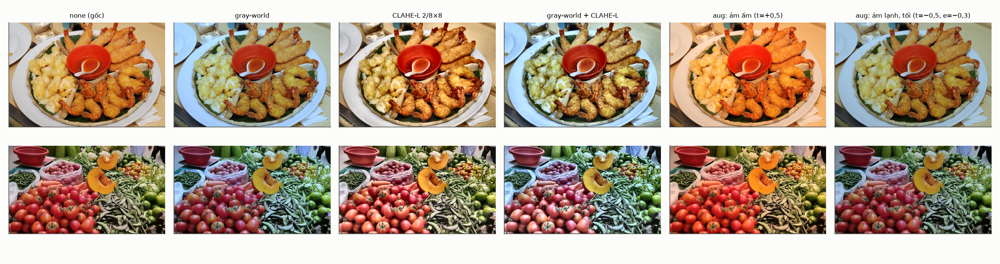
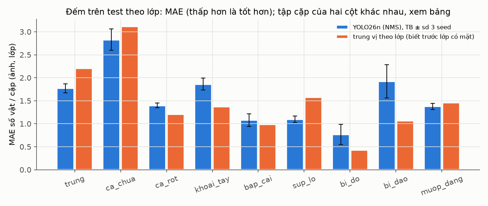
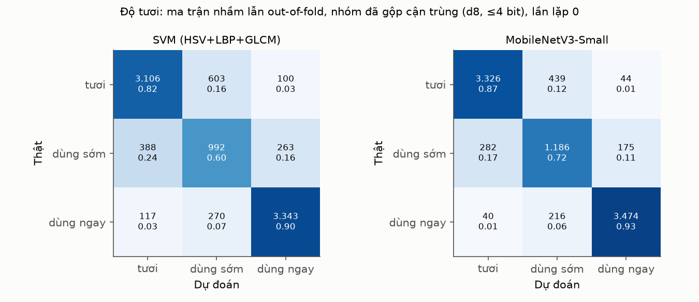
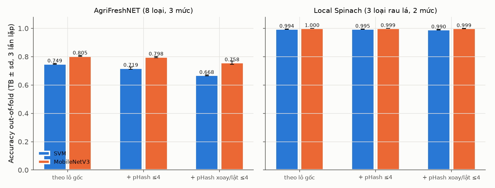

Tệp này là nguồn của `BaoCao_XuLyAnh_ThiGiacMayTinh.pdf` (dựng lại bằng `make_pdf.sh` cùng thư mục). Mã:
`ml/src/tastoria_ml/cv/`, kiểm thử: `ml/tests/cv/`, kết quả máy đọc được: `data/processed/cv/`. Mọi con số đọc
từ các tệp kết quả đó; không có số nào lấy từ bài báo hay ước lượng tay. Kết quả thô từng bước:
`ket-qua-so-bo.md`.

# 1. Tóm tắt

Module thị giác máy tính của Tastoria biến 1–2 ảnh tủ lạnh thành danh sách nguyên liệu có số lượng và mức độ
tươi. Module đang chạy thật trên `https://tastoria.ctslab.net`: bộ phát hiện YOLO26n (ONNX, CPU) cho xử lý phía
server p95 = 105 ms (đo ngày 18/10/2026, khi bản live còn ở địa chỉ cũ `safework.ctslab.net`; địa chỉ đó nay
không còn phục vụ Tastoria). Mọi số đo chất lượng mới có trên ảnh công khai, chưa có ảnh tủ lạnh nào của người
Việt.

**Lớp: bảng có 37, mô hình đang chạy nhận 13.** Danh mục lớp duy nhất là `data/kb/vision_classes.yaml`:
22 lớp chọn trong phân tích (`classes`) và 15 lớp thêm ngày 30/10/2026 (`proposed_classes`: mì tôm, xúc xích, đồ
hộp, sữa, sữa chua, hành lá, tỏi, ớt, chanh và 6 lớp đồ ăn vặt). Cả 37 đều được nạp vào bảng `vision_classes`
khi chạy `tastoria catalog import`. Mô hình đang triển khai (`yolo26n_640_none`, `deploy/models/detector/`)
chỉ được huấn luyện trên 13 lớp có ảnh công khai trong bộ v1, nên bản đồ lớp của nó (`model_version_classes`)
có đúng 13 dòng: cá, tôm, trứng, cà chua, cà rốt, khoai tây, bắp cải, súp lơ, bí đỏ, bí đao, mướp đắng, đậu que,
nấm. 24 lớp còn lại có trong bảng nhưng bản live chưa nhận ra; người dùng thêm chúng bằng tay trên chip.

Kết quả chính (tập test công khai, 3 seed):

- Phát hiện 13 lớp: AP@[.5:.95] COCO = 0,268 ± 0,005, AP50 = 0,414. Vật nhỏ chỉ đạt AP = 0,03.
- Tiền xử lý: gray-world và tăng cường đổi nguồn sáng hơn ảnh gốc khoảng 0,7 điểm mAP50-95, nằm trong biên tương
  đương ±1,5 điểm. Chưa kết luận được là có lợi.
- Đếm: sai số tuyệt đối trung bình (MAE) 1,67 vật trên mỗi cặp (ảnh, lớp), chỉ tốt hơn baseline "trung vị theo
  lớp" (1,80) một chút.
- Độ tươi: MobileNetV3-Small đạt macro-F1 0,828 so với 0,766 của SVM đặc trưng cổ điển, sau khi đã gộp ảnh cận
  trùng.

Ba vấn đề lớn còn mở:

1. Không có dữ liệu tủ lạnh thật. Với bộ v1 (mô hình đang chạy), 9/22 lớp phân tích (thịt, đậu phụ, rau lá
   Việt…) không có ảnh huấn luyện nào. Bộ v2 (mục 4.2) có ảnh cho 30/37 lớp nhưng chưa huấn luyện; 7 lớp vẫn
   trống: thịt lợn, thịt gà, su su, mướp, rau cải, rau muống, giá đỗ.
2. Đếm vật xếp chồng và vật nhỏ yếu.
3. Nhãn độ tươi mượn từ bộ dữ liệu khác định nghĩa, không phải nhãn thị giác do người chấm.

# 2. Vị trí module trong hệ thống

Module là cửa vào dữ liệu của cả Tastoria: kho nguyên liệu, độ gấp và bộ ghép mâm đều dùng đầu ra của nó. Người
dùng luôn sửa được kết quả trước khi nó vào kho, nên sai số của mô hình làm tốn công sửa chứ không tự động sinh ra
mâm sai.

Luồng xử lý một lần quét (UC12, UC13):

1. App nén ảnh về cạnh dài 1.280 px, gửi `POST /api/v1/scans`. Server kiểm magic bytes, giới hạn 4096² điểm ảnh,
   xoay theo EXIF rồi mã hoá lại JPEG không metadata.
2. Worker RQ (nạp ONNX một lần, 2 luồng CPU) chạy tiền xử lý, YOLO26n, NMS theo lớp, ánh xạ chỉ số đầu ra sang
   `vision_classes.id` qua `model_version_classes` rồi sang nguyên liệu mặc định của lớp.
3. Gộp khung thành chip theo BR-SCAN-01: cùng ngăn lấy max số đếm giữa các ảnh, khác ngăn thì cộng.
4. App long-poll `GET /scans/{id}?wait=10`, người dùng sửa chip, bấm xác nhận. Bước xác nhận ghi lô kho trong một
   giao dịch, gửi lại không tạo trùng.
5. Độ gấp của lô tính lúc đọc từ số ngày và (khi có) xác suất độ tươi từ ảnh (BR-FRESH-01..05).

Bộ phát hiện là bước duy nhất có mô hình đang chạy trên bản live; nhánh độ tươi đã có mô hình ONNX nhưng chưa
bật, nên độ gấp hiện chỉ tính theo số ngày.

Đồ ăn vặt (bim bim, bánh ngọt, bánh quy, kẹo, nước ngọt, nhóm thực phẩm `do_an_vat`) được nhận vào kho nhưng
không bao giờ vào mâm: bộ lọc cứng của backend (`catalog.excluded_food_groups`, `recipe_allowed`,
`ingredient_allowed`) luôn loại nhóm này, có hay không có chế độ ăn (kiểm thử
`backend/tests/integration/test_non_meal_group.py`).

| Mã | Yêu cầu | Trạng thái |
|---|---|---|
| NFR-PERF-01 | Xử lý quét phía server p95 ≤ 3 s | Đạt: p95 = 105 ms (1 người), 178 ms (5 người, 300 lượt), đo qua URL công khai |
| BR-SCAN-01 | Gộp nhiều ảnh: cùng ngăn lấy max, khác ngăn cộng | Đã cài, có kiểm thử |
| BR-SCAN-02 | Chỉ xác nhận mới ghi kho, lũy đẳng | Đã cài, có kiểm thử 4 lần xác nhận đồng thời |
| BR-FRESH-02 | u_img từ xác suất 4 mức độ tươi | Chưa bật trên live: mô hình độ tươi mới có 3 mức, chưa hiệu chỉnh |
| Bảo mật ảnh | Xoá ảnh gốc sau 30 ngày trừ khi đồng ý góp ảnh | Đã cài (job hằng giờ) |

# 3. Các bài toán cần giải quyết

Module gồm sáu bài toán. Bài 2, 3, 4 là lõi chấm điểm của môn Xử lý ảnh; bài 1, 5, 6 giúp chúng chạy đúng trong
điều kiện thật.

**Bài toán 1 — Chuẩn hoá ánh sáng.** Đèn LED tủ lạnh (khoảng 6.500 K) và đèn phòng (khoảng 2.700 K) làm cùng một
màu rau trông khác nhau. Trong mô hình von Kries, ảnh quan sát là phản xạ nhân theo từng kênh với nguồn sáng $e$:
$$c_k(x) = e_k\,\rho_k(x),\quad k\in\{R,G,B\}.$$
Cần ước lượng $e$ từ chính ảnh rồi chia ra, đồng thời cân bằng độ tương phản giữa ngăn sáng và ngăn tối mà không
đổi sắc độ. Câu hỏi: bước này có làm tăng AP của bộ phát hiện hay F1 của bộ phân loại độ tươi không?

**Bài toán 2 — Phát hiện nguyên liệu.** Cho ảnh $I$, tìm tập khung và lớp
$$f(I)=\{(b_i,y_i,s_i)\}_{i=1}^{n},\quad b_i\in[0,1]^4,\ y_i\in\{1,\dots,K\},\ s_i\in[0,1].$$
Bảng lớp có 37 lớp; mô hình đang chạy có $K=13$, bộ v2 có $K=30$ (các lớp có ít nhất một khung). Điều kiện
khó: vật che nhau, bọc túi nilon, vật nhỏ (ớt, tỏi, chanh chỉ vài chục pixel ở 640 px), lớp giống nhau (cải
ngọt/cải chíp, rau muống/rau lang). Mô hình phải chạy trên VPS 2 vCPU.

**Bài toán 3 — Đếm.** Với lớp đếm được, số trên chip là $\hat c$ = số khung có điểm ≥ $\tau$. Cần chọn $\tau$ và
ngưỡng NMS sao cho $\hat c$ gần số vật thật $c$; phân biệt số vật nhìn thấy với số vật có trong tủ, và tránh đếm
một quả hai lần khi chụp hai góc.

**Bài toán 4 — Phân loại độ tươi.** Cho ảnh cắt của một vật, ước lượng mức có thứ bậc tươi < dùng sớm < dùng
ngay (< kiểm tra) dưới dạng phân phối xác suất đã hiệu chỉnh, để đưa vào độ gấp
$$u_{img}=\sum_c P(c\mid x)\,m(c),\quad m=(0{,}25;\ 0{,}65;\ 0{,}9;\ 1{,}2).$$
Vì nhãn có thứ tự, nhầm "tươi" thành "dùng ngay" phải bị phạt nặng hơn nhầm sang mức kề.

**Bài toán 5 — Thu và gán nhãn dữ liệu đáng tin.** Cần tập test đại diện cho tủ lạnh Việt và đo được độ tin cậy
nhãn, vì mọi con số ở bài 2–4 chỉ có ý nghĩa khi nhãn đáng tin.

**Bài toán 6 — So với mô hình đa phương thức.** Gemini trả được khung `box_2d`. Câu hỏi then chốt: một mô hình
nano tự huấn luyện có đáng giữ so với gọi API không, xét độ chính xác, độ trễ, chi phí và quyền riêng tư?

# 4. Dữ liệu

Toàn bộ dữ liệu hiện có là ảnh công khai. Chưa có ảnh nào chụp trong tủ lạnh Việt, nên mọi kết quả ở mục 6 chỉ so
sánh phương pháp, không dự báo được độ chính xác khi dùng thật. Giấy phép và nguồn từng bộ:
`data/raw/images/<nguồn>/SOURCE.md`.

## 4.1 Bộ v1 (mô hình đang chạy)

| Bộ dữ liệu | Giấy phép | Dùng cho | Quy mô sau lọc |
|---|---|---|---|
| Open Images V7, tập boxable | Nhãn CC BY 4.0, ảnh CC BY 2.0 | Phát hiện, 11 nhãn | 10.873 ảnh |
| Vegetable Object Detection Dataset, Bangladesh (Jahan và cộng sự 2025) | CC BY 4.0 | Phát hiện, 9 nhãn | 3.150 khung hình từ 10 video |
| AgriFreshNET (Risdin và cộng sự 2026) | CC BY 4.0 | Độ tươi, 3 mức | 5.183 ảnh |
| Local Spinach Leaf (Hasan và cộng sự 2024) | CC BY 4.0 | Độ tươi rau lá, có rau muống | 3.999 ảnh |

Tập phát hiện sau khi gộp (`data/processed/cv/dataset_stats.json`): train 11.091, val 897, test 2.035 ảnh; test
có 7.946 khung thật. Bangladesh được chia theo video, không theo khung, vì các khung của cùng một video gần giống
hệt nhau. Ảnh cận trùng bị loại bằng pHash 64 bit (Hamming ≤ 4).

**Khoảng trống lớp.** 13/22 lớp phân tích có ảnh công khai: cá, tôm, trứng, cà chua, cà rốt, khoai tây, bắp cải,
súp lơ, bí đỏ, bí đao/bầu, mướp đắng, đậu que, nấm. 9 lớp không có ảnh nào trong v1: thịt lợn, thịt bò, thịt gà,
đậu phụ, su su, mướp, rau cải, rau muống, giá đỗ. Chính những lớp này là nguyên liệu chính của mâm cơm Việt. Tiêu
chí chọn 22 lớp (nguyên liệu chính, để ngăn mát, tách được bằng mắt) nằm trong `data/kb/vision_classes.yaml`.

**Nhãn độ tươi mượn.** 9.182 ảnh độ tươi mang nhãn của tác giả bộ dữ liệu: AgriFreshNET theo hạn dùng, Local
Spinach theo "fresh / non-fresh". Nhãn được ánh xạ về tươi 3.809 / dùng sớm 1.643 / dùng ngay 3.730. Đây không
phải nhãn thị giác 4 mức do hai người chấm mù ngày chụp như thiết kế v2 yêu cầu.

## 4.2 Bộ v2 (đã dựng, chưa huấn luyện)

`ml/src/tastoria_ml/cv/build_yolo_v2.py` dựng `data/processed/cv/yolo_v2/` từ v1 cộng ba nguồn mới, theo cả 37
lớp của bảng. Tập test v1 giữ nguyên (cùng 2.035 ảnh, nhãn ghi lại theo chỉ số v2); dữ liệu mới chỉ vào
train/val và một tập `heldout` riêng cho các lớp mới. Thống kê: `data/processed/cv/dataset_stats_v2.json`,
nguồn gốc từng ảnh: `manifest_v2.csv`.

| Nguồn | Giấy phép | Lớp | Ảnh train / val / heldout |
|---|---|---|---|
| LVIS v1 (Gupta và cộng sự 2019) trên ảnh COCO 2017 | Nhãn CC BY 4.0; ảnh theo từng ảnh Flickr, nhiều ảnh CC BY-NC | thịt bò, đậu phụ, hành lá, tỏi, ớt, chanh, xúc xích, sữa chua, bánh ngọt, bánh quy, bánh mì… | 2.885 / 359 / 775 |
| RPC checkout (Wei và cộng sự 2019) | CC BY-NC-SA 4.0 | mì tôm, đồ hộp, sữa, bim bim, kẹo, nước ngọt | 1.902 / 229 / 358 |
| Kitchen Fruit & Vegetable Detection (Morros 2026) | CC BY 4.0 | cà chua, cà rốt, khoai tây, chanh | 0 / 0 / 120 (chỉ held-out) |

Tổng: train 15.865, val 1.485, test 2.035, heldout 1.253 ảnh; 30/37 lớp có khung. 5.327 ảnh mang giấy phép phi
thương mại (cột `license_flag` của manifest), nên một mô hình huấn luyện trên v2 chỉ dùng được cho đồ án. Lớp ít
dữ liệu nhất: ớt 40 khung, sữa chua 95, đậu phụ 103 (không có khung val), hành lá 178. LVIS và RPC lệch miền xa
(món đã nấu trên đĩa, quầy thanh toán chụp từ trên xuống) nên số trên heldout sẽ không dự báo được tủ lạnh.

**Nhu cầu dữ liệu tự thu** (thiết kế v2, mục 5–7):

- Ảnh tủ lạnh của ≥ 12–15 hộ, 2–3 phiên mỗi hộ, kèm metadata hộ / phiên / ngăn / đèn / đời máy. Để ≥ 4 hộ làm tập
  test, mỗi lớp ≥ 30–50 vật thể trong test.
- Lô độ tươi: 6–8 loại rau lá và cà chua, ≥ 6–8 lô mỗi loại, mua ở ≥ 3 nơi; chụp 2 lần mỗi ngày với thẻ xám 18%.
- Vòng gán nhãn thử 100–150 ảnh do hai người gán từ đầu, trước khi đóng băng tập test.

# 5. Phương pháp

Mỗi bài toán dùng phương pháp đã được kiểm chứng trong tài liệu. Đóng góp riêng của nhóm nằm ở dữ liệu nguyên liệu
Việt, cách đánh giá và việc ghép các bước vào hệ thống chạy thật.

## 5.1 Cân bằng trắng và CLAHE (bài toán 1)

Ảnh 8 bit được giải mã sRGB về RGB tuyến tính trước khi ước lượng nguồn sáng. Nguồn sáng là trung bình Minkowski
bậc $p$ trên các điểm không cháy sáng (kênh < 250) và không gần đen:
$$e_k=\Big(\frac{1}{|\Omega|}\sum_{x\in\Omega}c_k(x)^p\Big)^{1/p},\qquad c'_k=\frac{\bar e}{e_k}\,c_k.$$

- Gray-world (Buchsbaum 1980) là $p=1$; shades-of-gray (Finlayson & Trezzi 2004) là $p=6$. Hệ số kẹp trong
  $[1/2;2]$ để một khung toàn rau xanh không bị đẩy sang tím — điểm yếu đã biết của giả thuyết thế giới xám.
- CLAHE (Zuiderveld 1994) chỉ chạy trên kênh $L^*$ của CIE L\*a\*b\*, nên sắc độ giữ nguyên. Tham số chọn trên
  val: clip 1,0, lưới 16×16, trong 5 cấu hình × 20 epoch.
- Nhánh "tăng cường đổi nguồn sáng" (theo Afifi & Brown 2019): không sửa ảnh lúc suy luận, mà nhân ngẫu nhiên tỉ
  lệ R/B trong khoảng $2^{\pm1{,}2}$ khi huấn luyện.
- Mọi phép áp lên toàn ảnh, giống nhau cho train/val/test, không bao giờ áp riêng trên khung cắt.

{width=95%}

## 5.2 Phát hiện bằng YOLO26n (bài toán 2)

YOLO (Redmon và cộng sự 2016) dự đoán khung và lớp cho toàn ảnh trong một lượt truyền: 8.400 vị trí ở 3 tỉ lệ
(stride 8/16/32) với ảnh 640×640.

- Chọn YOLO26n (2,4 triệu tham số) thay YOLOv8n của thiết kế v1, vì cùng cỡ nhưng mới hơn hai thế hệ và có thêm
  đầu một-một cho phép suy luận không cần NMS.
- Khởi tạo từ trọng số COCO, ultralytics 8.4.173. Huấn luyện trên L40S dùng chung: giới hạn 15% bộ nhớ, batch cố
  định 16, đỉnh dùng thực tế 3,65 GiB.
- Phục vụ: xuất ONNX đầu thô ($1\times17\times8.400$ = 4 toạ độ + 13 lớp) rồi chạy NMS theo lớp, IoU 0,7, trong
  worker. Ngưỡng điểm chọn trên val và lưu cùng phiên bản mô hình (`serving.json`), không nằm trong mã. Tên lớp
  nằm trong metadata `names` của ONNX; `tastoria mlops register` đối chiếu từng tên với bảng `vision_classes` và
  ghi `model_version_classes`, `gate` kiểm độ rộng đầu ra = 4 + số lớp.
- Đánh giá bằng AP kiểu COCO (faster-coco-eval). AP vật nhỏ tính trên khung < 32² pixel. Khoảng tin cậy dùng
  bootstrap cụm có cặp.

## 5.3 Đếm (bài toán 3)

Đơn vị đánh giá là cặp (ảnh, lớp đếm được) có $c>0$ hoặc $\hat c>0$, để cặp vắng mặt không làm sai số nhỏ đi giả
tạo:
$$\text{MAE}=\frac1N\sum|\hat c-c|,\qquad \text{MAE}_{rel}=\frac{\sum|\hat c-c|}{\sum c}.$$
Kèm tỷ lệ đúng tuyệt đối và đúng ±1. Ngưỡng $\tau$ chọn trên val ($\tau=0{,}2$ cho cả 3 seed). Baseline "trung vị
theo lớp" được biết trước lớp có mặt, tức một baseline lạc quan. Khung group-of của Open Images bị loại vì không
cho biết số vật.

## 5.4 Độ tươi: cổ điển so với học sâu (bài toán 4)

Cả hai nhánh dùng chung một mặt nạ tiền cảnh GrabCut (tỷ lệ tiền cảnh trung bình 0,247).

- Cổ điển: histogram HSV 18×8×8 bin; LBP đều (Ojala 2002) với $(P,R)=(8,1)$ và $(16,2)$; 6 thuộc tính GLCM
  (Haralick 1973) ở khoảng cách 1 và 3 theo 4 hướng; trung bình và độ lệch L\*a\*b\*. Bộ phân loại SVM RBF, $C$ và
  $\gamma$ chọn bằng CV lồng.
- Học sâu: MobileNetV3-Small (Howard và cộng sự 2019), khởi tạo ImageNet, 10 epoch AdamW; 1,5 triệu tham số,
  ONNX 6,1 MB.
- Chia tập: StratifiedGroupKFold 5 fold × 3 lần lặp, nhóm theo lô chụp. Sau khi phát hiện rò rỉ, nhóm theo cụm
  cận trùng pHash, kể cả bản bất biến xoay/lật.
- Chỉ số: macro-F1, κ trọng số bậc hai (QWK) và MAE theo bậc. Hai nhánh được so bằng bootstrap cụm theo nhóm,
  2.000 lần.

## 5.5 Thu và gán nhãn (bài toán 5)

- Chia tập theo hộ: đơn vị chia và đơn vị bootstrap là hộ, không phải ảnh, vì ảnh cùng tủ tương quan mạnh.
- Vòng gán thử: hai người gán từ đầu, không dùng nháp. Ghép khung bằng thuật toán Hungarian ở IoU ≥ 0,5; báo F1
  giữa hai người, tỷ lệ khung không ghép được, trung vị IoU và κ Cohen (1960) trên tên lớp. Ngưỡng đồng thuận
  κ ≥ 0,81 ("gần như hoàn toàn", Landis & Koch 1977).
- Nháp tự động từ Grounding DINO (Liu và cộng sự 2024) chỉ dùng cho train.
- Học chủ động: ảnh người dùng sửa chip (nếu họ đồng ý góp ảnh) vào hàng đợi gán nhãn. Việc sửa chip chỉ là tín
  hiệu chọn ảnh, không phải nhãn khung.

## 5.6 Baseline Gemini (bài toán 6)

Công cụ (`cv/gemini_baseline.py`) đã viết và có kiểm thử trên phản hồi giả lập, nhưng chưa gọi API vì chưa có
khoá. Thiết kế đánh giá:

- Prompt: danh mục đóng 22 lớp phân tích (`classes` của `vision_classes.yaml`) qua structured output, nhiệt độ 0,
  ghim model ID và ngày chạy, 3 lần chạy.
- Ba cấp so sánh: P/R/F1 khung ở IoU 0,5 và 0,3, MAE đếm, P/R/F1 danh sách. Không dùng mAP vì Gemini không trả
  điểm tin cậy. Thêm độ trễ và chi phí.
- Chỉ dùng ảnh của nhóm đã có đồng ý của chủ bếp, gói trả phí.

# 6. Kết quả đã đo

Trên ảnh công khai, bộ phát hiện đạt AP 0,27 và chạy dưới 30 ms trên CPU. Tiền xử lý chưa cho khác biệt rõ, bộ
đếm gần ngang baseline, còn bộ độ tươi học sâu thắng cổ điển ở mọi cách chia tập. Số liệu đọc từ
`data/processed/cv/` (YOLO26n, 640 px, tập test v1 2.035 ảnh, 7.946 khung). Mọi số ở mục này thuộc mô hình 13
lớp; bộ v2 chưa có kết quả.

## 6.1 Tiền xử lý (60 epoch, dừng sớm patience 15)

| Nhánh | Số seed | mAP50 test | mAP50-95 test |
|---|:---:|---:|---:|
| Ảnh gốc | 3 | 0,414 ± 0,009 | 0,268 ± 0,005 |
| Gray-world | 3 | 0,418 ± 0,005 | 0,275 ± 0,002 |
| Tăng cường đổi nguồn sáng | 2 | 0,420 ± 0,010 | 0,275 ± 0,006 |

Gray-world và tăng cường hơn ảnh gốc khoảng 0,7 điểm mAP50-95, nằm trong biên tương đương ±1,5 điểm đặt trước,
nên kết luận đúng là "chưa thấy khác biệt đáng kể", không phải "có lợi". Điều này khớp với Wang và cộng sự (2023):
tăng cường ảnh thường không giúp bộ phát hiện sâu. Hai nhánh CLAHE và gray-world + CLAHE ở 60 epoch chưa chạy;
seed thứ 3 của nhánh tăng cường bị dừng ở epoch 29 khi GPU dùng chung cạn bộ nhớ (lần chạy dở đã bị xoá, không
có số). CLAHE mới có lưới chọn tham số trên val (20 epoch, clip 1,0 × 16 tốt nhất: AP val 0,344). Trên ảnh công
khai, nguồn sáng đồng đều hơn tủ lạnh nhiều, nên thí nghiệm này phải làm lại khi có ảnh tủ lạnh.

## 6.2 NMS so với đầu một-một không NMS (ảnh gốc, trung bình 3 seed)

| Chế độ | AP@[.5:.95] | AP50 | AP vật nhỏ | AR@100 |
|---|---:|---:|---:|---:|
| Đầu một-nhiều + NMS | 0,268 | 0,413 | 0,030 | 0,557 |
| Đầu một-một, không NMS | 0,256 | 0,395 | 0,029 | 0,565 |

NMS cho AP cao hơn 1,2 điểm ở cả 3 seed, nên bản triển khai dùng NMS. Chế độ không NMS có recall nhỉnh hơn nhưng
độ chính xác thấp hơn. Vật nhỏ là điểm yếu nhất: AP chỉ 0,03 trên 376 khung nhỏ của test. Các lớp yếu nhất (AP50
test, mô hình đầu tiên) là bí đao 0,12, mướp đắng 0,17 và đậu que 0,25.

## 6.3 Đếm (lớp đếm được, τ = 0,2 chọn trên val, 3 seed)

| Phương pháp, trên cặp có lớp trong nhãn | MAE (vật) | MAE tương đối | Đúng tuyệt đối | Đúng ±1 |
|---|---:|---:|---:|---:|
| YOLO26n + NMS | 1,67 | 0,51 | 0,38 | 0,68 |
| Trung vị theo lớp (baseline lạc quan) | 1,80 | 0,55 | 0,29 | 0,69 |

Bộ phát hiện đếm đúng tuyệt đối nhiều hơn baseline (38% so với 29%), nhưng sai số trung bình chỉ giảm 0,13 vật và
tỷ lệ đúng ±1 ngang nhau. Nguyên nhân chính là cà chua và trứng xếp chồng, nhiều vật nhỏ. Tính trên mọi cặp có
$c>0$ hoặc $\hat c>0$, MAE là 1,72 và MAE tương đối 0,67. Chế độ không NMS cho số gần như bằng.

{width=80%}

## 6.4 Độ tươi (9.182 ảnh, 5 fold × 3 lần lặp)

| Cách nhóm khi chia tập | Số nhóm | SVM macro-F1 | MobileNetV3 macro-F1 | MobileNetV3 QWK |
|---|---:|---:|---:|---:|
| Theo lô chụp | 4.318 | 0,819 | 0,857 | 0,921 |
| + gộp cận trùng pHash ≤ 4 | 3.326 | 0,797 | 0,855 | 0,914 |
| + gộp cả bản xoay/lật | 2.366 | 0,766 | 0,828 | 0,898 |

- Rò rỉ được xác nhận: 34,2% ảnh Local Spinach có ảnh cận trùng nằm ở fold khác, AgriFreshNET chỉ 4,7%. Chia
  nghiêm hơn làm macro-F1 giảm 5,3 điểm với SVM và 2,9 điểm với MobileNetV3. Dòng cuối mới là số đáng tin.
- Học sâu thắng ở mọi cách chia. Theo lô: +0,033 macro-F1, khoảng tin cậy 95% 0,012–0,054, bootstrap cụm.
- Mức giữa "dùng sớm" yếu nhất với cả hai nhánh, đúng như dự đoán khi lớp này chỉ có 1.643 ảnh.

{width=80%}

{width=80%}

## 6.5 Độ trễ và triển khai

| Phép đo | p50 | p95 |
|---|---:|---:|
| YOLO26n ONNX, 2 luồng CPU, kể cả letterbox và hậu xử lý | 29,1 ms | 30,4 ms |
| MobileNetV3 độ tươi ONNX, 2 luồng | 1,2 ms | 1,4 ms |
| Quét thật qua URL công khai, phía server, 1 người (40 lượt) | 64 ms | 105 ms |
| Quét thật, 5 người đồng thời (300 lượt) | 72 ms | 178 ms |

Hai dòng quét thật đo ngày 18/10/2026 qua địa chỉ khi đó là `https://safework.ctslab.net/api/v1`
(`data/processed/cv/detector/scan_latency_live_c{1,5}.json`); bản live nay ở `https://tastoria.ctslab.net`, cùng
máy chủ và cùng mô hình. Mọi phép đo chạy trên máy chủ lab dùng chung (Xeon Gold 6542Y, worker giới hạn 2 CPU /
4 GB), chưa phải VPS đích. Ảnh test là 640–1.024 px, không phải 1.280 px. Mô hình độ tươi đã xuất ONNX và khớp
với PyTorch (sai khác xác suất ≤ 2,6 × 10⁻⁷), nhưng chưa được bật trên bản live.

# 7. Vấn đề tồn tại và hướng giải quyết

Vấn đề gốc là thiếu dữ liệu tủ lạnh Việt; phần lớn việc còn lại chờ nó. P1 chặn kết quả báo cáo môn, P2 làm sai
kết quả dùng thật, P3 là cải tiến.

| Ưu tiên | Vấn đề | Nguyên nhân | Hướng xử lý |
|---|---|---|---|
| P1 | Không có tập test tủ lạnh thật; mọi số đo không dự báo được chất lượng khi dùng | Chưa thu ảnh; ảnh công khai chụp ở studio, chợ, sạp rau | Thu ≥ 12–15 hộ × 2–3 phiên, đóng băng ≥ 4 hộ làm test trước khi huấn luyện lại; bootstrap cụm hai tầng (hộ rồi ảnh) |
| P1 | Mô hình live nhận 13/37 lớp của bảng; 7 lớp (thịt lợn, thịt gà, su su, mướp, rau cải, rau muống, giá đỗ) chưa có ảnh nào kể cả trong v2 | Không có bộ công khai tải được không cần khoá | Huấn luyện trên v2 (30 lớp) khi GPU rảnh; chụp riêng các lớp trống, kể cả ảnh "đồ vừa mua" trên bàn; dùng nhãn cha ("rau cải", "thịt đóng gói") khi mắt thường cũng khó tách |
| P1 | Nhãn độ tươi không phải nhãn thị giác, chỉ 3 mức, chưa hiệu chỉnh | Mượn nhãn theo hạn dùng của bộ dữ liệu khác | Hai người chấm 4 mức có ảnh mẫu, mù ngày chụp, κ trọng số ≥ 0,81; temperature scaling (Guo và cộng sự 2017) trên val rồi mới bật u_img |
| P1 | Baseline Gemini chưa chạy | Chưa có khoá API trả phí | Chạy công cụ có sẵn trên cùng tập test tủ lạnh; so P/R/F1 khung, MAE đếm, độ trễ, chi phí bằng bootstrap cặp theo ảnh |
| P2 | Vật nhỏ gần như bị bỏ qua (AP nhỏ 0,03) | 640 px làm ớt, tỏi, chanh còn vài chục pixel | So imgsz 960 với 640 về AP vật nhỏ và độ trễ; hoặc cắt ô chồng lấn kiểu SAHI (Akyon và cộng sự 2022) |
| P2 | Đếm vật xếp chồng gần ngang baseline (MAE 1,67 so với 1,80) | Vật che nhau; NMS IoU 0,7 gộp hai quả sát nhau | Chọn ngưỡng IoU NMS theo lớp trên val; Soft-NMS (Bodla và cộng sự 2017); hiển thị số đếm dạng khoảng |
| P2 | Gray-world sai khi khung hình toàn rau xanh | Giả thuyết trung bình cảnh là xám bị phá | Đánh giá bằng thẻ xám (sai số góc); so gray-world, shades-of-gray, gray-edge (van de Weijer 2007) |
| P2 | Chưa đo độ trễ đầu–cuối trên điện thoại và VPS đích | Mới đo trên máy lab, ảnh ≤ 1.024 px | Đo với ảnh 1.280 px trong container `--cpus=2 --memory=4g`; ghi mốc thời gian phía app qua `/events` |
| P3 | Giấy phép AGPL-3.0 của ultralytics; 5.327 ảnh v2 phi thương mại (RPC, một phần LVIS) | AGPL phủ mã huấn luyện và mô hình; giấy phép NC của nguồn | Đồ án: công bố mã theo AGPL; thương mại hoá: đổi sang bộ phát hiện Apache-2.0 (D-FINE, RT-DETRv2, RF-DETR) và bỏ ảnh NC |
| P3 | Chưa so với YOLO11n và ảnh 960 px | Thí nghiệm GPU bị dừng khi ổ đĩa và GPU dùng chung cạn | Chạy tiếp hàng đợi đã có (≤ 3 job, GPU trống ≥ 6 GB) |
| P3 | Vòng phản hồi từ người dùng chưa thành dữ liệu huấn luyện | Chip sửa không có khung | Học chủ động: ảnh có sửa hoặc độ tin cậy thấp vào hàng đợi gán nhãn; cổng triển khai không-kém với biên đặt trước |

# 8. Kế hoạch thí nghiệm và đánh giá tiếp theo

Mỗi câu hỏi có một chỉ số chính, một mốc so và một kiểm định đặt trước. Tập test tủ lạnh chỉ mở một lần cho số
liệu báo cáo; mọi lựa chọn tham số làm trên val hoặc GroupKFold theo hộ.

| Câu hỏi | Chỉ số chính | So với | Kiểm định |
|---|---|---|---|
| Tiền xử lý có giúp không? | AP@[.5:.95], 5 nhánh × 3 seed | Ảnh gốc | Chênh lệch có cặp, bootstrap cụm theo hộ; biên tương đương ±1,5 điểm |
| Dữ liệu v2 có giúp lớp mới không? | AP theo lớp trên heldout và trên test tủ lạnh | Mô hình 13 lớp (lớp chung) | Bootstrap cụm; báo riêng lớp có < 100 khung |
| Tự huấn luyện có đáng không? | F1 khung IoU 0,5, MAE đếm, F1 danh sách, độ trễ, chi phí | Gemini (ghim model ID và ngày) | Bootstrap cặp theo ảnh, cụm theo hộ |
| Đếm đúng đến đâu? | MAE, MAE tương đối, đúng ±1 | Trung vị theo lớp; đếm từ khung Gemini | Khoảng tin cậy bootstrap |
| Cổ điển hay học sâu cho độ tươi? | Macro-F1, QWK, MAE bậc | HSV + LBP + GLCM + SVM | GroupKFold theo lô 5 × 3, bootstrap cụm; McNemar chính xác là phân tích phụ |
| Cân bằng trắng nào tốt nhất? | Sai số góc so với thẻ xám | Gray-world, shades-of-gray, gray-edge | Wilcoxon có cặp theo ảnh |
| Đủ nhanh trên VPS đích không? | p50 / p95 xử lý server và đầu–cuối | NFR-PERF-01 (p95 ≤ 3 s) | ≥ 300 mẫu, 1 và 5 người đồng thời, khoảng tin cậy cho p95 |

Thứ tự làm đề xuất:

1. Vòng gán nhãn thử 100–150 ảnh, chốt hướng dẫn gán nhãn v2, rồi đóng băng tập test theo hộ.
2. Huấn luyện lại trên `yolo_v2` cộng ảnh nhóm, lặp lại ablation tiền xử lý trên dữ liệu tủ lạnh; đăng ký mô
   hình mới qua `tastoria mlops register` (bản đồ lớp mới tự ghi vào `model_version_classes`).
3. Chạy baseline Gemini trên cùng tập test.
4. Thu lô độ tươi với thẻ xám, chấm nhãn 4 mức, hiệu chỉnh và bật u_img trên bản live.
5. Đo độ trễ trên VPS đích và điện thoại.

Rủi ro: nếu Gemini thắng rõ ở phát hiện, lý do giữ mô hình tự huấn luyện sẽ là độ trễ (khoảng 30 ms trên CPU),
chi phí 0 mỗi lần quét, chạy không cần mạng, và ảnh tủ lạnh không rời khỏi máy chủ trong nước. Các điểm này cần
được đo, không chỉ nêu.

# 9. Tài liệu tham khảo

Các mục [1]–[10] và [17]–[22] đã được kiểm trên Crossref / trang gốc trong đợt rà soát ngày 17/10/2026
(`docs/research/raw/`). Các mục còn lại ghi theo thông tin xuất bản chuẩn.

**Phương pháp**

1. Redmon J, Divvala S, Girshick R, Farhadi A. You only look once: Unified, real-time object detection. CVPR.
   2016:779–788.
2. Jocher G, Qiu J. Ultralytics YOLO (YOLO11, YOLO26), phiên bản 8.4.173. Giấy phép AGPL-3.0. docs.ultralytics.com
3. Lin TY, Maire M, Belongie S, et al. Microsoft COCO: Common objects in context. ECCV. 2014:740–755.
   doi:10.1007/978-3-319-10602-1_48
4. Liu S, Zeng Z, Ren T, et al. Grounding DINO: Marrying DINO with grounded pre-training for open-set object
   detection. ECCV. 2024:38–55. doi:10.1007/978-3-031-72970-6_3
5. Howard A, Sandler M, Chu G, et al. Searching for MobileNetV3. ICCV. 2019:1314–1324.
6. Ojala T, Pietikäinen M, Mäenpää T. Multiresolution gray-scale and rotation invariant texture classification
   with local binary patterns. IEEE TPAMI. 2002;24(7):971–987.
7. Haralick RM, Shanmugam K, Dinstein I. Textural features for image classification. IEEE Trans. SMC.
   1973;SMC-3(6):610–621.
8. Cortes C, Vapnik V. Support-vector networks. Machine Learning. 1995;20(3):273–297.
9. Buchsbaum G. A spatial processor model for object colour perception. Journal of the Franklin Institute.
   1980;310(1):1–26.
10. Zuiderveld K. Contrast limited adaptive histogram equalization. In: Graphics Gems IV. Academic Press;
    1994:474–485.
11. Finlayson GD, Trezzi E. Shades of gray and colour constancy. Color and Imaging Conference. 2004:37–41.
12. van de Weijer J, Gevers T, Gijsenij A. Edge-based color constancy. IEEE Transactions on Image Processing.
    2007;16(9):2207–2214.
13. Afifi M, Brown MS. What else can fool deep learning? Addressing color constancy errors on deep neural network
    performance. ICCV. 2019. arXiv:1912.06960
14. Bodla N, Singh B, Chellappa R, Davis LS. Soft-NMS — Improving object detection with one line of code. ICCV.
    2017:5561–5569.
15. Akyon FC, Altinuc SO, Temizel A. Slicing aided hyper inference and fine-tuning for small object detection.
    ICIP. 2022.
16. Guo C, Pleiss G, Sun Y, Weinberger KQ. On calibration of modern neural networks. ICML. 2017:1321–1330.
17. Cohen J. A coefficient of agreement for nominal scales. Educational and Psychological Measurement.
    1960;20(1):37–46. doi:10.1177/001316446002000104
18. Landis JR, Koch GG. The measurement of observer agreement for categorical data. Biometrics. 1977;33(1):159–174.
    doi:10.2307/2529310
19. McNemar Q. Note on the sampling error of the difference between correlated proportions or percentages.
    Psychometrika. 1947;12(2):153–157. doi:10.1007/BF02295996
20. Dietterich TG. Approximate statistical tests for comparing supervised classification learning algorithms.
    Neural Computation. 1998;10(7):1895–1923. doi:10.1162/089976698300017197
21. Efron B, Tibshirani RJ. An Introduction to the Bootstrap. Chapman & Hall; 1993.
22. Wang và cộng sự. Ảnh hưởng của tăng cường ảnh dưới nước lên bộ phát hiện (18 phương pháp × 7 bộ phát hiện;
    ảnh gốc cho AP cao nhất). 2023. arXiv:2311.18814

**Đánh giá chất lượng nông sản bằng thị giác máy**

23. Brosnan T, Sun DW. Improving quality inspection of food products by computer vision — a review. Journal of
    Food Engineering. 2004;61(1):3–16.
24. Bhargava A, Bansal A. Fruits and vegetables quality evaluation using computer vision: A review. Journal of
    King Saud University — Computer and Information Sciences. 2021;33(3):243–257.
25. Koyama và cộng sự. Ước lượng độ tươi rau bina từ ảnh chụp hằng ngày trong 12 ngày ở 10 °C, nhãn cảm quan 4
    mức từ 12 người đánh giá. PLOS ONE. 2021. doi:10.1371/journal.pone.0248769
26. Abeer MH, Lamia MN, Nafsi JF, Chowdhury F, Anol MS, Ahamed MS. Local vegetable freshness classification based
    on chronological monitoring using transfer learning approach. ICCIDS 2023, IFIP AICT 673. 2023:50–66.
    doi:10.1007/978-3-031-38296-3_5

**Dữ liệu**

27. Kuznetsova A, et al. Open Images V7, tập boxable. storage.googleapis.com/openimages
28. Jahan et al. Vegetable Object Detection Dataset from Bangladesh. Mendeley Data V3; 2025.
    doi:10.17632/gnc4s3z2mf.3
29. Risdin F, Salauddin H, Tufa TA, Hossain MJ. AgriFreshNET Freshness and Shelf-Life Image Dataset. Mendeley Data
    V1; 2026. doi:10.17632/42m5tb7yv9.1
30. Hasan et al. Local Spinach Leaf Dataset. Mendeley Data V3; 2024. doi:10.17632/skf6w2s2h2.3
31. Gupta A, Dollár P, Girshick R. LVIS: A dataset for large vocabulary instance segmentation. CVPR. 2019:5356–5364.
32. Wei XS, Cui Q, Yang L, Wang P, Liu L. RPC: A large-scale retail product checkout dataset. arXiv:1901.07249.
    2019.
33. Morros Vilaseca O. Kitchen Fruit & Vegetable Detection. Hugging Face Datasets
    (omorros/kitchen-fruit-vegetable-detection); 2026. CC BY 4.0.

**API và công cụ**

34. Google. Gemini API — Image understanding (phát hiện đối tượng, box_2d chuẩn hoá 0–1000). ai.google.dev
35. ONNX Runtime 1.31.0. onnxruntime.ai

Tài liệu nội bộ: thiết kế v2 `docs/superpowers/specs/2026-10-17-tastoria-thiet-ke-v2.md`; kết quả thô
`docs/reports/xu-ly-anh/ket-qua-so-bo.md`; kết quả máy đọc được `data/processed/cv/`; nghiên cứu dữ liệu và mô
hình `docs/research/raw/01-xu-ly-anh-du-lieu-mo-hinh.md`.
