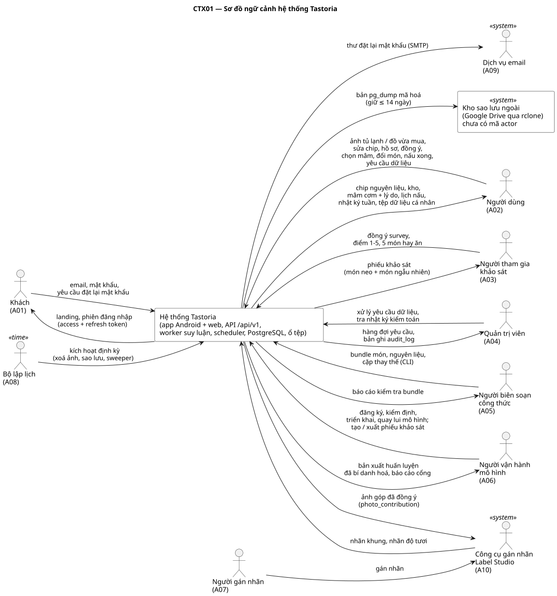

# Đặc tả yêu cầu phần mềm (SRS) — Tastoria

| Mục | Nội dung |
|---|---|
| Tài liệu | Software Requirements Specification theo cấu trúc ISO/IEC/IEEE 29148:2018 (mục 9.6) |
| Hệ thống | Tastoria — gợi ý một mâm cơm Việt từ ảnh tủ lạnh |
| Phiên bản | 1.1, 17/10/2026 (lịch sử thay đổi ở cuối bảng này) |
| Nguồn sự thật | `docs/sad/model.yaml` (mã actor, gói, UC, module, bảng, endpoint, BR, NFR); thiết kế v2 `docs/superpowers/specs/2026-10-17-tastoria-thiet-ke-v2.md` |
| Phần sinh tự động | Bảng FR (§3.2) và Phụ lục A sinh bằng `docs/sad/tools/collect_frs.py --write` từ bảng FR trong `docs/sad/use-cases/UCxx.md`; không sửa tay giữa các mốc `BEGIN/END` |
| Lịch sử thay đổi | 1.0 (17/10/2026): bản đầu. 1.1 (17/10/2026): sửa theo soi phản biện — NFR bổ sung viết thành điều khoản con của 10 mã trong `model.yaml`; chốt ngưỡng NFR-PERF-01..03 và quy trình đổi ngưỡng; tách hạn BR-DSR-01 theo loại; quy tắc tuổi BR-NUT-01; đơn vị `e_target_kcal`; quy tắc lô không có u; quy tắc kết thúc lần quét và hết hiệu lực mâm; tách FR ghép; thêm §2.6 (độ lệch so với thiết kế v2) và Phụ lục C (vấn đề mở) |

Quy ước: "phải" = yêu cầu bắt buộc kiểm chứng được; "nên" = khuyến nghị. Mã yêu cầu: `FR-<số UC>-<số>` (chức năng), `BR-<NHÓM>-<số>` (quy tắc nghiệp vụ), `NFR-<ĐẶC TÍNH>-<số>` (phi chức năng). Tham số in đậm là giá trị mặc định nằm trong bảng cấu hình, đổi được mà không đổi mã nguồn.

---

## 1. Giới thiệu

### 1.1 Mục đích

Tài liệu này đặc tả yêu cầu của hệ thống Tastoria (app Android + web, backend, worker suy luận, tác vụ định kỳ, công cụ dòng lệnh cho nhân sự) ở mức đủ để thiết kế, cài đặt và kiểm thử. Những điểm chưa chốt được nhận diện và theo dõi ở Phụ lục C; yêu cầu nào phụ thuộc một điểm còn mở thì ghi mã TBD tương ứng. Người đọc:

| Người đọc | Dùng tài liệu để |
|---|---|
| Nhóm phát triển backend, app | Cài đặt FR, BR, NFR; sinh client từ OpenAPI |
| Nhóm Xử lý ảnh, Học máy | Biết đầu vào/đầu ra mô hình phải thoả (BR-FRESH, BR-TRAY, NFR-PERF-01) |
| Người kiểm thử | Lập ca kiểm thử từ tiêu chí chấp nhận (`docs/sad/06-ke-hoach-kiem-thu.md`) |
| Giảng viên chấm | Đối chiếu yêu cầu ↔ thiết kế ↔ kiểm thử qua ma trận truy vết |

### 1.2 Phạm vi

**Tên sản phẩm**: Tastoria.

**Việc hệ thống làm**: nhận 1–2 ảnh tủ lạnh hoặc túi đồ vừa mua; nhận diện, đếm và ước độ tươi nguyên liệu; lưu kho theo lô; đề xuất **một** mâm cơm Việt (mặn + rau + canh, hoặc 2 món khi ăn một mình) ghép từ nguyên liệu đang có, ưu tiên đồ sắp hỏng, bám mục tiêu năng lượng, loại chắc chắn món có chất gây dị ứng đã khai; lập lịch nấu song song cả mâm; trừ kho khi nấu xong; ghi nhật ký tuần. Hệ thống có thêm trang khảo sát gu món (cho người ngoài, không cần tài khoản), luồng quyền dữ liệu cá nhân theo Luật 91/2025/QH15, công cụ nhân sự nhập kho món và vận hành mô hình.

**Lợi ích và mục tiêu đo được**

| Mục tiêu | Cách đo |
|---|---|
| Giảm đồ bỏ phí trong tủ lạnh của hộ | Số lô gấp được dùng kịp trong nhật ký tuần (`v_journal_days`) |
| Bữa ăn có rau, calo gần mục tiêu | Mâm từ 2 người luôn có slot `rau` (BR-TRAY-01); \|ΔE\|/E ≤ **15%** trên bộ kịch bản (thiết kế v2 §6.2) |
| Bớt mất thời gian chọn món | Mỗi lần một mâm; NFR-USE-01 |
| Mọi con số truy được nguồn | `recipe_nutrition.data_version`, `nutrient_sources`, BR-NUT-05 |

**Ngoài phạm vi (v2)**: tính calo từ ảnh món đã nấu; mã vạch, hoá đơn; thực đơn tuần; thông báo đẩy nhắc hạn dùng; đặt hàng; nhiều hồ sơ trong một hộ; thời tiết; bản iOS; slot "món tô". Baseline Gemini và việc huấn luyện mô hình là thí nghiệm ngoài hệ thống chạy thật; hệ thống chỉ nhận mô hình đã huấn luyện qua UC29–UC30.

**Chống mục tiêu (hệ thống làm ra điều này là lỗi)**: đề xuất mâm có món, gia vị hay đồ thay thế thuộc nhóm dị ứng người ăn đã khai; đề xuất nấu đồ ở mức "kiểm tra trước khi dùng"; hiển thị số liệu không có nguồn; sinh giả dữ liệu người dùng, khảo sát hay kết quả đo.

### 1.3 Thuật ngữ, chữ viết tắt

Xem [00-thuat-ngu.md](00-thuat-ngu.md). Các thuật ngữ cốt lõi: mâm, món, slot, chip, lô, độ gấp u, E_mâm, mức "kiểm tra trước khi dùng", đồng ý theo mục đích, bí danh hoá, lũy đẳng, Unit of Work, makespan.

### 1.4 Tài liệu tham chiếu

**Chuẩn và quy định**

| Mã | Tài liệu | Dùng ở |
|---|---|---|
| [S1] | ISO/IEC/IEEE 29148:2018, Systems and software engineering — Life cycle processes — Requirements engineering | Cấu trúc SRS |
| [S2] | ISO/IEC 25010:2023, Product quality model | Phân loại NFR §3.4 |
| [S3] | OMG UML 2.5.1 (2017) | Ký pháp sơ đồ |
| [S4] | A. Cockburn, *Writing Effective Use Cases*, 2001 | Mẫu đặc tả UC |
| [S5] | IETF RFC 9457, Problem Details for HTTP APIs | Định dạng lỗi API |
| [S6] | OpenAPI Specification 3.1 | Hợp đồng API |
| [S7] | W3C WCAG 2.2 | NFR-A11Y-01 |
| [S8] | Luật Bảo vệ dữ liệu cá nhân số 91/2025/QH15 | Đồng ý, quyền chủ thể, chuyển dữ liệu |
| [S9] | Nghị định 356/2025/NĐ-CP hướng dẫn Luật 91/2025/QH15 | Dữ liệu nhạy cảm, thời hạn xử lý yêu cầu |
| [S10] | Codex CXS 1-1985 (sửa 2024), General Standard for the Labelling of Prepackaged Foods | Nhóm dị ứng BR-ALG-02 |
| [S11] | FAO/WHO/UNU 1985, Energy and Protein Requirements | BMR, BR-NUT-01 |
| [S12] | OWASP API Security Top 10 (2023) | NFR bảo mật (BOLA) |
| [S13] | GNU Affero General Public License v3.0 | Ràng buộc giấy phép bộ phát hiện |

Ghi chú: văn bản [S8], [S9] được đọc qua bản đăng lại (chưa đối chiếu Công báo); các điều khoản trích dẫn cần rà soát pháp lý trước khi phát hành, xem `docs/sad/07-danh-gia-tac-dong-du-lieu-ca-nhan.md`.

**Tài liệu dự án**

| Tài liệu | Đường dẫn |
|---|---|
| Thiết kế v2 | `docs/superpowers/specs/2026-10-17-tastoria-thiet-ke-v2.md` |
| Mô hình phân tích thiết kế | `docs/sad/model.yaml` |
| Đặc tả use case UC01–UC34 | `docs/sad/use-cases/` |
| Chuẩn hoá CSDL | `docs/sad/04-chuan-hoa.md` |
| Từ điển dữ liệu | [05-tu-dien-du-lieu.md](05-tu-dien-du-lieu.md) |
| Kế hoạch kiểm thử | `docs/sad/06-ke-hoach-kiem-thu.md` |
| Đánh giá tác động xử lý dữ liệu cá nhân | `docs/sad/07-danh-gia-tac-dong-du-lieu-ca-nhan.md` |
| Ma trận truy vết | `docs/sad/08-ma-tran-truy-vet.md` (sinh bằng `gen_traceability.py`) |
| ERD | `docs/erd/ERD00-khai-niem-chen.puml` … `ERD08-tong-quan.puml` |
| Sơ đồ UML | `docs/uml/` (use case, hoạt động, tuần tự, lớp, trạng thái, thành phần, gói, triển khai, ngữ cảnh) |
| Hợp đồng API | `docs/api/openapi-v1.yaml` |
| Lược đồ CSDL | `db/schema.sql`, `db/schema_vp.sql` |
| Quyết định kiến trúc | `docs/adr/0001` … `0013` |

### 1.5 Tổng quan tài liệu

Mục 2 mô tả sản phẩm trong bối cảnh, người dùng, ràng buộc, giả định và độ lệch so với thiết kế v2 (2.6). Mục 3 là yêu cầu cụ thể: giao diện ngoài (3.1), chức năng (3.2), quy tắc nghiệp vụ có tiêu chí chấp nhận (3.3), phi chức năng (3.4), dữ liệu logic (3.5), ràng buộc thiết kế (3.6). Mục 4 nêu cách kiểm chứng từng loại yêu cầu. Phụ lục A thống kê UC và FR theo MoSCoW; Phụ lục B liệt kê đề xuất bổ sung mô hình; Phụ lục C liệt kê vấn đề mở và TBD.

---

## 2. Mô tả tổng quát

### 2.1 Bối cảnh sản phẩm

Tastoria là hệ thống mới, độc lập, không thay thế hệ thống nào. Hệ thống gồm:

- **App** Expo (React Native) một mã nguồn cho Android và web; giữ token trong secure-store, catalog và phiên nấu trong SQLite để nấu khi mất mạng, hàng đợi outbox cho nấu xong, sự kiện, sửa chip.
- **API** FastAPI dạng modular monolith (16 module M01–M16), tiền tố `/api/v1`, 70 endpoint.
- **Worker** (Valkey + RQ) chạy suy luận ảnh bằng ONNX, xuất dữ liệu cá nhân, xoá tài khoản.
- **Scheduler** (container cron) chạy tác vụ định kỳ UC32–UC34.
- **PostgreSQL 18 + pgvector**, ổ đĩa lưu tệp (ảnh, bản xuất, mô hình) phục vụ qua nginx `X-Accel-Redirect`.
- **CLI** `tastoria …` trong container api cho nhân sự (A05, A06).

Sơ đồ ngữ cảnh (mức 0) — nguồn `docs/uml/context/CTX01-ngu-canh.puml`:

Ranh giới: mọi tác nhân con người tương tác qua app/web (A01–A03), endpoint `/admin/*` (A04, A06) hoặc CLI (A05, A06). Hệ thống ngoài: Dịch vụ email A09 (SMTP; môi trường dev dùng Mailpit), Công cụ gán nhãn A10 (Label Studio tự host, người gán nhãn A07 làm việc trực tiếp trên công cụ này), kho sao lưu ngoài (Google Drive qua rclone; chưa có mã actor, xem đề xuất ở Phụ lục B). Mô hình học máy được huấn luyện ngoài hệ thống trên GPU của lab và nạp vào qua UC29–UC30.

### 2.2 Chức năng sản phẩm

34 use case chia 10 gói. Đặc tả kiểu Cockburn từng UC ở `docs/sad/use-cases/UCxx.md`; sơ đồ ở `docs/uml/usecase/UCD00-tong-quan.puml` và UCD01–UCD10.

| Gói | Chức năng | Use case |
|---|---|---|
| PK1 Tài khoản & bảo mật | Đăng ký, đăng nhập có làm mới phiên và khoá tạm, đăng xuất một/mọi thiết bị, đặt lại mật khẩu qua email | UC01, UC02, UC03, UC04 |
| PK2 Quyền riêng tư | Đồng ý theo mục đích; tải dữ liệu; xoá tài khoản; yêu cầu sửa, hạn chế, phản đối | UC05, UC06, UC07, UC08 |
| PK3 Hồ sơ & mục tiêu | Hồ sơ 60 giây; cập nhật dị ứng, chế độ ăn, cài đặt bếp; mục tiêu năng lượng gợi ý / tự nhập / chuyên gia | UC09, UC10, UC11 |
| PK4 Kho & quét | Quét toàn tủ hoặc đồ vừa mua; xác nhận chip vào kho; quản lý lô | UC12, UC13, UC14 |
| PK5 Mâm cơm | Nhận mâm hôm nay; đổi một món; "Thiếu gì?"; danh sách đi chợ | UC15, UC16, UC17, UC18 |
| PK6 Nấu & nhật ký | Nấu cả mâm theo lịch; nấu xong một chạm; hoàn tác trừ kho; nhật ký tuần | UC19, UC20, UC21, UC22 |
| PK7 Khảo sát gu | Chấm món ẩn danh; tạo phiếu và xuất kết quả | UC23, UC24 |
| PK8 Quản trị nội dung & dữ liệu | Nhập kho món; cặp thay thế; xử lý yêu cầu dữ liệu, xem nhật ký kiểm toán | UC25, UC26, UC27 |
| PK9 Vận hành mô hình | Xuất dữ liệu huấn luyện bí danh hoá; đăng ký, kiểm định, triển khai, quay lui mô hình; gán nhãn ảnh góp | UC28, UC29, UC30, UC31 |
| PK10 Tác vụ định kỳ | Xoá ảnh quá hạn; sao lưu; dọn job kẹt, token, khoá lũy đẳng | UC32, UC33, UC34 |

Luồng chính nối các gói: UC12 → UC13 (kho) → UC15 (mâm, có UC16/UC17 mở rộng) → UC19 → UC20 (trừ kho, ghi tương tác) → UC22. Sơ đồ hoạt động `docs/uml/activity/AD01-quet-den-nau.puml`.

**Quy tắc viết đặc tả UC** (áp cho mọi tệp UC):

- *Mức mục tiêu* theo Cockburn. **Mục tiêu người dùng** (user goal): việc tác nhân chính làm xong trong một lần, có giá trị tự thân, người đó có thể dừng sau khi xong; tác vụ định kỳ UC32–UC34 là mục tiêu người dùng của tác nhân thời gian A08. **Mục tiêu con** (subfunction): UC chỉ chạy bên trong luồng của UC khác (được include bắt buộc, hoặc extend mà không kích hoạt độc lập được), và đăng nhập. Áp: UC02, UC13, UC16, UC17, UC21 ở mức mục tiêu con; UC05 được UC09 include nhưng cũng mở độc lập từ Cài đặt, và UC18 extend UC15/UC17 nhưng mở trực tiếp được, nên hai UC này giữ mức mục tiêu người dùng. Một UC chỉ có một kịch bản chính; luồng do hệ thống tự kích hoạt (như làm mới phiên ở UC02) là luồng phụ.
- *Hộp đen*: kịch bản viết ở mức tác nhân ↔ hệ thống; lời gọi giữa module, bảng và view thuộc sơ đồ tuần tự (`docs/uml/sequence/`) và mục "Dữ liệu" của tệp UC. Đã áp cho UC02, UC12, UC13, UC15, UC16, UC17, UC19, UC20, UC22; các UC còn lại viết lại theo cùng quy tắc ở vòng sau (TBD-20).
- *Tiền điều kiện* là điều hệ thống bảo đảm trước khi UC bắt đầu và không được kiểm lại trong mở rộng; điều hệ thống không bảo đảm được thì đưa vào mở rộng (ví dụ UC15 mở rộng 1a).

### 2.3 Đặc điểm người dùng

**Chân dung người dùng cuối** (rút từ thiết kế v1 §1.3; là giả định, chưa kiểm bằng phỏng vấn):

| Chân dung | Bối cảnh | Điều cần nhất | Hệ quả cho yêu cầu |
|---|---|---|---|
| P1 Người ăn một mình (sinh viên, người mới đi làm) | Nấu không đều, tủ lạnh nhỏ, hay mua dư | Món nhanh, ít nguyên liệu, không bỏ phí đồ đã mua | Mâm 2 món khi n = 1 (BR-TRAY-01); thời gian tối đa (BR-TRAY-05); ghim lô (BR-TRAY-08) |
| P2 Gia đình nhỏ 2–4 người | Một người nấu bữa tối hằng ngày, có người ăn cùng | Mâm đủ món, cân bằng, không trùng kiểu chế biến | Mâm 3 món; dị ứng người ăn cùng (BR-ALG-01); lịch nấu song song (BR-COOK-01) |
| P3 Người có mục tiêu sức khoẻ | Giảm cân, dị ứng, ăn chay; có thể có mục tiêu do chuyên gia đặt | Calo vừa mục tiêu; loại chắc chắn món gây dị ứng | BR-NUT-01..06, BR-ALG-01..02, BR-DIET-01; mục tiêu chuyên gia ghi đè |

Điều khoản sử dụng dành cho người ≥ 18 tuổi (BR-NUT-01). Hệ thống chỉ kiểm tuổi khi nhận chỉ số cơ thể (FR-09-05, FR-09-13); việc chặn từ lúc đăng ký chưa có (TBD-11). Giả định người dùng cuối dùng điện thoại Android phổ thông hoặc trình duyệt, đọc tiếng Việt, không có kiến thức dinh dưỡng chuyên môn.

**Tác nhân** (theo `model.yaml`):

| Mã | Tác nhân | Loại | Kênh | Trình độ, tần suất | Quyền |
|---|---|---|---|---|---|
| A01 | Khách | Người | App, web, landing | Bất kỳ; một lần khi bắt đầu | public |
| A02 | Người dùng (kế thừa A01) | Người | App Android, web | Không chuyên; mỗi ngày 1–2 lần (quét, mâm, nấu) | `users.role = user` |
| A03 | Người tham gia khảo sát | Người | Trang web qua link/QR | Không chuyên; một lần ~45 món | public + `respondent_token`, ẩn danh |
| A04 | Quản trị viên | Người | `/admin/*` | Nhân sự được đào tạo; khi có yêu cầu dữ liệu | `role = admin` |
| A05 | Người biên soạn công thức | Người | CLI | Biết cấu trúc bundle YAML/CSV; theo đợt | `role = curator` |
| A06 | Người vận hành mô hình | Người | CLI, `/admin/models`, `/admin/surveys` | Kỹ sư học máy; theo đợt huấn luyện | `role = ml_operator` |
| A07 | Người gán nhãn | Người | Label Studio (A10) | Đã học hướng dẫn gán nhãn v2; theo đợt | Tài khoản Label Studio, không có tài khoản Tastoria |
| A08 | Bộ lập lịch | Thời gian | Container `scheduler` | Mỗi phút (sweeper), hằng ngày (xoá ảnh, sao lưu) | Chạy trong mạng nội bộ |
| A09 | Dịch vụ email | Hệ thống ngoài | SMTP | Khi có yêu cầu đặt lại mật khẩu | — |
| A10 | Công cụ gán nhãn | Hệ thống ngoài | API Label Studio | Theo lệnh `tastoria labeling push\|pull` | — |

Người ăn cùng không phải tác nhân: họ không tương tác với hệ thống; A02 khai nhóm dị ứng của họ cho từng bữa (`meal_plan_coeater_allergens`). Đây là độ lệch có chủ đích so với thiết kế v2 §12 mục 2 (xem §2.6).

### 2.4 Ràng buộc

| Mã | Ràng buộc | Nguồn | Ảnh hưởng tới yêu cầu |
|---|---|---|---|
| RB-01 | **Pháp lý — dữ liệu cá nhân (PDPL)**: Luật 91/2025/QH15 và NĐ 356/2025. Chỉ số cơ thể và lịch sử tương tác là dữ liệu nhạy cảm; đồng ý phải theo từng mục đích, im lặng không là đồng ý; chủ thể có quyền truy cập, sửa, xoá, rút đồng ý, hạn chế, phản đối; xử lý trên nền tảng ở nước ngoài là chuyển dữ liệu xuyên biên giới. | [S8], [S9], ADR 0006, ADR 0012 | BR-CONSENT-01..04, BR-DSR-01, BR-RETAIN-01, NFR-PRIV-01, UC05–UC08, UC28 |
| RB-02 | **GPU dùng chung**: huấn luyện chạy trên L40S của lab, máy dùng chung với nhóm khác: batch cố định, `set_per_process_memory_fraction(0.15)`, kiểm `nvidia-smi` trước khi chạy, một job một lúc, chạy thử 1 epoch. Không có GPU ở môi trường phục vụ. | ADR 0012, thiết kế v2 §7 | Suy luận phục vụ chạy CPU (ONNX); NFR-PERF-01 đo trên CPU |
| RB-03 | **Máy phục vụ 2 vCPU / 4 GB RAM** (máy chủ lab đóng vai VPS, giới hạn bằng `--cpus=2 --memory=4g`): nginx, api, worker, scheduler, postgres, valkey cùng chạy. | Thiết kế v2 §7, §10 | Một worker, `intra_op_num_threads = 2`; NFR-PERF-01, NFR-PERF-02; xếp hạng bằng NumPy (ADR 0008) |
| RB-04 | **Giấy phép AGPL-3.0** của YOLO26n/YOLO11n (Ultralytics): người dùng tương tác qua mạng phải nhận được mã nguồn (§13). | [S13], ADR 0011 | Khi triển khai công khai (phụ thuộc GD-07): repo công khai; app và landing có liên kết "Mã nguồn" tới commit đang chạy. Không công bố trọng số huấn luyện bằng ảnh người dùng góp khi chưa rà soát pháp lý |
| RB-05 | Ngôn ngữ giao diện tiếng Việt; câu chữ mô tả thẳng, không quảng cáo. | Thiết kế v2 §1, §9 | Mọi thông báo lỗi tiếng Việt suy từ `code` |
| RB-06 | **Nền tảng**: chỉ Android và web, không iOS; một mã nguồn Expo. Ngưỡng đo được: Android 7.0 (API 24) trở lên; web trên bản ổn định mới nhất của Chrome, Firefox, Safari, Edge tại thời điểm kiểm thử. Nếu Expo SDK 58 đòi API tối thiểu cao hơn thì lấy mức của Expo và đổi theo quy trình đổi ngưỡng ở §3.4 (TBD-13). | ADR 0010 | Kiểm bằng TC-E2E-05 trên ma trận thiết bị |
| RB-07 | Công cụ nộp sơ đồ: Visual Paradigm qua plugin PlantUML-VP và Reverse DDL. | ADR 0013 | Cú pháp PlantUML giới hạn; `db/schema_vp.sql` |
| RB-08 | Không sinh giả dữ liệu cần người thật (ảnh, khảo sát, đánh giá, đáp án thay thế). | Thiết kế v2 §1, §5 | Hệ thống phải có công cụ thu: UC23, UC31, chế độ góp ảnh |

### 2.5 Giả định và phụ thuộc

| Mã | Giả định / phụ thuộc | Nếu sai thì |
|---|---|---|
| GD-01 | Sản phẩm nộp cho ba môn như thiết kế v2 §2 (chưa được người dùng xác nhận). | Điều chỉnh phạm vi PK7–PK9 |
| GD-02 | Người dùng cuối có điện thoại có camera và kết nối Wi-Fi/4G khi quét; nấu có thể mất mạng. | Quét không dùng được offline; nấu dùng catalog SQLite + outbox |
| GD-03 | Kho món 150–200 món mặn/rau/canh do nhóm biên soạn, mỗi món ≥ 2 nguồn. | NFR-PERF-02 đo với 200 món; ít món hơn làm mâm kém đa dạng |
| GD-04 | Có ≥ 12–15 hộ cho ảnh tủ lạnh, 80–100 người khảo sát, 8–10 người thử app (thiết kế v2 §13). | Báo cáo dùng dữ liệu công khai và ghi rõ giới hạn; NFR-USE-01 chưa kiểm được |
| GD-05 | Máy chủ lab đặt tại Việt Nam (cần xác nhận khi rà soát pháp lý). | Phải lập hồ sơ chuyển dữ liệu xuyên biên giới |
| GD-06 | Máy chủ lab không có cam kết sẵn sàng (SLA); hệ thống không đặt chỉ tiêu uptime. | Bổ sung NFR sẵn sàng nếu triển khai cho người dùng thật |
| GD-07 | Người dùng đồng ý đưa repo lên GitHub công khai và dùng tên miền công khai (thiết kế v2 §13 mục 4; chưa xác nhận, TBD-17). | Không triển khai công khai cho người ngoài nhóm (chỉ chạy nội bộ, liên kết "Mã nguồn" của RB-04 chưa cần), hoặc đổi sang bộ phát hiện không theo AGPL (cần ADR mới thay ADR 0011) |
| PT-01 | Bảng thành phần thực phẩm Việt Nam 2007, USDA FoodData Central (CC0), FSIS FoodKeeper (CC0). | Thiếu giá trị dinh dưỡng/thời hạn → món không được `published` (UC25) |
| PT-02 | Cloudflare Tunnel sẵn có để ra Internet; tên miền công khai cần người dùng đồng ý. | Chỉ chạy nội bộ |
| PT-03 | Dịch vụ SMTP (dev: Mailpit). | UC04 không hoạt động; các UC khác không ảnh hưởng |
| PT-04 | Label Studio tự host trên hạ tầng trong nước. | UC31 (Could) hoãn |
| PT-05 | Google Drive qua rclone làm nơi đẩy bản sao lưu đã mã hoá. | Cần nơi lưu thay thế để đạt NFR-REL-01 |
| PT-06 | Thư viện ghim phiên bản: Expo SDK 58, FastAPI, PostgreSQL 18 + pgvector 0.8.x, Valkey 9, `ultralytics==8.4.x` (chỉ khi huấn luyện), OR-Tools, onnxruntime. | Cập nhật ADR liên quan |

### 2.6 Độ lệch so với thiết kế v2

Thiết kế v2 §11 ghi NFR ở dạng rút gọn ("bản đầy đủ ở SRS"). Những chỗ SRS này cụ thể hoá hoặc khác thiết kế v2:

| Mục | Thiết kế v2 | SRS 1.1 | Lý do |
|---|---|---|---|
| Actor "Người ăn cùng" | §12 mục 2 liệt kê là actor | Không là tác nhân; là bên liên quan, nhóm dị ứng do A02 khai cho từng bữa | Không tương tác với hệ thống; `model.yaml` không có mã. Đề xuất ở Phụ lục B nếu chủ mô hình muốn giữ như thiết kế |
| NFR bổ sung | 10 NFR | Giữ 10 mã; 21 yêu cầu bổ sung viết thành điều khoản con `.b`–`.e` (§3.4) | Không tạo mã ngoài `model.yaml`; đề xuất tách mã ở Phụ lục B |
| NFR-PERF-01 | p95 đặt theo số đo vòng đầu, mục tiêu ≤ 3 s | p95 ≤ 3 s là ngưỡng chấp nhận | Yêu cầu phải có ngưỡng kiểm được; đổi ngưỡng theo quy trình ở §3.4 |
| NFR-PERF-02 | Không nêu số người đồng thời | 10 người dùng đồng thời, ≥ 300 yêu cầu | Khớp TC-PERF-02 |
| NFR-PERF-03 | Chỉ báo p50/p95 | p95 ≤ 8 s (Wi-Fi), ≤ 12 s (4G) | Như trên; dưới mốc 20 s app ngừng chờ (FR-12-15) |
| NFR-PRIV-01, BR-DSR-01 | Mọi yêu cầu hoàn tất ≤ 24 h | Loại tự động ≤ 24 h; loại thủ công xác nhận ≤ 24 h, hoàn tất ≤ 10 ngày (`correct`) hoặc ≤ 15 ngày (`restrict`, `object`); không nhận `type = access` | Ba loại thủ công cần A04 xử lý (UC08, UC27) nên hạn 24 h không bảo đảm được bằng hệ thống |
| NFR-MAINT-01 | Độ phủ ≥ 80% | Độ phủ dòng ≥ 80% và nhánh ≥ 80%, đo riêng từng module | Làm rõ cách đo |
| BR-NUT-01 | Chỉ phục vụ người ≥ 18 tuổi | Thêm quy tắc tính tuổi theo năm sinh và bước xác nhận đủ 18 tuổi | Hệ thống chỉ lưu năm sinh |
| BR-NUT-04 | Không nói đơn vị lưu của E_mâm | `meal_plans.e_target_kcal` lưu E_mâm của một người | Cùng đơn vị với `kcal_per_person` và nhật ký (UC22) |
| BR-FRESH-02 | Không nói lô vừa thiếu L vừa không có ảnh độ tươi | u không xác định: lô khả dụng, không được thưởng, nhãn "Chưa rõ hạn" | Lấp khoảng trống giữa BR-FRESH-01 và BR-FRESH-02 |
| Kết thúc lần quét | §8: job 30 s, thử lại tối đa 2 lần | Lỗi suy luận → `failed`; quá giờ hoặc quá tuổi 5 phút → `expired` | Khớp sơ đồ ST01 và OpenAPI |
| Hết hiệu lực mâm | Không có quy tắc | FR-15-37, FR-15-38, FR-15-39, FR-15-41 | Khớp sơ đồ ST02 |

---

## 3. Yêu cầu cụ thể

### 3.1 Giao diện ngoài

#### 3.1.1 Giao diện người dùng

Màn hình app (thiết kế v2 §9). Ngôn ngữ thị giác: nền kem, nhấn nâu đất nung, nhãn độ tươi xanh lá / hổ phách / đỏ cam / xám luôn kèm chữ; font Be Vietnam Pro tự host; có chế độ tối; đáp ứng NFR-A11Y-01.

| Màn hình | UC | Ghi chú |
|---|---|---|
| Landing (HTML/CSS tĩnh) | — | Số liệu thật đã đo; liên kết "Mã nguồn" (RB-04) |
| Đăng ký / Đăng nhập | UC01, UC02 | Báo khoá tạm bằng chữ |
| Quên mật khẩu, Đặt mật khẩu mới | UC04 | |
| Hồ sơ 60 giây (4 bước + màn đồng ý riêng) | UC09, UC05 | Ô đồng ý không tích sẵn |
| Trang chủ | UC15, UC12 | Lối vào quét và mâm |
| Quét (toàn tủ / đồ vừa mua) | UC12 | Chọn chế độ, đánh dấu "ngăn khác" |
| Xác nhận nguyên liệu (chip) | UC13 | Chip mức "kiểm tra" buộc xác nhận |
| Kho | UC14 | Lô, nhãn độ tươi, lô `not_seen` |
| Mâm cơm hôm nay | UC15 | Mâm tròn, dòng lý do, khoảng calo, "gợi ý x bát cơm", người ăn cùng, ghim lô |
| Đổi món (lý do) | UC16 | 4 lý do |
| Thiếu gì? | UC17 | 3 gợi ý thay thế |
| Danh sách đi chợ | UC18 | |
| Nấu cả mâm | UC19 | Lịch nấu, hẹn giờ, chạy offline |
| Nấu xong | UC20, UC21 | Thích/không thích từng món; nút hoàn tác 10 phút |
| Nhật ký | UC22 | Biểu đồ 7 ngày có số bằng chữ |
| Cài đặt (hồ sơ, đồng ý, tải dữ liệu, xoá tài khoản) | UC10, UC11, UC05–UC08, UC03 | |
| Khảo sát gu (web, không tài khoản) | UC23 | Đồng ý → chấm từng món → món hay ăn → cảm ơn |

Nhân sự (A04–A06) không có giao diện đồ hoạ riêng ở v2: dùng endpoint `/admin/*` qua công cụ HTTP và CLI.

#### 3.1.2 Giao diện phần cứng

| Thiết bị | Yêu cầu |
|---|---|
| Camera điện thoại / chọn ảnh từ thư viện | App dùng expo-camera, expo-image-picker; nén cạnh dài **1.280 px** JPEG bằng expo-image-manipulator trước khi tải lên; tối đa 2 ảnh mỗi lần quét. Thiếu quyền camera thì cho chọn ảnh từ thư viện hoặc nhập tay (UC14). |
| Màn hình luôn sáng khi nấu | expo-keep-awake trong màn Nấu cả mâm. |
| Máy phục vụ | CPU x86-64, 2 vCPU, 4 GB RAM cho toàn stack (RB-03); không cần GPU. |
| GPU huấn luyện | NVIDIA L40S dùng chung (RB-02); ngoài hệ thống chạy thật. |

#### 3.1.3 Giao diện phần mềm

| Giao diện | Bên kia | Giao thức, định dạng | Yêu cầu |
|---|---|---|---|
| API v1 | App, trang khảo sát, nhân sự | HTTPS, JSON, tiền tố `/api/v1`; hợp đồng `docs/api/openapi-v1.yaml` (OpenAPI 3.1) | 70 endpoint: 51 cần người dùng đăng nhập, 10 public, 4 public + `respondent_token`, 5 nhân sự (3 `admin`, 2 `ml_operator`). Lỗi `application/problem+json` (RFC 9457) có `code` ổn định. Bearer JWT. `Idempotency-Key` bắt buộc cho `POST /scans`, `POST /meal-plans`, `POST /meal-plans/{id}/items/{itemId}/swap`, `POST /cook-sessions`, `POST /cook-sessions/{id}/complete`; `event_id` do app sinh cho `POST /events`. Phân trang keyset (`created_at`, `id`). Thời gian ISO 8601, tuần ISO, múi giờ Asia/Ho_Chi_Minh. Id công khai là UUID. Client app sinh từ OpenAPI. |
| Quét bất đồng bộ | App | `POST /scans` → 202 + `Location` + `Retry-After: 1`; `GET /scans/{id}?wait=10` long-poll | Trạng thái `queued`, `processing`, `done`, `failed`, `expired` (sơ đồ `docs/uml/state/ST01-scan.puml`). Lỗi suy luận ở lần chạy thứ 3 → `failed` (FR-12-19); quá giờ ở lần chạy thứ 3 hoặc quá tuổi 5 phút → `expired` (FR-34-02, FR-34-11) |
| Tệp | App | `GET /scans/{id}/images/{ordinal}`, `GET /me/data-requests/{id}/download` → nginx `X-Accel-Redirect` | API kiểm quyền chủ sở hữu trước khi giao nginx |
| CLI nhân sự | A05, A06 | Lệnh `tastoria catalog …`, `tastoria survey …`, `tastoria mlops …`, `tastoria labeling push\|pull` chạy trong container api | Mỗi lệnh ghi `audit_log`; danh sách đủ trong `model.yaml` (`cli`) |
| Email | A09 | SMTP (dev: Mailpit) | Chỉ gửi thư đặt lại mật khẩu; không gửi dữ liệu cá nhân khác ngoài địa chỉ email |
| Gán nhãn | A10 Label Studio | API Label Studio; lệnh `tastoria labeling push\|pull` | Chỉ đẩy ảnh có `scan_images.contributed = true`; nhận về nhãn khung và nhãn độ tươi |
| CSDL | PostgreSQL 18 + pgvector 0.8.x | SQL qua SQLAlchemy; migration Alembic | Lược đồ `db/schema.sql` là bản đối chiếu của migration |
| Hàng đợi | Valkey 9 + RQ | Giao thức Redis | Job quét, xuất dữ liệu, xoá tài khoản; bộ đếm khoá đăng nhập |
| Sao lưu | Google Drive (rclone) | `pg_dump -Fc` mã hoá | Giữ ≤ 14 ngày (BR-RETAIN-01) |
| Sức khoẻ dịch vụ | Giám sát | `GET /healthz`, `GET /readyz` | `readyz` chỉ xanh khi CSDL, Valkey và mô hình đang chạy đã nạp |

#### 3.1.4 Giao diện truyền thông

- Mọi lưu lượng từ Internet đi qua HTTPS, kết thúc TLS ở Cloudflare Tunnel; nginx là cổng duy nhất và chỉ bind `127.0.0.1`; các container khác không mở cổng ra ngoài (NFR-SEC-02.c).
- App gửi lại yêu cầu khi mất mạng qua outbox với cùng `Idempotency-Key` hoặc `event_id`; server trả lại nguyên văn phản hồi lần đầu trong 48 giờ.
- Log JSON có `request_id`, trả lại cho client trong header phản hồi để tra lỗi.

### 3.2 Yêu cầu chức năng

Mỗi FR là một phát biểu nguyên tử "Hệ thống/App phải …" thuộc đúng một UC; tiêu chí chấp nhận Given/When/Then nằm cạnh FR trong tệp đặc tả UC. Mức MoSCoW của FR là mức trong phạm vi UC của nó: mức hiệu lực khi lập kế hoạch phát hành = mức thấp hơn giữa UC và FR (ví dụ FR mức M thuộc UC31 mức C chỉ bắt buộc khi UC31 được làm).

Thuộc tính của FR theo ISO/IEC/IEEE 29148 §5.2.8, áp chung cho mọi dòng của bảng:

- **Nguồn / căn cứ**: UC chứa FR (cột "UC") và các BR liệt kê ở `rules` trong front-matter của UC đó; BR lấy từ thiết kế v2 §4.
- **Kiểm chứng**: T (kiểm thử) cho mọi FR. Mã ca kiểm thử nằm ở cột "Tham chiếu" của `docs/sad/06-ke-hoach-kiem-thu.md` và trong ma trận `docs/sad/08-ma-tran-truy-vet.md`.
- **Ưu tiên**: cột MoSCoW.

Bảng sinh tự động chưa in riêng hai cột "Nguồn" và "Kiểm chứng" cho từng dòng (giới hạn hiện tại của `collect_frs.py`, TBD-21). Một số FR còn nêu tên cột CSDL trong phát biểu; khi đó tên cột là yêu cầu lưu trữ có chủ đích (ví dụ chỉ lưu dạng băm), các trường hợp còn lại được chuyển sang tiêu chí chấp nhận ở vòng rà soát sau (TBD-21).

Bảng dưới sinh tự động; muốn sửa FR thì sửa tệp UC rồi chạy `uv run --with pyyaml python docs/sad/tools/collect_frs.py --write`.

<!-- BEGIN:FR-TABLE -->
Tổng số: 446 FR — M (Must) 339, S (Should) 91, C (Could) 16. Tiêu chí chấp nhận Given/When/Then của từng FR nằm trong tệp đặc tả UC tương ứng.

| Mã | UC | Phát biểu | MoSCoW |
|---|---|---|---|
| FR-01-01 | UC01 | Hệ thống phải tạo một tài khoản mới với `role = user`, `status = active`, `token_version = 0` khi email hợp lệ chưa được dùng và mật khẩu đạt chính sách. | M |
| FR-01-02 | UC01 | Hệ thống phải từ chối đăng ký khi email đã tồn tại, so khớp không phân biệt hoa thường, với mã lỗi `email_taken`. | M |
| FR-01-03 | UC01 | Hệ thống phải từ chối mật khẩu ngắn hơn tham số cấu hình `password_min_length` với mã lỗi `weak_password`. | M |
| FR-01-04 | UC01 | Hệ thống phải từ chối email sai cú pháp với mã lỗi `invalid_email`. | M |
| FR-01-05 | UC01 | Hệ thống phải lưu mật khẩu dưới dạng băm Argon2id và không ghi mật khẩu dạng rõ vào CSDL, log hay phản hồi. | M |
| FR-01-06 | UC01 | Hệ thống phải cấp access JWT hạn 15 phút và một refresh token hạn 30 ngày thuộc một `family_id` mới ngay khi đăng ký thành công. | M |
| FR-01-07 | UC01 | Hệ thống phải ghi `users` và `refresh_tokens` trong cùng một giao dịch, để lỗi ở bất kỳ bước nào không để lại tài khoản không có phiên. | M |
| FR-01-08 | UC01 | Hệ thống phải không ghi bất kỳ `consent_events` nào trong lúc đăng ký. | M |
| FR-02-01 | UC02 | Hệ thống phải cấp access JWT hạn 15 phút có `kid` và `token_version` hiện hành, cùng một refresh token hạn 30 ngày thuộc `family_id` mới, khi email và mật khẩu đúng. | M |
| FR-02-02 | UC02 | Hệ thống phải trả cùng mã lỗi `invalid_credentials` và cùng thông điệp cho email không tồn tại và mật khẩu sai. | M |
| FR-02-03 | UC02 | Hệ thống phải khoá đăng nhập của cặp (email, IP) trong 15 phút ngay sau lần sai thứ 5 liên tiếp. | M |
| FR-02-04 | UC02 | Hệ thống phải từ chối mọi lần đăng nhập của cặp (email, IP) đang bị khoá, kể cả với mật khẩu đúng, cho đến khi hết 15 phút. | M |
| FR-02-05 | UC02 | Hệ thống phải đặt lại bộ đếm sai của cặp (email, IP) và `users.failed_logins` về 0 khi đăng nhập thành công. | M |
| FR-02-06 | UC02 | Hệ thống phải xoay vòng refresh token: mỗi lần làm mới hợp lệ thu hồi token cũ, cấp token mới cùng `family_id` và ghi `replaced_by_id`. | M |
| FR-02-07 | UC02 | Hệ thống phải thu hồi mọi refresh token cùng `family_id` và trả `refresh_reused` khi một token đã thu hồi được dùng lại. | M |
| FR-02-08 | UC02 | Hệ thống phải từ chối đăng nhập và làm mới phiên của tài khoản `status = deletion_requested` với mã `account_deletion_pending`. | M |
| FR-02-09 | UC02 | Hệ thống phải từ chối mọi access token có claim `token_version` nhỏ hơn `users.token_version` hiện tại. | M |
| FR-02-10 | UC02 | Hệ thống phải lưu refresh token chỉ ở dạng SHA-256 (`token_sha256`) và không lưu chuỗi token gốc. | M |
| FR-03-01 | UC03 | Hệ thống phải thu hồi mọi refresh token chưa thu hồi thuộc `family_id` của refresh token gửi kèm `POST /auth/logout`. | M |
| FR-03-02 | UC03 | Hệ thống phải trả 204 và không thu hồi thêm gì khi `POST /auth/logout` nhận một refresh token đã thu hồi. | M |
| FR-03-03 | UC03 | Hệ thống phải tăng `users.token_version` thêm 1 và thu hồi mọi refresh token chưa thu hồi của người dùng trong cùng một giao dịch khi nhận `POST /auth/logout-all`. | M |
| FR-03-04 | UC03 | Hệ thống phải từ chối access token phát hành trước lần `logout-all` ngay ở yêu cầu kế tiếp. | M |
| FR-03-05 | UC03 | Hệ thống phải chỉ thu hồi refresh token thuộc chính người dùng của access token. | M |
| FR-03-06 | UC03 | App phải xoá token khỏi secure-store ngay khi người dùng đăng xuất và gửi lại yêu cầu thu hồi khi có mạng nếu lần gọi đầu thất bại. | S |
| FR-04-01 | UC04 | Hệ thống phải trả 202 với cùng nội dung phản hồi cho `POST /auth/password-reset/request` bất kể email có tài khoản hay không. | M |
| FR-04-02 | UC04 | Hệ thống phải tạo một dòng `password_resets` chỉ chứa `token_sha256` và `expires_at = created_at + reset_token_ttl` khi email thuộc tài khoản active. | M |
| FR-04-03 | UC04 | Hệ thống phải gửi đúng một thư chứa liên kết đặt lại tới email qua A09 cho mỗi token được tạo. | M |
| FR-04-04 | UC04 | Hệ thống phải không tạo token mới và không gửi thư mới khi tài khoản đã có token chưa dùng, còn hạn, tạo trong vòng `reset_resend_cooldown`. | M |
| FR-04-05 | UC04 | Hệ thống phải vô hiệu mọi token cũ chưa dùng của tài khoản khi tạo token mới. | S |
| FR-04-06 | UC04 | Hệ thống phải từ chối confirm với token không khớp, đã dùng hoặc hết hạn bằng một mã lỗi chung `reset_token_invalid`. | M |
| FR-04-07 | UC04 | Hệ thống phải ghi băm Argon2id của mật khẩu mới cho tài khoản và đặt `used_at` của token khi nhận confirm hợp lệ. | M |
| FR-04-08 | UC04 | Hệ thống phải xoá trạng thái khoá đăng nhập của tài khoản khi đặt lại mật khẩu thành công. | S |
| FR-04-09 | UC04 | Hệ thống phải từ chối mật khẩu mới ngắn hơn `password_min_length` với `weak_password` mà không tiêu token. | M |
| FR-04-10 | UC04 | Hệ thống phải tăng `users.token_version` thêm 1 khi confirm hợp lệ, để mọi access token phát hành trước đó bị từ chối. | M |
| FR-04-11 | UC04 | Hệ thống phải thu hồi mọi refresh token chưa thu hồi của tài khoản khi confirm hợp lệ. | M |
| FR-04-12 | UC04 | Hệ thống phải thực hiện FR-04-07, FR-04-10 và FR-04-11 trong cùng một giao dịch: lỗi ở bất kỳ bước nào thì mật khẩu, `used_at`, `token_version` và refresh token đều giữ như trước. | M |
| FR-05-01 | UC05 | Hệ thống phải trả bản điều khoản hiện hành của một mục đích, là `policy_versions` có `effective_from` lớn nhất không vượt quá thời điểm hiện tại. | M |
| FR-05-02 | UC05 | App phải hiển thị mỗi mục đích `health_profile`, `personalization`, `photo_contribution` bằng một công tắc riêng, ở trạng thái tắt khi mục đích chưa `granted`. | M |
| FR-05-03 | UC05 | Hệ thống phải ghi một `consent_events` `action = grant` có `policy_version_id`, `channel`, `app_version`, `created_at` cho mỗi mục đích được bật. | M |
| FR-05-04 | UC05 | Hệ thống phải từ chối với mã `policy_outdated` và không ghi dòng nào khi một `policy_version_id` gửi lên không phải bản hiện hành của mục đích đó. | M |
| FR-05-05 | UC05 | Hệ thống phải không ghi thêm `consent_events` khi mục đích đã `granted` với đúng `policy_version_id` gửi lên. | M |
| FR-05-06 | UC05 | Hệ thống phải trả trạng thái mỗi mục đích từ `v_current_consents` thuộc tập {`none`, `granted`, `withdrawn`, `superseded`}, trong đó `superseded` là khi sự kiện mới nhất là grant trỏ bản cũ hơn bản hiện hành. | M |
| FR-05-07 | UC05 | Hệ thống phải coi mục đích ở trạng thái `none`, `withdrawn` hoặc `superseded` là chưa đồng ý khi module khác gọi `privacy.has_consent(user_id, purpose)`. | M |
| FR-05-08 | UC05 | Hệ thống phải ghi `consent_events` `action = withdraw` và tăng `users.token_version` thêm 1 trong cùng một giao dịch khi nhận `POST /me/consents/{purpose}/withdraw` cho mục đích đang `granted` hoặc `superseded`. | M |
| FR-05-09 | UC05 | Hệ thống phải tạo `dsr_requests` `type = withdraw`, `status = received`, `subject_ref` = HMAC-SHA256 của `user_id` trong cùng giao dịch rút đồng ý. | M |
| FR-05-10 | UC05 | Hệ thống phải xoá dữ liệu của mục đích bị rút và chuyển `dsr_requests` sang `completed` trong ≤ 24 giờ kể từ `received_at`. | M |
| FR-05-11 | UC05 | Hệ thống phải, khi rút `health_profile`, đặt `sex_enc`, `birth_year_enc`, `height_cm_enc`, `weight_kg_enc`, `enc_key_id`, `kcal_target`, `kcal_source` của `profiles` về NULL. | M |
| FR-05-12 | UC05 | Hệ thống phải, khi rút `personalization`, xoá mọi `interactions` của người dùng và không nhận ghi `interactions` mới cho đến khi người dùng đồng ý lại. | M |
| FR-05-13 | UC05 | Hệ thống phải, khi rút `photo_contribution`, đặt `scan_images.contributed = false` cho mọi ảnh của người dùng và xoá các tệp tương ứng trong thư mục `contrib/`. | M |
| FR-05-14 | UC05 | Hệ thống phải trả 200 với trạng thái hiện tại và không ghi sự kiện, không tăng `token_version`, không tạo `dsr_requests` khi rút một mục đích đang `none` hoặc `withdrawn`. | M |
| FR-05-15 | UC05 | Hệ thống phải từ chối mọi câu lệnh UPDATE và DELETE trực tiếp lên `consent_events`, ngoài xoá dây chuyền khi xoá dòng `users`. | S |
| FR-06-01 | UC06 | Hệ thống phải tạo `dsr_requests` `type = export`, `status = received` với `subject_ref`, `received_at`, `acknowledged_at` và trả 202 kèm `id` khi nhận `POST /me/data-requests` loại `export`. | M |
| FR-06-02 | UC06 | Hệ thống phải trả yêu cầu export đang mở (`received` hoặc `in_progress`) thay vì tạo yêu cầu mới khi người dùng gửi lại. | M |
| FR-06-03 | UC06 | Hệ thống phải hoàn tất yêu cầu export (`status = completed`, có `result_key`) trong ≤ 24 giờ kể từ `received_at`. | M |
| FR-06-04 | UC06 | Hệ thống phải đưa vào tệp xuất mọi bản ghi của người dùng ở các bảng liệt kê tại bước 6. | M |
| FR-06-05 | UC06 | Hệ thống phải xuất cột sức khoẻ ở dạng đã giải mã và ghi một dòng `audit_log` cho mỗi lần giải mã. | M |
| FR-06-06 | UC06 | Hệ thống phải loại `password_hash`, `token_sha256`, `request_sha256` và mọi khoá mã hoá khỏi tệp xuất. | M |
| FR-06-07 | UC06 | Hệ thống phải đưa vào tệp xuất tệp ảnh quét gốc của người dùng còn trên đĩa (`purged_at IS NULL`). | S |
| FR-06-08 | UC06 | Hệ thống phải trả 404 `not_found` cho `GET /me/data-requests/{id}` và `GET /me/data-requests/{id}/download` khi `id` thuộc người dùng khác. | M |
| FR-06-09 | UC06 | Hệ thống phải phục vụ tệp xuất qua `X-Accel-Redirect` chỉ khi yêu cầu `type = export` ở `completed`, và trả 409 `request_not_ready` khi chưa xong. | M |
| FR-06-10 | UC06 | Hệ thống phải ghi một dòng `audit_log` `action = dsr_download` cho mỗi lần phục vụ tệp xuất. | S |
| FR-06-11 | UC06 | Hệ thống phải kèm trong tệp xuất một tệp mô tả liệt kê từng bảng, ý nghĩa từng cột bằng tiếng Việt và thời điểm xuất. | S |
| FR-06-12 | UC06 | Hệ thống phải từ chối `POST /me/data-requests` có `type = access` bằng 422 `invalid_request` và không tạo `dsr_requests`; quyền xem được đáp ứng bằng màn tự phục vụ và bản sao `export`. | M |
| FR-07-01 | UC07 | Hệ thống phải yêu cầu mật khẩu hiện tại đúng mới nhận yêu cầu `type = delete`. | S |
| FR-07-02 | UC07 | Hệ thống phải, trong cùng một giao dịch khi nhận yêu cầu xoá, tạo `dsr_requests` `type = delete` `status = received`, đặt `users.status = deletion_requested`, tăng `token_version` thêm 1 và thu hồi mọi refresh token của người dùng. | M |
| FR-07-03 | UC07 | Hệ thống phải từ chối mọi access token cũ và mọi lần đăng nhập của tài khoản ngay sau khi yêu cầu xoá được nhận. | M |
| FR-07-04 | UC07 | Hệ thống phải xoá mọi tệp của người dùng trên volume lưu trữ (ảnh trong `tmp/` và `contrib/`, tệp xuất dữ liệu) trước khi xoá dòng `users`. | M |
| FR-07-05 | UC07 | Hệ thống phải xoá cứng mọi dòng dữ liệu cá nhân của người dùng ở các bảng liệt kê tại bước 9. | M |
| FR-07-06 | UC07 | Hệ thống phải giữ dòng `dsr_requests` của yêu cầu xoá với `user_id = NULL`, `subject_ref` không đổi và `status = completed` sau khi xoá xong. | M |
| FR-07-07 | UC07 | Hệ thống phải hoàn tất yêu cầu xoá trong ≤ 24 giờ kể từ `received_at`. | M |
| FR-07-08 | UC07 | Hệ thống phải không xoá dòng nào của `recipes`, `ingredients` và các bảng `catalog` khác khi xoá tài khoản. | M |
| FR-07-09 | UC07 | Hệ thống phải cho job xoá chạy lại nhiều lần với cùng kết quả, không lỗi khi tệp hoặc dòng đã bị xoá ở lần trước. | M |
| FR-07-10 | UC07 | App phải nêu bằng chữ trước khi xác nhận rằng dữ liệu bị xoá trong ≤ 24 giờ và bản sao lưu chứa dữ liệu đó tự hết hạn sau tối đa 14 ngày. | S |
| FR-08-01 | UC08 | Hệ thống phải tạo `dsr_requests` `status = received` với `type` gửi lên, `note`, `subject_ref`, `received_at`, `acknowledged_at` khi nhận yêu cầu loại `correct`, `restrict` hoặc `object` có mô tả không trống. | C |
| FR-08-02 | UC08 | Hệ thống phải từ chối yêu cầu loại `correct`, `restrict`, `object` có `note` trống với mã `invalid_request`. | C |
| FR-08-03 | UC08 | Hệ thống phải trả yêu cầu cùng `type` đang ở `received` hoặc `in_progress` thay vì tạo dòng mới khi người dùng gửi lại. | C |
| FR-08-04 | UC08 | App phải đề nghị màn tự sửa (UC10) trước khi cho gửi yêu cầu `correct`, và nêu cách rút `personalization` (UC05) trước khi cho gửi yêu cầu `object`. | C |
| FR-08-05 | UC08 | Hệ thống phải cho tài khoản `role = admin` đóng yêu cầu thủ công bằng `completed` hoặc `rejected`, ghi `completed_at` và nối ghi chú kết quả vào `note`. | C |
| FR-08-06 | UC08 | Hệ thống phải từ chối `resolve` với `status = rejected` khi không có ghi chú lý do, với mã `reason_required`. | C |
| FR-08-07 | UC08 | Hệ thống phải từ chối `resolve` từ tài khoản không có `role = admin` với 403. | C |
| FR-08-08 | UC08 | Hệ thống phải ghi đúng một dòng `audit_log` `action = dsr_resolve` cho mỗi lần đổi trạng thái yêu cầu, và không ghi thêm khi `resolve` gọi lại trên yêu cầu đã đóng. | C |
| FR-08-09 | UC08 | Hệ thống phải từ chối `resolve` cho yêu cầu loại `export`, `delete`, `withdraw` với mã `request_not_manual`. | C |
| FR-08-10 | UC08 | Hệ thống phải trả cho mỗi yêu cầu thủ công một hạn hoàn tất `due_at` = `received_at` + 10 ngày với `correct` và + 15 ngày với `restrict`, `object`. | C |
| FR-08-11 | UC08 | App phải hiện thời điểm nhận và hạn hoàn tất của yêu cầu thủ công bằng chữ. | C |
| FR-09-01 | UC09 | Hệ thống phải hiện màn đồng ý riêng trước bước 1, mỗi mục đích `health_profile`, `personalization`, `photo_contribution` một ô ở trạng thái chưa tích, kèm phiên bản điều khoản hiện hành. | M |
| FR-09-02 | UC09 | Hệ thống phải ghi mỗi đồng ý trong luồng này với `channel = onboarding` và `policy_version_id` hiện hành của mục đích. | M |
| FR-09-03 | UC09 | Hệ thống phải hiện thanh tiến độ theo thứ tự cơ thể → vận động và mục tiêu → dị ứng và chế độ ăn → 5 món hay ăn (4 bước; 2 bước khi không có đồng ý `health_profile`). | S |
| FR-09-04 | UC09 | Hệ thống phải từ chối lưu mọi chỉ số cơ thể khi người dùng không có đồng ý `health_profile` hiện hành. | M |
| FR-09-05 | UC09 | Hệ thống phải từ chối năm sinh B khi Y − B ≤ 17, với Y là năm hiện tại theo Asia/Ho_Chi_Minh (người đó chắc chắn chưa đủ 18 tuổi). | M |
| FR-09-06 | UC09 | Hệ thống phải lưu giới, năm sinh, chiều cao, cân nặng chỉ ở dạng mã hoá AES-GCM trong các cột `*_enc` kèm `enc_key_id`. | M |
| FR-09-07 | UC09 | Hệ thống phải hiện mục tiêu gợi ý sau bước 2, tính theo FR-11-01 đến FR-11-05 (BMR FAO/WHO/UNU 1985 theo 3 khoảng tuổi; PAL 1,50/1,75/2,00; giảm cân TEE − 500, sàn 1.200 nữ / 1.500 nam), kèm E_mâm trưa = E × 0,35 và tối = E × 0,30, và chưa ghi `kcal_target` cho tới khi người dùng xác nhận. | M |
| FR-09-08 | UC09 | Hệ thống phải ghi `kcal_target` và `kcal_source = suggested` khi người dùng bấm "Dùng mục tiêu này". | M |
| FR-09-09 | UC09 | Hệ thống phải hiện đủ 10 nhóm dị ứng của `allergen_groups` (8 nhóm Codex 2024: ngũ cốc chứa gluten, giáp xác, trứng, cá, đậu phộng, sữa, vừng, hạt cây; 2 nhóm bổ sung: đậu nành, nhuyễn thể) và chỉ cho qua bước khi người dùng chọn ít nhất một nhóm hoặc chọn "Không dị ứng nhóm nào". | M |
| FR-09-10 | UC09 | Hệ thống phải cho chọn chế độ ăn trong tập {không có} ∪ `diets` (v2: `chay`) và lưu vào `profiles.diet_code` (NULL khi không có). | M |
| FR-09-11 | UC09 | Hệ thống phải chỉ nhận tối đa 5 món hay ăn, mỗi món ở trạng thái `published`. | M |
| FR-09-12 | UC09 | Hệ thống phải lưu từng bước độc lập và khi mở lại app phải bắt đầu ở bước đầu tiên chưa được server xác nhận lưu. | S |
| FR-09-13 | UC09 | Hệ thống phải, khi Y − B = 18 (người đó có thể mới 17 tuổi), chỉ lưu chỉ số cơ thể nếu yêu cầu có xác nhận "tôi đã đủ 18 tuổi" (`adult_confirmed = true`), và trả 422 `age_confirmation_required` khi thiếu xác nhận. | M |
| FR-10-01 | UC10 | Hệ thống phải trả hồ sơ đã giải mã chỉ cho chính chủ tài khoản và ghi một dòng `audit_log` cho mỗi lần giải mã. | M |
| FR-10-02 | UC10 | Hệ thống phải từ chối cập nhật chỉ số cơ thể, mức vận động và mục tiêu khi không có đồng ý `health_profile` hiện hành. | M |
| FR-10-03 | UC10 | Hệ thống phải áp cùng kiểm tra tuổi ≥ 18 như FR-09-05 khi cập nhật năm sinh. | M |
| FR-10-04 | UC10 | Hệ thống phải, khi chỉ số cơ thể, mức vận động hoặc mục tiêu đổi và `kcal_source = suggested`, trả gợi ý mới cùng `target_stale = true` mà không tự đổi `kcal_target`. | S |
| FR-10-05 | UC10 | Hệ thống phải thay toàn bộ tập dị ứng của người dùng bằng tập gửi lên, chỉ nhận mã có trong `allergen_groups` (8 nhóm Codex CXS 1-1985 sửa 2024 + đậu nành, nhuyễn thể, như FR-09-09), và từ chối cả yêu cầu nếu có một mã lạ. | M |
| FR-10-06 | UC10 | Hệ thống phải hỏi xác nhận trước khi gửi tập dị ứng rỗng thay cho một tập khác rỗng. | S |
| FR-10-07 | UC10 | Hệ thống phải nhận `diet_code` là NULL hoặc một mã có trong `diets` (v2: `chay`). | M |
| FR-10-08 | UC10 | Hệ thống phải áp dị ứng và chế độ ăn mới cho mọi lần gọi `profile.get_meal_constraints()` bắt đầu sau khi PUT tương ứng trả 200, không phục vụ từ bộ đệm cũ. | M |
| FR-10-09 | UC10 | Hệ thống phải trả `burners = 2`, `default_persons = 2`, `timezone = Asia/Ho_Chi_Minh` khi người dùng chưa có dòng `user_settings`. | M |
| FR-10-10 | UC10 | Hệ thống phải chỉ nhận `burners` ∈ [1, 4], `default_persons` ∈ [1, 6] và `timezone` là tên vùng IANA hợp lệ. | M |
| FR-10-11 | UC10 | Hệ thống phải chỉ nhận tối đa 5 món hay ăn ở trạng thái `published` khi sửa danh sách món hay ăn. | M |
| FR-10-12 | UC10 | Hệ thống phải xử lý PUT lặp lại cùng thân như một lần: trạng thái cuối giống nhau và không phát sinh dòng trùng. | M |
| FR-11-01 | UC11 | Hệ thống phải tính tuổi dùng cho công thức = Y − B (Y là năm hiện tại theo Asia/Ho_Chi_Minh, B là năm sinh đã lưu) và từ chối tính khi Y − B ≤ 17. | M |
| FR-11-02 | UC11 | Hệ thống phải tính BMR bằng phương trình FAO/WHO/UNU 1985 theo cân nặng, chọn hệ số theo giới và khoảng tuổi nửa mở [18, 30), [30, 60), ≥ 60 như bảng ở mục 10. | M |
| FR-11-03 | UC11 | Hệ thống phải tính TEE = BMR × PAL với PAL = 1,50 (`light`), 1,75 (`moderate`), 2,00 (`heavy`). | M |
| FR-11-04 | UC11 | Hệ thống phải đặt E = TEE khi mục tiêu là giữ cân (`goal = maintain`). | M |
| FR-11-05 | UC11 | Hệ thống phải đặt E = max(TEE − 500, sàn) khi mục tiêu là giảm cân, sàn = 1.200 kcal cho nữ và 1.500 kcal cho nam, và báo `floor_applied = true` khi dùng sàn. | M |
| FR-11-06 | UC11 | Hệ thống phải chỉ nhận `goal` ∈ {`maintain`, `lose`, `expert`}; không có công thức tăng cân. | M |
| FR-11-07 | UC11 | Hệ thống phải trả gợi ý kèm BMR, PAL, TEE, tên phương trình và nguồn, và không ghi bất kỳ cột nào của `profiles` khi tính gợi ý. | M |
| FR-11-08 | UC11 | Hệ thống phải trả E_mâm bữa trưa = E × 0,35 và bữa tối = E × 0,30, làm tròn tới kcal nguyên. | M |
| FR-11-09 | UC11 | Hệ thống phải ghi `kcal_target` và `kcal_source` ∈ {`suggested`, `user`, `expert`} khi người dùng xác nhận và từ chối `kcal_target` ngoài [800, 5000]. | M |
| FR-11-10 | UC11 | Hệ thống phải, với `kcal_source = suggested`, tự tính lại E từ hồ sơ đang lưu tại thời điểm ghi và lưu giá trị đó, bỏ qua số kcal client gửi. | M |
| FR-11-11 | UC11 | Hệ thống phải giữ nguyên `kcal_target` có `kcal_source` ∈ {`expert`, `user`} khi chỉ số cơ thể hoặc mức vận động thay đổi. | M |
| FR-11-12 | UC11 | Hệ thống phải báo `below_floor = true` khi số người dùng tự nhập (`kcal_source = user`) dưới 1.200 kcal (nữ) / 1.500 kcal (nam) và chỉ lưu khi yêu cầu có `confirm_below_floor = true`. | S |
| FR-11-13 | UC11 | Hệ thống phải từ chối cả hai endpoint với 403 `consent_required` khi không có đồng ý `health_profile` hiện hành, và app phải hiện "Chưa có mục tiêu năng lượng". | M |
| FR-11-14 | UC11 | Hệ thống phải trả 422 `profile_incomplete` kèm tên các trường còn thiếu khi thiếu giới, năm sinh, cân nặng hoặc mức vận động để tính gợi ý. | M |
| FR-11-15 | UC11 | Hệ thống phải ghi một dòng `audit_log` (`action = decrypt`, `entity = profiles`, `purpose = health_profile`) cho mỗi lần giải mã chỉ số cơ thể khi tính gợi ý. | M |
| FR-11-16 | UC11 | Hệ thống có thể trả thêm BMR theo Mifflin–St Jeor (9,99 W + 6,25 H − 4,92 A + 166 S − 161) với nhãn "phương án so sánh", không dùng để đặt E. | C |
| FR-12-01 | UC12 | Hệ thống phải nhận 1–2 ảnh và `mode` ∈ {`fridge`, `haul`} trong `POST /scans` và lưu `mode` vào `scans.mode`. | M |
| FR-12-02 | UC12 | Hệ thống phải từ chối ảnh lớn hơn 3 MB với 413 `image_too_large`. | M |
| FR-12-03 | UC12 | Hệ thống phải kiểm magic bytes và từ chối tệp không phải ảnh với 415 `unsupported_media_type`. | M |
| FR-12-04 | UC12 | Hệ thống phải từ chối ảnh có số điểm ảnh lớn hơn 4096 × 4096 với 422 `image_too_many_pixels`. | M |
| FR-12-05 | UC12 | Hệ thống phải xoay ảnh theo EXIF rồi mã hoá lại JPEG không metadata trước khi lưu. | M |
| FR-12-06 | UC12 | Hệ thống phải bắt buộc header `Idempotency-Key` và, trong 48 giờ, trả lại nguyên văn phản hồi lần đầu cho cùng (người dùng, key, thân yêu cầu) mà không tạo scan mới. | M |
| FR-12-07 | UC12 | Hệ thống phải từ chối với 422 `idempotency_key_reused` khi cùng key đi kèm thân yêu cầu khác (so `request_sha256`). | M |
| FR-12-08 | UC12 | Hệ thống phải trả 202 kèm `Location: /api/v1/scans/{id}` và `Retry-After: 1`, scan ở `status = queued`. | M |
| FR-12-09 | UC12 | Hệ thống phải hỗ trợ long-poll `GET /scans/{id}?wait=10`: trả ngay khi trạng thái rời `queued`/`processing`, chậm nhất sau 10 giây. | M |
| FR-12-10 | UC12 | Hệ thống phải cắt mỗi lần chạy job nhận diện sau 30 giây và không ghi `detections`, `scan_items` của lần chạy bị cắt. | M |
| FR-12-11 | UC12 | Hệ thống phải ghi vào scan id bản `detector` và `freshness` đang chạy theo `model_deployments` lúc job bắt đầu, cùng `preprocess_version`. | M |
| FR-12-12 | UC12 | Hệ thống phải quy mỗi lớp thị giác về nguyên liệu qua `vision_class_ingredients` có `is_default = true` và tạo đúng một `scan_items` (`origin = model`) cho mỗi nguyên liệu nhận được. | M |
| FR-12-13 | UC12 | Hệ thống phải tính `model_count` của lớp đếm được theo BR-SCAN-01: max giữa các ảnh cùng `shelf_group`, cộng giữa các `shelf_group` khác nhau. | M |
| FR-12-14 | UC12 | Hệ thống phải trả 404 `not_found` khi `scan_id` không thuộc người gọi. | M |
| FR-12-15 | UC12 | App phải dừng chờ sau 20 giây tổng kể từ lúc tải lên xong và hiện hai lựa chọn "Thử lại" và "Nhập tay". | S |
| FR-12-16 | UC12 | Hệ thống phải lưu xác suất đã hiệu chỉnh `p_tuoi`, `p_dung_som`, `p_dung_ngay`, `p_kiem_tra` cho mỗi khung thuộc lớp có mô hình độ tươi và tính u_img = 0,25·P(tươi) + 0,65·P(dùng sớm) + 0,9·P(dùng ngay) + 1,2·P(kiểm tra); chip mang u_img lớn nhất trong các khung của nó. | M |
| FR-12-17 | UC12 | Hệ thống phải đặt `scan_images.contributed = true` chỉ khi người dùng có đồng ý `photo_contribution` hiện hành tại lúc tải lên; ảnh `contributed = false` được UC32 xoá sau 30 ngày. | M |
| FR-12-18 | UC12 | Hệ thống phải, với `mode = fridge` và `status = done`, trả danh sách lô `in_stock` của người dùng có nguyên liệu không xuất hiện trong chip nào; với `mode = haul` không trả danh sách này. | M |
| FR-12-19 | UC12 | Hệ thống phải, khi một lần chạy gặp lỗi suy luận, đưa lần quét lại hàng đợi nếu `attempts` < 3 và đặt `status = failed` với `error_code` của lỗi khi `attempts` = 3; `attempts` tăng 1 mỗi lần worker bắt đầu chạy. | M |
| FR-13-01 | UC13 | Hệ thống phải gán nhãn độ tươi cho chip theo u_img của chip: < 0,5 "Tươi"; [0,5; 0,8) "Nên dùng sớm"; [0,8; 1,0] "Dùng ngay"; > 1,0 hoặc `p_kiem_tra` lớn nhất trong 4 xác suất → "Kiểm tra trước khi dùng"; chip không có xác suất độ tươi không mang nhãn. | M |
| FR-13-02 | UC13 | App phải hiện mỗi nhãn độ tươi bằng chữ kèm chấm màu và dòng "Gợi ý chất lượng, không phải kết luận an toàn thực phẩm" trên màn xác nhận. | M |
| FR-13-03 | UC13 | Hệ thống phải, khi người dùng đổi nguyên liệu của chip `origin = model`, lưu nguyên liệu gốc vào `original_ingredient_id` và đặt `user_action = relabeled`. | M |
| FR-13-04 | UC13 | Hệ thống phải, khi người dùng sửa số đếm hoặc mức lượng, ghi `final_count` hoặc `qty_level` và đặt `user_action = edited` (giữ `model_count`). | M |
| FR-13-05 | UC13 | Hệ thống phải tạo chip `origin = user_added` (không có khung) khi người dùng thêm nguyên liệu, và từ chối nguyên liệu đã có chip trong cùng scan với 409 `duplicate_item`. | M |
| FR-13-06 | UC13 | Hệ thống phải, khi xoá chip, đặt `user_action = deleted` với chip `origin = model` và xoá hẳn dòng với chip `origin = user_added`. | M |
| FR-13-07 | UC13 | Hệ thống phải chỉ cho thêm, sửa, xoá chip khi scan ở `status = done` và trả 409 `scan_not_editable` ở trạng thái khác. | M |
| FR-13-08 | UC13 | Hệ thống phải không tạo hay đổi dòng `pantry_lots`, `pantry_transactions` nào khi thêm, sửa, xoá chip. | M |
| FR-13-09 | UC13 | Hệ thống phải từ chối xác nhận với 409 `freshness_check_required` khi còn chip nhãn "Kiểm tra trước khi dùng" chưa có `user_freshness` và chưa bị xoá. | M |
| FR-13-10 | UC13 | Hệ thống phải quy đổi chip đếm được thành g_min = g_max = số đếm × `ingredient_units.grams_per_unit`, số đếm là `final_count` nếu có, nếu không là `model_count`. | M |
| FR-13-11 | UC13 | Hệ thống phải quy đổi chip không đếm được thành [g_min, g_max] của `qty_levels` theo nhóm thực phẩm của nguyên liệu và mức đã chọn, và từ chối xác nhận với 422 `qty_level_required` khi chip chưa có mức. | M |
| FR-13-12 | UC13 | Hệ thống phải thực hiện toàn bộ ghi kho của một lần xác nhận và đổi `scans.status` từ `done` sang `confirmed` trong cùng một giao dịch. | M |
| FR-13-13 | UC13 | Hệ thống phải, ở `mode = haul`, tạo một lô mới cho mỗi chip còn lại với `acquired_at` = ngày xác nhận theo múi giờ người dùng, `acquired_basis = purchase_date_entered`, `status = in_stock`, `source_scan_item_id` = id chip. | M |
| FR-13-14 | UC13 | Hệ thống phải, ở `mode = fridge`, tạo lô mới cho chip có nguyên liệu không có lô `in_stock`/`not_seen` nào, với `acquired_at = scans.created_at` và `acquired_basis = first_seen`. | M |
| FR-13-15 | UC13 | Hệ thống phải, ở `mode = fridge`, với chip có nguyên liệu đã có lô `in_stock` hoặc `not_seen`, không tạo lô mới mà cập nhật `p_*`, `freshness_observed_at`, `freshness_model_version_id` của lô có `acquired_at` mới nhất và chuyển lô `not_seen` về `in_stock`. | M |
| FR-13-16 | UC13 | Hệ thống phải, ở `mode = fridge`, chuyển mọi lô `in_stock` của người dùng có nguyên liệu không xuất hiện ở chip nào (sau khi trừ chip đã xoá) sang `not_seen`, không ghi giao dịch và không xoá lô. | M |
| FR-13-17 | UC13 | Hệ thống phải xử lý `POST /scans/{id}/confirm` lũy đẳng: gọi lại khi scan đã `confirmed` trả 200 với cùng tóm tắt và không ghi kho lần nữa. | M |
| FR-13-18 | UC13 | Hệ thống phải từ chối xác nhận với 409 `invalid_scan_state` khi scan ở `queued`, `processing`, `failed`, `expired` hoặc `discarded`, và cho `POST /scans/{id}/discard` chuyển `done` → `discarded` không ghi kho (gọi lại khi đã `discarded` trả 200). | M |
| FR-13-19 | UC13 | Hệ thống phải chép `p_tuoi`, `p_dung_som`, `p_dung_ngay`, `p_kiem_tra` của chip (khung có u_img lớn nhất) vào lô mới, `freshness_observed_at = scans.finished_at`, `freshness_model_version_id = scans.classifier_version_id`. | M |
| FR-13-20 | UC13 | Hệ thống phải đặt `pantry_lots.user_checked_at` = thời điểm xác nhận cho lô sinh từ chip "Kiểm tra trước khi dùng" mà người dùng chọn "Vẫn dùng được". | S |
| FR-14-01 | UC14 | Hệ thống phải trả các lô `in_stock` và `not_seen` của người gọi, mỗi lô có lượng [g_min, g_max] lấy từ `v_pantry_lot_balance`, u, nhãn độ tươi, cờ `available`, sắp theo u giảm dần. | M |
| FR-14-02 | UC14 | Hệ thống phải tính u_time = d / L với d = số ngày (thập phân) từ `acquired_at` tới thời điểm đọc và L = `ingredients.shelf_life_days`. | M |
| FR-14-03 | UC14 | Hệ thống phải kết hợp u theo BR-FRESH-03: `acquired_basis = purchase_date_entered` → u = max(u_time, u_img); `first_seen` và max P(c) ≥ 0,6 → u = u_img; còn lại u = max(u_time, u_img); lô không có xác suất độ tươi → u = u_time. | M |
| FR-14-04 | UC14 | Hệ thống phải gán nhãn theo u: < 0,5 "Tươi"; [0,5; 0,8) "Nên dùng sớm"; [0,8; 1,0] "Dùng ngay"; > 1,0 hoặc `p_kiem_tra` lớn nhất trong 4 xác suất → "Kiểm tra trước khi dùng". | M |
| FR-14-05 | UC14 | Hệ thống phải gán nhãn "Chưa rõ hạn" cho lô không tính được u (L NULL và không có xác suất độ tươi), tính lô đó vào lượng khả dụng (`available = true`) và không cho lô đó được thưởng trong hàm mục tiêu ghép mâm (FR-15-16). | M |
| FR-14-06 | UC14 | Hệ thống phải không lưu u ở bất kỳ cột nào; hai lần đọc cùng một lô ở hai thời điểm khác nhau cho u theo thời điểm đọc. | M |
| FR-14-07 | UC14 | Hệ thống phải đặt `available = false` cho lô nhãn "Kiểm tra trước khi dùng" chưa được người dùng xác nhận và cho lô `not_seen`, và loại chúng khỏi lượng khả dụng mà module meal đọc qua pantry. | M |
| FR-14-08 | UC14 | App phải hiện mỗi nhãn độ tươi bằng chữ kèm chấm màu (xám cho "Kiểm tra trước khi dùng") và dòng "Gợi ý chất lượng, không phải kết luận an toàn thực phẩm" trên màn Kho. | M |
| FR-14-09 | UC14 | Hệ thống phải tạo một lô mới cho mỗi lần thêm tay, lượng quy đổi theo FR-13-10/FR-13-11 hoặc gam người dùng nhập (g_min = g_max), `acquired_basis = purchase_date_entered` khi có ngày mua, nếu không thì `first_seen` với `acquired_at = now()`. | M |
| FR-14-10 | UC14 | Hệ thống phải ghi sửa lượng thành giao dịch `manual_edit` với delta = lượng mới − lượng hiện tại (riêng cho g_min và g_max), không sửa `initial_g_*`, và không ghi giao dịch khi delta = 0. | M |
| FR-14-11 | UC14 | Hệ thống phải xử lý bỏ đồ bằng một giao dịch `discard` có delta = −lượng hiện tại và `urgency_at_event` = u lúc bỏ, rồi đặt `status = discarded`. | M |
| FR-14-12 | UC14 | Hệ thống phải, khi người dùng nhập hoặc sửa ngày mua, đặt `acquired_basis = purchase_date_entered` và từ chối ngày ở tương lai với 422 `acquired_at_in_future`. | M |
| FR-14-13 | UC14 | Hệ thống phải chỉ cho chuyển trạng thái lô bằng tay theo: `not_seen` → `in_stock`; `not_seen` → `used_up`; `in_stock` → `used_up`; chuyển sang `used_up` kèm giao dịch `manual_edit` đưa lượng về 0; chuyển khác trả 409 `invalid_lot_transition`. | M |
| FR-14-14 | UC14 | Hệ thống phải ghi `user_checked_at` khi người dùng xác nhận lô ở mức "Kiểm tra trước khi dùng" vẫn dùng được, và từ chối với 409 `lot_not_check_level` khi lô không ở mức đó. | M |
| FR-14-15 | UC14 | Hệ thống phải coi lô có `user_checked_at` muộn hơn `freshness_observed_at` (hoặc lô không có quan sát ảnh) là "Dùng ngay" với `available = true` thay cho "Kiểm tra trước khi dùng", cho tới quan sát độ tươi kế tiếp. | S |
| FR-14-16 | UC14 | Hệ thống phải trả 404 `not_found` cho mọi thao tác trên lô không thuộc người gọi. | M |
| FR-14-17 | UC14 | Hệ thống phải từ chối lượng âm hoặc g_min > g_max với 422 `validation_error`, và lượng hiện tại hiển thị không bao giờ âm. | M |
| FR-14-18 | UC14 | App phải hỏi xác nhận trước khi bỏ đồ, nêu rằng thao tác không hoàn tác được và cách sửa nếu bỏ nhầm (thêm lại lô bằng tay). | S |
| FR-14-19 | UC14 | Hệ thống phải trả 200 và không ghi giao dịch mới khi nhận `discard` cho lô đã `discarded`. | M |
| FR-15-01 | UC15 | Hệ thống phải từ chối `POST /meal-plans` có `persons` ngoài [1, 6], `max_minutes` ngoài [10, 180] hoặc `meal` khác `lunch`/`dinner` bằng 422 và không lưu bản ghi nào. | M |
| FR-15-02 | UC15 | Hệ thống phải từ chối yêu cầu có quá 2 lô ghim, hoặc lô ghim không thuộc A02 hoặc không ở trạng thái `in_stock`, bằng 422. | M |
| FR-15-03 | UC15 | Hệ thống phải từ chối mã dị ứng người ăn cùng không có trong `allergen_groups` bằng 422. | M |
| FR-15-04 | UC15 | Hệ thống phải trả nguyên văn phản hồi đã lưu (mã trạng thái và thân) khi nhận lại cùng `Idempotency-Key` với cùng nội dung trong 48 giờ, và không tạo mâm mới. | M |
| FR-15-05 | UC15 | Hệ thống phải từ chối cùng `Idempotency-Key` đi với nội dung khác (so `request_sha256`) bằng 422 `idempotency_key_reused`. | M |
| FR-15-06 | UC15 | Hệ thống phải loại mọi món có ít nhất một nguyên liệu (kể cả `is_staple = true` và `is_optional = true`) thuộc nhóm dị ứng của A02 hoặc của người ăn cùng khai trong yêu cầu. | M |
| FR-15-07 | UC15 | Hệ thống phải loại mọi món có nguyên liệu thuộc nhóm thực phẩm bị chế độ ăn của A02 loại trừ theo `diet_exclusions`. | M |
| FR-15-08 | UC15 | Hệ thống phải chỉ xét món có `status = published`. | M |
| FR-15-09 | UC15 | Hệ thống phải tính lượng cần need(r, i, n) = gam_i × n / servings_r và làm tròn lên theo đơn vị `ingredient_units` với nguyên liệu `countable = true`. | M |
| FR-15-10 | UC15 | Hệ thống phải chỉ chấp nhận mâm mà với mọi nguyên liệu không phải gia vị luôn có, tổng need gộp trên mọi món ≤ tổng g_min khả dụng của các lô `in_stock` không ở mức "kiểm tra trước khi dùng". | M |
| FR-15-11 | UC15 | Hệ thống phải ghép mâm 3 món (`man`, `rau`, `canh`) khi n ≥ 2 và mâm 2 món (`man` + slot `rau` hoặc `canh` cho hàm mục tiêu cao hơn) khi n = 1. | M |
| FR-15-12 | UC15 | Hệ thống phải chỉ chấp nhận mâm có makespan lịch nấu (bước chủ động không chồng nhau, số bước chiếm bếp đồng thời ≤ `user_settings.burners`, bước trong món theo thứ tự) ≤ `max_minutes`. | M |
| FR-15-13 | UC15 | Hệ thống phải chỉ chấp nhận mâm dùng mỗi lô ghim ít nhất 50% g_min của lô đó. | M |
| FR-15-14 | UC15 | Hệ thống phải chọn ứng viên bằng top-K = 20 mỗi slot theo điểm cấp món (ŝ' + α·U_r − β·lệch calo_r), và khi không có tổ hợp khả thi thì mở rộng K thành toàn bộ món qua lọc cứng trước khi kết luận không khả thi. | M |
| FR-15-15 | UC15 | Hệ thống phải chọn tổ hợp có hàm mục tiêu Σ ŝ' + α·U(m) − β·\|E(m) − E_mâm\|/E_mâm − γ·D(m) lớn nhất trong các tổ hợp khả thi, với E(m) và E_mâm cùng tính theo một người, α, β, γ lấy từ bộ tham số có `params_version` ghi vào mâm. | M |
| FR-15-16 | UC15 | Hệ thống phải chỉ tính U(m) trên lô có u xác định và u ∈ [0,5; 1,0]; lô ở mức "kiểm tra trước khi dùng" và lô không tính được u ("Chưa rõ hạn", FR-14-05) không được thưởng. | M |
| FR-15-17 | UC15 | Hệ thống phải xếp hạng gu bằng trung bình món + content-based từ 5 món hay ăn và không đọc `interactions` khi A02 không có đồng ý `personalization` hiện hành. | M |
| FR-15-18 | UC15 | Hệ thống phải dùng bản `ranker` trong `model_deployments` khi A02 có đồng ý `personalization` và ghi id bản đó vào `meal_plans.ranker_version_id`. | M |
| FR-15-19 | UC15 | Hệ thống phải tính E_mâm của một người = E × 0,35 cho `lunch` và E × 0,30 cho `dinner`, và lưu giá trị theo một người này (không nhân n) vào `meal_plans.e_target_kcal`. | M |
| FR-15-20 | UC15 | Hệ thống phải đặt β = 0 và `e_target_kcal = NULL` khi A02 không có đồng ý `health_profile` hoặc chưa có mục tiêu năng lượng; app hiện "chưa có mục tiêu". | M |
| FR-15-21 | UC15 | Hệ thống phải tính số bát cơm/người = clip((E_mâm − E_món/người) / E_bát, 0,5, 3) làm tròn 0,5, với E_mâm của một người (trước khi nhân n), E_bát là năng lượng 150 g cơm từ bảng thành phần, và lưu vào `rice_bowls_per_person`. | M |
| FR-15-22 | UC15 | Hệ thống phải lưu `kcal_low`/`kcal_high` = E(m) × (1 ∓ h), với E(m) là năng lượng mỗi người của mâm (Σ `kcal_per_person` các món `active`) và h là phân vị 80 sai số tương đối đã hiệu chỉnh; khi chưa hiệu chỉnh thì để NULL và app hiện "đang hiệu chỉnh". | M |
| FR-15-23 | UC15 | Hệ thống phải lưu `reason_vi` không rỗng sinh từ thành phần đóng góp chuẩn hoá lớn nhất của mâm so với mâm tốt nhì (dùng đồ sắp hỏng, khớp calo hoặc hợp gu). | S |
| FR-15-24 | UC15 | Hệ thống phải, khi n ≥ 2 và không có mâm 3 món khả thi, ghép mâm 2 món (mặn + rau hoặc canh) và ghi vào `reason_vi` rằng đây là mâm 2 món vì thiếu nguyên liệu. | M |
| FR-15-25 | UC15 | Hệ thống phải lưu `meal_plans` (`status = proposed`), `meal_plan_items`, `meal_plan_coeater_allergens`, `meal_plan_pins` và khoá lũy đẳng trong một giao dịch; lỗi ở bất kỳ bước nào thì không còn dòng nào. | M |
| FR-15-26 | UC15 | Hệ thống phải ghi một `interactions` loại `served` (có `position`, `ranker_version_id`, `propensity`) cho mỗi món trong mâm khi và chỉ khi A02 có đồng ý `personalization` hiện hành. | M |
| FR-15-27 | UC15 | Hệ thống phải chuyển mâm từ `proposed` sang `accepted` và trả 200 khi nhận `POST /meal-plans/{id}/accept` của chủ mâm. | M |
| FR-15-28 | UC15 | Hệ thống phải trả 404 cho `GET /meal-plans/{id}` khi mâm không thuộc người gọi. | M |
| FR-15-29 | UC15 | Hệ thống phải tự áp đồ thay thế khi ghép mâm chỉ từ cặp có `curated = true` trong `substitution_pairs` mà đồ thay thế có đủ trong kho và qua BR-ALG-01/BR-DIET-01, ghi `meal_plan_item_substitutions` với `origin = lookup`. | S |
| FR-15-30 | UC15 | Hệ thống phải trả 422 `pin_unsatisfiable` nêu id lô ghim khi không có mâm khả thi nào dùng đủ 50% g_min của lô đó, và không lưu `meal_plans`. | M |
| FR-15-31 | UC15 | Hệ thống phải, khi không có mâm khả thi nào (kể cả mâm 2 món), trả 422 `no_feasible_tray` kèm danh sách nguyên liệu thiếu (id, gam) của 3 mâm có hàm mục tiêu cao nhất khi bỏ ràng buộc kho, và không lưu `meal_plans`. | M |
| FR-15-32 | UC15 | Hệ thống phải trả 200 với mâm hiện tại và không đổi gì khi nhận accept cho mâm đã `accepted`. | M |
| FR-15-33 | UC15 | Hệ thống phải trả 409 và giữ nguyên trạng thái khi nhận accept cho mâm ở `cooked`, `abandoned` hoặc `expired`. | M |
| FR-15-34 | UC15 | Hệ thống phải trả 404 và không đổi trạng thái khi `POST /meal-plans/{id}/accept` nhắm mâm không thuộc người gọi. | M |
| FR-15-35 | UC15 | Hệ thống phải trả mâm có `created_at` mới nhất của người gọi cho `GET /meal-plans/latest`, hoặc 404 khi người gọi chưa có mâm nào. | M |
| FR-15-36 | UC15 | Hệ thống phải ghép mâm khi A02 chưa có `profiles` hoặc `user_settings`, coi như không có nhóm dị ứng, không có chế độ ăn, không có mục tiêu năng lượng (β = 0) và dùng giá trị mặc định của `user_settings` (2 họng bếp). | S |
| FR-15-37 | UC15 | Hệ thống phải chuyển mâm `proposed` sang `expired` khi cùng người dùng tạo thành công mâm mới cho cùng bữa (`meal`) trong cùng ngày địa phương. | M |
| FR-15-38 | UC15 | Hệ thống phải chuyển mâm `accepted` không có phiên nấu `in_progress` sang `abandoned` khi cùng người dùng tạo thành công mâm mới cho cùng bữa trong cùng ngày địa phương. | M |
| FR-15-39 | UC15 | Hệ thống phải coi mâm `proposed` đã qua giờ kết thúc bữa (tham số `meal_end_lunch` = **15:00**, `meal_end_dinner` = **24:00** theo `user_settings.timezone`, tính trên ngày tạo mâm) là `expired` trong mọi phản hồi và mọi thao tác ghi trên mâm sau thời điểm đó. | M |
| FR-15-40 | UC15 | App phải hiện mục tiêu năng lượng của nhóm bằng `e_target_kcal` × `persons` kèm dòng chữ ghi đây là ước lượng theo người dùng (BR-TRAY-07). | M |
| FR-15-41 | UC15 | Hệ thống phải coi mâm `accepted` không có phiên nấu `in_progress` đã qua giờ kết thúc bữa (tham số như FR-15-39) là `abandoned` trong mọi phản hồi và mọi thao tác ghi trên mâm sau thời điểm đó. | M |
| FR-16-01 | UC16 | Hệ thống phải từ chối yêu cầu đổi món không có lý do hoặc có lý do ngoài {`khong_hop_gu`, `moi_an`, `thieu_thoi_gian`, `khac`} bằng 422 và giữ nguyên mâm. | M |
| FR-16-02 | UC16 | Hệ thống phải trả 404 khi mâm không thuộc người gọi hoặc `itemId` không thuộc mâm `{id}`. | M |
| FR-16-03 | UC16 | Hệ thống phải trả 409 khi mâm không ở `proposed`/`accepted` hoặc món không ở `active`. | M |
| FR-16-04 | UC16 | Hệ thống phải trả nguyên văn phản hồi đã lưu khi nhận lại cùng `Idempotency-Key` cùng nội dung trong 48 giờ, không đổi món thêm. | M |
| FR-16-05 | UC16 | Hệ thống phải giữ nguyên `recipe_id` của mọi món `active` khác slot bị đổi. | M |
| FR-16-06 | UC16 | Hệ thống phải chọn món mới cùng slot với món bị đổi, không thuộc tập món đã `swapped_out` trong mâm này và khác món đang đổi. | M |
| FR-16-07 | UC16 | Hệ thống phải loại ứng viên có nguyên liệu (kể cả gia vị) thuộc nhóm dị ứng của A02 hoặc trong `meal_plan_coeater_allergens` của mâm, hoặc trái `diet_exclusions` của chế độ ăn A02. | M |
| FR-16-08 | UC16 | Hệ thống phải chỉ nhận món mới khi mâm sau đổi thoả khả thi kho gộp (BR-TRAY-04), makespan ≤ `max_minutes` (BR-TRAY-05) và lô ghim ≥ 50% g_min (BR-TRAY-08). | M |
| FR-16-09 | UC16 | Hệ thống phải chọn trong các ứng viên hợp lệ món làm hàm mục tiêu của cả mâm (theo `params_version` của mâm) lớn nhất. | S |
| FR-16-10 | UC16 | Hệ thống phải trong một giao dịch đặt dòng cũ `status = swapped_out` với `swap_reason` đã chọn, và tạo dòng mới `active` cùng slot với `replaced_item_id` = id dòng cũ. | M |
| FR-16-11 | UC16 | Hệ thống phải tính lại `kcal_low`, `kcal_high`, `rice_bowls_per_person`, `reason_vi` của mâm sau đổi và giữ nguyên `e_target_kcal`. | M |
| FR-16-12 | UC16 | Hệ thống phải ghi một `interactions` loại `swapped` có `swap_reason` cho món cũ và một `served` cho món mới khi và chỉ khi A02 có đồng ý `personalization` hiện hành. | M |
| FR-16-13 | UC16 | Hệ thống phải không ghi `interactions` loại `disliked` khi đổi món, với mọi lý do; nhãn âm về gu chỉ suy ra từ `swap_reason = khong_hop_gu`. | M |
| FR-16-14 | UC16 | Hệ thống phải trả 422 `no_alternative` và giữ nguyên mâm khi không còn ứng viên hợp lệ cho slot. | M |
| FR-17-01 | UC17 | Hệ thống phải liệt kê là "thiếu" mọi nguyên liệu không phải gia vị luôn có của món mà need (theo `persons` của mâm, chia chung với các món khác) vượt tổng g_min khả dụng, kèm lượng thiếu bằng gam. | M |
| FR-17-02 | UC17 | Hệ thống phải, khi yêu cầu có `ingredient_id` thuộc công thức của món, trả gợi ý cho đúng nguyên liệu đó kể cả gia vị hoặc nguyên liệu đủ trong kho. | S |
| FR-17-03 | UC17 | Hệ thống phải trả tối đa 3 gợi ý cho mỗi nguyên liệu thiếu. | M |
| FR-17-04 | UC17 | Hệ thống phải xếp gợi ý theo nguồn: cặp bảng tra khớp ngữ cảnh (slot, cách nấu) trước, theo `score` giảm dần; rồi lân cận embedding; rồi kNN dinh dưỡng cùng nhóm. | S |
| FR-17-05 | UC17 | Hệ thống phải chỉ gợi ý nguyên liệu cùng `food_group_code` với nguyên liệu gốc, `is_active = true` và khác nguyên liệu gốc. | M |
| FR-17-06 | UC17 | Hệ thống phải loại mọi gợi ý thuộc nhóm dị ứng của A02 hoặc trong `meal_plan_coeater_allergens` của mâm, hoặc trái `diet_exclusions` của chế độ ăn A02. | M |
| FR-17-07 | UC17 | Hệ thống phải bỏ nguồn embedding khi không có bản `substitution` trong `model_deployments` mà vẫn trả gợi ý từ bảng tra và kNN dinh dưỡng. | S |
| FR-17-08 | UC17 | Hệ thống phải hiện cho mỗi gợi ý lượng gam = need × `ratio` (làm tròn lên theo đơn vị với nguyên liệu đếm được), cờ có trong kho và khoảng lượng khả dụng [g_min, g_max]. | M |
| FR-17-09 | UC17 | Hệ thống phải không tính lô ở mức "kiểm tra trước khi dùng" khi đặt cờ có trong kho và khoảng lượng khả dụng. | M |
| FR-17-10 | UC17 | Hệ thống phải kiểm lại lọc cứng (FR-17-05, FR-17-06) khi nhận `POST .../substitutions` và trả 422 nếu đồ thay thế không qua, không ghi gì. | M |
| FR-17-11 | UC17 | Hệ thống phải lưu đúng một dòng `meal_plan_item_substitutions` cho mỗi cặp (món, nguyên liệu gốc), thay dòng cũ khi A02 chọn lại, ghi `grams` và `origin` ∈ {`lookup`, `embedding`, `user`}. | M |
| FR-17-12 | UC17 | Hệ thống phải tính lại `kcal_per_person` của món theo BR-NUT-05 với đồ thay thế và cập nhật `kcal_low`/`kcal_high` của mâm. | M |
| FR-17-13 | UC17 | Hệ thống phải trả 404 khi mâm/món không thuộc người gọi và 409 khi mâm không ở `proposed`/`accepted` hoặc món không `active`, cho cả hai endpoint của UC17. | M |
| FR-17-14 | UC17 | Hệ thống phải cho thêm nguyên liệu thiếu vào danh sách đi chợ từ màn "Thiếu gì?" với `qty_g` = lượng thiếu và `source_meal_plan_item_id` = món. | S |
| FR-18-01 | UC18 | Hệ thống phải trả `GET /shopping-items` chỉ gồm dòng của người gọi, mặc định `status = open`, lọc được theo `status`, phân trang keyset theo (`created_at`, `id`). | M |
| FR-18-02 | UC18 | Hệ thống phải tạo dòng `shopping_items` `status = open` và trả 201 khi nhận `POST /shopping-items` hợp lệ không trùng. | M |
| FR-18-03 | UC18 | Hệ thống phải từ chối bằng 422 khi `ingredient_id` không tồn tại hoặc `is_active = false`, hoặc `qty_g` ≤ 0. | M |
| FR-18-04 | UC18 | Hệ thống phải từ chối bằng 422 khi `note` dài quá 200 ký tự. | C |
| FR-18-05 | UC18 | Hệ thống phải, khi đã có dòng `open` của người gọi cùng `ingredient_id` và cùng `source_meal_plan_item_id` (kể cả cùng NULL), cập nhật `qty_g`, `note` của dòng đó và trả 200 thay vì tạo dòng mới. | M |
| FR-18-06 | UC18 | Hệ thống phải trả 404 khi `source_meal_plan_item_id` không tồn tại hoặc thuộc mâm của người khác. | M |
| FR-18-07 | UC18 | Hệ thống phải chỉ cho các chuyển trạng thái `open` → `bought`, `open` → `dropped`, `bought` → `open`, `dropped` → `open`, và trả 409 cho chuyển khác. | M |
| FR-18-08 | UC18 | Hệ thống phải chỉ cho sửa `qty_g`, `note` khi dòng ở `open`, trả 409 khi khác. | S |
| FR-18-09 | UC18 | Hệ thống phải trả 404 cho `PATCH /shopping-items/{id}` khi dòng không thuộc người gọi. | M |
| FR-18-10 | UC18 | Hệ thống phải trả cùng kết quả 200 khi nhận lại cùng một PATCH (ví dụ `status = bought` lần hai). | M |
| FR-18-11 | UC18 | Hệ thống phải không tạo hoặc sửa `pantry_lots` khi dòng chuyển `bought`. | M |
| FR-18-12 | UC18 | Hệ thống phải tìm nguyên liệu cho ô "Thêm" theo `name_vi` và `ingredient_synonyms`, chỉ trả nguyên liệu `is_active = true`. | S |
| FR-19-01 | UC19 | Hệ thống phải tạo phiên nấu chỉ cho mâm thuộc người gọi và đang ở `accepted`. | M |
| FR-19-02 | UC19 | Hệ thống phải từ chối tạo phiên thứ hai khi mâm đã có một phiên `in_progress`. | M |
| FR-19-03 | UC19 | Hệ thống phải trả nguyên văn phản hồi đã lưu khi nhận lại cùng `Idempotency-Key` và cùng nội dung trong 48 giờ. | M |
| FR-19-04 | UC19 | Hệ thống phải trả `422` `idempotency_key_reused` khi cùng `Idempotency-Key` đi kèm thân yêu cầu khác. | M |
| FR-19-05 | UC19 | Hệ thống phải xếp lịch sao cho không có hai bước `kind = active` chồng thời gian. | M |
| FR-19-06 | UC19 | Hệ thống phải giữ số bước `uses_burner = true` chạy đồng thời ≤ `burners` của phiên. | M |
| FR-19-07 | UC19 | Hệ thống phải xếp các bước trong cùng một món theo đúng thứ tự `step_no`. | M |
| FR-19-08 | UC19 | Hệ thống phải xếp để mọi món kết thúc trong cửa sổ 5 phút (300 giây) trước `serve_at`. | M |
| FR-19-09 | UC19 | Hệ thống phải xếp món có cách nấu xào kết thúc sau mọi món khác của mâm. | M |
| FR-19-10 | UC19 | Hệ thống phải báo phần vượt khi makespan lớn hơn `max_minutes` của mâm và chỉ tạo phiên khi người dùng xác nhận. | M |
| FR-19-11 | UC19 | Hệ thống phải lập lịch từ đúng bản món mà `meal_plan_items.recipe_id` trỏ tới, kể cả khi bản đó đã `retired`. | M |
| FR-19-12 | UC19 | Hệ thống phải chuyển phiên `in_progress` sang `abandoned` khi nhận `POST /cook-sessions/{id}/abandon` mà không thay đổi kho. | M |
| FR-19-13 | UC19 | Hệ thống phải bỏ qua sự kiện `viewed` của người dùng chưa đồng ý `personalization`. | M |
| FR-20-01 | UC20 | Hệ thống phải chuyển phiên từ `in_progress` sang `completed` và mâm từ `accepted` sang `cooked` trong cùng giao dịch với trừ kho. | M |
| FR-20-02 | UC20 | Hệ thống phải rollback mọi thay đổi khi bất kỳ bước nào trong giao dịch hoàn tất thất bại. | M |
| FR-20-03 | UC20 | Hệ thống phải trả nguyên văn phản hồi đã lưu khi nhận lại cùng `Idempotency-Key` và cùng nội dung trong 48 giờ, không trừ kho lần hai. | M |
| FR-20-04 | UC20 | Hệ thống phải không trừ kho lần hai khi phiên đã `completed`, kể cả với `Idempotency-Key` khác. | M |
| FR-20-05 | UC20 | Hệ thống phải tính lượng cần trừ theo need(r, i, n) = gam_i × n / servings_r cộng dồn giữa các món, dùng nguyên liệu thay thế đã nhận thay cho nguyên liệu gốc. | M |
| FR-20-06 | UC20 | Hệ thống phải làm tròn lên lượng của đồ đếm được theo `ingredient_units.grams_per_unit`. | M |
| FR-20-07 | UC20 | Hệ thống phải trừ từ lô có u cao nhất trước, chuyển sang lô kế tiếp khi lô hiện tại hết. | M |
| FR-20-08 | UC20 | Hệ thống phải không trừ tự động lô ở mức "kiểm tra trước khi dùng". | M |
| FR-20-09 | UC20 | Hệ thống phải ghi mỗi lần trừ một giao dịch `cook_deduct` delta âm, `ref_type = cook_session`, `ref_id` = id phiên, `urgency_at_event` = u lúc trừ. | M |
| FR-20-10 | UC20 | Hệ thống phải trừ tới 0 và báo phần thiếu khi kho không đủ, không trả lỗi. | M |
| FR-20-11 | UC20 | Hệ thống phải ghi một `interactions` loại `cooked` cho mỗi món `active` khi người dùng có đồng ý `personalization`. | M |
| FR-20-12 | UC20 | Hệ thống phải ghi `liked` hoặc `disliked` theo từng món được chấm, không ghi cho món không chấm. | M |
| FR-20-13 | UC20 | Hệ thống phải không ghi `interactions` khi người dùng không có đồng ý `personalization`, nhưng vẫn trừ kho và chuyển trạng thái. | M |
| FR-21-01 | UC21 | Hệ thống phải chấp nhận hoàn tác khi thời điểm server ≤ `completed_at` + 600 giây. | S |
| FR-21-02 | UC21 | Hệ thống phải từ chối hoàn tác sau 600 giây kể từ `completed_at` mà không ghi gì. | S |
| FR-21-03 | UC21 | Hệ thống phải ghi đúng một giao dịch `undo` đối dấu, trỏ `reverses_id`, cho mỗi giao dịch `cook_deduct` của phiên. | S |
| FR-21-04 | UC21 | Hệ thống phải đưa lượng còn của mọi lô bị trừ về đúng giá trị trước khi hoàn tất, khi không có thay đổi nào khác xen giữa. | S |
| FR-21-05 | UC21 | Hệ thống phải chuyển lô `used_up` do lần hoàn tất này về `in_stock` khi lượng còn sau đảo > 0. | S |
| FR-21-06 | UC21 | Hệ thống phải không ghi giao dịch đảo lần hai khi nhận lại yêu cầu hoàn tác cho phiên đã `reverted`. | S |
| FR-21-07 | UC21 | Hệ thống phải chuyển mâm `cooked` về `accepted` khi hoàn tác thành công. | S |
| FR-21-08 | UC21 | Hệ thống phải ghi một `interactions` loại `undone` cho mỗi `cooked` của phiên khi người dùng có đồng ý `personalization`, không xoá dòng `cooked`. | S |
| FR-21-09 | UC21 | Hệ thống phải rollback cả trạng thái phiên, mâm và giao dịch kho khi hoàn tác lỗi giữa chừng. | S |
| FR-22-01 | UC22 | Hệ thống phải trả đúng 7 ngày từ thứ Hai tới Chủ nhật của tuần ISO 8601 được yêu cầu. | S |
| FR-22-02 | UC22 | Hệ thống phải gán bữa vào ngày theo `completed_at` quy đổi sang `user_settings.timezone`. | S |
| FR-22-03 | UC22 | Hệ thống phải chỉ tính phiên `completed`, bỏ phiên `reverted` và `abandoned`. | S |
| FR-22-04 | UC22 | Hệ thống phải tính kcal/người của ngày = Σ `kcal_per_person` đã chụp của các món `active` + Σ `rice_bowls_per_person` × E_bát của các mâm đã nấu, không tính lại phần món từ dinh dưỡng món hiện tại. | S |
| FR-22-05 | UC22 | Hệ thống phải hiện mục tiêu từ `meal_plans.e_target_kcal` đã chụp và hiện "chưa có mục tiêu" khi giá trị này NULL. | S |
| FR-22-06 | UC22 | Hệ thống phải hiện kcal dạng khoảng [`kcal_low`, `kcal_high`] khi đã hiệu chỉnh và hiện "đang hiệu chỉnh" khi chưa. | S |
| FR-22-07 | UC22 | Hệ thống phải đếm số lô khác nhau có giao dịch `cook_deduct` với `urgency_at_event` trong [0,5; 1,0] trong ngày. | S |
| FR-22-08 | UC22 | Hệ thống phải trả `422` `invalid_iso_week` khi tham số `week` không phải tuần ISO 8601 hợp lệ. | S |
| FR-22-09 | UC22 | Hệ thống phải chỉ trả dữ liệu nhật ký và danh sách mâm của người gọi. | M |
| FR-22-10 | UC22 | Hệ thống phải gắn nhãn "xấp xỉ" cho kcal/người của mâm có `persons` ≥ 2, vì năng lượng nhóm tính bằng E_mâm × n. | S |
| FR-22-11 | UC22 | Hệ thống phải so kcal/người của ngày (FR-22-04) với mục tiêu theo một người của cùng ngày (Σ `e_target_kcal` của các mâm đã nấu), không nhân hay chia theo `persons`. | S |
| FR-23-01 | UC23 | Hệ thống phải hiện ô đồng ý mục đích `survey` ở trạng thái chưa tích và chỉ cho bắt đầu khi người tham gia tự tích. | M |
| FR-23-02 | UC23 | Hệ thống phải từ chối tạo người tham gia khi thiếu đồng ý, không ghi bảng nào. | M |
| FR-23-03 | UC23 | Hệ thống phải ghi `policy_version_id` hiện hành của mục đích `survey` và `consented_at` cho mỗi người tham gia. | M |
| FR-23-04 | UC23 | Hệ thống phải từ chối với `409` `policy_outdated` khi `policy_version_id` gửi lên không phải bản hiện hành. | M |
| FR-23-05 | UC23 | Hệ thống phải giao cho mỗi người tham gia mọi món neo của form đang mở. | M |
| FR-23-06 | UC23 | Hệ thống phải giao thêm đúng `n_random` món `published` không trùng neo, phân tầng theo slot tỷ lệ với số món mỗi slot trong kho. | M |
| FR-23-07 | UC23 | Hệ thống phải trộn ngẫu nhiên `display_order` của các món được giao cho từng người tham gia. | M |
| FR-23-08 | UC23 | Hệ thống phải chỉ nhận điểm nguyên 1–5 hoặc `never_eaten = true` (khi đó `rating` NULL) cho một món được giao. | M |
| FR-23-09 | UC23 | Hệ thống phải trả `404` khi chấm món không nằm trong danh sách được giao của người tham gia. | M |
| FR-23-10 | UC23 | Hệ thống phải lưu kết quả như một lần khi cùng lệnh chấm được gửi nhiều lần, và lưu giá trị cuối khi người tham gia đổi điểm. | M |
| FR-23-11 | UC23 | Hệ thống phải chỉ nhận danh sách món hay ăn gồm tối đa 5 món `published` khác nhau. | M |
| FR-23-12 | UC23 | Hệ thống phải chỉ đặt `completed_at` khi mọi món được giao đã có trả lời, và trả danh sách món còn thiếu nếu chưa đủ. | M |
| FR-23-13 | UC23 | Hệ thống phải không lưu email, tên, số điện thoại, địa chỉ IP hay user agent của người tham gia trong các bảng `survey_*`. | M |
| FR-24-01 | UC24 | Hệ thống phải tạo form với đúng N món neo khác nhau, đều `published`, khi chạy `create-form --anchors N --random M`. | S |
| FR-24-02 | UC24 | Hệ thống phải rút món neo phân tầng theo slot, tỷ lệ với số món mỗi slot trong kho. | S |
| FR-24-03 | UC24 | Hệ thống phải đóng form đang mở trong cùng giao dịch tạo form mới, để luôn có nhiều nhất một form mở. | S |
| FR-24-04 | UC24 | Hệ thống phải từ chối tạo form khi N + M lớn hơn số món `published` hoặc một slot không có món. | S |
| FR-24-05 | UC24 | Hệ thống phải chỉ cho tài khoản vai trò `ml_operator` chạy lệnh khảo sát và gọi `GET /admin/surveys`. | S |
| FR-24-06 | UC24 | Hệ thống phải ghi một dòng `audit_log` cho mỗi lần chạy `create-form` và `export`, gồm vai trò, hành động, `entity_id`. | S |
| FR-24-07 | UC24 | Hệ thống phải chỉ xuất người tham gia có `completed_at` khác NULL. | S |
| FR-24-08 | UC24 | Hệ thống phải không đưa vào tệp xuất bất kỳ cột định danh nào ngoài `respondent_id` (UUID ngẫu nhiên). | S |
| FR-24-09 | UC24 | Hệ thống phải ghi `manifest.json` gồm `version` form, thời điểm xuất, `is_open`, số người, số điểm và sha256 của từng tệp CSV. | S |
| FR-24-10 | UC24 | Hệ thống phải trả trong `GET /admin/surveys` số người tham gia và số người hoàn tất của từng form. | S |
| FR-25-01 | UC25 | Hệ thống phải kiểm tra toàn bộ bundle và chỉ ghi vào kho khi không còn lỗi chặn nào; có lỗi thì không ghi bản ghi nào. | M |
| FR-25-02 | UC25 | Hệ thống phải liệt kê mọi lỗi kiểm tra theo dạng `tệp:dòng: mã lỗi: mô tả`, không dừng ở lỗi đầu tiên. | M |
| FR-25-03 | UC25 | Hệ thống phải từ chối giá trị enum ngoài miền: `slot` ngoài {man, rau, canh}, `kind` bước ngoài {active, passive}, `role` ngoài {main, side, seasoning}. | M |
| FR-25-04 | UC25 | Hệ thống phải từ chối nguyên liệu không khai báo tường minh danh sách nhóm dị ứng (danh sách rỗng là khai báo hợp lệ). | M |
| FR-25-05 | UC25 | Hệ thống phải chỉ chấp nhận mã nhóm dị ứng có trong `allergen_groups` (Codex 2024 cộng đậu nành, nhuyễn thể). | M |
| FR-25-06 | UC25 | Hệ thống phải yêu cầu mỗi nguyên liệu `countable = true` có ít nhất một dòng `ingredient_units` với `grams_per_unit > 0` và `source` không rỗng. | M |
| FR-25-07 | UC25 | Hệ thống phải yêu cầu nguyên liệu có `shelf_life_days` thì có `shelf_life_basis` không rỗng. | S |
| FR-25-08 | UC25 | Hệ thống phải yêu cầu món chuyển `published` có ≥ 2 dòng `recipe_sources`, mọi nguyên liệu có ánh xạ bảng thành phần, và bước đánh số liên tục từ 1 với `minutes > 0`. | M |
| FR-25-09 | UC25 | Hệ thống phải nhập lại bundle không đổi mà không tạo bản ghi mới, không tính lại dinh dưỡng (lũy đẳng). | M |
| FR-25-10 | UC25 | Hệ thống phải, khi bundle sửa nguyên liệu hoặc bước của món `published`, tạo bản `recipes` mới `published` và chuyển bản cũ sang `retired`, không sửa tại chỗ. | M |
| FR-25-11 | UC25 | Hệ thống phải không xoá cứng nguyên liệu hay món bị bỏ khỏi bundle mà chuyển `is_active = false` hoặc `retired`. | M |
| FR-25-12 | UC25 | Hệ thống phải tính `recipe_nutrition.per_serving` cho mỗi chất trong `nutrients` theo Σ w_i·EP_i/100·n_ik·RF_ik với EP_i = 1 − `refuse_pct`/100 lấy từ `food_items` và RF = 1 cho năng lượng và chất sinh năng lượng. | M |
| FR-25-13 | UC25 | Hệ thống phải áp hệ số hấp thu chất béo cho món có cách nấu rán ngập dầu khi tính `lipid_g` và `energy_kcal`. | S |
| FR-25-14 | UC25 | Hệ thống phải ghi `computed_at` và `data_version` (phiên bản các nguồn thành phần đã dùng) cho mỗi dòng `recipe_nutrition` được tính lại. | M |
| FR-25-15 | UC25 | Hệ thống phải chạy kiểm tra dị ứng và chế độ ăn toàn kho món × mọi nhóm dị ứng sau khi ghi và rollback nếu có ≥ 1 vi phạm; ghi `audit_log` cho mọi lần chạy. | M |
| FR-26-01 | UC26 | Hệ thống phải ghi tệp cặp thay thế trong một giao dịch: có bất kỳ lỗi chặn nào thì không ghi cặp nào. | M |
| FR-26-02 | UC26 | Hệ thống phải phân giải tên nguyên liệu qua `name_vi` và `ingredient_synonyms`, báo lỗi khi không có hoặc có nhiều hơn một id khớp. | M |
| FR-26-03 | UC26 | Hệ thống phải từ chối cặp có hai nguyên liệu khác `food_group_code`. | M |
| FR-26-04 | UC26 | Hệ thống phải từ chối cặp trỏ nguyên liệu `is_active = false`. | M |
| FR-26-05 | UC26 | Hệ thống phải từ chối `ratio ≤ 0`, `score` ngoài [0, 1], `source` rỗng, `context_slot` ngoài {man, rau, canh} và `context_method_code` không có trong `cooking_methods`. | M |
| FR-26-06 | UC26 | Hệ thống phải từ chối hai dòng trùng khoá (gốc, thay, slot, cách nấu) trong cùng tệp, coi slot rỗng và cách nấu rỗng là một giá trị. | M |
| FR-26-07 | UC26 | Hệ thống phải đồng bộ cặp `curated = true` theo tệp: thêm cặp mới, cập nhật `ratio`, `score`, `source` của cặp đã có, xoá cặp curated không còn trong tệp. | S |
| FR-26-08 | UC26 | Hệ thống phải không thay đổi cặp `curated = false` khi nhập tệp. | S |
| FR-26-09 | UC26 | Hệ thống phải cho kết quả "0 thay đổi" khi nhập lại tệp giống dữ liệu hiện có. | S |
| FR-26-10 | UC26 | Hệ thống phải ghi một dòng `audit_log` (action `substitutes.import`, kết quả, số cặp thay đổi) cho mỗi lần chạy. | M |
| FR-27-01 | UC27 | Hệ thống phải chỉ cho tài khoản `role = admin` gọi `GET /admin/data-requests`, `POST /admin/data-requests/{id}/resolve`, `GET /admin/audit-log`. | M |
| FR-27-02 | UC27 | Hệ thống phải trả hàng đợi yêu cầu phân trang keyset theo (created_at, id), lọc được theo `status` và `type`. | S |
| FR-27-03 | UC27 | Hệ thống phải đánh dấu quá hạn yêu cầu chưa `completed`/`rejected` khi now vượt hạn của loại (`received_at` + 24 giờ với `export`, `delete`, `withdraw`; `due_at` của FR-08-10 với `correct`, `restrict`, `object`) và xếp chúng lên đầu danh sách. | S |
| FR-27-04 | UC27 | Hệ thống phải không trả cột sức khoẻ hay nội dung hồ sơ trong danh sách yêu cầu. | M |
| FR-27-05 | UC27 | Hệ thống phải chỉ chấp nhận chuyển trạng thái received → in_progress, received → completed/rejected, in_progress → completed/rejected; chuyển khác trả 409. | S |
| FR-27-06 | UC27 | Hệ thống phải đặt `acknowledged_at` ở lần chuyển đầu tiên khỏi `received` và `completed_at` khi chuyển sang `completed` hoặc `rejected`. | S |
| FR-27-07 | UC27 | Hệ thống phải bắt buộc ghi chú không rỗng khi kết quả là `rejected`. | S |
| FR-27-08 | UC27 | Hệ thống phải trả 200 với trạng thái hiện tại và không ghi thay đổi mới khi resolve được gửi lại với cùng kết quả đã áp dụng. | S |
| FR-27-09 | UC27 | Hệ thống phải, khi chấp nhận yêu cầu `restrict` hoặc `object` gắn một mục đích đồng ý, ghi `consent_events` action `withdraw` và tăng `users.token_version` trong cùng giao dịch. | S |
| FR-27-10 | UC27 | Hệ thống phải ghi `audit_log` (actor_user_id, actor_role, action, entity, entity_id, request_id) cho mỗi lần xem danh sách, xem nhật ký và resolve. | M |
| FR-27-11 | UC27 | Hệ thống phải trả `audit_log` phân trang keyset, lọc được theo khoảng `created_at`, `actor_user_id`, `entity`, `action`. | S |
| FR-27-12 | UC27 | Hệ thống phải cho đóng yêu cầu có `user_id` NULL (chủ thể đã xoá tài khoản) và trả `subject_ref` dạng hex thay cho user_id. | C |
| FR-28-01 | UC28 | Hệ thống phải chỉ xuất `interactions` của người có đồng ý `personalization` hiện hành tại thời điểm xuất. | M |
| FR-28-02 | UC28 | Hệ thống phải chỉ xuất sửa chip, khung và ảnh góp của người có đồng ý `photo_contribution` hiện hành và ảnh `contributed = true`, `purged_at` NULL. | M |
| FR-28-03 | UC28 | Hệ thống phải loại người có `users.status = deletion_requested` khỏi mọi tệp. | M |
| FR-28-04 | UC28 | Hệ thống phải thay `user_id` bằng HMAC-SHA256(khoá xuất, user_id) và không ghi `user_id`, email hay cột `*_enc` nào. | M |
| FR-28-05 | UC28 | Hệ thống phải cho cùng bí danh với cùng `user_id` và cùng khoá ở mọi lần xuất. | S |
| FR-28-06 | UC28 | Hệ thống phải làm thô mọi thời điểm về ngày theo múi Asia/Ho_Chi_Minh. | S |
| FR-28-07 | UC28 | Hệ thống phải chỉ xuất dòng có thời điểm ≥ `--since`. | M |
| FR-28-08 | UC28 | Hệ thống phải xuất danh sách bí danh thu hồi gồm người rút `personalization` hoặc `photo_contribution`, và chủ thể có yêu cầu `delete` hoàn tất, từ `since`. | M |
| FR-28-09 | UC28 | Hệ thống phải giữ `swap_reason`, `type`, `position`, `ranker_version_id`, `propensity` của mỗi tương tác. | S |
| FR-28-10 | UC28 | Hệ thống phải ghi manifest có số dòng và sha256 của từng tệp, `since`, thời điểm xuất, mã khoá HMAC và phiên bản mô hình đang chạy. | M |
| FR-28-11 | UC28 | Hệ thống phải không để lại tệp mang tên cuối khi lỗi giữa chừng (ghi tạm rồi đổi tên). | S |
| FR-28-12 | UC28 | Hệ thống phải từ chối chạy khi khoá HMAC chưa cấu hình hoặc tệp khoá nằm trong thư mục đích, và ghi `audit_log` cho mọi lần chạy. | M |
| FR-29-01 | UC29 | Hệ thống phải tính sha256 của tệp mô hình lúc đăng ký và lưu vào `model_versions.sha256`. | M |
| FR-29-02 | UC29 | Hệ thống phải chỉ chấp nhận `name` thuộc {detector, freshness, ranker, substitution}. | M |
| FR-29-03 | UC29 | Hệ thống phải trả phiên bản đã có khi đăng ký lại cùng (name, version) và cùng sha256, và từ chối khi sha256 khác. | M |
| FR-29-04 | UC29 | Hệ thống phải lưu bản đồ lớp vào `model_version_classes` với `class_index` liên tục từ 0 và mỗi `vision_class_id` có trong `vision_classes`. | M |
| FR-29-05 | UC29 | Hệ thống phải yêu cầu mọi lớp trong bản đồ lớp của mô hình `freshness` có `has_freshness_model = true`. | S |
| FR-29-06 | UC29 | Hệ thống phải ghi phiên bản mới với `status = candidate` và lưu `metrics`, `preprocess_version`, `mlflow_run_id` từ tham số. | M |
| FR-29-07 | UC29 | Hệ thống phải không để lại tệp trong `models/` khi đăng ký thất bại. | S |
| FR-29-08 | UC29 | Hệ thống phải kết luận PASS khi cận dưới khoảng tin cậy bootstrap 95% của hiệu chỉ số chính (ứng viên − đang chạy) trên tập kiểm tra đóng băng ≥ −δ, ngược lại FAIL. | M |
| FR-29-09 | UC29 | Hệ thống phải chuyển phiên bản sang `validated` khi PASS, `rejected` khi FAIL, và đặt `gate_report_key` trỏ báo cáo đã lưu. | M |
| FR-29-10 | UC29 | Hệ thống phải từ chối chạy cổng với phiên bản không ở `candidate`. | M |
| FR-29-11 | UC29 | Hệ thống phải cho FAIL khi sha256 tập kiểm tra đóng băng khác giá trị đã khoá, hoặc khi mô hình `freshness` thiếu ngưỡng nhãn đã khoá hay hệ số hiệu chỉnh nhiệt độ. | M |
| FR-29-12 | UC29 | Hệ thống phải trả qua `GET /admin/models` danh sách phiên bản (name, version, status, created_at, metrics) và con trỏ triển khai mỗi `name`, chỉ cho `role = ml_operator`, và ghi `audit_log` cho `register`, `gate`. | S |
| FR-30-01 | UC30 | Hệ thống phải chỉ cho triển khai phiên bản có `status = validated`. | M |
| FR-30-02 | UC30 | Hệ thống phải kiểm tệp tại `artifact_key` tồn tại và sha256 khớp trước khi đổi con trỏ. | M |
| FR-30-03 | UC30 | Hệ thống phải, khi triển khai, đặt `previous_version_id` = bản đang chạy, `active_version_id` = bản mới, `switched_at`, `switched_by` trong một giao dịch. | M |
| FR-30-04 | UC30 | Hệ thống phải không thay đổi con trỏ khi triển khai phiên bản đang chạy. | S |
| FR-30-05 | UC30 | Hệ thống phải, khi quay lui, hoán đổi `active_version_id` và `previous_version_id`. | M |
| FR-30-06 | UC30 | Hệ thống phải từ chối quay lui khi `previous_version_id` rỗng hoặc tệp của bản trước không còn. | M |
| FR-30-07 | UC30 | Hệ thống phải, khi `api` hoặc `worker` khởi động, nạp đúng phiên bản trong `model_deployments` và kiểm sha256 trước khi nạp. | M |
| FR-30-08 | UC30 | Hệ thống phải để `GET /readyz` trả chưa sẵn sàng khi mô hình cần thiết chưa nạp được hoặc sha256 sai. | M |
| FR-30-09 | UC30 | Hệ thống phải ghi phiên bản đã dùng vào `scans.detector_version_id`, `scans.classifier_version_id`, `meal_plans.ranker_version_id` và `interactions.ranker_version_id` cho mọi bản ghi tạo sau khi nạp. | M |
| FR-30-10 | UC30 | Hệ thống phải ghi `audit_log` cho mỗi lần `deploy` và `rollback` (action, name, bản cũ, bản mới). | M |
| FR-30-11 | UC30 | Hệ thống phải cho quay lui hoàn tất (từ lệnh rollback tới `GET /readyz` sẵn sàng) trong < 5 phút trên máy chủ đích. | S |
| FR-31-01 | UC31 | Hệ thống phải chỉ gửi sang công cụ gán nhãn ảnh có `contributed = true`, `purged_at` NULL, của người có đồng ý `photo_contribution` hiện hành. | M |
| FR-31-02 | UC31 | Hệ thống phải gỡ khỏi công cụ gán nhãn mọi tác vụ có ảnh không còn đủ điều kiện ở mỗi lần `push`. | M |
| FR-31-03 | UC31 | Hệ thống phải không gửi `user_id`, email hay thông tin tài khoản trong tác vụ, chỉ gửi ảnh và `scan_images.id`. | M |
| FR-31-04 | UC31 | Hệ thống phải không tạo tác vụ trùng cho cùng `scan_images.id` khi chạy `push` nhiều lần. | M |
| FR-31-05 | UC31 | Hệ thống phải xếp ưu tiên ảnh có chip bị sửa (`user_action` khác `kept` hoặc `origin = user_added`) trước ảnh còn lại. | C |
| FR-31-06 | UC31 | Hệ thống phải gửi khung dự đoán từ `detections` làm gợi ý, đánh dấu là dự đoán, không phải nhãn. | C |
| FR-31-07 | UC31 | Hệ thống phải loại khung có toạ độ ngoài [0, 1] hoặc x1 ≥ x2 hoặc y1 ≥ y2 khi `pull`. | M |
| FR-31-08 | UC31 | Hệ thống phải loại khung có lớp không thuộc `vision_classes` khi `pull`. | M |
| FR-31-09 | UC31 | Hệ thống phải loại mọi nhãn của ảnh hết điều kiện tại thời điểm `pull` và ghi tập nhãn hợp lệ thành tệp có sha256 trong `contrib/`. | M |
| FR-31-10 | UC31 | Hệ thống phải ghi `audit_log` cho mỗi lần `push` và `pull` (số tác vụ thêm/gỡ, số nhãn nhận/loại). | M |
| FR-32-01 | UC32 | Hệ thống phải xoá tệp và đặt `purged_at` cho mọi ảnh có `scans.created_at` < now − 30 ngày, trừ ảnh `contributed = true` của người đang đồng ý `photo_contribution`. | M |
| FR-32-02 | UC32 | Hệ thống phải giữ ảnh có scan tạo trong vòng 30 ngày. | M |
| FR-32-03 | UC32 | Hệ thống phải giữ ảnh `contributed = true` quá 30 ngày khi chủ ảnh đang đồng ý `photo_contribution`. | M |
| FR-32-04 | UC32 | Hệ thống phải xoá ảnh `contributed = true` của người không còn đồng ý `photo_contribution`, không phụ thuộc tuổi ảnh. | M |
| FR-32-05 | UC32 | Hệ thống phải không xoá dòng `scan_images`, chỉ xoá tệp và đặt `purged_at`. | S |
| FR-32-06 | UC32 | Hệ thống phải coi tệp không còn trên đĩa là đã xoá và vẫn đặt `purged_at`. | S |
| FR-32-07 | UC32 | Hệ thống phải tiếp tục xử lý các ảnh khác khi xoá một tệp lỗi, không đặt `purged_at` cho ảnh lỗi, và thoát mã ≠ 0 nếu có ít nhất một lỗi. | S |
| FR-32-08 | UC32 | Hệ thống phải không chạy chồng hai lần tác vụ (khoá tư vấn); lần thứ hai thoát mã 0 mà không xử lý. | S |
| FR-32-09 | UC32 | Hệ thống phải ghi một dòng `audit_log` (action `retention.purge_images`, số ảnh xoá, số lỗi) cho mỗi lần chạy có xử lý. | M |
| FR-33-01 | UC33 | Hệ thống phải tạo bản sao lưu toàn bộ CSDL bằng `pg_dump -Fc` mỗi ngày một lần. | M |
| FR-33-02 | UC33 | Hệ thống phải kiểm bản dump đọc được bằng `pg_restore --list` trước khi đẩy. | M |
| FR-33-03 | UC33 | Hệ thống phải chỉ đẩy ra ngoài máy chủ bản đã mã hoá, và từ chối chạy khi khoá mã hoá chưa cấu hình. | M |
| FR-33-04 | UC33 | Hệ thống phải kiểm kích thước và checksum bản trên Drive khớp bản cục bộ trước khi xoá bất kỳ bản cũ nào. | M |
| FR-33-05 | UC33 | Hệ thống phải giữ trên Drive tối đa 7 bản ngày gần nhất và 1 bản tuần, và xoá mọi bản cũ hơn 14 ngày. | M |
| FR-33-06 | UC33 | Hệ thống phải thử lại việc đẩy lên Drive tối đa 3 lần khi lỗi, và khi vẫn lỗi thì giữ nguyên các bản cũ trên Drive. | S |
| FR-33-07 | UC33 | Hệ thống phải thay bản cùng ngày khi chạy lại trong ngày, không làm tăng số bản ngày. | S |
| FR-33-08 | UC33 | Hệ thống phải không chạy chồng hai lần tác vụ sao lưu (khoá tư vấn). | S |
| FR-33-09 | UC33 | Hệ thống phải xoá tệp dump chưa mã hoá và tệp tạm sau mỗi lần chạy, thành công hay thất bại. | M |
| FR-33-10 | UC33 | Hệ thống phải ghi `audit_log` (action `backup.create`, tên bản, sha256, số bản bị xoá) cho mỗi lần chạy thành công và ghi log JSON có mã lỗi khi thất bại. | M |
| FR-34-01 | UC34 | Hệ thống phải đưa lại hàng đợi lần quét ở `queued` hoặc `processing` có mốc gần nhất cũ hơn 60 giây khi `attempts` < 3 và `created_at` chưa quá 5 phút, không đổi `attempts`. | M |
| FR-34-02 | UC34 | Hệ thống phải đặt `status = expired`, `error_code = timeout` và `finished_at` cho lần quét `processing` kẹt quá 60 giây có `attempts` = 3. | M |
| FR-34-03 | UC34 | Hệ thống phải không đụng tới lần quét ở `queued`/`processing` chưa quá 60 giây. | M |
| FR-34-04 | UC34 | Hệ thống phải không ghi vào `pantry_lots`, `pantry_transactions` và không chuyển lần quét sang `done` hay `confirmed`. | M |
| FR-34-05 | UC34 | Hệ thống phải cập nhật trạng thái lần quét có điều kiện để worker hoàn tất cùng lúc không bị ghi đè. | S |
| FR-34-06 | UC34 | Hệ thống phải giữ nguyên `attempts` và trạng thái khi enqueue lại lỗi. | S |
| FR-34-07 | UC34 | Hệ thống phải xoá `idempotency_keys` có `created_at` < now − 48 giờ và giữ các dòng mới hơn. | M |
| FR-34-08 | UC34 | Hệ thống phải xoá `refresh_tokens` và `password_resets` có `expires_at` < now và giữ dòng còn hạn, kể cả token đã thu hồi nhưng chưa hết hạn. | M |
| FR-34-09 | UC34 | Hệ thống phải không chạy chồng hai lần sweeper (khoá tư vấn). | S |
| FR-34-10 | UC34 | Hệ thống phải ghi một dòng log JSON cho mỗi lần chạy sweeper gồm số lần quét đưa lại, số lần quét đặt `expired` và số dòng xoá từng bảng. | S |
| FR-34-11 | UC34 | Hệ thống phải đặt `status = expired`, `error_code = timeout` cho lần quét ở `queued` hoặc `processing` có `created_at` cũ hơn 5 phút, bất kể `attempts`. | M |
| FR-34-12 | UC34 | Hệ thống phải ghi một dòng `audit_log` `action = sweep.scans_expired` cho mỗi lần chạy sweeper có ít nhất một lần quét bị đặt `expired`, và không ghi khi không có. | S |
<!-- END:FR-TABLE -->

### 3.3 Quy tắc nghiệp vụ

Mỗi BR là ràng buộc nghiệp vụ áp lên nhiều FR. Tiêu chí chấp nhận dưới đây là căn cứ viết ca kiểm thử tự động; mỗi BR có ít nhất một ca (NFR-MAINT-01.b). Cột "UC" lấy từ `model.yaml` và front-matter UC. Cột "Nguồn" ghi căn cứ (TK v2 = thiết kế v2; "làm rõ 1.1" = SRS 1.1 cụ thể hoá, xem §2.6). Cột "Kiểm chứng" ghi phương pháp (T = kiểm thử, I = kiểm tra, A = phân tích, D = trình diễn) và các ca kiểm thử tham chiếu tới BR.

#### 3.3.1 Mâm cơm

| Mã | Phát biểu | Tiêu chí chấp nhận | UC | Nguồn | Kiểm chứng |
|---|---|---|---|---|---|
| BR-TRAY-01 | Số người n ∈ [1, 6]. n = 1: mâm 2 món = mặn + (rau hoặc canh), lấy cặp có hàm mục tiêu cao hơn. n ≥ 2: mặn + rau + canh. Slot hợp lệ: `man`, `rau`, `canh`. | Given kho đủ cho cả (mặn + rau) và (mặn + canh), n = 1; When tạo mâm; Then mâm có đúng 2 món `active`, một `man` và một trong `rau`/`canh`, là cặp có hàm mục tiêu cao hơn. Given n = 3; Then đúng 3 món `man`, `rau`, `canh`. Given n = 0 hoặc n = 7; Then 422 và không có `meal_plans` mới. | UC15 | TK v2 §4 | T: TC-MEAL-01, TC-MEAL-07, TC-PROP-03 |
| BR-TRAY-02 | Lượng cần need(r, i, n) = gam_i × n / servings_r; đồ đếm được làm tròn lên theo đơn vị. | Given món `servings = 2` dùng 300 g thịt, n = 3; Then need = 450 g. Given món `servings = 4` dùng 3 quả trứng (50 g/quả), n = 3; Then need = 2,25 quả làm tròn lên 3 quả = 150 g. | UC15 | TK v2 §4 | T: TC-COOK-10, TC-MEAL-05, TC-PROP-03 |
| BR-TRAY-03 | Số bát cơm/người = clip((E_mâm − E_món/người) / E_bát, **0,5**, **3**), làm tròn 0,5 bát; E_bát tính cho **150 g** cơm. App hiện "gợi ý x bát cơm". | Given E_mâm = 700, E_món/người = 400, E_bát = 200 kcal; Then 1,5 bát. Given E_món/người ≥ E_mâm; Then 0,5 bát. Given (E_mâm − E_món/người)/E_bát = 4,2; Then 3 bát. Given không có E_mâm (BR-CONSENT-02); Then không hiện số bát. | UC15 | TK v2 §4 | T: TC-MEAL-14 |
| BR-TRAY-04 | Với mọi nguyên liệu không phải gia vị luôn có, Σ need của các món trong mâm ≤ cận dưới lượng khả dụng (lô ở mức ≤ "dùng ngay"); nguyên liệu dùng chung giữa các món được cộng gộp. | Given một lô thịt [300, 400] g, món mặn cần 200 g và canh cần 150 g cùng thịt đó; When ghép; Then tổ hợp này bị loại (350 > 300). Given lô duy nhất của nguyên liệu ở mức "kiểm tra trước khi dùng"; Then không món nào cần nguyên liệu đó được chọn. Given nguyên liệu `is_staple = true` không có lô; Then món vẫn khả thi. | UC15, UC16 | TK v2 §4 | T: TC-MEAL-06, TC-MEAL-26, TC-MEAL-30, TC-PANT-06, TC-PROP-03 |
| BR-TRAY-05 | Makespan lịch nấu (BR-COOK-01) ≤ thời gian tối đa người dùng chọn. | Given `max_minutes = 30` và tổ hợp có makespan 35 phút; When ghép; Then tổ hợp bị loại. Given mọi tổ hợp mâm trả về; Then lịch nấu CP-SAT của mâm có makespan ≤ `max_minutes`. | UC15, UC19 | TK v2 §4 | T: TC-COOK-04, TC-MEAL-08, TC-MEAL-26, TC-PROP-04 |
| BR-TRAY-06 | Không có mâm khả thi: thử mâm 2 món; vẫn không có thì trả danh sách nguyên liệu còn thiếu của 3 mâm tốt nhất để đưa vào danh sách đi chợ. | Given n = 2 và chỉ có mâm 2 món khả thi; Then trả mâm 2 món, dòng lý do ghi "mâm 2 món vì thiếu nguyên liệu". Given kho rỗng; Then 422 `no_feasible_tray` có đúng 3 danh sách thiếu (id nguyên liệu, gam) và số `meal_plans` không đổi. | UC15, UC18 | TK v2 §4 | T: TC-MEAL-17 |
| BR-TRAY-07 | E_mâm của nhóm = E_mâm người dùng × n (xấp xỉ, ghi rõ trên UI và báo cáo). | Given mâm có `e_target_kcal` = 600 (E_mâm của người dùng, BR-NUT-04) và n = 3; When mở màn mâm; Then mục tiêu nhóm hiển thị = 1.800 kcal, `e_target_kcal` vẫn là 600, và màn hình có dòng chữ ghi đây là ước lượng theo người dùng. | UC15 | TK v2 §4 | T: TC-JRNL-03, TC-JRNL-06, TC-MEAL-13 |
| BR-TRAY-08 | Người dùng ghim tối đa **2** lô "phải dùng"; mâm hợp lệ dùng mỗi lô ghim ≥ **50%** g_min của lô đó; không có mâm thoả thì báo và gợi ý bỏ ghim. | Given ghim 3 lô; Then 422 và không tạo mâm. Given lô ghim cá [400, 500] g; Then mâm trả về dùng ≥ 200 g cá. Given không mâm khả thi nào dùng đủ 200 g; Then 422 `pin_unsatisfiable` nêu id lô cá. | UC15 | TK v2 §4 | T: TC-MEAL-01, TC-MEAL-09, TC-MEAL-26, TC-PROP-03 |
| BR-SWAP-01 | Đổi món = giải lại với các slot còn lại cố định, loại các món đã bị đổi ra trong mâm này. Người dùng chọn 1 lý do: không hợp gu / mới ăn / thiếu thời gian / khác. Chỉ "không hợp gu" là nhãn âm về gu. | Given mâm có món A ở slot `rau`; When đổi với lý do `moi_an`; Then món mới ≠ A, hai slot kia giữ nguyên `recipe_id`, dòng A chuyển `swapped_out`. When đổi tiếp slot đó; Then không trả lại A. Given lý do `khong_hop_gu`; Then tương tác `swapped` mang `swap_reason = khong_hop_gu` và chỉ lý do này được dùng làm nhãn âm khi huấn luyện. | UC16 | TK v2 §4 | T: TC-MEAL-23, TC-MEAL-25, TC-MEAL-28, TC-PROP-07 |

#### 3.3.2 Dị ứng và chế độ ăn

| Mã | Phát biểu | Tiêu chí chấp nhận | UC | Nguồn | Kiểm chứng |
|---|---|---|---|---|---|
| BR-ALG-01 | Không món, gia vị hay đồ thay thế nào trong mâm thuộc nhóm dị ứng hoặc trái chế độ ăn đã khai của người dùng hoặc người ăn cùng của bữa đó. `is_staple` chỉ miễn kiểm kho, không miễn kiểm dị ứng. | Given toàn kho món × mọi nhóm dị ứng (khai cho người dùng, rồi riêng cho người ăn cùng); When ghép mâm, đổi món, gợi ý thay thế; Then 0 vi phạm (chạy trong CI). Given người dùng dị ứng cá và nước mắm là `is_staple` gắn nhóm cá; Then không món nào dùng nước mắm được chọn. | UC15, UC16, UC17, UC25 | TK v2 §4 | T: TC-CAT-06, TC-MEAL-03, TC-MEAL-22, TC-MEAL-26, TC-MEAL-32, TC-PROP-01 |
| BR-ALG-02 | Nhóm dị ứng theo Codex CXS 1-1985 sửa 2024 (ngũ cốc chứa gluten, giáp xác, trứng, cá, đậu phộng, sữa, vừng, hạt cây) + nhóm bổ sung đậu nành, nhuyễn thể. | Given bảng `allergen_groups` sau khi nạp dữ liệu tham chiếu; Then có đúng 8 nhóm `basis = codex_2024` và 2 nhóm `basis = tastoria_extra` (đậu nành, nhuyễn thể); `GET /reference` trả đủ 10 nhóm. | UC10 | TK v2 §4 | T: TC-CAT-02, TC-PROF-06, TC-PROF-10, TC-PROP-01 |
| BR-DIET-01 | Chế độ ăn (v2: `chay`) loại các nhóm thực phẩm qua bảng `diet_exclusions`. | Given người dùng chọn `chay`; When ghép mâm hoặc gợi ý thay thế; Then không món hay đồ thay thế nào có nguyên liệu thuộc nhóm thực phẩm nằm trong `diet_exclusions` của `chay`. | UC10, UC15, UC17 | TK v2 §4 | T: TC-MEAL-04, TC-MEAL-22, TC-MEAL-32, TC-PROF-11, TC-PROP-02 |

#### 3.3.3 Lượng và kho

| Mã | Phát biểu | Tiêu chí chấp nhận | UC | Nguồn | Kiểm chứng |
|---|---|---|---|---|---|
| BR-QTY-01 | Đơn vị tính chuẩn là gam khối lượng lúc mua; kho lưu khoảng [g_min, g_max]. | Given mọi dòng `pantry_lots`; Then `initial_g_min ≤ initial_g_max` (CHECK) và mọi giao dịch ghi `delta_g_min`, `delta_g_max` bằng gam. | UC13, UC14 | TK v2 §4 | T: TC-PANT-08, TC-PANT-09, TC-PROP-03, TC-PROP-05, TC-SCAN-19 |
| BR-QTY-02 | Đồ đếm được quy đổi qua `ingredient_units` (ví dụ 1 quả trứng gà = **50 g**, có nguồn); mức ít/vừa/nhiều quy đổi qua `qty_levels` theo nhóm thực phẩm. | Given chip trứng `final_count = 4`; When xác nhận; Then lô mới có [200, 200] g. Given chip rau `qty_level = vua` và `qty_levels` của nhóm rau là [200, 400] g; Then lô có [200, 400] g. | UC13 | TK v2 §4 | T: TC-CAT-03, TC-COOK-10, TC-MEAL-05, TC-MEAL-34, TC-SCAN-19 |
| BR-PANTRY-01 | Mỗi lần thêm đồ tạo một lô riêng có `acquired_at` (ngày mua người dùng nhập, nếu không thì lần đầu thấy). | Given kho đã có lô cà chua; When xác nhận quét có cà chua; Then có thêm một lô mới, lô cũ không đổi lượng. Given người dùng không nhập ngày mua; Then `acquired_basis = first_seen`. | UC13, UC14 | TK v2 §4 | T: TC-PANT-08, TC-PROP-05, TC-SCAN-21, TC-SCAN-22 |
| BR-PANTRY-02 | Nấu xong trừ kho theo lô có độ gấp cao nhất trước, ghi giao dịch âm; hoàn tác trong **10 phút** bằng giao dịch đảo. | Given hai lô rau u = 0,9 và u = 0,3, món cần 300 g, lô u = 0,9 còn [200, 250] g; When nấu xong; Then lô u = 0,9 bị trừ hết trước, phần còn lại trừ lô u = 0,3. When hoàn tác ở phút 9; Then có giao dịch `undo` trỏ `reverses_id` và lượng trở lại như trước. When hoàn tác ở phút 11; Then bị từ chối, kho không đổi. | UC20, UC21 | TK v2 §4 | T: TC-COOK-11, TC-COOK-14, TC-PROP-05 |
| BR-PANTRY-03 | Quét toàn tủ: lô không thấy chuyển `not_seen` và hỏi người dùng, không tự xoá. Quét đồ vừa mua: chỉ thêm lô mới, ngày mua = hôm nay. | Given lô rau muống `in_stock` không có trong lần quét `fridge`; When xác nhận; Then lô chuyển `not_seen`, không có giao dịch `discard`. Given quét `haul`; Then không lô nào đổi trạng thái và mọi lô mới có `acquired_basis = purchase_date_entered`, `acquired_at` = ngày hôm nay theo múi giờ người dùng. | UC12, UC13 | TK v2 §4 | T: TC-SCAN-13, TC-SCAN-21, TC-SCAN-22 |
| BR-SCAN-01 | Gộp nhiều ảnh trong một lần quét: cùng ngăn thì số đếm của lớp = max giữa các ảnh; đánh dấu "ngăn khác" thì cộng. | Given ảnh 1 thấy 4 trứng, ảnh 2 thấy 3 trứng, cùng `shelf_group`; Then `model_count = 4`. Given khác `shelf_group`; Then `model_count = 7`. | UC12 | TK v2 §4 | T: TC-SCAN-08 |
| BR-SCAN-02 | Chỉ `POST /scans/{id}/confirm` (lũy đẳng, từ trạng thái `done`) mới ghi vào kho; sửa chip không ghi kho. | Given scan `done`; When sửa, xoá, thêm chip; Then số dòng `pantry_transactions` không đổi. When confirm hai lần; Then lần hai trả cùng kết quả, không có lô trùng. Given scan `processing`; When confirm; Then 409 `invalid_scan_state` và kho không đổi. | UC13 | TK v2 §4 | T: TC-REL-02, TC-SCAN-17, TC-SCAN-23 |

#### 3.3.4 Độ tươi và độ gấp

| Mã | Phát biểu | Tiêu chí chấp nhận | UC | Nguồn | Kiểm chứng |
|---|---|---|---|---|---|
| BR-FRESH-01 | u_time = d / L; d = số ngày từ `acquired_at`, L = thời hạn ngăn mát của nguyên liệu (FoodKeeper ánh xạ, hiệu chỉnh theo nhóm khi có). | Given `shelf_life_days = 5`, lô mua cách đây 2 ngày; When đọc lô; Then u_time = 0,4. Given L = NULL; When đọc lô; Then lô không có u_time (u lấy theo BR-FRESH-02 hoặc không xác định). | UC14 | TK v2 §4 | T: TC-PANT-02, TC-PROP-06 |
| BR-FRESH-02 | u_img = Σ_c P(c)·m(c), m(tươi) = **0,25**, m(dùng sớm) = **0,65**, m(dùng ngay) = **0,9**, m(kiểm tra) = **1,2**, P từ bộ phân loại đã hiệu chỉnh nhiệt độ. Lô không có ảnh độ tươi: u = u_time. *Làm rõ 1.1*: lô vừa không có ảnh độ tươi vừa không có u_time (L NULL) có u không xác định: được tính vào lượng khả dụng, không được thưởng trong hàm mục tiêu, nhãn "Chưa rõ hạn". | Given P = (0,1; 0,2; 0,6; 0,1); When tính u_img; Then u_img = 0,815. Given lớp không có mô hình độ tươi; When quét; Then `p_*` = NULL và u = u_time. Given L = NULL và lô không có `p_*`; When đọc lô và ghép mâm; Then lô có nhãn "Chưa rõ hạn", `available = true` và không góp vào U(m) (FR-14-05, FR-15-16). | UC12 | TK v2 §4; làm rõ 1.1 | T: TC-PANT-04, TC-PROP-06, TC-SCAN-11 |
| BR-FRESH-03 | Ngày mua do người dùng nhập: u = max(u_time, u_img). Ngày là lần đầu thấy và max P(c) ≥ **0,6**: u = u_img; còn lại u = max(u_time, u_img). | Given `purchase_date_entered`, u_time = 0,3, u_img = 0,7; Then u = 0,7. Given `first_seen`, u_time = 0,9, u_img = 0,4, max P = 0,7; Then u = 0,4. Given `first_seen`, max P = 0,5; Then u = 0,9. | UC14 | TK v2 §4 | T: TC-PANT-03, TC-PROP-06 |
| BR-FRESH-04 | Nhãn: u < **0,5** tươi; [0,5; 0,8) nên dùng sớm; [0,8; 1,0] dùng ngay; u > 1,0 hoặc lớp "kiểm tra" có xác suất lớn nhất → kiểm tra trước khi dùng: không tính vào lượng khả dụng, không được thưởng trong hàm mục tiêu, chip buộc người dùng xác nhận. | Given u = 0,49 / 0,5 / 0,8 / 1,0 / 1,01; When gán nhãn; Then nhãn lần lượt tươi / nên dùng sớm / dùng ngay / dùng ngay / kiểm tra. Given chip mức kiểm tra chưa có `user_freshness` và chưa bị xoá; When confirm scan; Then 409 `freshness_check_required` và không lô nào được tạo. Given lô mức kiểm tra; When ghép mâm; Then lô không có trong lượng khả dụng cho tới khi có `user_checked_at`. Lô có u không xác định không thuộc mức nào (BR-FRESH-02). | UC13, UC14, UC15 | TK v2 §4 | T: TC-MEAL-11, TC-MEAL-34, TC-PANT-04, TC-PANT-06, TC-PROP-06, TC-SCAN-14, TC-SCAN-18 |
| BR-FRESH-05 | u tính lúc đọc, không lưu. Nhãn trên app luôn có chữ kèm chấm màu; là gợi ý chất lượng, không kết luận an toàn thực phẩm. | Given lược đồ `pantry_lots`; Then không có cột lưu u. Given cùng lô đọc hôm nay và ngày mai; Then u tăng theo d. Given màn Kho; Then mỗi nhãn có chữ, và màn có câu ghi rõ đây là gợi ý, không kết luận an toàn. | UC14 | TK v2 §4 | T: TC-A11Y-02, TC-PANT-05, TC-PANT-07, TC-PROP-06, TC-SCAN-15 |

#### 3.3.5 Năng lượng

| Mã | Phát biểu | Tiêu chí chấp nhận | UC | Nguồn | Kiểm chứng |
|---|---|---|---|---|---|
| BR-NUT-01 | Chỉ phục vụ người ≥ 18 tuổi. Khoảng tuổi [18, 30), [30, 60), ≥ 60. BMR mặc định FAO/WHO/UNU 1985 theo cân nặng; Mifflin–St Jeor là phương án so sánh. *Làm rõ 1.1*: hệ thống chỉ lưu năm sinh B; với Y là năm hiện tại theo Asia/Ho_Chi_Minh: Y − B ≤ 17 thì từ chối; Y − B = 18 thì chỉ nhận khi người dùng xác nhận rõ đã đủ 18 tuổi; Y − B ≥ 19 thì nhận. Tuổi dùng để chọn khoảng tuổi = Y − B. Người không qua cổng tuổi không được lưu chỉ số cơ thể và không có mục tiêu năng lượng, như BR-CONSENT-02 (phạm vi rộng hơn: TBD-11). | Given Y = 2026; When gửi hồ sơ với năm sinh 2009; Then 422 `age_below_minimum` và không lưu chỉ số. When gửi năm sinh 2008 không có xác nhận đủ 18 tuổi; Then 422 `age_confirmation_required`; When gửi lại có xác nhận; Then 200. Given nam 25 tuổi 60 kg; When tính BMR; Then BMR = 15,3 × 60 + 679 = 1.597 kcal. Given nam có Y − B = 30; When tính BMR; Then dùng hệ số khoảng [30, 60). | UC09, UC11 | TK v2 §4; làm rõ 1.1 | T: TC-NUT-01, TC-NUT-02, TC-PROF-03, TC-PROP-08 |
| BR-NUT-02 | PAL: nhẹ **1,50**, trung bình **1,75**, nặng **2,00**; TEE = BMR × PAL. | Given BMR = 1.597, PAL trung bình; Then TEE = 2.794,75 kcal (hiển thị làm tròn 2.795). | UC09, UC11 | TK v2 §4 | T: TC-NUT-03, TC-PROP-08 |
| BR-NUT-03 | Giảm cân: E = TEE − **500**, không dưới **1.200** (nữ) / **1.500** (nam). Mục tiêu chuyên gia ghi đè mọi công thức. Không có tăng cân tự động. | Given nữ TEE = 1.600, mục tiêu giảm; Then E = 1.200 (không phải 1.100). Given `kcal_source = expert`, giá trị 1.400; Then E = 1.400 bất kể công thức. Given yêu cầu mục tiêu "tăng cân"; Then 422. | UC09, UC11 | TK v2 §4 | T: TC-NUT-04, TC-NUT-05, TC-NUT-08, TC-NUT-09, TC-PROP-08 |
| BR-NUT-04 | E_mâm = E × s, s = **0,35** bữa trưa, **0,30** bữa tối. *Làm rõ 1.1*: E_mâm là năng lượng một bữa của một người (người dùng); `meal_plans.e_target_kcal` lưu giá trị này, không nhân số người; mục tiêu nhóm (BR-TRAY-07) tính lúc hiển thị. | Given E = 2.000; When tính E_mâm; Then E_mâm trưa = 700, tối = 600. Given mâm tối n = 3 với E = 2.000; When tạo mâm; Then `meal_plans.e_target_kcal` = 600 và `persons` = 3. | UC11, UC15 | TK v2 §4; làm rõ 1.1 | T: TC-JRNL-06, TC-MEAL-13, TC-NUT-07, TC-PROP-08 |
| BR-NUT-05 | Dinh dưỡng món theo EuroFIR: Σ w_i·EP_i/100·n_ik·RF_ik; RF = 1 cho năng lượng và chất sinh năng lượng; món rán ngập dầu dùng hệ số hấp thu chất béo. Lưu kèm phiên bản dữ liệu. | Given món 1 khẩu phần dùng 200 g nguyên liệu có `refuse_pct = 10` và 100 kcal/100 g; Then năng lượng/khẩu phần = 200 × 0,9 × 1 = 180 kcal. Given bundle nhập xong; Then mọi `recipe_nutrition` có `data_version` khác NULL. | UC25 | TK v2 §4 | T: TC-CAT-05, TC-MEAL-35 |
| BR-NUT-06 | Calo hiển thị dạng khoảng; nửa độ rộng = phân vị 80 sai số tương đối khi so ≥ 30 món với Viện Dinh dưỡng. Chưa đo xong thì không hiện khoảng, hiện "đang hiệu chỉnh". | Given chưa có tham số nửa độ rộng; When tạo mâm; Then `kcal_low`, `kcal_high` = NULL và app hiện "đang hiệu chỉnh". Given nửa độ rộng 20% và mâm có E(m) = 600 kcal/người (Σ `kcal_per_person` các món `active`); When tạo mâm; Then khoảng [480, 720] kcal/người. | UC15, UC22 | TK v2 §4 | T: TC-JRNL-03, TC-MEAL-15 |

#### 3.3.6 Đồng ý và quyền dữ liệu

| Mã | Phát biểu | Tiêu chí chấp nhận | UC | Nguồn | Kiểm chứng |
|---|---|---|---|---|---|
| BR-CONSENT-01 | Mục đích: `health_profile` (nhạy cảm), `personalization` (nhạy cảm), `photo_contribution` (tuỳ chọn, mặc định tắt), `survey` (người tham gia khảo sát). Không tích sẵn. | Given tài khoản mới; Then `v_current_consents` không có dòng `grant` nào. Given màn đồng ý; Then mọi ô ở trạng thái chưa chọn. Given người tham gia khảo sát chưa đồng ý `survey`; Then không tạo `survey_respondents`. | UC05, UC23 | TK v2 §4 | T: TC-PRIV-02, TC-PRIV-03, TC-PROF-01, TC-SCAN-12, TC-SURV-01 |
| BR-CONSENT-02 | Không đồng ý `health_profile`: không lưu chỉ số cơ thể; β = 0; app hiện "chưa có mục tiêu". | Given không đồng ý `health_profile`; When gửi chỉ số cơ thể; Then các cột `*_enc` vẫn NULL. When tạo mâm; Then hàm mục tiêu dùng β = 0, `e_target_kcal` = NULL, app hiện "chưa có mục tiêu". | UC05, UC09, UC15 | TK v2 §4 | T: TC-MEAL-13, TC-MEAL-38, TC-NUT-10, TC-PROF-03 |
| BR-CONSENT-03 | Không đồng ý `personalization`: không ghi `interactions`; xếp hạng dùng trung bình món + content-based từ 5 món hay ăn. | Given không đồng ý; When gửi `POST /events`, nấu xong, đổi món; Then số dòng `interactions` của người dùng không đổi. When tạo mâm; Then không đọc `interactions` của người dùng và `ranker_version_id` = NULL. Given UC28 xuất dữ liệu; Then người không đồng ý không có trong bản xuất. | UC15, UC20, UC28 | TK v2 §4 | T: TC-COOK-07, TC-COOK-13, TC-MEAL-12, TC-MEAL-19, TC-MEAL-28, TC-MLOP-01, TC-PRIV-23, TC-SEC-03 |
| BR-CONSENT-04 | Rút đồng ý có hiệu lực ngay (tăng `token_version`), xoá dữ liệu của mục đích đó trong ≤ 24 giờ. | Given rút `health_profile` lúc T; Then `token_version` tăng 1, access token cũ bị 401 `token_revoked`, có `dsr_requests` `type = withdraw`; tới T + 24 h các cột `*_enc` = NULL và yêu cầu `completed`. | UC05 | TK v2 §4 | T: TC-ADM-04, TC-PRIV-05, TC-PRIV-06 |
| BR-DSR-01 | Yêu cầu của chủ thể dữ liệu (truy cập, sửa, tải về, xoá, rút đồng ý, hạn chế, phản đối) ghi vào `dsr_requests`; hệ thống tự hoàn tất ≤ 24 giờ, luôn trong hạn NĐ 356/2025 Điều 5. *Làm rõ 1.1*: hạn ≤ 24 giờ áp cho loại tự động (`export`, `delete`, `withdraw`). Loại thủ công (`correct`, `restrict`, `object`; UC08, UC27) được xác nhận đã nhận ≤ 24 giờ và hoàn tất ≤ **10 ngày** (`correct`) hoặc ≤ **15 ngày** (`restrict`, `object`) kể từ `received_at` — hạn NĐ 356/2025 Điều 5 khoản 2–3 theo bản đọc ở `07-danh-gia-tac-dong-du-lieu-ca-nhan.md`, cần rà soát pháp lý. Quyền xem được đáp ứng bằng màn tự phục vụ và bản sao `export`; API không nhận `type = access`. | Given yêu cầu `export` lúc T; When hệ thống hoạt động bình thường; Then có `dsr_requests` `received` và tới T + 24 h chuyển `completed` có `result_key`. Given yêu cầu `delete`; When xoá xong; Then vẫn còn dòng `dsr_requests` có `subject_ref`, `user_id` = NULL. Given yêu cầu `correct` và `object` lúc T; When tạo; Then `acknowledged_at` − `received_at` ≤ 24 h, `due_at` lần lượt T + 10 ngày và T + 15 ngày, A04 thấy chúng trong hàng đợi và quá hạn sau `due_at` (FR-08-10, FR-27-03). Given `type = access`; When gửi; Then 422 và không tạo `dsr_requests` (FR-06-12). | UC06, UC07, UC08, UC27 | TK v2 §4; làm rõ 1.1 | T: TC-ADM-02, TC-ADM-06, TC-PRIV-09, TC-PRIV-14, TC-PRIV-17, TC-PRIV-20, TC-PRIV-21 |
| BR-RETAIN-01 | Ảnh quét gốc xoá sau **30 ngày** trừ khi đã đồng ý góp ảnh. Bản sao lưu giữ ≤ **14 ngày** (7 bản ngày + 1 bản tuần) để nằm trong hạn xoá 20 ngày. | Given ảnh `contributed = false` tạo 31 ngày trước; When job UC32 chạy; Then tệp bị xoá và `purged_at` khác NULL. Given ảnh `contributed = true`; Then tệp còn. Given nơi sao lưu sau khi UC33 chạy; Then không có bản nào cũ hơn 14 ngày và số bản ≤ 8. | UC07, UC32, UC33 | TK v2 §4 | T: TC-JOB-01, TC-JOB-05, TC-PRIV-16, TC-PRIV-22 |

#### 3.3.7 Kho món và nấu

| Mã | Phát biểu | Tiêu chí chấp nhận | UC | Nguồn | Kiểm chứng |
|---|---|---|---|---|---|
| BR-CATALOG-01 | Món `published` là bất biến: sửa nguyên liệu hoặc bước thì tạo bản mới và chuyển bản cũ sang `retired`; mâm và phiên nấu cũ vẫn trỏ bản đã dùng. Nguyên liệu và món không bị xoá cứng; dữ liệu cá nhân thì xoá cứng. | Given món X `published` đã dùng trong mâm M; When nhập bundle sửa nguyên liệu X; Then có bản X' `published`, X chuyển `retired`, M vẫn trỏ X. Given nguyên liệu bị bỏ khỏi bundle; Then `is_active = false`, dòng vẫn còn. Given xoá tài khoản; Then không còn dòng nào có `user_id` của tài khoản đó. | UC25 | TK v2 §4 | T: TC-CAT-04, TC-COOK-05, TC-MEAL-04, TC-PRIV-14 |
| BR-COOK-01 | Lịch nấu: một người nấu không làm hai bước chủ động cùng lúc; số bước chiếm bếp đồng thời ≤ số họng bếp (mặc định **2**); bước trong một món theo thứ tự; mọi món xong trong cửa sổ **5 phút** trước giờ dọn, món xào xong cuối. | Given mâm 3 món, `burners = 2`; When lập lịch; Then không có hai bước `active` chồng thời gian, tại mọi thời điểm số bước `uses_burner` ≤ 2, `step_no` tăng theo thời gian trong mỗi món, mọi món kết thúc trong [serve_at − 5 phút, serve_at] và món có cách nấu xào kết thúc cuối cùng. | UC19 | TK v2 §4 | T: TC-COOK-03, TC-PERF-05, TC-PROP-04 |
| BR-COOK-02 | "Nấu xong" lũy đẳng: trừ kho + ghi tương tác + chuyển trạng thái trong một giao dịch. Đánh giá thích/không thích theo từng món. | Given phiên `in_progress`; When complete hai lần cùng `Idempotency-Key`; Then một bộ giao dịch kho, một lần chuyển `completed`. Given lỗi giả lập khi ghi tương tác; Then không có giao dịch kho nào được ghi và phiên vẫn `in_progress`. Given mâm 3 món; Then app cho chọn thích/không thích riêng từng món. | UC20 | TK v2 §4 | T: TC-COOK-08, TC-COOK-09, TC-COOK-13, TC-E2E-02, TC-REL-02, TC-SEC-02 |

### 3.4 Yêu cầu phi chức năng

Phân loại theo ISO/IEC 25010:2023. `model.yaml` có 10 mã NFR, lấy từ thiết kế v2 §11. SRS này chỉ dùng 10 mã đó. Các yêu cầu phi chức năng bổ sung được viết thành **điều khoản con** của mã gần nhất, dạng `NFR-<ĐẶC TÍNH>-<số>.<chữ>` (ví dụ NFR-SEC-01.c); điều khoản gốc không có hậu tố. Mỗi điều khoản là một yêu cầu bắt buộc, có ngưỡng, điều kiện đo và phương pháp kiểm chứng riêng. Công cụ truy vết đếm điều khoản con theo mã cha; phủ kiểm thử ở mức điều khoản ghi ở `docs/sad/06-ke-hoach-kiem-thu.md` §4.3. Đề xuất tách điều khoản con thành mã riêng ở Phụ lục B. Ràng buộc nền tảng (Android, web) là ràng buộc thiết kế RB-06 ở §2.4, có ngưỡng đo được.

**Quy trình đổi ngưỡng**: mọi ngưỡng trong mục này là ngưỡng chấp nhận của SRS 1.1. Muốn đổi một ngưỡng (ví dụ sau vòng đo đầu), nhóm ghi số đo, lý do và ngưỡng mới vào dòng "Lịch sử thay đổi" ở đầu tài liệu, tăng phiên bản SRS, rồi cập nhật ca kiểm thử tương ứng trước khi chạy kiểm thử chấp nhận. Không đổi ngưỡng của một bản phát hành sau khi đã có kết quả kiểm thử chấp nhận của bản đó.

Môi trường đo chuẩn (MT-chuẩn): Docker Compose của thiết kế v2 §10 trên máy chủ lab giới hạn `--cpus=2 --memory=4g`, PostgreSQL 18 có kho 200 món đã `published`, một worker.

#### 3.4.1 Hiệu năng

| Mã | Phát biểu | Ngưỡng | Điều kiện đo | Phương pháp |
|---|---|---|---|---|
| NFR-PERF-01 | Thời gian xử lý quét ở server, từ `enqueued_at` tới `finished_at` của lần quét kết thúc ở `done`. | p95 ≤ 3 s | MT-chuẩn; ảnh 1.280 px thật; 5 người dùng đồng thời; ≥ 300 mẫu; lần quét `failed`/`expired` không tính vào p95 và được báo riêng | Kiểm thử tải (k6) + truy vấn `scans` |
| NFR-PERF-01.b | Tài nguyên: toàn bộ dịch vụ phục vụ chạy trong 2 vCPU / 4 GB. | Bộ nhớ đỉnh tổng các container ≤ 3,5 GB; không container nào bị OOM hay khởi động lại | Trong lúc chạy kiểm thử của NFR-PERF-01 và NFR-PERF-02 | `docker stats` ghi mỗi giây |
| NFR-PERF-02 | Độ trễ `POST /meal-plans`. | p95 ≤ 1 s | MT-chuẩn; kho món 200 món, kho người dùng 30 lô; 10 người dùng đồng thời; ≥ 300 yêu cầu | Kiểm thử tải (Locust); log `request_id` + thời gian |
| NFR-PERF-02.b | Độ trễ các endpoint đọc của người dùng (`GET /pantry/lots`, `GET /meal-plans/latest`, `GET /journal`, `GET /me/profile`). | p95 ≤ 300 ms cho mỗi endpoint | MT-chuẩn; 20 người dùng đồng thời; 30 lô, 30 mâm/người | Kiểm thử tải (k6) |
| NFR-PERF-02.c | Thời gian lập lịch nấu trong `POST /cook-sessions`. | p95 ≤ 2 s; bộ giải có giới hạn thời gian, hết giờ thì trả lịch khả thi tốt nhất đã tìm | MT-chuẩn; mâm 3 món, tổng ≤ 30 bước | Kiểm thử tải + kiểm thử đơn vị có đo |
| NFR-PERF-03 | Thời gian quét đầu–cuối trên điện thoại (bấm chụp xong → hiện chip). | p95 ≤ 8 s trên Wi-Fi; p95 ≤ 12 s trên 4G | Điện thoại Android tầm trung thật; mốc thời gian phía app; ≥ 30 lần mỗi loại mạng | Đo ở phiên thử người dùng |

#### 3.4.2 Độ tin cậy

| Mã | Phát biểu | Ngưỡng | Điều kiện đo | Phương pháp |
|---|---|---|---|---|
| NFR-REL-01 | Khôi phục từ sao lưu. | RPO ≤ 24 h; RTO ≤ 2 h; diễn tập ≥ 1 lần trước khi nộp | Máy trắng, chỉ có bản `pg_dump` đã mã hoá + script khôi phục | Diễn tập có biên bản (thời gian, bản dùng, kết quả kiểm `readyz`) |
| NFR-REL-01.b | Không mất và không nhân đôi thao tác khi mạng chập chờn (outbox + lũy đẳng). | 0 bản ghi trùng, 0 thao tác mất | 100 lần ngắt mạng ngẫu nhiên khi gửi quét, nấu xong, sự kiện | Kiểm thử E2E có tiêm lỗi mạng |
| NFR-REL-01.c | Quay lui phiên bản mô hình. | < 5 phút từ lệnh `tastoria mlops rollback <name>` tới `readyz` xanh với bản trước | MT-chuẩn | Diễn tập, bấm giờ |
| NFR-REL-01.d | Không có lần quét kẹt vô hạn. | Mọi lần quét rời `queued`/`processing` trong ≤ 6 phút kể từ `created_at` (tuổi tối đa 5 phút, FR-34-11, cộng chu kỳ sweeper 1 phút) | Worker bị dừng giữa job | Kiểm thử tích hợp tiêm lỗi |

#### 3.4.3 Bảo mật

| Mã | Phát biểu | Ngưỡng | Điều kiện đo | Phương pháp |
|---|---|---|---|---|
| NFR-SEC-01 | Thời hạn token. | Access JWT 15 phút; refresh 30 ngày, xoay vòng theo family; dùng lại refresh đã thu hồi → thu hồi cả family | Đồng hồ giả lập | Kiểm thử tích hợp |
| NFR-SEC-01.b | Lưu bí mật. | Mật khẩu băm Argon2id (`pwdlib`); refresh token và token đặt lại mật khẩu chỉ lưu SHA-256; không có bí mật dạng rõ trong CSDL và log | Toàn bộ CSDL và log sau bộ kiểm thử E2E | Kiểm tra mã + quét chuỗi trong dump và log |
| NFR-SEC-01.c | Chống BOLA. | 100% endpoint có `{id}` trả 404 khi đối tượng không thuộc người gọi | Hai tài khoản A, B; mọi endpoint trong `model.yaml` có tham số đường dẫn | Kiểm thử tự động sinh từ danh sách endpoint |
| NFR-SEC-01.d | Phân quyền nhân sự. | Endpoint `staff:<role>` trả 403 cho mọi vai trò khác; mỗi thao tác nhân sự ghi `audit_log` | Tài khoản bốn vai trò `user`, `admin`, `curator`, `ml_operator` | Kiểm thử tích hợp theo ma trận vai trò × endpoint |
| NFR-SEC-02 | Chống dò mật khẩu. | Khoá 15 phút sau 5 lần sai liên tiếp theo (email, IP) | 5 lần sai liên tiếp từ cùng (email, IP): lần thứ 5 trả 429; lần thứ 6 với mật khẩu đúng trong 15 phút vẫn trả 429; cùng email từ IP khác đăng nhập được; sau 15 phút mật khẩu đúng trả 200 (khớp FR-02-03, FR-02-04) | Kiểm thử tích hợp, đồng hồ giả |
| NFR-SEC-02.b | Ảnh tải lên an toàn. | ≤ 2 ảnh × 3 MB; kiểm magic bytes; ≤ 4096 × 4096 điểm ảnh; xoay theo EXIF rồi mã hoá lại JPEG không metadata | Bộ tệp độc hại (PDF đổi đuôi, ảnh bom giải nén, ảnh có GPS) | Kiểm thử tích hợp |
| NFR-SEC-02.c | Bề mặt mạng. | Chỉ HTTPS từ Internet; nginx bind `127.0.0.1`; không container nào mở cổng ra ngoài | Máy phục vụ đang chạy | Quét cổng từ máy ngoài + kiểm tra `compose.yaml` |

#### 3.4.4 Quyền riêng tư

| Mã | Phát biểu | Ngưỡng | Điều kiện đo | Phương pháp |
|---|---|---|---|---|
| NFR-PRIV-01 | Thời hạn xử lý yêu cầu của chủ thể dữ liệu. | Loại tự động (`export`, `delete`, `withdraw`): ≤ 24 h từ `received_at` tới `completed_at`. Loại thủ công (`correct`, `restrict`, `object`): `acknowledged_at` − `received_at` ≤ 24 h; hoàn tất ≤ 10 ngày (`correct`) hoặc ≤ 15 ngày (`restrict`, `object`) | Tài khoản có dữ liệu đủ mọi bảng cá nhân; đồng hồ giả | Kiểm thử tích hợp + truy vấn `dsr_requests`; với loại thủ công kiểm thêm sổ xử lý của A04 |
| NFR-PRIV-01.b | Lưu giữ tối thiểu. | Ảnh gốc không góp: xoá trong ≤ 31 ngày; sao lưu ≤ 14 ngày; dữ liệu tài khoản đã xoá không còn ở đâu sau ≤ 20 ngày | Lịch job UC32, UC33 | Kiểm thử tích hợp + kiểm nơi sao lưu |
| NFR-PRIV-01.c | Bảo vệ chỉ số sức khoẻ. | Cột `*_enc` mã hoá AES-GCM ở tầng ứng dụng; chỉ module `profile` giải mã; 100% lần giải mã có dòng `audit_log` | Bộ kiểm thử UC09–UC11, UC15 | import-linter + kiểm thử đếm dòng `audit_log` |
| NFR-PRIV-01.d | Nơi xử lý dữ liệu cá nhân. | Huấn luyện và gán nhãn có dữ liệu cá nhân chỉ trên hạ tầng trong nước; Colab/Kaggle chỉ nhận dữ liệu công khai; bản xuất huấn luyện đã bí danh hoá | Mọi lần chạy UC28 | Kiểm tra quy trình + nhật ký UC28 |

#### 3.4.5 Truy cập

| Mã | Phát biểu | Ngưỡng | Điều kiện đo | Phương pháp |
|---|---|---|---|---|
| NFR-A11Y-01 | Khả năng truy cập của app và trang khảo sát. | WCAG 2.2 mức AA; vùng chạm ≥ 44 × 44 dp | Mọi màn hình ở §3.1.1, chế độ sáng và tối | Công cụ kiểm tự động (axe trên web) + kiểm tay theo danh sách tiêu chí |
| NFR-A11Y-01.b | Không chỉ dùng màu; đọc được bằng trình đọc màn hình. | Mọi nhãn độ tươi, trạng thái, biểu đồ có chữ đi kèm; tương phản chữ ≥ 4,5:1 ở cả hai chế độ; mọi điều khiển có nhãn TalkBack | Như NFR-A11Y-01 | Kiểm tay với TalkBack + đo tương phản |

#### 3.4.6 Khả dụng

| Mã | Phát biểu | Ngưỡng | Điều kiện đo | Phương pháp |
|---|---|---|---|---|
| NFR-USE-01 | Khả dụng tổng thể. | SUS ≥ 68; ≥ 80% người thử hoàn thành mỗi nhiệm vụ | 8–10 người thử, nhiệm vụ: hồ sơ, quét + xác nhận, nhận mâm + đổi món, nấu xong | Phiên thử người dùng có kịch bản; bảng SUS 10 câu |
| NFR-USE-01.b | Hồ sơ 60 giây. | Trung vị thời gian hoàn thành UC09 ≤ 60 s | Như NFR-USE-01 | Mốc thời gian phía app |
| NFR-USE-01.c | Thông báo lỗi dễ hiểu. | 100% `code` lỗi API có câu tiếng Việt tương ứng trong app, không hiện mã kỹ thuật cho người dùng | Danh sách `code` trong OpenAPI | Kiểm thử đối chiếu tự động |

#### 3.4.7 Bảo trì

| Mã | Phát biểu | Ngưỡng | Điều kiện đo | Phương pháp |
|---|---|---|---|---|
| NFR-MAINT-01 | Kiểm thử và ranh giới module. | Độ phủ dòng ≥ 80% và độ phủ nhánh ≥ 80%, đo riêng từng module `meal`, `pantry`, `profile`, `cooking` (không lấy trung bình); import-linter xanh | Mỗi lần CI | pytest-cov (`--cov-branch`) + import-linter |
| NFR-MAINT-01.b | Truy vết quy tắc. | Mỗi BR có ≥ 1 ca kiểm thử tự động; ma trận truy vết 0 ô trống; 0 mã lạ | Mỗi lần CI | `check_refs.py`, `gen_traceability.py --strict` |
| NFR-MAINT-01.c | Tái lập mô hình. | 100% `model_versions` có `mlflow_run_id`; mỗi run ghi commit, sha256 dữ liệu, seed, danh sách id test, phiên bản thư viện | Mọi bản đăng ký qua UC29 | Kiểm tra sổ MLflow |
| NFR-MAINT-01.d | Quan sát được. | Mọi yêu cầu có log JSON với `request_id`; `GET /healthz`, `GET /readyz` phản hồi ≤ 1 s | MT-chuẩn | Kiểm thử tích hợp |
| NFR-MAINT-01.e | Ổn định hợp đồng API. | OpenAPI hợp lệ (`openapi-spec-validator`) và có đủ 70 endpoint của `model.yaml`; thay đổi trong `/api/v1` tương thích ngược | Mỗi lần CI | Validator + so endpoint với `model.yaml` + diff hợp đồng |

#### 3.4.8 Tương thích

Nền tảng chạy app có ngưỡng đo được ở ràng buộc RB-06 (§2.4), kiểm bằng TC-E2E-05. Ổn định hợp đồng API (khả năng tương tác giữa app và API) là NFR-MAINT-01.e.

### 3.5 Yêu cầu dữ liệu logic

- **Mô hình dữ liệu**: 62 bảng và 3 view (`v_current_consents`, `v_pantry_lot_balance`, `v_journal_days`) chia theo 13 module có dữ liệu, định nghĩa trong `model.yaml` (`tables`, `views`). ERD khái niệm Chen `docs/erd/ERD00-khai-niem-chen.puml`; ERD chân quạ theo nhóm `ERD01-dinh-danh-quyen-rieng-tu` … `ERD07-khao-sat-mo-hinh` và tổng quan `ERD08-tong-quan`.
- **Chuẩn hoá**: mọi quan hệ đạt BCNF, có phân tích khoá ứng viên và phụ thuộc hàm từng bảng trong `docs/sad/04-chuan-hoa.md`. Phi chuẩn hoá có kiểm soát (mỗi trường hợp có mục riêng ở 04-chuan-hoa): `recipe_nutrition` (giá trị dẫn xuất, tính lại bằng job, có `data_version`); ảnh chụp lịch sử `meal_plans.e_target_kcal`, `kcal_low`, `kcal_high`, `meal_plan_items.kcal_per_person`, `cook_sessions.burners`.
- **Từ điển dữ liệu**: [05-tu-dien-du-lieu.md](05-tu-dien-du-lieu.md), sinh từ catalog PostgreSQL sau khi áp `db/schema.sql`.
- **Toàn vẹn**: PK/FK/UNIQUE/CHECK theo `model.yaml`; FK ghép bảo đảm cùng chủ sở hữu (`interactions` → `meal_plans(id, user_id)`) và cùng slot (`meal_plan_items` → `recipes(id, slot)`); unique một phần "một món `active` mỗi slot".
- **Chỉ ghi thêm**: `pantry_transactions`, `consent_events`, `audit_log`; trạng thái hiện tại lấy qua view.
- **Giá trị tính lúc đọc, không lưu**: lượng hiện tại của lô, độ gấp u (BR-FRESH-05), tổng thời gian món.
- **Dữ liệu nhạy cảm**: `profiles.*_enc` (AES-GCM, `enc_key_id`); `interactions` chỉ ghi khi có đồng ý `personalization`; `dsr_requests.subject_ref` là HMAC-SHA256.
- **Lưu giữ và xoá**: xoá tài khoản xoá cứng mọi bảng có `user_id` (ON DELETE CASCADE), giữ `dsr_requests` và `audit_log` với `user_id` = NULL; ảnh theo BR-RETAIN-01; `idempotency_keys` 48 giờ, token hết hạn dọn ở UC34.
- **Tần suất và khối lượng ước tính** (dùng để chọn chỉ mục): ≤ 200 món; ~20 lớp thị giác; mỗi người dùng ~30 lô đang có, 1–2 mâm và 1 lần quét mỗi ngày.

### 3.6 Ràng buộc thiết kế

Các quyết định đã chấp nhận trong `docs/adr/` là ràng buộc với thiết kế và cài đặt:

| ADR | Quyết định | Yêu cầu bị ràng buộc |
|---|---|---|
| 0001 | Modular monolith, ranh giới module cưỡng chế bằng import-linter (M01–M16, phụ thuộc theo `model.yaml`) | NFR-MAINT-01 |
| 0002 | Lưu tệp trên ổ đĩa, phục vụ qua `X-Accel-Redirect` (không MinIO) | UC06, UC13, BR-RETAIN-01 |
| 0003 | Valkey + RQ cho việc nền; container `scheduler` (cron) cho việc định kỳ | UC12, UC32–UC34, NFR-PERF-01 |
| 0004 | Access JWT ngắn hạn + refresh token opaque xoay vòng theo family | UC02, UC03, NFR-SEC-01 |
| 0005 | Mã hoá cột sức khoẻ ở tầng ứng dụng; giao diện `profile.get_meal_constraints()` | BR-CONSENT-02, NFR-PRIV-01.c |
| 0006 | Đồng ý theo mục đích, nhật ký đồng ý chỉ ghi thêm | BR-CONSENT-01..04 |
| 0007 | Lũy đẳng (`Idempotency-Key`, `event_id`) và Unit of Work cho thao tác nhiều module | BR-SCAN-02, BR-COOK-02, NFR-REL-01.b |
| 0008 | Phục vụ xếp hạng gu bằng mảng NumPy đã xuất, không cài LightFM trong API | NFR-PERF-02, RB-03 |
| 0009 | Lịch nấu cả mâm bằng CP-SAT (OR-Tools) | BR-COOK-01, BR-TRAY-05, NFR-PERF-02.c |
| 0010 | Expo: một mã nguồn cho Android và web | RB-06 |
| 0011 | Bộ phát hiện YOLO26n, nghĩa vụ giấy phép AGPL-3.0; suy luận bằng onnxruntime | RB-04, NFR-PERF-01 |
| 0012 | Huấn luyện trên GPU lab trong nước; Colab/Kaggle chỉ cho dữ liệu công khai | RB-01, RB-02, NFR-PRIV-01.d |
| 0013 | Giao sơ đồ cho Visual Paradigm qua plugin PlantUML-VP và Reverse DDL | RB-07 |

Ràng buộc chuẩn khác: lỗi API theo RFC 9457; hợp đồng OpenAPI 3.1; PostgreSQL 18 + pgvector 0.8.x; mọi truy vấn theo `{id}` lọc theo chủ sở hữu.

---

## 4. Kiểm chứng

| Loại yêu cầu | Phương pháp chính | Nơi ghi |
|---|---|---|
| FR (§3.2) | Kiểm thử (đơn vị, tích hợp API, E2E) theo tiêu chí Given/When/Then trong tệp UC | `docs/sad/06-ke-hoach-kiem-thu.md`; mã TC ghi vào `tests:` của front-matter UC |
| BR (§3.3) | Kiểm thử tự động; BR-ALG-01 và khả thi mâm thêm kiểm thử tính chất trên toàn kho món | 06-ke-hoach-kiem-thu |
| NFR (§3.4) | Theo cột "Phương pháp" của từng điều khoản (gồm điều khoản con): kiểm thử tải, diễn tập, kiểm tra mã, phiên thử người dùng, công cụ tự động | 06-ke-hoach-kiem-thu §4.3 (bảng phủ theo điều khoản) |
| RB-06 (§2.4) | Kiểm thử E2E trên ma trận nền tảng (TC-E2E-05) | 06-ke-hoach-kiem-thu |
| Dữ liệu logic (§3.5) | Kiểm tra: `db/schema.sql` áp được và khớp `model.yaml` (`docs/sad/tools/test_ddl.sh`); rà soát 04-chuan-hoa | test_ddl.sh, 04-chuan-hoa |
| Giao diện ngoài (§3.1) | Kiểm hợp đồng OpenAPI; trình diễn màn hình | `docs/api/openapi-v1.yaml` |
| Ràng buộc thiết kế (§3.6) | Kiểm tra mã (import-linter, cấu hình compose) | ADR tương ứng |

**Truy vết**: `docs/sad/08-ma-tran-truy-vet.md` nối UC → FR → endpoint/CLI → module → bảng → TC, sinh bằng `docs/sad/tools/gen_traceability.py`; số ô trống phải bằng 0. Công cụ hiện nối endpoint, bảng và module ở mức UC (chưa ở mức từng FR), chưa có trục NFR → TC, và tính cả UC33 (sao lưu toàn bộ CSDL) khi kiểm "bảng có UC dùng"; ba giới hạn này theo dõi ở TBD-22. Trong lúc chờ, phủ NFR theo điều khoản kiểm ở 06 §4.3.

**Kiểm tra nhất quán tài liệu** (chạy trước khi nộp):

| Lệnh | Kiểm |
|---|---|
| `python docs/sad/tools/check_refs.py` | Mọi mã A/UC/PK/M/BR/NFR/FR/TC/endpoint trong tài liệu và sơ đồ có trong `model.yaml` hoặc được định nghĩa |
| `uv run --with pyyaml python docs/sad/tools/collect_frs.py --check` | Bảng FR §3.2 và Phụ lục A khớp các tệp UC |
| `docs/sad/tools/render.sh` | Mọi sơ đồ PlantUML render được |
| `docs/sad/tools/test_ddl.sh` | DDL áp được và khớp `model.yaml` |

---

## Phụ lục A. Danh sách use case và thống kê MoSCoW

Sinh tự động bởi `collect_frs.py`. "MoSCoW UC" lấy từ `model.yaml`; các cột FR đếm theo mức ghi trong bảng FR của từng UC.

<!-- BEGIN:UC-MOSCOW -->
| UC | Tên | Gói | MoSCoW UC | Số FR | FR M | FR S | FR C |
|---|---|---|---|---|---|---|---|
| UC01 | Đăng ký tài khoản | PK1 | M | 8 | 8 | 0 | 0 |
| UC02 | Đăng nhập | PK1 | M | 10 | 10 | 0 | 0 |
| UC03 | Đăng xuất (một hoặc mọi thiết bị) | PK1 | M | 6 | 5 | 1 | 0 |
| UC04 | Đặt lại mật khẩu | PK1 | S | 12 | 10 | 2 | 0 |
| UC05 | Quản lý đồng ý theo mục đích | PK2 | M | 15 | 14 | 1 | 0 |
| UC06 | Tải về dữ liệu cá nhân | PK2 | M | 12 | 9 | 3 | 0 |
| UC07 | Xoá tài khoản và toàn bộ dữ liệu | PK2 | M | 10 | 8 | 2 | 0 |
| UC08 | Yêu cầu sửa, hạn chế hoặc phản đối xử lý | PK2 | C | 11 | 0 | 0 | 11 |
| UC09 | Thiết lập hồ sơ 60 giây | PK3 | M | 13 | 11 | 2 | 0 |
| UC10 | Cập nhật hồ sơ, dị ứng, chế độ ăn, cài đặt bếp | PK3 | M | 12 | 10 | 2 | 0 |
| UC11 | Đặt mục tiêu năng lượng (gợi ý / tự nhập / chuyên gia) | PK3 | M | 16 | 14 | 1 | 1 |
| UC12 | Quét nguyên liệu (toàn tủ hoặc đồ vừa mua) | PK4 | M | 19 | 18 | 1 | 0 |
| UC13 | Xác nhận và sửa kết quả quét | PK4 | M | 20 | 19 | 1 | 0 |
| UC14 | Quản lý kho (sửa lượng, ngày mua, bỏ đồ, xác nhận đồ cần kiểm tra) | PK4 | M | 19 | 17 | 2 | 0 |
| UC15 | Nhận mâm cơm hôm nay | PK5 | M | 41 | 38 | 3 | 0 |
| UC16 | Đổi một món | PK5 | M | 14 | 13 | 1 | 0 |
| UC17 | Xem và chọn thay thế nguyên liệu thiếu (Thiếu gì?) | PK5 | M | 14 | 10 | 4 | 0 |
| UC18 | Quản lý danh sách đi chợ | PK5 | S | 12 | 9 | 2 | 1 |
| UC19 | Nấu cả mâm | PK6 | M | 13 | 13 | 0 | 0 |
| UC20 | Hoàn tất bữa nấu (nấu xong một chạm) | PK6 | M | 13 | 13 | 0 | 0 |
| UC21 | Hoàn tác trừ kho | PK6 | S | 9 | 0 | 9 | 0 |
| UC22 | Xem nhật ký tuần | PK6 | S | 11 | 1 | 10 | 0 |
| UC23 | Tham gia khảo sát gu món ăn | PK7 | M | 13 | 13 | 0 | 0 |
| UC24 | Quản lý đợt khảo sát (tạo phiếu, xuất kết quả) | PK7 | S | 10 | 0 | 10 | 0 |
| UC25 | Nhập và kiểm tra kho công thức, nguyên liệu | PK8 | M | 15 | 13 | 2 | 0 |
| UC26 | Quản lý cặp thay thế nguyên liệu | PK8 | S | 10 | 7 | 3 | 0 |
| UC27 | Xử lý yêu cầu dữ liệu và xem nhật ký kiểm toán | PK8 | S | 12 | 3 | 8 | 1 |
| UC28 | Xuất dữ liệu huấn luyện đã bí danh hoá | PK9 | S | 12 | 8 | 4 | 0 |
| UC29 | Đăng ký và kiểm định phiên bản mô hình | PK9 | M | 12 | 9 | 3 | 0 |
| UC30 | Triển khai và quay lui phiên bản mô hình | PK9 | M | 11 | 9 | 2 | 0 |
| UC31 | Gán nhãn ảnh góp | PK9 | C | 10 | 8 | 0 | 2 |
| UC32 | Xoá ảnh quét quá hạn | PK10 | M | 9 | 5 | 4 | 0 |
| UC33 | Sao lưu cơ sở dữ liệu | PK10 | M | 10 | 7 | 3 | 0 |
| UC34 | Dọn job quét kẹt, token và khoá lũy đẳng hết hạn | PK10 | M | 12 | 7 | 5 | 0 |
| **Tổng** | 34 UC | | M 24 · S 8 · C 2 | 446 | 339 | 91 | 16 |
<!-- END:UC-MOSCOW -->

## Phụ lục B. Đề xuất bổ sung mô hình (`model.yaml`)

SRS này không tạo mã ngoài `model.yaml`. Những chỗ mô hình chưa có, cần chủ `model.yaml` quyết định:

| # | Đề xuất | Lý do | Ảnh hưởng nếu nhận |
|---|---|---|---|
| B1 | Tách 21 điều khoản con NFR thành mã NFR riêng trong `nfrs` (mỗi điều khoản `.b`–`.e` một mã mới cùng nhóm đặc tính; thêm nhóm tương thích cho ràng buộc nền tảng của RB-06) | Truy vết và báo cáo theo từng mã; thiết kế v2 §11 chỉ có bản rút gọn | Đổi mã ở §3.4, ADR ở §3.6, cột "Tham chiếu" của 06; `check_refs.py` tự nhận mã mới |
| B2 | Actor cho kho sao lưu ngoài (Google Drive qua rclone) | Là hệ thống ngoài nhận dữ liệu cá nhân đã mã hoá (UC33) | Thêm vào CTX01, UCD10 |
| B3 | Actor "Người ăn cùng" (không tài khoản) nếu muốn giữ đúng thiết kế v2 §12 mục 2 | Độ lệch ở §2.6 | Thêm vào UCD05 dạng bên liên quan, không có UC riêng |
| B4 | Cột ghi xác nhận đủ 18 tuổi (ví dụ thời điểm xác nhận) hoặc tháng sinh mã hoá trong `profiles` | FR-09-13 hiện chỉ kiểm xác nhận lúc gửi, không lưu bằng chứng | Bỏ được bước xác nhận khi có tháng sinh |
| B5 | Bỏ giá trị `access` khỏi `dsr_requests.type`, hoặc định nghĩa hành vi riêng cho nó | FR-06-12 từ chối loại này; enum còn giá trị không dùng | Sửa DDL, OpenAPI |
| B6 | Thêm loại yêu cầu "áp dụng biện pháp bảo vệ dữ liệu" vào `dsr_requests.type` | Luật 91 Điều 4 khoản 1 điểm e (xem 07-danh-gia) | Thêm FR ở UC08 |
| B7 | Cho module `meal` biết phiên nấu `in_progress` mà không phụ thuộc `cooking` (ví dụ `cooking` gọi `meal` đánh dấu mâm đang nấu khi tạo phiên), hoặc cho `jobs` phụ thuộc `meal` để chạy chuyển trạng thái theo giờ | FR-15-38, FR-15-41 cần điều kiện này; deps hiện tại không có đường hợp lệ | Sửa `modules.deps` hoặc giao diện `meal` |
| B8 | Chỗ đặt bộ lập lịch thuần dùng chung cho `meal` (makespan, BR-TRAY-05) và `cooking` (BR-COOK-01) | `meal` không được gọi `cooking` (TBD-02) | Thêm thư viện ngoài module hoặc đặt trong `catalog`/`core` |
| B9 | Gắn `GET /me/profile` thêm UC09 và `GET /admin/data-requests` thêm UC08 | App dùng chúng trong hai UC này | Sửa `endpoints` |
| B10 | `POST /pantry/lots` nhận `Idempotency-Key` | Gửi lại sau mất mạng có thể tạo lô trùng (UC14 câu hỏi 2) | Sửa `endpoints`, OpenAPI |

## Phụ lục C. Vấn đề mở và TBD

Theo ISO/IEC/IEEE 29148, yêu cầu chưa chốt phải được nhận diện và quản lý. Mỗi mục có mã, phần bị ảnh hưởng, phương án, người quyết và hạn. "Đã chốt" nghĩa là FR/BR đã sửa theo phương án ghi; mục còn mở không làm FR nào mâu thuẫn hay không kiểm được, trừ khi ghi rõ. Người quyết: **ND** = người dùng (chủ dự án), **PT** = nhóm phân tích thiết kế, **BE** = nhóm backend, **ML** = nhóm học máy, **PL** = người rà soát pháp lý. Hạn là đề xuất, tính theo kế hoạch S1/S2.

| Mã | Vấn đề | Ảnh hưởng | Phương án / kết quả | Người quyết | Hạn | Trạng thái |
|---|---|---|---|---|---|---|
| TBD-01 | Nguồn quyết định khoá đăng nhập: bộ đếm (email, IP) hay `users.locked_until` | UC02, NFR-SEC-02, ST06 | Bộ đếm (email, IP) quyết định; `users.failed_logins`, `locked_until` chỉ phản ánh. ST06 cần sửa cho khớp | PT | 17/10/2026 | Đã chốt |
| TBD-02 | Nơi tính makespan khi `meal` không được gọi `cooking` | UC15 (FR-15-12), BR-TRAY-05 | Mức yêu cầu: makespan dùng cùng thuật toán với lịch UC19, kiểm bằng tiêu chí của BR-TRAY-05. Chỗ đặt mã: Phụ lục B8 | PT, BE | 31/10/2026 | Đã chốt yêu cầu; thiết kế mở |
| TBD-03 | Hạn xử lý yêu cầu dữ liệu thủ công | BR-DSR-01, NFR-PRIV-01, UC08, UC27 | Xác nhận ≤ 24 h; hoàn tất ≤ 10 ngày (`correct`), ≤ 15 ngày (`restrict`, `object`) | PT; PL xác nhận | Trước phát hành công khai | Đã chốt, chờ rà soát pháp lý |
| TBD-04 | Khi nào mâm `expired` / `abandoned` | UC15, ST02 | FR-15-37, FR-15-38, FR-15-39, FR-15-41; tham số giờ kết thúc bữa 15:00 / 24:00. Đường phụ thuộc module: Phụ lục B7 | PT; ND xác nhận giờ | 31/10/2026 | Đã chốt yêu cầu; tham số chờ xác nhận |
| TBD-05 | Giá trị mặc định `max_minutes` trên app | UC15 | Đề xuất 45 phút; không ảnh hưởng FR phía server | ND | 31/10/2026 | Mở |
| TBD-06 | Mâm 2 món khi n ≥ 2 có tăng khẩu phần hay giữ công thức bát cơm | BR-TRAY-03, BR-TRAY-06 | Hiện giữ nguyên công thức bát cơm | ND, ML | 31/10/2026 | Mở |
| TBD-07 | Mã lỗi trong đặc tả UC khác `ProblemCode` của OpenAPI (ví dụ `no_feasible_tray` / `infeasible_tray`, `login_locked` / `account_locked`) | Mọi UC có mã lỗi, OpenAPI | Chốt một bộ mã, sửa phía còn lại | PT, BE | 24/10/2026 | Mở |
| TBD-08 | Quy tắc kết thúc lần quét hết lượt | UC12, UC34, ST01, OpenAPI | Lỗi suy luận ở lần chạy thứ 3 → `failed` (FR-12-19); quá giờ ở lần chạy thứ 3 hoặc quá tuổi 5 phút → `expired` (FR-34-02, FR-34-11); ngưỡng kẹt 60 s | PT | 17/10/2026 | Đã chốt |
| TBD-09 | Bỏ đồ không có hoàn tác | UC14 | v2 không hoàn tác; app hỏi xác nhận (FR-14-18); sửa nhầm bằng thêm lô tay | PT | 17/10/2026 | Đã chốt |
| TBD-10 | Tuổi tính theo năm sinh lệch tối đa 1 năm | BR-NUT-01, UC09, UC11 | Y − B ≤ 17 từ chối; Y − B = 18 cần xác nhận (FR-09-13); có lưu tháng sinh hay không: Phụ lục B4 | PT; ND | 31/10/2026 | Đã chốt quy tắc; lưu trữ mở |
| TBD-11 | Phạm vi "chỉ phục vụ người ≥ 18 tuổi": có chặn từ lúc đăng ký không | BR-NUT-01, UC01, UC09 | Hiện chỉ chặn chỉ số cơ thể và mục tiêu năng lượng | ND; PL | 31/10/2026 | Mở |
| TBD-12 | Hành vi kỹ thuật của "hạn chế xử lý" | UC08, UC27 | Chưa có; A04 xử lý thủ công theo từng yêu cầu | PT, PL | 31/10/2026 | Mở |
| TBD-13 | Mức API Android tối thiểu của Expo SDK 58 | RB-06 | Đặt API 24; đổi theo quy trình đổi ngưỡng nếu Expo đòi cao hơn | BE | Khi khoá phiên bản Expo | Mở |
| TBD-14 | `audit_log` có dùng cho tác vụ hệ thống không | FR-32-09, FR-33-10, FR-34-12 | Hiện có ghi; nếu chỉ cho nhân sự thì chuyển sang log JSON | PT | 31/10/2026 | Mở |
| TBD-15 | Cửa sổ ân hạn cho refresh token vừa xoay | UC02 (R4a), NFR-SEC-01 | Hiện phát hiện dùng lại nghiêm ngặt | PT | 31/10/2026 | Mở |
| TBD-16 | Đóng an toàn khi Valkey lỗi làm mọi người không đăng nhập được | UC02 (3b) | Hiện đóng an toàn (503) | ND | 31/10/2026 | Mở |
| TBD-17 | Đồng ý công khai repo và tên miền | GD-07, RB-04 | Chờ người dùng | ND | Trước triển khai công khai | Mở |
| TBD-18 | Nửa độ rộng khoảng calo (phân vị 80 sai số so với Viện Dinh dưỡng) chưa đo | BR-NUT-06 | Chưa đo thì hiện "đang hiệu chỉnh" (đã có FR) | ML | Sau khi có ≥ 30 món đối chiếu | Mở (dữ liệu) |
| TBD-19 | Hiệu lực của "Vẫn dùng được" với đồ mức kiểm tra | UC14 (FR-14-15) | Hiệu lực tới quan sát mới; có giới hạn thời gian hay không chưa chốt | PT, ML | 31/10/2026 | Mở |
| TBD-20 | Các câu hỏi mở còn lại trong tệp UC (mục 16 mỗi tệp) và các UC chưa viết lại theo quy tắc hộp đen (UC01, UC03–UC11, UC14, UC18, UC21, UC23–UC34) | Đặc tả UC | Rà soát từng câu ở vòng sau; câu nào làm FR mâu thuẫn thì đưa thành mục TBD riêng | PT | 31/10/2026 | Mở |
| TBD-21 | Bảng FR sinh tự động chưa có cột "Nguồn", "Kiểm chứng"; một số phát biểu FR còn nêu tên cột CSDL; `collect_frs.py --check` chưa báo tiêu chí thiếu Given/When/Then | §3.2 | Sửa `collect_frs.py`; chuyển tên cột sang tiêu chí chấp nhận | PT | 31/10/2026 | Mở |
| TBD-22 | Ma trận truy vết chưa có trục NFR → TC, chưa nối endpoint/bảng ở mức FR, và kiểm "bảng có UC dùng" bị UC33 (sao lưu) làm vô nghĩa | §4, 08-ma-tran-truy-vet | Sửa `gen_traceability.py`: thêm mục NFR → TC; cột endpoint/bảng theo FR; loại UC33 khỏi phép kiểm phủ bảng | PT | 31/10/2026 | Mở |
